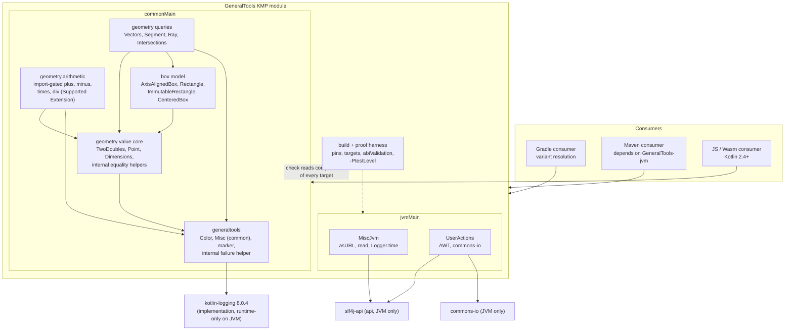
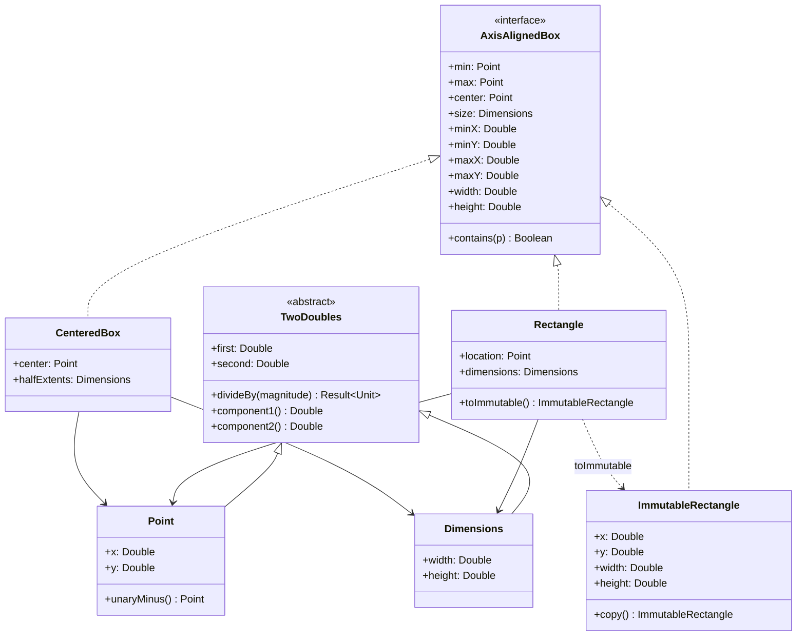
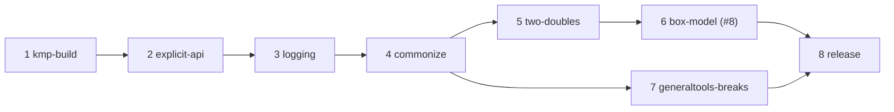

# Architecture: GeneralTools 3.0.0 on Kotlin Multiplatform, with immutable box copies

- **Covers:**
  - [SpartanLaboratories/GeneralTools#7](https://github.com/SpartanLaboratories/GeneralTools/issues/7),
    *"Make GeneralTools Kotlin Multiplatform (Color and geometry usable from common code)"*.
  - [SpartanLaboratories/GeneralTools#8](https://github.com/SpartanLaboratories/GeneralTools/issues/8),
    *"Read-only views for Point and Square so libraries can expose geometry without copying"*,
    which the same change resolves.
- **Designs:** release `3.0.0` (a major version): one Kotlin Multiplatform module with `jvm`, `js` and
  `wasmJs` targets; `Color`, the geometry package and the platform-neutral `Misc` helpers in common
  code; the listed set of API breaks; an immutable box copy and primitive box accessors for #8;
  import-gated arithmetic operators for `Point` and `Dimensions` as the first Supported Extension;
  and the proof and release procedure that goes with them.
- **Baseline:** branch `feat/issue-7-kotlin-multiplatform`, started from `master` @ `17d30bc`. The
  branch head at the time of writing is `044f338` and carries research documents only. `src/main`
  at `17d30bc` is byte-identical to tag `2.2.0` (`git diff 2.2.0 17d30bc -- src/main` is empty).
  `master` has since moved to `c196d1a`, which only deletes `src/test/resources/keys.txt` (PR #10).
- **Status:** systems design - implementation plans to follow.
- **Related:**
  - research: [`research/README.md`](research/README.md) and the findings files it links
    (cited below by file name);
  - earlier plans: [`../1-color-methods/plan.md`](../1-color-methods/plan.md),
    [`../3-geometry-primitives/plan.md`](../3-geometry-primitives/plan.md),
    [`../3-geometry-primitives/final-implementation.md`](../3-geometry-primitives/final-implementation.md).

---

## 1. Reading guide

Sections 2-5 state what must be true and what is known. Section 6 names the systems, section 7 wires
them, section 8 attaches them to what exists (including a verdict for every existing class that
touches a mechanism 3.0.0 replaces). Section 9 gives each public surface its openness and stability
tier. Section 11 cuts the work into eight plannable units with a landing order; the order is a
constraint, not a suggestion, because common code cannot compile until specific replacements have
landed (section 11.2).

---

## 2. Requirements

**Functional**

1. **Multiplatform.** One Gradle module publishes `jvm` (bytecode 17), `js` and `wasmJs` variants.
   There are no Android, native or browser targets. The Maven coordinates
   `io.github.spartanlaboratories:GeneralTools` and every package name are unchanged.
2. **Placement.** `Color`, the whole `com.spartanlabs.geometry` package and the platform-neutral
   `Misc` helpers are in common code and behave the same on all three targets (exceptions: number
   text formatting and `Float` precision on JS, both documented). `read`, `asURL`, the slf4j
   `Logger.time` extension and `UserActions` stay JVM-only.
3. **JVM floor.** A JVM consumer on Kotlin 2.2.0 compiles against `GeneralTools-jvm`, and a
   consumer on Kotlin 2.1.20 can read its metadata. Consumers' slf4j backends keep working.
4. **The break set** - these breaks, and no others, each a clean break with no deprecation cycle:
   1. the library is multiplatform (Maven-only consumers depend on `GeneralTools-jvm`);
   2. `TwoDoubles` is no longer `sealed`; subclassing it is Experimental behind an ERROR-level opt-in;
   3. `TwoDoubles.divideBy` divides in place and returns `Result<Unit>` instead of throwing; a zero
      divisor leaves the value unchanged and is reported at WARN; it divides each component directly;
   4. `evaluateList` takes `(T) -> Boolean`, is not `inline`, and lives in common code;
   5. the `com.spartanlabs.logging` package is deleted;
   6. `Square` is renamed `Rectangle` with `val` references; `toSquare()` becomes `toRectangle()`;
   7. `TwoDoubles` equality becomes lawful (NaN equals NaN, `-0.0` hashes like `0.0`);
   8. `Color`'s public constructor validates its channels;
   9. `trimIfLongerThan` throws `IndexOutOfBoundsException` for a negative length on every platform;
   10. `capitalizeEveryWord` stops dropping commas that are part of its input.
5. **Kept as in 2.x.** `Point` and `Dimensions` stay mutable with every in-place member; `/=` with a
   zero divisor still throws `IllegalArgumentException("Cannot divide by zero")`; `Rectangle.min` and
   `size` still return the live `location` and `dimensions`; `Color` keeps its public constructor and
   public `copy`; `CenteredBox`, `Segment` and `Ray` keep their shapes and their "treat as immutable"
   KDoc.
6. **Additive (issue #8).** An immutable box copy (`ImmutableRectangle`, returned by
   `Rectangle.toImmutable()`); allocation-free primitive accessors on `AxisAlignedBox`; the operators
   that fit without making existing code ambiguous (`p in box`, `-p`, `val (x, y) = p`).
7. **Hand-out without copying (issue #8).** A library can give its callers a box they cannot mutate
   with one copy at construction and no copy per read, and the intersection functions read any
   `AxisAlignedBox` without per-call allocation.
8. **Opt-in arithmetic.** `plus`, `minus`, `times` and `div` for `Point` and `Dimensions` are
   available to a file that imports them, as a Supported Extension. A file that does not import them
   compiles and behaves exactly as in 2.x.

**Process and proof**

9. **Proof of the API change.** The committed JVM API dump differs from the 2.2.0 baseline by exactly
   the signature part of the break set, reviewed against a break ledger. What a dump cannot show
   (sealed-ness, the opt-in gate, behaviour) gets a test or a consumer-smoke check of its own.
10. **Tests.** Every test sits in `com.spartanlabs.testing.<level>.<package>`; pure tests run on all
   three targets; a `-PtestLevel` property selects levels on every target's test task.
11. **Landing discipline.** Everything lands on the feature branch with `master` merged in first.
    After every unit the build passes on every target and the dump differs from the baseline by
    exactly the ledger rows of the breaks landed so far. Each break is its own commit.
12. **Release.** Publishing is manual and staged; nothing reaches Maven Central until the maintainer
    starts the release; the steps that can fail run before the irreversible one. Migration notes
    covering every break go in the README and the GitHub release.

**Acceptance criteria** (for the finished release; after `kmp-build` alone the web compilations and test
tasks have no sources yet, and `commonize` gives them their first)

- `./gradlew build` is green with `jvmTest`, `jsNodeTest` and `wasmJsNodeTest` all run, and
  `checkKotlinAbi` passes.
- The baseline is the JVM dump of tag `2.2.0` as the Kotlin Gradle plugin lists it. It restates the
  binary-compatibility-validator `0.18.2` dump made with the tag's own build in a scratch copy outside
  the repository, and differs from it only by lines that a difference between the two tools' listing
  rules explains, each naming a member with the same descriptor and access flags in both builds (S2,
  section 3.3). The first build-migration commit leaves the JVM dump byte-identical to that baseline.
- The final JVM dump differs from that baseline only by the rows in section 11.3.
- The klib dump contains no `read`, `asURL`, `Logger.time`, `UserActionsKt` or `com.spartanlabs.logging`
  entry.
- A Kotlin 2.2.0 JVM project, a Kotlin 2.1.20 JVM project, a Kotlin 2.4 multiplatform project and a
  plain Maven project each resolve and compile a one-screen usage of `Color`, `Point` and
  `Rectangle` against the published-to-a-file-repository artifacts.
- The migrated scratch clone of MyGameTools builds against the new artifacts.

---

## 3. Current state

### 3.1 This repository at the baseline

**Build.** One Kotlin/JVM module; no `src/commonMain`.

- `build.gradle.kts:8-10` applies `kotlin("jvm") 2.2.0`, `java-library` and vanniktech `0.36.0`.
  There is no toolchain or `jvmTarget` setting. `group` is set at `:13`; the version `2.2.0` is passed
  to `coordinates(...)` at `:32`.
- `build.gradle.kts:21-22` has `api(slf4j-api:2.0.16)` and `implementation(commons-io:2.4)`;
  `:25-26` has `testApi(kotlin("test"))` and logback `1.5.13` for tests; `:61-63` enables the JUnit
  platform. `settings.gradle.kts` applies the foojay toolchain resolver `1.0.0`.
- The Gradle wrapper is `9.0.0` (`gradle/wrapper/gradle-wrapper.properties`). `gradlew` is committed
  with mode `100644` (not executable). `kotlin-js-store/` and `api/` do not exist.
- `.github/workflows/Build.yml:7-16` runs `./gradlew build` on every push with `actions/checkout@v2`,
  `actions/setup-java@v2` (`adopt`, JDK 17) and a `chmod +x` step. It does not publish.
- The baseline build passes with 185 tests (182 backtick-named plus 3 in the stray class), none
  failing or skipped.

**Source layout.** Directories do not mirror packages: `src/main/kotlin/{generaltools,geometry,logging}/`
hold `com.spartanlabs.generaltools`, `com.spartanlabs.geometry` and `com.spartanlabs.logging`.
Ten test classes already sit in `src/test/kotlin/com/spartanlabs/testing/component/{generaltools,geometry}/`;
the rest are flat in `src/test/kotlin/{generaltools,geometry}/` (`MiscKtTest` (empty), `MiscTest`,
`UserActionsTest`, a stray class `Point` in `geometry/Point.kt`, `PointTest`, `SquareTest`,
`TwoDoublesTest`). `src/test/resources/keys.txt` still exists on the branch; nothing in the build, the
sources or the documents other than the research refers to it, and `master` already deletes it.

**Geometry model.**

- `TwoDoubles` is `sealed` (`TwoDoubles.kt:13`) with `var first`/`var second`; `Point` and
  `Dimensions` are its only subclasses (`Point.kt:14`, `:40`). `setTo`, `modBy`, `amplifyBy` and the
  four `*Assign` operators mutate in place (`:19-55`).
- `divideBy` is `amplifyBy(1/magnitude)` behind a zero check that logs ERROR and throws
  `IllegalArgumentException` (`:42-47`); `divAssign` is an expression body over it (`:55`).
- `equals` compares `javaClass` and IEEE `==` components (`:61-65`); `hashCode` folds
  `javaClass.hashCode()` and `Double.hashCode` (`:72-73`). So `Point(0.0, 0.0) == Point(-0.0, 0.0)`
  but the hashes differ, and a point with a NaN coordinate is not equal to itself.
- `Square` is a `data class` with `var location` and `var dimensions` (`Square.kt:16-21`);
  `min` returns `location` itself and `size` returns `dimensions` itself (`:23`, `:34`) while `max`
  and `center` build new `Point`s (`:26-31`).
- `AxisAlignedBox` (`AxisAlignedBox.kt:14-37`) declares `min`, `max`, `center`, `size` and an `infix`
  `contains` that reads `min.x`, `max.x` and so on. `CenteredBox` (`CenteredBox.kt:22-36`) builds a
  fresh `Point`/`Dimensions` on each of `min`, `max`, `size`. `Square.toCenteredBox()` and
  `AxisAlignedBox.toSquare()` are top-level functions in `CenteredBox.kt:67`, `:79`, so their JVM facade
  is `CenteredBoxKt`. `Square.kt` declares no top-level function.
- `segmentIntersectsBox`, `rayIntersectsBox` and `boxProblem` read `box.min`, `box.max` and `box.size`
  repeatedly (`Intersections.kt:131-170`, `:188-237`, `:249-258`); on a `CenteredBox` that is up to nine
  allocations per call (`mutable-geometry-model.md` section 3.4).
- `Segment`, `Ray` and `CenteredBox` are `data class`es over mutable `Point`s whose KDoc says "treat as
  immutable" (`Segment.kt:8-18`, `Ray.kt:11`, `CenteredBox.kt:10-13`).

**Logging and failure.**

- Seven main files hold a `private val log = LoggerFactory.getLogger("com.spartanlabs....")`:
  `Misc.kt:22`, `UserActions.kt:17`, `Intersections.kt:7`, `Point.kt:9`, `Segment.kt:6`,
  `TwoDoubles.kt:6`, `Vectors.kt:7`.
- Twelve sites report an expected failure: eleven log at WARN and return `Result.failure
  (IllegalArgumentException(...))` - `Point.distanceFrom` (`Point.kt:31-34`), `Segment.asRay`
  (`Segment.kt:46-51`), `Point.normalized` (`Vectors.kt:80-85`), `segmentIntersectsSegment` twice
  (`Intersections.kt:61-67`), `segmentIntersectsBox` twice (`:132-141`), `rayIntersectsBox` four times
  (`:189-206`) - and the twelfth is the throwing `divideBy`. The log line and the exception message
  differ at every site: the log carries the offending values, the exception a short stable message.
- `com.spartanlabs.logging` (`logging/Logger.kt`, `logging/MessageBuilder.kt`: `Logger`, `LoggerKt`,
  `MessageBuilder`, `IJColor`) has no user anywhere in this repository outside its own package.

**JVM-only calls that block common code.** `javaClass` in `TwoDoubles.equals`/`hashCode`
(`TwoDoubles.kt:62`, `:73`); `String.format` in `Color.toHex` (`Color.kt:149`, `:151`);
`java.util.function.Predicate` in `evaluateList` (`Misc.kt:10`, `:57`); a stray `import
java.lang.Math.pow` in `Point.kt:4`; the deprecated JVM/JS-only `String.capitalize()` in
`capitalizeEveryWord` (`Misc.kt:28`); `java.io`/`java.net` in `read` and `asURL` (`Misc.kt:5-9`,
`:35-48`); the slf4j `Logger.time` extension (`Misc.kt:75`); AWT, commons-io and slf4j in
`UserActions.kt` (which imports `java.awt.Rectangle` explicitly at `:6` and nothing from
`com.spartanlabs.geometry`). In tests: `Thread.sleep` (`MiscTest.kt:61`, `:69`), the JVM-only `assert`
(`geometry/Point.kt:14`), slf4j `LoggerFactory` fields and JUnit `@Tag` in every test class.

**`Color`.** A `data class` of four `Int` channels documented `0..255` but not validated
(`Color.kt:23`, KDoc `:8-20`); `Color.of` clamps (`:185-191`); every factory and transform except a
sign-bearing `fromHex` input produces in-range channels.

### 3.2 Consumers at the baseline (read-only)

Details and sources: [`downstream-under-mutable-model.md`](research/downstream-under-mutable-model.md),
[`downstream-blast-radius.md`](research/downstream-blast-radius.md). Counts were read at MyGameTools
`dc5214f`, MyGameClient (`GameGraphics`) `8b428a4`, MyGameServer `9eef06b`, WebTools `d00cd0e` and
SpartanGraphics `50b61e2`; they can drift as those repositories move.

- **MyGameTools** (`SpartanLabsGaming`) pins GeneralTools `2.2.0` as an `api` dependency and builds
  with Kotlin 2.2.0. It names `Square` on 39 code lines in 14 files, assigns `area.dimensions` in
  `VisibleObject`, and has 40 in-place `Point`/`Dimensions` mutation sites in 17 files (6 in main
  sources).
- **MyGameClient** reaches GeneralTools through `gametools` 5.0.0 (which requires GeneralTools `2.0.1`)
  and builds with Kotlin 2.1.20. It names `Square` on 27 lines in 8 files.
- **MyGameServer, WebTools, SpartanGraphics** use none of the affected members.
- **Published `gametools` 5.0.0 and 5.1.0** reference `com/spartanlabs/geometry/Square`; 5.1.0 is on
  Maven Central and requires GeneralTools `2.2.0`.
- No downstream code uses `divideBy`, `/=`, `evaluateList`, `com.spartanlabs.logging`, `Color.copy`,
  `min` or `size` of a `Square`, an exhaustive `when` over `TwoDoubles`, or Java, declares its own
  operator on a GeneralTools type, destructures a `Point`, or implements `AxisAlignedBox`.

### 3.3 Verified outside-world facts the design rests on

All were re-opened at their sources on 2026-10-18/19 (see the verification tables in
[`research/README.md`](research/README.md)) unless marked otherwise.

| Fact | Source |
|---|---|
| Kotlin 2.4.21 is the latest stable Kotlin; KGP 2.4.21 documents Gradle 9.0.0 as supported; vanniktech `0.37.0` is the first release documented as tested against KGP 2.4; kotlin-logging `8.0.4`, `actions/setup-java` v6.1.0 are each the latest release | [`kmp-build-and-kotlin-compat.md`](research/kmp-build-and-kotlin-compat.md) F6, [`kmp-maven-central-publishing.md`](research/kmp-maven-central-publishing.md) F1 |
| A Kotlin compiler reads class metadata up to one minor ahead of itself; the metadata a build writes follows its `languageVersion`; the stdlib a consumer sees comes from the library's own `kotlin-stdlib` requirement | `kmp-build-and-kotlin-compat.md` F1-F3 |
| `js`/`wasmJs` klibs carry the ABI version of the compiler that built them and `languageVersion` does not lower it, so web consumers need Kotlin 2.4 or newer; `coreLibrariesVersion` cannot be lowered for web compilations | `kmp-build-and-kotlin-compat.md` F4, F5 |
| Kotlin/JS is Stable and Kotlin/Wasm is Beta; klib binary-compatibility guarantees are not finalized | `research/README.md` "Sources reused"; `kmp-build-and-kotlin-compat.md` F7 |
| kotlin-logging 8.0.4 publishes `jvm`, `js`, `wasmJs`; delegates to slf4j on the JVM and to the console elsewhere; prints one startup line on first use unless `-Dkotlin-logging.logStartupMessage=false`; `implementation` in `commonMain` is runtime-only on the JVM variant; `KotlinLogging.logger {}` is unreliable on JS/Wasm so logger names are passed explicitly | [`kotlin-logging-adoption.md`](research/kotlin-logging-adoption.md) F1-F9 |
| `Double.toString` prints `1.0` as `1` on JS; a `Float` is double precision on JS; `String.substring` with a negative length returns `""` on JS; `KClass.qualifiedName` is always `null` on JS; `minOf`/`maxOf` propagate NaN on all targets | [`cross-platform-behaviour-parity.md`](research/cross-platform-behaviour-parity.md) 3.1, 3.2, 3.3, 3.7, 3.13 |
| A member returning `Result` has a name-mangled JVM name (`distanceFrom-IoAF18A`, `asRay-d1pmJ48`); top-level functions are not mangled. Verified in today's jar | [`idiomatic-kotlin-api-mechanics.md`](research/idiomatic-kotlin-api-mechanics.md) F2.1 |
| `@SubclassOptInRequired` (since Kotlin 2.1) gates subclassing of open and abstract classes only; using the type needs no opt-in; a marker with `@Target()` can only be passed to `@SubclassOptInRequired`/`@OptIn`; its annotation is absent from ABI dumps | `idiomatic-kotlin-api-mechanics.md` F5.1, F5.2 |
| The KGP ABI validation (`abiValidation()`, `@since 2.4.0`) is Experimental, writes `api/<project>.api` and `api/<project>.klib.api` in the binary-compatibility-validator text format, and is wired into `check` as `checkKotlinAbi` | `idiomatic-kotlin-api-mechanics.md` F6.1 |
| The KGP JVM dumper and binary-compatibility-validator `0.18.2` list different members for the same class files. The plugin takes the visibility of a synthetic default-arguments constructor from the constructor it serves and leaves out a `protected` member of a sealed or enum class; binary-compatibility-validator counts every `protected` member as public. For the 2.2.0 classes the two dumps differ by one line, `TwoDoubles`' `public synthetic fun <init> (DDILkotlin/jvm/internal/DefaultConstructorMarker;)V`, which only binary-compatibility-validator lists; the class files of the tag's own build and of the migrated build have the same members and descriptors, and that constructor the same flags. The plugin's klib dump lists no constructor of a sealed class. Read at the sources and compared on 2026-10-20 | [`research/README.md`](research/README.md), "API mechanics and proof of the API change"; `plan-kmp-build.md` section 3 |
| The JVM backend gives a class whose primary-constructor parameters all have default values a parameterless constructor with the primary constructor's visibility, except a sealed class. Read at the source on 2026-10-20 | `research/README.md`, same section |
| `a += b` on a `var` is an overload ambiguity when both `plusAssign` and a `plus` returning a subtype exist | [`mutable-geometry-model.md`](research/mutable-geometry-model.md) 3.3 (Kotlin operator-overloading docs and specification) |
| A `data class` cannot extend a type whose `componentN()` is `final`: "If the functions of the supertype cannot be overridden due to incompatible signatures or due to their being final, an error is reported." Re-read 2026-10-19 | <https://kotlinlang.org/docs/data-classes.html> |
| Backtick names consisting of letters, digits, spaces, hyphens and apostrophes are legal on JS and Wasm from language version 2.1; level selection by package filter reaches `jvmTest`, `jsNodeTest` and `wasmJsNodeTest` through `AbstractTestTask` | [`kmp-test-levels-and-names.md`](research/kmp-test-levels-and-names.md) F3, F5 |
| Central Portal staged deployments can be downloaded and tested before Publish; `publishToMavenCentral` uploads without releasing; the KMP artifacts are `GeneralTools`, `GeneralTools-jvm`, `GeneralTools-js`, `GeneralTools-wasm-js` | `kmp-maven-central-publishing.md` F4-F7, F9 |
| Published `gametools-core` 5.1.0 and `gametools-world` 5.1.0 reference `com/spartanlabs/geometry/Square` at the named sites. The consequent `NoClassDefFoundError` is derived from the bytecode references and has not been executed | `downstream-under-mutable-model.md` 3.3 |

---

## 4. Assumptions

Each is relied on and has not been confirmed by running it. The unit that confirms it is named.

| # | Assumption | If false | Confirmed in |
|---|---|---|---|
| A2 | Compiling `js` and `wasmJs` at `languageVersion`/`apiVersion` 2.2 under KGP 2.4.21 works. | Fall back to pinning the versions on the JVM compilation only; the JVM compilation then remains the gate for what common code may use. | `kmp-build` |
| A3 | A Kotlin 2.2.0 JVM consumer and a Kotlin 2.1.20 JVM consumer compile against `GeneralTools-jvm` built with KGP 2.4.21 at language 2.2 with `api(kotlin-stdlib:2.2.0)`. | The language/API pin or the stdlib pin is wrong; the pins move before anything is published. | `release` (smoke matrix) |
| A4 | The ledger in section 11.3 predicts the dump. It is hand-derived from `javap -p -s` of the 2.2.0 jar, two published dumps and the plugin's listing rules (section 3.3), not produced by the tool. | The ledger is corrected; any dump line outside the corrected ledger is an error or a missing migration note. | each break unit |
| A5 | `this::class` in `equals`/`hashCode` costs nothing measurable on the JVM (a `ClassReference` is allocated per call; escape analysis is expected to remove it). `Actor.isAtDestination` in MyGameTools compares `Point`s with `==` every frame. | Replace the class comparison with an `internal expect fun sameClass(a: Any, b: Any)` whose JVM actual is `a.javaClass === b.javaClass`. No public signature changes. | `two-doubles` |
| A6 | `@SubclassOptInRequired(Marker::class)` on an `abstract class` in the same module forces `@OptIn` only on its subclasses (`Point`, `Dimensions`), and a `@Target()` marker is accepted by the compiler at language 2.2. | The marker gets a non-empty target set or the opt-in is applied module-wide; the dump shows the marker class either way. | `two-doubles` |
| A7 | The multifile facade split (`Misc.kt` common + `MiscJvm.kt` JVM, both `@file:JvmMultifileClass`/`@file:JvmName("MiscKt")`) leaves the `MiscKt` dump lines unchanged, including the `inline` `onException` and `@Throws` `asURL`. kotlinx.coroutines 1.11.0 shares one facade the same way between a common and a platform source set (`common/src/channels/Channels.common.kt` and `concurrent/src/channels/Channels.kt`, both `@file:JvmMultifileClass @file:JvmName("ChannelsKt")`). | No split keeps every function on `MiscKt`: two files that produce `MiscKt` clash without `@JvmMultifileClass`, and any other facade name moves functions to another class, a binary break outside the break set. `commonize` does not land a commit that changes a `MiscKt` dump line; the choice of which functions move goes to the user first. | `commonize` |
| A8 | The published `GeneralTools-jvm-3.0.0.module` shows kotlin-logging only in the runtime variant, slf4j-api in the API variant, and a `kotlin-stdlib` requirement of 2.2.0. | The dependency scopes in `commonMain`/`jvmMain` are corrected. | `release` |
| A9 | vanniktech `0.37.0` signs and publishes the four KMP publications with the keyring-file signing properties and Gradle's configuration cache. | The signing properties or the cache setting change; no source change. | `release` |
| A10 | `ImmutableRectangle`'s constructor shape (defaults or none) and the exact member counts of `Rectangle`/`ImmutableRectangle` in the dump follow the sketches in section 6. | The ledger counts change; public shape is fixed in the unit plan before code. | `box-model` |
| A11 | The downstream line counts in section 3.2 still describe the downstream repositories' current heads. | The throwaway migration in `release` reports the real number; the notes quote it. | `release` |
| A12 | An extension operator declared in `com.spartanlabs.geometry.arithmetic` takes part in resolving `a += b` only in a file that imports it. A file that does not import the package resolves `+=` on a `var` `Point` to the member `plusAssign`, exactly as in 2.x. In an importing file the same statement is an ambiguity error. | The import does not confine the ambiguity, so the package would break `var` holders in files that never imported it, and it does not ship. | `two-doubles`: a non-importing test file with `var` `+=` compiles beside the package. The smoke project in `release` shows the importing case failing. |

---

## 5. Non-goals

- Android, native, browser (`browser()`) and WASI targets; a `webMain` source set unless a shared
  JS/Wasm `actual` is ever needed; a version catalog; a pre-release version; a CI publish workflow; a
  `CHANGELOG.md` (migration notes live in the README and the GitHub release).
- Immutable `Point` or `Dimensions`; `ReadOnlyPoint`, `ReadOnlyDimensions`, `ReadOnlySquare` or any
  other read-only view type; an immutable twin of `Point`, `Segment`, `Ray` or `CenteredBox` in 3.0.0
  ([#15](https://github.com/SpartanLaboratories/GeneralTools/issues/15) tracks `Point` and `Segment`,
  [#13](https://github.com/SpartanLaboratories/GeneralTools/issues/13) `toImmutable()` for every box).
- Operators that are not offered:
  - member arithmetic operators (`plus`, `minus`, `times`, `div`) on `Point`/`Dimensions`, since the
    import-gated package carries them;
  - `Dimensions ± Point` and component-wise products;
  - arithmetic operators on boxes, segments and rays, which would mean translation and scaling;
  - arithmetic on consumers' own `TwoDoubles` subclasses;
  - `unaryPlus`, `inc`, `dec`, `compareTo`, `rangeTo`, `get` and `rem`.
- For issue #8, a read-only or immutable `Point`. `Point` and `Dimensions` stay mutable, so #8 is
  resolved for boxes (`ImmutableRectangle`, `toImmutable()` and the allocation-free accessors), and
  `Segment`, `Ray` and `CenteredBox` keep their "treat as immutable" KDoc. #8 closes once 3.0.0 is
  published, not at the PR merge, with a comment that states this scope and points to #15 and #13.
- Making `Rectangle.min` and `size` return copies.
- A deprecated `typealias Square = Rectangle`, a deprecated `toSquare()` or any other shim.
- Float32 emulation on JS; normalising `Double.toString` across platforms; per-logger log-level
  control on JS/Wasm.
- Parameterising `EPSILON`. [SpartanLaboratories/GeneralTools#11](https://github.com/SpartanLaboratories/GeneralTools/issues/11)
  tracks additive overloads defaulting to `EPSILON`, for a minor release after 3.0.0.
- Migrating MyGameTools, MyGameClient or any other downstream repository (they are read-only here);
  filing issues against them.
- An in-repository compile-fail test for the unsealing and opt-in checks.
  [SpartanLaboratories/GeneralTools#12](https://github.com/SpartanLaboratories/GeneralTools/issues/12)
  tracks a Gradle TestKit level-3 test for a minor release after 3.0.0 (section 13).

---

## 6. System inventory

Ten systems. Each has one responsibility; "owns" lists what lives there, "not" what it explicitly
does not do.

### S1. Build and target configuration

- **Responsibility:** turn the repository into one KMP module that compiles, tests and packages for
  `jvm`, `js` and `wasmJs` at a Kotlin 2.2 language/API floor and JVM 17.
- **Placement:** `build.gradle.kts`, `settings.gradle.kts`, `gradle.properties`, committed
  `kotlin-js-store/yarn.lock`, `gradle/wrapper` (unchanged at 9.0.0).
- **Owns:**
  - plugins: `kotlin("multiplatform") 2.4.21` replaces `kotlin("jvm")` and `java-library`;
    vanniktech `0.37.0`;
  - the pins: `languageVersion` and `apiVersion` exactly 2.2 on the `kotlin {}` extension;
    `commonMain` `api(kotlin-stdlib:2.2.0)`; `jvmToolchain(17)`, `jvmTarget` 17, and an explicit
    `org.gradle.jvm.version = 17` attribute on the JVM variant; `coreLibrariesVersion` is not lowered;
  - targets: `jvm()`, `js { nodejs() }`, `@OptIn(ExperimentalWasmDsl::class) wasmJs { nodejs() }`;
  - dependencies by source set: `commonMain` `implementation(kotlin-logging:8.0.4)` (added by the
    `logging` unit); the web source sets (`jsMain` and `wasmJsMain`, or the default hierarchy's
    shared `webMain`) `api(kotlin-stdlib)` at the plugin's version; `jvmMain` `api(slf4j-api:2.0.16)`
    and `implementation(commons-io:2.4)`; `commonTest` `implementation(kotlin("test"))`; `jvmTest`
    logback `1.5.13`. The web stdlib line is required: declaring `kotlin-stdlib:2.2.0` in
    `commonMain` switches off the stdlib the plugin would add, and the JS and Wasm compilers reject a
    stdlib klib older than themselves. Gradle resolves the web compilations to the newer stdlib, and
    the duplicate requirement in the web variants is the shape Okio publishes
    ([`kmp-build-and-kotlin-compat.md`](research/kmp-build-and-kotlin-compat.md), recommendation);
  - the `-PtestLevel=<level>[,<level>]` filter on every `AbstractTestTask` (levels `gating`,
    `component`, `integration`, `deterministic`, `e2e`, `nonfunctional`, `uat`; unknown level is a
    build error; `failOnNoMatchingTests = false`; unset runs everything);
  - publishing: `mavenPublishing {}` kept, `group`/`version` on the project,
    `configure(KotlinMultiplatform(javadocJar = JavadocJar.Empty(), sourcesJar = SourcesJar.Sources()))`,
    `publishToMavenCentral()` and `signAllPublications()`;
  - CI: `.github/workflows/Build.yml` moves to `actions/setup-java@v6` with Temurin 17 and current
    checkout/Gradle actions; no Node step (the plugin downloads Node).
- **Not:** any source semantics; any API.

### S2. API proof harness

- **Responsibility:** make the public API of every target a reviewed, committed artifact and fail the
  build on an unreviewed change.
- **Placement:** `kotlin { @OptIn(ExperimentalAbiValidation::class) abiValidation() }` in S1;
  `api/GeneralTools.api` (JVM) and `api/GeneralTools.klib.api` (klib, `js` + `wasmJs`) committed;
  `check` depends on `checkKotlinAbi`; `updateKotlinAbi` rewrites the files.
- **Owns:** the baseline dump: tag `2.2.0` recorded once by binary-compatibility-validator `0.18.2`
  with the tag's own build in a scratch copy, then restated as the plugin's own dump of the same
  classes, both committed before any source or build change. The baseline is always the dump of the
  tool `check` runs. The restatement is admitted by comparing the class files of the two builds: the
  same files, the same members and descriptors, and every line it drops or adds naming a member with
  the same descriptor and access flags in both builds, explained by a rule in which the two tools
  differ (section 3.3; for these classes, one `TwoDoubles` line). S2 also owns the break ledger
  (section 11.3) against which the combined diff is reviewed, and `explicitApi()` on the `kotlin {}`
  extension, so that a declaration is public only on purpose in a module that now exports to three
  targets.
- **Not:** it does not see sealed-ness, annotations such as `@SubclassOptInRequired`, `operator`,
  KDoc, or behaviour; those are covered by tests and the consumer smoke checks (section 11.3). Nor
  does it see class-file changes the dump format has no word for, such as `ACC_BRIDGE` or Kotlin
  metadata; the 2.4.21 compiler makes some (break 1 in section 11.3), and the release smoke matrix
  checks that consumers read the metadata.

### S3. Failure and logging seam

- **Responsibility:** report every expected failure the same way - one WARN line on the file's own
  logger and a `Result.failure(IllegalArgumentException)` carrying the same message.
- **Placement:** `commonMain`, package `com.spartanlabs.generaltools`, a new file of `internal`
  declarations (its facade has no public member and is not dumped).
- **Owns:**
  - `internal fun <T> KLogger.failure(message: String, detail: (() -> Any?)? = null): Result<T>`;
  - the per-file `private val log = KotlinLogging.logger("com.spartanlabs.<package>.<File>")`
    convention. The 2.x logger names stay unchanged, so consumers' logback rules keep matching, and
    JS/Wasm get real names.
- **Contract:** `failure`
  - builds the exception from `message` alone;
  - logs at WARN lazily: `warn { if (detail == null) message else "$message: ${detail()}" }`, so
    `detail` is evaluated only when WARN is enabled and never reaches the exception;
  - attaches no throwable, so no stack trace points into the helper;
  - returns the failure.

  Public signatures never mention kotlin-logging, and no public `inline` function logs.
- **Call-site rule:** each site passes its 2.x exception message unchanged as `message`. Its
  `detail` is the diagnostics its 2.x WARN line carried: the function name and the offending values,
  as in `"segmentIntersectsSegment: NaN coordinate in $s1 or $s2"`. Exception texts are therefore
  byte-identical to 2.x, and the WARN line keeps the values.
- **Not:** it does not decide levels beyond WARN. It is not used by the throwing members (`/=`, the
  arithmetic `div`, `Color.fromHex`, `trimIfLongerThan`), which report by exception.

### S4. Geometry value core

- **Responsibility:** the mutable coordinate-pair value types, their equality contract, and the
  import-gated arithmetic on them.
- **Placement:** `commonMain`:
  - `com.spartanlabs.geometry`: `TwoDoubles.kt`, `Point.kt` holding `Point` and `Dimensions`, and a
    new internal equality-helper file;
  - `com.spartanlabs.geometry.arithmetic`: one file, `geometry/arithmetic/Arithmetic.kt`, facade
    `ArithmeticKt`;
  - `com.spartanlabs.generaltools`: the opt-in marker and the `SupportedExtension` annotation.
- **Public shapes (contract with every other system):**

```kotlin
// com.spartanlabs.generaltools
@RequiresOptIn(level = RequiresOptIn.Level.ERROR, message = "Subclassing TwoDoubles is Experimental ...")
@Retention(AnnotationRetention.BINARY)
@Target()
public annotation class ExperimentalForInheritanceGeneralToolsApi

@MustBeDocumented
@Retention(AnnotationRetention.BINARY)          // kept in the compiled library, so a consumer's IDE shows it
@Target(AnnotationTarget.CLASS, AnnotationTarget.FUNCTION, AnnotationTarget.PROPERTY, AnnotationTarget.TYPEALIAS)
public annotation class SupportedExtension      // documents the tier; gates nothing; not an opt-in

// com.spartanlabs.geometry
@SubclassOptInRequired(ExperimentalForInheritanceGeneralToolsApi::class)
public abstract class TwoDoubles protected constructor(public var first: Double = 0.0, public var second: Double = 0.0) {
    protected constructor(doubles: TwoDoubles)                     // first/second are final properties
    public val containsNaN: Boolean
    public fun setTo(first: Double, second: Double); public infix fun setTo(new: TwoDoubles)
    public fun modBy(first: Double, second: Double); public infix fun modBy(change: TwoDoubles)
    public infix fun amplifyBy(magnitude: Double)
    public infix fun divideBy(magnitude: Double): Result<Unit>     // in place; 0.0 and -0.0 leave the value unchanged, WARN via S3
    public operator fun plusAssign(doubles: TwoDoubles); public operator fun minusAssign(doubles: TwoDoubles)
    public operator fun timesAssign(magnitude: Double)
    public operator fun divAssign(magnitude: Double)               // block body; throws IAE("Cannot divide by zero"), no log
    public operator fun component1(): Double; public operator fun component2(): Double   // final
    public final override fun equals(other: Any?): Boolean         // same concrete class; IEEE per component; NaN == NaN
    public final override fun hashCode(): Int                      // class folded in; -0.0 as 0.0; every NaN alike
    public override fun toString(): String                         // "first, second" in the platform's own number format
}
public class Point(x: Double = 0.0, y: Double = 0.0) : TwoDoubles { /* x, y, copy ctor, distanceFrom, */ public operator fun unaryMinus(): Point }
public class Dimensions(width: Double = 0.0, height: Double = 0.0) : TwoDoubles { /* width, height, copy ctor */ }

// com.spartanlabs.geometry.arithmetic - every function @SupportedExtension, non-inline, returns a new value
public operator fun Point.plus(other: Point): Point
public operator fun Point.plus(offset: Dimensions): Point
public operator fun Point.minus(other: Point): Point
public operator fun Point.minus(offset: Dimensions): Point
public operator fun Point.times(factor: Double): Point
public operator fun Point.div(divisor: Double): Point                  // 0.0 or -0.0: throws IAE("Cannot divide by zero"), no log
public operator fun Double.times(point: Point): Point
public operator fun Dimensions.plus(other: Dimensions): Dimensions
public operator fun Dimensions.minus(other: Dimensions): Dimensions
public operator fun Dimensions.times(factor: Double): Dimensions
public operator fun Dimensions.div(divisor: Double): Dimensions        // same zero policy
public operator fun Double.times(dimensions: Dimensions): Dimensions
```

- **Owns:** the equality contract (same concrete class, IEEE-equal components except NaN equals NaN,
  `-0.0` hashes like `0.0` and still equals it, every NaN hashes alike; no pair equal in 2.x becomes
  unequal) and the two `internal` helpers that implement it - a component comparison (`a == b ||
  both NaN`) and a component hash (`-0.0 -> 0.0`, canonical NaN) - which `ImmutableRectangle` reuses.
- **Owns, arithmetic:** the value-returning twins of the in-place members, for the combinations that
  have a geometric meaning in this library:
  - vector sum and difference;
  - a corner offset by a size (`Point ± Dimensions`, which are the library's own `Rectangle.max` and
    `CenteredBox.min`/`max` formulas);
  - sums and differences of sizes;
  - scaling, in both operand orders.

  Each operator leaves its operands unchanged. `div` divides each component directly, as `/=` does,
  so `p / k` equals what `p /= k` leaves. A zero divisor throws as `/=` does.
- **Import gating (A12):** only a file that imports the package, or one of its members, sees the
  operators. Library code outside the package does not import it. The KDoc and the migration notes
  state the accepted costs:
  - in an importing file, `+=`, `-=`, `*=` and `/=` on a `var` `Point` or `Dimensions` holder are
    ambiguous and stop compiling; a `val` holder is unaffected;
  - a wildcard import of the package brings every operator in, and an IDE may add the import when
    `p + q` does not resolve;
  - a member operator added later would shadow the extension.

  `import com.spartanlabs.geometry.*` does not bring them in, because Kotlin star imports do not
  reach subpackages.
- **Not:** no factory hook and no abstract member (no member returns a new `TwoDoubles`); no member
  non-assigning arithmetic; no immutable twin.

### S5. Box model

- **Responsibility:** one shape contract for axis-aligned rectangles, three storage forms, and the
  conversions between them.
- **Placement:** `commonMain`, `com.spartanlabs.geometry`: `AxisAlignedBox.kt`, `Rectangle.kt`
  (renamed from `Square.kt`), `ImmutableRectangle.kt` (new), `CenteredBox.kt` (keeps its name so the
  facade `CenteredBoxKt` is unchanged).
- **Public shapes:**

```kotlin
public interface AxisAlignedBox {
    public val min: Point; public val max: Point; public val center: Point; public val size: Dimensions   // unchanged
    public val minX: Double get() = min.x     // new; defaults derive from min/max/size
    public val minY: Double get() = min.y
    public val maxX: Double get() = max.x
    public val maxY: Double get() = max.y
    public val width: Double get() = size.width
    public val height: Double get() = size.height
    public infix operator fun contains(p: Point): Boolean   // default reads the primitives; NaN anywhere -> false
}

public data class Rectangle(val location: Point = Point(), val dimensions: Dimensions = Dimensions()) : AxisAlignedBox {
    // min = location (live), size = dimensions (live), max/center fresh; minX..height override without allocating
    public fun toImmutable(): ImmutableRectangle
    // copy() is shallow: it shares location and dimensions; toString prints "Rectangle(...)"
}

public class ImmutableRectangle(public val x: Double, public val y: Double,
                                override val width: Double, override val height: Double) : AxisAlignedBox {
    public fun copy(x: Double = this.x, y: Double = this.y, width: Double = this.width, height: Double = this.height): ImmutableRectangle
    // minX = x, maxX = x + width, ...; min/max/center/size return fresh Point/Dimensions;
    // equals/hashCode/toString hand-written to the S4 contract; never equal to a Rectangle
}

// CenteredBox.kt (facade CenteredBoxKt)
public fun Rectangle.toCenteredBox(): CenteredBox
public fun AxisAlignedBox.toRectangle(): Rectangle     // independent mutable copy with fresh Point/Dimensions
```

- **Invariants:**
  - An accessor override must return exactly what the box's own `min`/`max`/`size` would, bit for bit.
    Where an implementor can, it derives `min`/`max`/`size` from its accessors (`CenteredBox`,
    `ImmutableRectangle`, `Rectangle.max`), so agreement holds by construction; `Rectangle.min` and
    `size` stay the live parts. A shared contract test runs against every implementor, including a
    defaults-only box.
  - `AxisAlignedBox` is a shape contract, not a read-only guarantee: a `Rectangle` handed out as
    `AxisAlignedBox` still exposes its live `location` and `dimensions` through `min` and `size`. The
    protection is the immutable copy, taken once at hand-out.
  - Equality and `hashCode` of `Rectangle` follow the current values of its parts; KDoc warns that a
    value used as a hash key must not change while it is in the map and points to `toImmutable()` as
    the safe key. `CenteredBox`, `Segment` and `Ray` keep their "treat as immutable" KDoc.
- **Not:** no `ReadOnly*` types; no `Rectangle.setTo`; no center primitives.

### S6. Geometry queries

- **Responsibility:** vector algebra, `Segment`, `Ray` and the intersection tests.
- **Placement:** `commonMain`, `com.spartanlabs.geometry`: `Vectors.kt` (`EPSILON`, `dot`, `cross`,
  `length`, `lengthSquared`, `normalized`, `projectedOnto`), `Segment.kt`, `Ray.kt`, `Intersections.kt`
  (`SegmentIntersection`, `segmentIntersectsSegment`, `segmentIntersectsBox`, `rayIntersectsBox`,
  private `boxProblem`).
- **Owns:** the failure sites (all reported through S3) and the NaN-safe slab arithmetic. After the
  accessor change the box tests read `minX`/`maxX`/`width`/`height` instead of `min`/`max`/`size`, with
  the same results and no per-read allocation.
- **Not:** signatures do not change; `SegmentIntersection` stays a `sealed interface` because the
  three-way result is part of the contract.

### S7. Color

- **Responsibility:** the validated RGBA value type with its transforms and codecs.
- **Placement:** `commonMain`, `com.spartanlabs.generaltools.Color`.
- **Owns:** the `0..255` invariant - an `init { require(...) }` on the public constructor throws
  `IllegalArgumentException` for any channel outside `0..255`; `copy` goes through the constructor and
  so validates; `Color.of` clamps; `toHex` renders each channel with `toString(16).padStart(2, '0')
  .uppercase()`; KDoc states that `Float` arithmetic in `lerp`/`luminance` is double precision on JS.
- **Not:** no copy-visibility annotation; no internal constructor.

### S8. Misc helpers

- **Responsibility:** the small general helpers, split by what they need from the platform.
- **Placement:** `Misc.kt` (common) and `MiscJvm.kt` (JVM), both starting with
  `@file:JvmMultifileClass` and `@file:JvmName("MiscKt")` (explicit `kotlin.jvm` imports), so every
  function stays on the facade `MiscKt`. Final state:
  - common: `capitalizeEveryWord`, `evaluateList(list: Iterable<T>, validator: (T) -> Boolean)`,
    `profile`, `onException` (public `inline`), `forEveryIndexed`, `forEvery`, `trimIfLongerThan`;
  - JVM: `String.asURL()`, `read(textFile)`, `Logger.time(...)` (slf4j), each with the slf4j logger the
    JVM file keeps.
- **Not:** no new function; the other files keep their names, so no other JVM facade moves.

### S9. JVM-only platform edge

- **Responsibility:** everything that needs AWT, the file system, `java.net` or slf4j directly.
- **Placement:** `jvmMain`: `UserActions.kt` (facade `UserActionsKt`), `MiscJvm.kt`, and until it is
  deleted `logging/Logger.kt` and `logging/MessageBuilder.kt`.
- **Owns:** `api(slf4j-api)` and `implementation(commons-io)` - the only place those dependencies are
  visible. `UserActions` keeps its slf4j logger and `java.awt.Rectangle` import.
- **Not:** no geometry types, no common callers.

### S10. Test suite

- **Responsibility:** prove each system's behaviour on every target it ships on, organised by level.
- **Placement:** `src/commonTest/kotlin`, `src/jvmTest/kotlin`, `src/jvmTest/resources/logback-test.xml`.
  Every class is in `com.spartanlabs.testing.<level>.<package>`, one class per file.

| Existing | New home | Level |
|---|---|---|
| the ten classes already under `testing/component/` (`ColorTest`, `AxisAlignedBoxTest`, `CenteredBoxTest`, `PointVectorOpsTest`, `RayBoxIntersectionTest`, `RayTest`, `SegmentBoxIntersectionTest`, `SegmentSegmentIntersectionTest`, `SegmentTest`, `TwoDoublesHashCodeTest`) | `commonTest`, same package | 2 |
| `geometry/PointTest.kt` plus the three tests of the stray class `Point` (`assert` becomes `assertTrue`) | `commonTest`, `testing.component.geometry.PointTest` | 2 |
| `geometry/SquareTest.kt` | `commonTest`, `testing.component.geometry.SquareTest`, renamed `RectangleTest` with the type | 2 |
| `geometry/TwoDoublesTest.kt` | `commonTest`, `testing.component.geometry.TwoDoublesTest` | 2 |
| `MiscTest`, 10 pure tests | `commonTest`, `testing.component.generaltools.MiscTest` | 2 |
| `MiscTest`, `asURL` x2 and `Logger time` | `jvmTest`, separate classes (e.g. `AsUrlTest`, `LoggerTimeTest`) | 2 |
| `MiscTest`, `read` | `jvmTest`, e.g. `testing.integration.generaltools.ReadTest` | 3 |
| `UserActionsTest` (5 tests) | `jvmTest`, `testing.integration.generaltools.UserActionsTest` | 3 |
| `MiscKtTest` (empty) | deleted | - |
| `src/test/resources/logback-test.xml` | `src/jvmTest/resources/` | - |

  Test classes lose their slf4j `LoggerFactory` field, its `log.` calls and `@Tag` when they move
  to `commonTest`; they keep the "Level 2 (Isolated Component Behaviour)" KDoc line. All 182 backtick
  names are legal on every target, so the move renames none. The seven that name `Square` or
  `toSquare` follow the rename to `Rectangle`/`toRectangle`, and ColorTest's `primary constructor does
  not clamp out-of-range channels` takes a name that states its new assertion. Every other name stays
  verbatim. Only `logback-test.xml` moves from
  `src/test/resources`; `keys.txt` is never touched by the move.

---

## 7. Interactions

### 7.1 Structure and dependency direction



Reading the arrows:

- **Direction is acyclic.** `geometry` depends on `generaltools` (the opt-in marker and the internal
  failure helper); `generaltools` (`Color`, `Misc`) never depends on `geometry`. Within `geometry`:
  queries -> box model -> value core, and the arithmetic package -> value core. Nothing in the library
  imports the arithmetic package; only consumers' files do. The one file-level loop in 2.x
  (`CenteredBox.kt` converting to and from `Square`) stays inside the box model.
- **`jvmMain` depends on `commonMain`, never the reverse.** `MiscJvm.kt` contributes to the same JVM
  facade as `Misc.kt` through `@JvmMultifileClass`; it is not referenced from common code.
- **kotlin-logging is an implementation detail** of `commonMain`: it never appears in a public
  signature, so it is absent from consumers' compile classpaths.

### 7.2 Boundary table

| Boundary | Kind | What crosses | Contract |
|---|---|---|---|
| Any failure site (S6, `TwoDoubles.divideBy`) -> S3 | call | `message: String` (the 2.x exception text) and an optional lazy `detail` (the 2.x WARN diagnostics); returns `Result<T>` | one WARN line on the caller's logger, `message` plus the rendered `detail`; `IllegalArgumentException(message)` |
| Consumer file -> arithmetic package | import | `plus`/`minus`/`times`/`div` on `Point`/`Dimensions` | visible only where imported; results are new values; `div` by zero throws without logging; in that file, `+=`... on a `var` holder is ambiguous |
| S3 -> logging backend | call | a lazy `warn { message }` on a named `KLogger` | JVM: delegated to slf4j under the unchanged logger name; JS/Wasm: console, one global level (INFO default) |
| S6 and `AxisAlignedBox.contains` -> S5 | call | the six primitive accessors | values equal the box's own `min`/`max`/`size` components; default bodies derive them, overrides must not differ |
| S5 `ImmutableRectangle` -> S4 | call (internal) | the two equality helpers | same equality contract as `TwoDoubles`; never equal across types |
| S5 `Rectangle` <-> caller | **shared mutable state** | live `location`, `dimensions`, and through them `min`, `size` | the one place callers alias library state on purpose; `toImmutable()` is the cut |
| S4 `Point` <-> callers | shared mutable state | in-place verbs on a `Point` several holders share (`VisibleObject` shares `area.location` with `GameObject`) | unchanged from 2.x; rename and `val` references must not copy `location` |
| S4 subclasses -> S4 | inheritance (Experimental) | `first`/`second` storage; the protected constructors | the subclass supplies no equality, hash or mutators; opt-in `@OptIn(ExperimentalForInheritanceGeneralToolsApi::class)` |
| S1 -> S2 | build wiring | compiled output of every target | `check` runs `checkKotlinAbi`; `updateKotlinAbi` is a deliberate act |
| S8 common <-> S8 JVM | same JVM facade | functions of one multifile class | facade name `MiscKt` fixed on both files |
| Library -> consumers | artifact | Gradle module metadata with `jvm`, `js`, `wasmJs` variants; JVM POM | the JVM variant requires `kotlin-stdlib` 2.2.0, `slf4j-api` (API), kotlin-logging and commons-io (runtime) |

There are no events, no callbacks registered with the library, and no background work. The only
global state is the logging backend's configuration.

### 7.3 Type relationships



---

## 8. Integration with existing systems

### 8.1 This repository

- **Build (`build.gradle.kts`, `settings.gradle.kts`).** Replaced as described in S1. The
  `mavenPublishing {}` block (POM metadata, `publishToMavenCentral()`, `signAllPublications()`) stays;
  only the version moves out of `coordinates(...)` onto the project, and the KMP publication
  configuration is added. `foojay-resolver-convention` stays, so `jvmToolchain(17)` resolves on a
  machine without JDK 17. The explanatory comment on `kotlin-dsl` at `build.gradle.kts:2-7` is
  rewritten for the new plugin set.
- **CI (`.github/workflows/Build.yml`).** `./gradlew build` already means `check`, so it now also runs
  `jsNodeTest`, `wasmJsNodeTest` and `checkKotlinAbi` with no step added. Action versions move to the
  current majors with Temurin 17. `gradlew` is committed with mode `100644`, so the `chmod +x` step
  stays unless the executable bit is committed in the same change. `-PtestLevel` is not set in CI:
  every level runs on every target.
- **`.gitignore`.** `build/` and `.kotlin` are already ignored; `api/` and `kotlin-js-store/` are
  tracked.
- **README.** Owned by the units, not left to the end (README-currency rule): `kmp-build` rewrites the
  intro, coordinates (`GeneralTools:3.0.0`, Maven artifact `GeneralTools-jvm`), build-and-test (per-target
  tasks, `-PtestLevel`) and the releasing section (upload-then-publish flow, keyring-file signing
  properties); `logging` adds a `## Logging` section (logger names, what a WARN line carries, the
  startup line and its opt-out); `commonize` marks JVM-only items in Modules; each break unit updates the quick-reference
  text it invalidates and appends its rows to the "3.0.0 migration notes" section; `release` reconciles
  the section (who is affected, clean-break statement, the published-`gametools` warning, the
  kotlin-logging startup-line switch, the web Kotlin 2.4 floor, the equality and `divideBy`
  numerical notes). Rows (symptom -> cause -> fix) are listed in
  [`downstream-under-mutable-model.md`](research/downstream-under-mutable-model.md) 3.8.
- **Earlier plans.** `docs/plans/1-color-methods/plan.md` (its "constructor is left untouched" statements
  and module list) and `docs/plans/3-geometry-primitives/plan.md` (58 mentions of `Square`; its
  follow-ups for mutable `Point`/`Dimensions` are answered by this design) each get a dated one-line
  pointer to this folder, written as planning documents outside every unit. Their bodies stay as
  history. Conventions this design reuses from them: the `testing.<level>` layout and `X.of`
  clamping factory (#1), and "treat as immutable" for composites of mutable `Point`s (#3 section 7).

### 8.2 Adoption verdicts

Every existing class or file that uses a mechanism 3.0.0 replaces or sits beside gets an answer.
"In scope" names the unit; "follow-up" names the work and its trigger.

**The 7 slf4j logger fields**

| File | Verdict |
|---|---|
| `geometry/TwoDoubles.kt:6` | In scope: `logging` (kotlin-logging, same name); the logger survives because `divideBy` reports through it (`two-doubles`). |
| `geometry/Point.kt:9` | In scope: `logging`. |
| `geometry/Segment.kt:6` | In scope: `logging`. |
| `geometry/Vectors.kt:7` | In scope: `logging`. |
| `geometry/Intersections.kt:7` | In scope: `logging`. |
| `generaltools/Misc.kt:22` | In scope, split: the common file gains a kotlin-logging logger when `evaluateList` (the only common function that logs) arrives (`generaltools-breaks`); `asURL`/`read` keep an slf4j logger in `MiscJvm.kt`. |
| `generaltools/UserActions.kt:17` | Not adopted: a JVM-only file with no common caller; slf4j is already on its classpath. |

**The 12 failure sites**

| Site | Verdict |
|---|---|
| `Point.distanceFrom` (`Point.kt:31`), `Segment.asRay` (`Segment.kt:45`), `Point.normalized` (`Vectors.kt:74`), `segmentIntersectsSegment` x2, `segmentIntersectsBox` x2, `rayIntersectsBox` x4 (`Intersections.kt`) | In scope: `logging`; afterwards no `IllegalArgumentException(` construction remains outside the helper except the throwing members `TwoDoubles.divideBy` (until `two-doubles`) and `Color.fromHex` (a grep guard in that unit's plan). |
| `TwoDoubles.divideBy` (`TwoDoubles.kt:42`) | In scope: `two-doubles` (new semantics, same helper). |
| Throwing members that are not `Result`-returning: `divAssign`, `Color.fromHex` (`Color.kt:265`), `trimIfLongerThan` | Not adopted: they report by exception by contract; converting them is a further break. |

**Other replaced mechanisms**

| Mechanism | Where | Verdict |
|---|---|---|
| `com.spartanlabs.logging` | `logging/Logger.kt`, `logging/MessageBuilder.kt` | In scope: deleted in `logging`, as that unit's last commit; no in-repo or downstream user, no replacement. |
| `javaClass` equality | `TwoDoubles.kt:62`, `:73` | In scope: `commonize` swaps to `this::class` with identical semantics; `two-doubles` changes the contract. The data classes that hold `Point`s (`Rectangle`, `CenteredBox`, `Segment`, `Ray`, `SegmentIntersection.Touching`/`Overlapping`) inherit the new contract through `Point.equals` with no code change. |
| `String.format` | `Color.kt:149`, `:151` | In scope: `commonize`. |
| `java.util.function.Predicate` | `Misc.kt:10`, `:57` | In scope: `generaltools-breaks`. |
| `java.lang.Math.pow` import | `Point.kt:4` | In scope: `commonize`; `kotlin.math.pow` on `:5` stays. |
| deprecated `String.capitalize()` | `Misc.kt:28` | In scope: `generaltools-breaks` (replacement expression below). |
| `Thread.sleep`, JVM-only `assert`, slf4j fields and `@Tag` in tests | `MiscTest.kt:61`, `:69`; `geometry/Point.kt:14`; every test class | In scope: `commonize` for tests that move to `commonTest`. |
| comments that say `minOf`/`maxOf` "delegate to java.lang.Math" | `Intersections.kt:150`, `:213` | In scope: `commonize` rewrites them to the platform-neutral statement (NaN propagates on every target). |

`capitalizeEveryWord` becomes `split(' ').joinToString(" ") { it.replaceFirstChar { c -> if
(c.isLowerCase()) c.titlecase() else c.toString() } }`, which keeps commas and no longer depends on the
JVM default locale. `trimIfLongerThan` adds an explicit `IndexOutOfBoundsException` for a negative
length.

**Every `AxisAlignedBox` implementation**

| Implementation | Verdict |
|---|---|
| `Square` -> `Rectangle` | In scope (`box-model`): renamed, then overrides the six accessors, then gains `toImmutable()`. |
| `CenteredBox` (`CenteredBox.kt:22`) | In scope: `box-model` overrides the six accessors with the expressions its `min`/`max`/`size` already use (bit-identical). |
| `ImmutableRectangle` | New in `box-model`, overriding the accessors from construction. |
| Any other in-repo implementor | None exists in sources or tests; downstream none either. |

**The intersection functions**

| Function | Verdict |
|---|---|
| `segmentIntersectsBox`, `rayIntersectsBox`, `boxProblem`, `AxisAlignedBox.contains` | In scope: `box-model` switches them to the primitive accessors; results and exception messages unchanged. |
| `segmentIntersectsSegment` | No box involved; only the logger/helper change (`logging`). |

**`Square`'s users**

| User | Verdict |
|---|---|
| `CenteredBox.kt:67`, `:79` (`toCenteredBox`, `toSquare`) | In scope: `box-model`. |
| KDoc naming `Square`: `AxisAlignedBox.kt:5,11`, `CenteredBox.kt:7,62,76`, `Intersections.kt:121,175` | In scope: `box-model`. |
| Tests: `AxisAlignedBoxTest`, `CenteredBoxTest`, `SegmentBoxIntersectionTest`, `SquareTest` | In scope: `box-model`: the type, the imports, the seven names that mention `Square`/`toSquare`, and `SquareTest` -> `RectangleTest`. |
| `README.md` | In scope: `box-model`. |
| `docs/plans/3-geometry-primitives/plan.md` | Pointer note only. |
| MyGameTools (14 files), MyGameClient (8 files) | Follow-up in those repositories after 3.0.0 is published; this change only rehearses it in a scratch clone (`release`). |
| Published `gametools` 5.0.0/5.1.0 | Cannot be fixed from here; the release notes say none runs beside 3.0.0. |

**`Segment`, `Ray` and `CenteredBox` against the immutable-copy mechanism**

| Type | Verdict |
|---|---|
| `CenteredBox` | Not adopted now. Its parts are mutable `Point`/`Dimensions`, so a "frozen" `CenteredBox` has no immutable parts to hold; its "treat as immutable" KDoc stays accurate. A consumer that must hand one out converts `box.toRectangle().toImmutable()`. **Named follow-up:** an additive `toImmutable()` for every `AxisAlignedBox`, in a minor ([#13](https://github.com/SpartanLaboratories/GeneralTools/issues/13)). |
| `Segment`, `Ray` | Not adopted. They hold `Point`s and there is no immutable `Point` (section 5, which also gives issue #8's scope). **Named follow-up:** immutable counterparts for `Point` and `Segment` ([#15](https://github.com/SpartanLaboratories/GeneralTools/issues/15)). |

**Other files that touch the new surface**

| File | Verdict |
|---|---|
| `UserActions.kt` | No change beyond explicit-API modifiers and the move to `jvmMain`. Its `java.awt.Rectangle` import is explicit, so the new `com.spartanlabs.geometry.Rectangle` never collides with it. **Follow-up (additive):** a `screenshotArea` overload taking an `AxisAlignedBox` ([#14](https://github.com/SpartanLaboratories/GeneralTools/issues/14)). |
| `Ray.kt` | No change (no logger, no failure site). |
| `Color.kt` | `toHex` in `commonize`; validation in `generaltools-breaks`; the 14 companion constants and every transform already produce in-range channels. |

### 8.3 Downstream consumers

| Consumer | Effect of 3.0.0 | Work, and where it happens |
|---|---|---|
| MyGameTools (Kotlin 2.2.0, `api` dependency on `2.2.0`) | 66 lines in 22 files stop compiling: 39 in 14 MyGameTools files and 27 in 8 MyGameClient files, all from the rename plus `VisibleObject`'s `area.dimensions = value`. Its 40 in-place mutations and every `Color(...)` call keep compiling. `Square` is in its public API, so its migration is a major for its own consumers. | Out of scope. Rehearsed in a throwaway scratch clone built through `--include-build`. Cross-repo follow-up: a MyGameTools release on 3.0.0. |
| MyGameClient (via `gametools`, Kotlin 2.1.20) | Compiles against `gametools` only; blocked until MyGameTools releases on 3.0.0. A Kotlin 2.1.20 compiler reads 2.2 metadata. `Portrait` builds a `Color` from network values: out-of-range input now throws; it belongs with `Color.of`. Its `Color.lightened` extension is already shadowed since 2.1.0. | Out of scope; migration notes carry the guidance. |
| MyGameServer, WebTools, SpartanGraphics | None. SpartanGraphics plans its own `Rectangle`; a file needing both aliases one import. | None. |
| Published `gametools` 5.0.0 / 5.1.0 | `NoClassDefFoundError: com/spartanlabs/geometry/Square` on constructing an `Actor`/`Alive`, a `TiledMap` or a `ZoneGrid` (derived, not executed). | Release notes state that no published `gametools` runs beside GeneralTools 3.0.0; the pre-publish check loads `gametools-core` 5.1.0 once so the notes quote the real error. |

Silent behaviour changes for consumers, each stated in the migration notes: `VisibleObject.dimensions =
d` becomes `area.dimensions.setTo(d)` (copies instead of adopting); `Actor.isAtDestination` differs only
for NaN positions; `Rectangle.toString()` prints `Rectangle(...)`; `divideBy` results can differ by one
unit in the last place; a failure now logs at WARN (previously the throwing `divideBy` logged ERROR);
kotlin-logging 8 prints one startup line per process; `trimIfLongerThan` with a negative length throws
a plain `IndexOutOfBoundsException` on the JVM, where 2.x threw its subtype
`StringIndexOutOfBoundsException`, so a `catch` of the subtype stops matching; `Color.fromHex` given a
`-` sign (`"#-1-1-1"`) throws where 2.x returned an out-of-range `Color`.

---

## 9. Extension and stability

### 9.1 Openness by surface

| Surface | Kind | Open or closed, and why | Parameterised policy | Tier |
|---|---|---|---|---|
| Multiplatform artifacts and variants | packaging | n/a | n/a | Stable Core |
| `ExperimentalForInheritanceGeneralToolsApi` | annotation | Closed (annotation). `@RequiresOptIn(ERROR)`, `@Retention(BINARY)`, `@Target()`: usable only as an argument of `@SubclassOptInRequired`/`@OptIn`, so it gates inheritance without gating use. Raising a level later would break consumers; lowering never does, so it starts at ERROR. | - | Stable Core (it is the mechanism that marks an Experimental seam) |
| `TwoDoubles` - use (`Point`, `Dimensions`, parameters, `divideBy`, operators, destructuring) | domain type | Abstract base: no instantiation of the bare base, no abstract members. | `/=` throws and `divideBy` reports - two spellings for two callers, no flag. | Stable Core |
| `TwoDoubles` - subclassing | domain type, inheritance | Open to subclassing behind the opt-in. **Kept safe:** `equals`/`hashCode` are `final` (same-class rule plus the hash fold are the invariant); `first`, `second`, every in-place verb, the four `*Assign` operators, `containsNaN`, `component1`/`component2` are final; constructors are `protected`; `toString` stays open because no contract depends on it. | - | **Experimental.** No consumer has subclassed it yet. Once one builds on it, it graduates to Supported Extension, moving from the opt-in marker to `@SupportedExtension`, and the release notes of that release record the promotion. |
| `Point`, `Dimensions` | domain value types | Final. Equality is keyed on the concrete class, so an open `Point` would let a subclass instance silently stop being equal to a `Point` everywhere a `Point` is a map key, a `Segment` end or a `Rectangle` part; a consumer that needs another coordinate pair extends `TwoDoubles` instead. Opening them later is source- and binary-compatible; closing is not. | - | Stable Core |
| `AxisAlignedBox` | interface (shape contract) | Open: consumers may implement it. The six accessors have default bodies so existing implementors keep compiling; an implementor that already declares `width`/`height`/`minX`... incompatibly would not (no such class is known). **Kept safe:** overrides must equal the box's own `min`/`max`/`size` components. Documented as a shape contract, not a read-only guarantee. | allocation behaviour is the implementor's: defaults allocate, overrides need not | Stable Core |
| `Rectangle` | domain value type | Final `data class` (generated `equals`/`copy`/`componentN` are part of its shape). `val` references stop holders swapping the parts; the parts stay mutable. | - | Stable Core |
| `ImmutableRectangle` | immutable value type | Final, hand-written `equals`/`hashCode`/`toString`, no `data` modifier so `copy(x, y, width, height)` can evolve. Not an extension seam, so an opt-in would only burden the libraries that expose it in public signatures. | - | Stable Core |
| `CenteredBox`, `Segment`, `Ray`, `SegmentIntersection` | value types | Unchanged. `SegmentIntersection` stays `sealed` - its three outcomes are the exhaustive result contract. | `EPSILON` is a shared public constant, not a parameter (non-goal) | Stable Core |
| Intersection functions, vector extensions | functions | Closed (top-level). | - | Stable Core |
| `SupportedExtension` | annotation | Closed (annotation). `@MustBeDocumented`, `BINARY` retention, and targets class, function, property and type alias. It is not an opt-in: it documents the tier and gates nothing. | - | Stable Core (it is the mechanism that marks the tier) |
| `com.spartanlabs.geometry.arithmetic` operators | top-level extension operators | Closed functions, gated by import: a file that does not import them resolves as in 2.x. **Accepted costs**, stated in the KDoc and the migration notes: in an importing file, `+=`, `-=`, `*=` and `/=` on a `var` `Point`/`Dimensions` holder are ambiguous; a wildcard import brings every operator in; a member operator added later would shadow them. They are not `inline`, so their bodies can change without recompiling consumers. | `div` shares `/=`'s zero policy | **Supported Extension** (`@SupportedExtension`): a likely but non-core need, with the same compatibility guarantee as Stable Core. The functions double as the worked example for a consumer adding the same operators to its own `TwoDoubles` subclass. |
| `Color` | value type | Final `data class`; the public constructor validates; `copy` stays public and validates through it. | `Color.of` clamps, the constructor rejects - the caller picks the policy. | Stable Core |
| `Misc` common helpers | functions | `evaluateList` takes a Kotlin lambda; `onException` stays `inline`. | - | Stable Core |
| `read`, `asURL`, `Logger.time`, `UserActions` | JVM-only functions | Closed. | - | Stable Core (JVM only) |
| Logger names and WARN level | observable configuration | Names (`com.spartanlabs.<package>.<File>`) are unchanged from 2.x so existing backend rules match. | Level and sink are the backend's to configure on the JVM; JS/Wasm have one global level. | Stable Core (documented in the Boundary Ring KDoc and the migration notes) |
| `failure` helper, equality helpers, `-PtestLevel`, ABI files | internal tooling | `internal` or build-only; not API. | - | - |

**Consequence for subclassers.** No subclass of `TwoDoubles` can be a `data class`: a data class's
generated `componentN()` cannot override the `final` `component1()`/`component2()` it inherits (source
in section 3.3). That fits the seam - a subclass's state lives in `first`/`second`, and `equals`/
`hashCode` are already final - and the KDoc on `TwoDoubles` says so.

**The first Supported Extension.** The `com.spartanlabs.geometry.arithmetic` operators are the first
surface in the Supported Extension tier. `@SupportedExtension`, in `com.spartanlabs.generaltools`
beside the opt-in marker, is introduced with them. The `TwoDoubles` subclassing seam moves onto the
same annotation when it graduates.

**Level-2 KDoc obligations on new or changed public surface:**
- `TwoDoubles`: the hash-key warning, platform `toString`, the final members, no data-class
  subclass, the opt-in;
- `Point.unaryMinus`;
- `divideBy`: what a zero divisor does, that a discarded result is harmless, and the last-ulp
  difference from 2.x;
- `divAssign`: it throws and does not log;
- `AxisAlignedBox`: the shape contract and accessor agreement;
- `Rectangle`: the shallow `copy()`, the live `min`/`size`, the hash-key warning, `toImmutable()`;
- `ImmutableRectangle`;
- `SupportedExtension`: what the tier means, that it carries the same guarantee as Stable Core, and
  that it is not an opt-in;
- each arithmetic operator: the result is a new value and the operands are unchanged, `div`'s zero
  policy, the three accepted costs, and the in-place members as the allocation-free alternative;
- `Color`: validation, `copy`, and `Float` precision on JS;
- `trimIfLongerThan`: the exception type.

**Boundary-Ring notes:** the WARN-per-failure side effect, the logger names and what the WARN line
carries; kotlin-logging's startup line; JS/Wasm console output.

---

## 10. Alternatives considered

| Alternative | Why it does not fit | What would have to be true for it to win |
|---|---|---|
| Immutable `Point`/`Dimensions` (studied in [`immutable-geometry-model.md`](research/immutable-geometry-model.md)) | Live state such as an entity position is updated in place without allocation, and code shares one `Point` between holders (`VisibleObject` hands `area.location` to `GameObject`, which `Alive` then mutates). Removing the in-place verbs would break the 40 mutation sites and every sharing holder, and `divideBy` would need a factory hook on an open base. | Consumers have moved to value semantics and allocation per update is acceptable; or hash-keyed geometry becomes the dominant use. |
| Read-only view interfaces (`ReadOnlyPoint`, `ReadOnlyDimensions`, `ReadOnlySquare`) | They would spread through every `Point` parameter (`distanceFrom`, `Segment`, `contains`, ...) or force overloads; an interface cannot carry `equals`, so a consumer's implementor would never equal a `Point` under the same-class rule; a read-only view is not an immutable value; as an untried seam each would need an opt-in, which defeats a type meant to be handed out. | The whole API took the read-only supertype (as the Kotlin stdlib takes `List`), and a consumer proved the need. |
| `Rectangle.min` and `size` return copies | Makes an `AxisAlignedBox`-typed handle sound as a live read-only view, but it is a behavioural change from the documented identity of `min`/`size` beyond the break set, and the immutable copy already gives a library a safe hand-out. | A consumer needs a live, non-copying, non-mutable view of a changing box, and no caller depends on `min`/`size` aliasing. |
| One `data class` of four `Double`s as the immutable copy | Generated equality uses `Double.equals`: `0.0` and `-0.0` would be unequal while `Point(0.0, 0.0) == Point(-0.0, 0.0)`, and the two box types would disagree on the same coordinates. Dropping `data` also keeps `copy` evolvable. | The equality contract treated signed zeros as distinct. |
| Immutable copy built from immutable point and size parts | Needs two more public types, each with its own equality and tier, for no consumer need. | An immutable `Point` already existed. |
| Member arithmetic operators | A member `plus` returning `Point` next to `plusAssign` makes `a += b` ambiguous on every `var` holder in every consumer file, and could never be added later in a minor; the import confines that cost to files that opt in. | `plusAssign` and its siblings did not exist. |
| Arithmetic typed on `TwoDoubles`, mirroring the members' parameter types | `Dimensions + Point` has no geometric meaning, and a `TwoDoubles` result would need a factory hook the base does not have. | The base had a factory, and every pair of subtypes combined meaningfully. |
| The arithmetic package as Experimental (`@RequiresOptIn`) | The import already gates the ambiguity, so a second gate adds friction without protecting anything; the need is likely and the shape small and conventional, which is the Supported Extension tier. | The operator set's shape were unproven. |
| Package name `com.spartanlabs.geometry.operators` | The operators that cause no ambiguity (`unaryMinus`, `componentN`, `contains`) stay members; the package holds only the value-returning arithmetic it gates, which `arithmetic` names. | Every operator lived in the package. |
| Translation and scaling operators on boxes, segments and rays | Scaling a box has no single meaning (about the origin, the corner or the centre), and translation is a separate feature from the `Point`/`Dimensions` arithmetic. | A consumer needed box arithmetic and one meaning were agreed. |
| A recursive generic `TwoDoubles<T>`, or an interface for `TwoDoubles` | The generic breaks every plain `TwoDoubles` reference; an interface cannot carry `equals`/`hashCode`. | Subclassing became the main use and plain references disappeared. |
| `Color` with an `internal` constructor and `@ExposedCopyVisibility` | Breaks every `Color(...)` call outside the library for no benefit over a validating public constructor, and the compiler still flags consumers' `copy` calls. | The constructor had to be removed to keep a factory-only API. |
| Separate artifacts (`GeneralTools-core` in common, a JVM artifact for the rest) | Splits the coordinates and doubles the publishing surface; Gradle module metadata already keeps commons-io, slf4j and AWT off the `js`/`wasmJs` variants, and the JVM-only surface is three functions plus `UserActions`. | The JVM-only part grew heavy dependencies web consumers should never resolve. |
| Per-platform `expect`/`actual` logging or an in-house reporter instead of kotlin-logging | More code per platform, and the JVM side would have to re-implement the slf4j bridge so consumers' backends keep working. | kotlin-logging's startup line or maintenance became unacceptable. |
| A Kotlin Gradle plugin older than 2.4.21 (2.2.0, 2.3.21) | 2.2.0 has pre-Beta Wasm, no `webMain`, and Gradle 9.0.0 outside its documented range; 2.3.21 works only while the build sits exactly one minor above its oldest consumer. | All consumers sat on one fixed minor. |
| A global `coreLibrariesVersion` pin | The JS and Wasm compilers reject an older stdlib klib. | Only the JVM target existed. |
| Renaming the JVM-only `Misc` functions' facade (`MiscJvmKt`) instead of a multifile class | Moves `read`, `asURL` and `Logger.time` to a new class: a binary break outside the break set. | The binary break were acceptable. |
| binary-compatibility-validator as the standing dump tool | In maintenance mode; it needs an extra plugin, and the KGP tool emits the same text format and covers klibs from one pin. It is used once, to record tag `2.2.0` with the tag's own build; the baseline that `check` compares against is that record restated in the KGP tool's listing (S2). | The KGP tool's DSL churned past what pinning KGP exactly can absorb. |
| Per-level Gradle test tasks; JUnit tags | Web test tasks cannot be registered by hand, each test would run once per level under `check`, and tags do not exist in common code. | The test runtime were JVM-only. |
| Staging the work as a single plannable unit | The work spans a build migration, mechanical edits to every public declaration, six independently verifiable API changes and an operational release; one plan would bury the per-break commit and per-break ledger discipline. | The team were one person landing one branch in one sitting with no review. |
| A `0.x`/pre-release version for the smoke test | A published pre-release is permanent and its bytes differ from the release. | Central allowed deleting a version. |

---

## 11. Decomposition

### 11.1 Why eight units

The work has five kinds of change that fail differently:
- build wiring;
- mechanical API-neutral edits;
- neutral commonization;
- API changes;
- the release.

A dump-neutral checkpoint after each neutral unit is what makes the later diff reviewable, so the
neutral work is split from the breaks.

The breaks are grouped by the system they change, because each system has its own tests, README rows
and ledger rows:
- the value core (S4);
- the box model (S5);
- the general helpers (S7, S8);
- the logging system (S3), which also removes the obsolete `com.spartanlabs.logging` package it
  replaces.

The box model is one unit although it carries one break and two additions. The rename, the
accessors and the immutable copy all edit `Rectangle` and `AxisAlignedBox`, and one plan keeps
their signatures consistent.

Eight units give one plan per system or cluster and one commit per break. Fewer would hide the
checkpoints. More, either one plan per break or a box model split into several units, would spread
one file's successive states across several plans.

`plan-<unit-slug>.md` follows for each unit: **eight plan documents**, all beside this document. The
`box-model` plan resolves issue #8 and names it in its header. The `manager` agent performs the git
steps; the plans describe the commits and never run them.

### 11.2 Units and landing order

Before the first implementation commit, `master` (`c196d1a`) is merged into the branch, which removes
`src/test/resources/keys.txt` from the tree. No move ever touches that file.

| Order | Slug | Scope | Depends on | Dump expectation after the unit |
|---|---|---|---|---|
| 1 | `kmp-build` | Commit the 2.2.0 baseline dump first, then restate it as the plugin's own dump of the same classes, admitted by a class-file comparison of the two builds (S2). Replace `kotlin("jvm")`/`java-library` with the multiplatform plugin; targets, pins, toolchain and JVM-17 attribute; dependencies by source set (all of S1's except kotlin-logging, which `logging` adds); `abiValidation()` wired into `check`; the `-PtestLevel` filter; vanniktech `0.37.0` and the KMP publication configuration with `group`/`version` on the project, landing at `2.2.0`, then the bump to `3.0.0` as a `build:` commit of its own; CI action upgrades; committed `kotlin-js-store/yarn.lock`; README intro, coordinates, build-and-test, releasing. **All existing sources move to `jvmMain`, all existing tests to `jvmTest`, unchanged** (`logback-test.xml` to `src/jvmTest/resources`); `js` and `wasmJs` compile empty. A deliberately JVM-only intermediate state: nothing is common yet. If the ABI tool cannot run with empty web compilations, this unit declares `jvm()` only and the web targets, their stdlib lines and the Yarn lock arrive with `commonize`'s first common sources, keeping the JVM proof here. | master merged | JVM dump byte-identical to the restated baseline, which drops one line of the binary-compatibility-validator dump (section 3.3). No klib content yet. |
| 2 | `explicit-api` | `explicitApi()` on the `kotlin {}` extension and the mechanical edits to the 118 public declarations in `jvmMain` that strict mode rejects (40 of them also take an explicit type equal to the inferred one). No API change. Its own commit so the later break diffs are not buried in modifier noise. | 1 | Byte-identical. |
| 3 | `logging` | Add `commonMain` `implementation(kotlin-logging:8.0.4)`. Add the internal `KLogger.failure(message, detail)` helper, with a `commonTest` test that uses a three-member recording `KLogger` fake. Replace the five geometry loggers with `KotlinLogging.logger("<same name>")`, and route the eleven `Result.failure` sites through the helper; each keeps its 2.x exception message and passes its 2.x WARN diagnostics as `detail`. The throwing `divideBy` keeps its ERROR log through the new logger until `two-doubles`. Files still compile in `jvmMain`. The last commit deletes `com.spartanlabs.logging` (break 5). | 1 (2 for ordering) | Byte-identical until the last commit, which removes the four logging classes. |
| 4 | `commonize` | Make everything that can be common, common. See the readiness table below. Replace `javaClass` with `this::class` (identical semantics), `String.format` with `toString(16).padStart(2, '0').uppercase()`, drop `import java.lang.Math.pow`; split `Misc` into `Misc.kt` + `MiscJvm.kt` with the shared facade name; `git mv` files to `commonMain`; move tests to `commonTest`/`jvmTest` with level packages, drop slf4j fields/`@Tag`/`Thread.sleep`/`assert`, fold the stray `Point` class into `PointTest`, delete `MiscKtTest`; make the `Point.toString` test layout-only; create and review `GeneralTools.klib.api`; README Modules marks JVM-only items. | 3 | JVM dump byte-identical (including every `MiscKt` line). The klib dump is created and shows no `read`, `asURL`, `Logger.time`, `UserActionsKt`, or `com.spartanlabs.logging`. |
| 5 | `two-doubles` | S4. Commits, in order: (a) unseal, add the marker, `@SubclassOptInRequired`, opt-in `Point`/`Dimensions`, `protected` constructors; (b) `divideBy` in place returning `Result<Unit>` via the helper, direct division, `divAssign` block body that throws without logging; (c) equality contract with the internal helpers and `final` `equals`/`hashCode`; (d) additive `component1`/`component2` and `Point.unaryMinus`; (e) the `SupportedExtension` annotation and the import-gated `com.spartanlabs.geometry.arithmetic` package, with tests of every operator, the zero-divisor policy, and a non-importing test file whose `var` `+=` still compiles (A12), plus the README quick-reference and migration rows with the accepted costs. Tests for each; the `::class` allocation contingency (A5) is exercised here. | 4 | `TwoDoubles` rows, `Point.unaryMinus`, the marker and `SupportedExtension` classes, the `ArithmeticKt` facade (section 11.3). |
| 6 | `box-model` (issue #8) | S5. Commits, in order: (a) the rename: `Square` -> `Rectangle` with `val` references, `Square.kt` -> `Rectangle.kt`, `toSquare()` -> `toRectangle()`, `Rectangle.toCenteredBox()`, `toString` text, KDoc (shallow `copy()`, hash-key warning), tests, the seven test names that mention `Square`/`toSquare` and `SquareTest` -> `RectangleTest`, README geometry text and migration rows; (b) six primitive accessors with default bodies on `AxisAlignedBox`, allocation-free overrides in `Rectangle` and `CenteredBox`, `contains` becomes an `operator` (and stays `infix`), and `segmentIntersectsBox`, `rayIntersectsBox` and `boxProblem` read the primitives, with a shared contract test over every implementor; (c) `ImmutableRectangle` and `Rectangle.toImmutable()`, the `AxisAlignedBox.toRectangle()` round trip, and equality, hash and `toString` using the S4 helpers, with tests (never equal to a `Rectangle`, signed-zero and NaN behaviour, round trip, `copy`); README for each. | 4, 5 | After (a): `Square` rows out, `Rectangle` (17 members) in, `CenteredBoxKt` rows. After (b): `AxisAlignedBox` +6, `$DefaultImpls` +6, `CenteredBox` +6, `Rectangle` +6. After (c): the `ImmutableRectangle` class and `Rectangle.toImmutable`. |
| 7 | `generaltools-breaks` | S7 and S8 breaks, each its own commit: `evaluateList` to `(T) -> Boolean` in common (kotlin-logging logger in `Misc.kt`); `trimIfLongerThan` negative-length check; `capitalizeEveryWord` replacement plus the comma test; `Color` constructor validation (with `copy`, the `fromHex` sign cases, and the constructor test inverted and renamed to state its new assertion); README quick-reference and migration rows. Independent of units 5 and 6. | 3, 4 | `MiscKt.evaluateList` descriptor; `Color` and the rest of `MiscKt` unchanged. |
| 8 | `release` | Operational, no feature code: reconcile the dump diff with the ledger; confirm the project version `3.0.0` set in `kmp-build`; run the pre-publish sequence below, finishing the migration notes (README and GitHub release body) once step 2 has captured the real `gametools` error, then merging; tag and release. | 1-7 | Whole ledger. |

**Common-code readiness (why the order is forced).** Common code cannot use slf4j, `javaClass`,
`String.format`, `Predicate` or `java.lang.Math`. A file may enter `commonMain` only after the unit
that removes its JVM-only use has landed.

| File | JVM-only use at baseline | Removed by | Enters `commonMain` in |
|---|---|---|---|
| `geometry/TwoDoubles.kt` | slf4j logger; `javaClass` | `logging`; `commonize` | `commonize` |
| `geometry/Point.kt` | slf4j logger; `java.lang.Math.pow` import | `logging`; `commonize` | `commonize` |
| `geometry/Segment.kt`, `Vectors.kt`, `Intersections.kt` | slf4j logger | `logging` | `commonize` |
| `geometry/Ray.kt`, `AxisAlignedBox.kt`, `Square.kt`, `CenteredBox.kt` | none of their own; they reference `Point` | nothing to remove; they cannot precede `Point` | `commonize` |
| `generaltools/Color.kt` | `String.format` | `commonize` | `commonize` |
| `generaltools/Misc.kt` | `java.io`, `java.net`, slf4j `Logger`, `Predicate`, `capitalize()` | `commonize` splits off the JVM functions; `generaltools-breaks` moves `evaluateList` and `capitalizeEveryWord` up | pure functions (`profile`, `onException`, `forEveryIndexed`, `forEvery`, `trimIfLongerThan`) in `commonize`; `evaluateList` and `capitalizeEveryWord` in `generaltools-breaks` (until then they sit in `MiscJvm.kt` with their current bodies, still on facade `MiscKt`) |
| `generaltools/UserActions.kt` | AWT, commons-io, slf4j | never | stays `jvmMain` |
| `logging/*.kt` | none, but deleted | `logging` (its last commit) | never: deleted before `commonize`, so it never enters the klib dump |

A test follows its subject: it moves to `commonTest` in the unit that moves the subject, after losing
its own JVM-only uses.



Unit 7 depends on neither unit 5 nor unit 6. On a single linear branch it lands in the order shown,
and it can move earlier without changing the design.

### 11.3 Break ledger and proof

Rows are the expected differences from the committed 2.2.0 baseline in the plugin's listing (a
prediction - A4), the unit that lands them, and the proof for what the dump cannot show.

| Break | JVM dump rows | Unit | Proof for what the dump hides |
|---|---|---|---|
| 1 Multiplatform | none (dump neutral); klib dump created | `kmp-build`, `commonize` | consumer smoke matrix; Maven consumer on `GeneralTools-jvm`; the class-file comparison behind the restated baseline, which also records what the 2.4.21 compiler changes outside the dump (`ACC_BRIDGE` on `Square.contains(Point)` and `CenteredBox.contains(Point)`, Kotlin metadata; `plan-kmp-build.md` section 3) |
| 2 Unseal + marker | `TwoDoubles`: loses its two synthetic accessor constructors `(DDLkotlin/jvm/internal/DefaultConstructorMarker;)V` and `(Lcom/spartanlabs/geometry/TwoDoubles;Lkotlin/jvm/internal/DefaultConstructorMarker;)V`; gains three `protected` constructors, `()V` (new: the JVM backend adds a parameterless constructor once the class is not sealed), `(DD)V` and `(Lcom/spartanlabs/geometry/TwoDoubles;)V`, and the line `public synthetic fun <init> (DDILkotlin/jvm/internal/DefaultConstructorMarker;)V` (a constructor 2.2.0 already has, which the plugin lists once the class is not sealed); marker class added; header stays `public abstract class` | `two-doubles` | smoke source: `class Foo : TwoDoubles()` fails without `@OptIn`, compiles with it; `Point(1.0, 2.0)` and a `TwoDoubles` parameter need no opt-in; an exhaustive `when` over `TwoDoubles` without `else` stops compiling |
| 3 `divideBy` | `divideBy (D)V` replaced by `divideBy-IoAF18A (D)Ljava/lang/Object;` | `two-doubles` | unit tests: value changes on success; unchanged on `0.0` and `-0.0` with `isFailure` and `IllegalArgumentException`; one WARN line; a `49.0` case; `/=` by zero still throws and does not log |
| 4 `evaluateList` | `MiscKt.evaluateList` descriptor `Predicate` -> `Function1` | `generaltools-breaks` | existing `evaluateList` tests (trailing lambdas) |
| 5 logging package | `Logger`, `LoggerKt`, `MessageBuilder`, `IJColor` removed (18 members) | `logging` | grep: no user in any repository |
| 6 `Square` -> `Rectangle` | `Square` (19 members) removed; `Rectangle` (17 members after the rename, 24 after the accessors and `toImmutable`) added; `CenteredBoxKt`: `toCenteredBox` receiver and `toSquare` -> `toRectangle` | `box-model` | tests; `rect.min`/`size` identity assertions (`assertSame`) keep the live-parts contract |
| 7 Equality | `TwoDoubles.equals`/`hashCode` become `final` | `two-doubles` | tests: `Point(NaN, 0.0) == Point(NaN, 0.0)`, `Point(0.0, 0.0) == Point(-0.0, 0.0)` with equal hashes, `Point != Dimensions` with equal values, an `ImmutableRectangle != Rectangle` with equal numbers |
| 8 `Color` validation | none (constructor, `copy`, `component1..4` stay) | `generaltools-breaks` | tests: `Color(300, 0, 0)` and `Color(0, 0, 0).copy(alpha = 256)` throw `IllegalArgumentException`; `Color.of` clamps; `fromHex` with a sign character throws |
| 9 `trimIfLongerThan` | none | `generaltools-breaks` | test on every target |
| 10 `capitalizeEveryWord` | none | `generaltools-breaks` | comma test on every target |
| Additive: accessors | `AxisAlignedBox` +6, `$DefaultImpls` +6, `CenteredBox` +6, `Rectangle` +6 | `box-model` | contract test over all implementors; a class compiled against 2.2.0's `AxisAlignedBox` still links (JVM default methods) |
| Additive: `ImmutableRectangle`, `toImmutable` | class (about 19 members) and one `Rectangle` member | `box-model` | round-trip and equality tests |
| Additive: `SupportedExtension` | annotation class added | `two-doubles` | - |
| Additive: import-gated arithmetic | facade `com/spartanlabs/geometry/arithmetic/ArithmeticKt` added with twelve functions (`plus`/`minus` for `Point`+`Point`, `Point`+`Dimensions`, `Dimensions`+`Dimensions`; `times`/`div` on each type with a `Double`; `times` with a `Double` receiver for each type) | `two-doubles` | unit tests of every operator, including `div` by `0.0` and `-0.0` throwing without a log line; a non-importing test file with `var` `+=` compiles (A12); the smoke project shows `+=` on a `var` holder failing in an importing file |
| Additive: operators | `TwoDoubles` +`component1 ()D`, `component2 ()D`; `Point` +`unaryMinus ()Lcom/spartanlabs/geometry/Point;`; `operator` on `contains` is not recorded | `two-doubles`, `box-model` | compile tests of `-p`, `val (x, y) = p`, `p in box`, `box contains p` |
| Unchanged | `Point`, `Dimensions`, `Segment`, `Ray`, `Color`, `Color$Companion`, `CenteredBox$Companion`, `IntersectionsKt`, `SegmentIntersection` and subclasses, `VectorsKt`, `UserActionsKt`, every other `MiscKt` line | - | any other changed line is an error or a missing migration note |

A dump diff can be satisfied by the wrong change (a source-compatible overload hiding a break), so the
ledger is compared against intent, not against zero diff.

Against binary-compatibility-validator's record of tag `2.2.0`, the `TwoDoubles` synthetic
default-arguments line shows no change: that tool lists it for the sealed class too. Only the
restated baseline omits it, which is why row 2 shows it as gained.

### 11.4 `release` in detail

Runs on the maintainer's machine; steps 1-3 gate step 4. The smoke project and the MyGameTools clone
live outside the repository and are discarded afterwards.

1. A throwaway MyGameTools migration in a scratch clone, built against this repository through
   `--include-build`. It exposes API gaps while additions are still free.
2. Publish to a file repository under `build/`; consumer smoke matrix: Kotlin 2.2.0 JVM, Kotlin 2.1.20
   JVM, Kotlin 2.4 multiplatform, plain Maven on `GeneralTools-jvm`, whose source also checks what the
   dump cannot show (unsealing and the opt-in gate, and the arithmetic package's import gating:
   `var` `+=` compiles without the import and is ambiguous with it); re-run the clone against it; load a
   published `gametools-core` 5.1.0 against the new artifacts once and keep the real error for the notes;
   read `GeneralTools-jvm-3.0.0.module` (A8).
3. `publishToMavenCentral` (upload only, never `publishAndReleaseToMavenCentral`); repeat the smoke
   matrix and the clone against the Central Portal's staged-download endpoint.
4. Press Publish; check once from plain `mavenCentral()`.
5. Tag a bare `3.0.0` and create the GitHub release (notes = the README's migration section).

Two stages frame these steps:
- **Before step 1**, the combined dump diff is reconciled with the ledger in section 11.3, line by line.
- **Between steps 2 and 3**, the migration notes are finished with the error text step 2 captured. The
  PR then merges into `master` as a merge commit, and CI runs green on it.

The upload in step 3 is built from that merge commit, and `master` takes no other commit until the tag
goes on the same commit, so the tagged tree is the published tree. That puts the release on `master`, as
`2.2.0` is (on `master`'s merge commit `dcbdc9a`). The `manager` agent performs the merge, the tag and the
GitHub release.

---

## 12. Risks at the systems level

**Breaking changes and consumers**

- Source and binary breaks are the point of the release; the full list is section 2.4. The migration
  notes lead with who is affected and carry a symptom -> cause -> fix table.
- No published `gametools` runs beside 3.0.0, and MyGameClient is blocked until MyGameTools releases on
  3.0.0. Coordinates and package names are unchanged, so a Gradle build that mixes them resolves to
  3.0.0 and fails at runtime, not at resolution.
- Web consumers need Kotlin 2.4 or newer (klib ABI version); Kotlin/Wasm is Beta and klib
  binary-compatibility guarantees are not finalized, so the `js` and `wasmJs` variants carry a weaker
  practical promise than the JVM variant. The README says so. No current consumer uses them.
- The `Rectangle` name collides with `java.awt.Rectangle` (imported in this library's `UserActions.kt`),
  libGDX and SpartanGraphics' planned shape; a file that needs two aliases one import.
- The arithmetic package's accepted costs land on consumers who import it:
  - their `var` holders' compound assignments stop compiling in that file;
  - an IDE may add the import when `p + q` does not resolve, which opts the file in without a
    deliberate decision;
  - a member operator added in a later release would shadow the extension silently.

  The KDoc and migration notes state all three. MyGameTools has no `var` holder that uses a compound
  operator, so it can import the package without that cost.

**Cross-repo impact**

- MyGameTools (`SpartanLabsGaming`): a migration and a release on 3.0.0 (about 17 files and 45 lines
  plus its own changelog; a major for its consumers). MyGameClient follows through `gametools`. Neither is
  changed here; nothing is filed against them. Any issue to track the migration is the maintainer's to
  open.
- SpartanLaboratories/SpartanGraphics: may adopt GeneralTools types later; its own `Rectangle` needs an
  import alias then.

**Concurrency and performance**

- No new shared mutable state. `Point`/`Dimensions` stay unsynchronised exactly as in 2.x; `Color` and
  `ImmutableRectangle` are immutable; the internal helpers are stateless; loggers are file-level values.
- Hot paths: `rayIntersectsBox` and `segmentIntersectsBox` stop allocating per read (up to 9 and 13
  allocations on a non-`Rectangle` box today). Cost added: `this::class` per `equals`/`hashCode` on the
  JVM (A5); true division in place of reciprocal multiplication (two divides instead of two multiplies);
  a lazy `warn { }` check on failure paths only.
- Failure logging: every expected failure is a WARN line. A loop that probes degenerate input floods the
  log; JVM consumers silence `com.spartanlabs.geometry` in their backend, JS/Wasm have only one global
  level. `divideBy(0.0)` builds an exception (and captures a stack trace on the JVM) per call, so
  divisors that can be zero are tested first in hot loops. The KDoc and notes say so.
- Hash keys: `Point`, `Dimensions` and `Rectangle` are mutable and hash by value; mutating one while it
  is a key in a hash collection is undefined, as in 2.x. KDoc points to `toImmutable()`.

**Tooling and process**

- `ExperimentalAbiValidation` is Experimental and its DSL changed between Kotlin 2.2 and 2.4. KGP is
  pinned exactly and the DSL is re-read on every bump. The text format is shared with
  binary-compatibility-validator, which remains a fallback, but the two tools list `protected`
  members of sealed and enum classes differently (section 3.3). A switch therefore compares the
  fallback's dump of the then-current classes with the committed file before it replaces the file,
  as the restatement of the baseline does.
- The dump has no word for some class-file changes a compiler upgrade makes. The move to the 2.4.21
  compiler adds `ACC_BRIDGE` to `Square.contains(Point)` and `CenteredBox.contains(Point)` and
  changes Kotlin metadata; the restatement's class-file comparison records these once. A later KGP
  bump can bring more of the same kind with no dump change. Callers link by name and descriptor; the
  release smoke matrix checks that Kotlin 2.2.0 and 2.1.20 consumers read the metadata (A3).
- The build depends on first-run network downloads (Node, Yarn); the `kotlin-js-store/yarn.lock` is
  committed and a KGP bump needs `./gradlew kotlinUpgradeYarnLock`.
- CI time grows by the two web test runs and the ABI check.
- Merge hazard: moving test resources before merging `master` would carry `keys.txt` and produce a
  delete/modify conflict; the move names `logback-test.xml` only, after the merge.
- Release is irreversible: the staged-deployment checks (`release`) exist for that reason.

**Migration**

- `Color` validation can turn a silent out-of-range value into an exception at a distance (MyGameClient
  `Portrait`); the notes direct untrusted input to `Color.of`.
- `divideBy` ulp differences and the NaN equality change are stated as contract changes.

---

## 13. Known gaps

- **The ledger and several mechanics are predictions.** No 3.0.0 change has been compiled. Not yet
  established: the exact constructor lines of the unsealed `TwoDoubles` (derived from the plugin's
  listing rules and its own test data, section 3.3); whether `CenteredBox` lists the new accessors as
  overrides or bridges; the member counts of `Rectangle` and `ImmutableRectangle`; the mangled name
  `divideBy-IoAF18A` (computed, matched against two existing suffixes, not read from a 3.0.0 build).
- **The Kotlin-metadata flags that the 2.4.21 compiler writes differently** for the data classes'
  generated `equals`, `hashCode` and `toString` are not decoded; the release smoke matrix is the
  check that consumers read them (A3).
- **Spikes that settle build questions** belong to `kmp-build`: 2.2 language/API on `js`/`wasmJs` under
  KGP 2.4.21 (A2); `org.gradle.jvm.version` on the published JVM variant; vanniktech signing with
  keyring properties and the configuration cache (A9); whether the `kotlin-logging` module file shows
  runtime-only scope (A8).
- **`ImmutableRectangle`'s constructor shape** (defaults, or none) is fixed in its unit plan (A10).
- **No in-repository protection for the compile-time guarantees.** The smoke project checks once that
  unsealing, the opt-in gate and the arithmetic import gating all hold. A later regression would not
  fail CI, because the ABI dump records none of them.
  [SpartanLaboratories/GeneralTools#12](https://github.com/SpartanLaboratories/GeneralTools/issues/12)
  tracks a Gradle TestKit compile-fail test (level 3) for a minor release after 3.0.0. The same
  harness can hold the arithmetic ambiguity.
- **`@SupportedExtension` is documentation only.** Nothing in the build checks it. A marked
  declaration is held to its promise by the ABI dump and by review, exactly like Stable Core. The
  repository publishes an empty javadoc jar, so consumers see the marker through their IDE and the
  KDoc, not through generated documentation.
- **`EPSILON` and the intersection tolerances are public constants, not parameters.** This is
  pre-existing policy that a consumer might reasonably want to change.
  [SpartanLaboratories/GeneralTools#11](https://github.com/SpartanLaboratories/GeneralTools/issues/11)
  tracks additive overloads defaulting to `EPSILON`, for a minor release after 3.0.0.
- **`gradlew` is not executable in git** (mode `100644`); CI keeps its `chmod` step unless the bit is
  committed with the build migration.
- **SpartanGraphics' planned type names** come from an uncommitted planning draft in that repository.
- **Not executed:** the runtime `NoClassDefFoundError` for published `gametools` (derived from bytecode
  references); every web-target behaviour claim in the parity findings is source-read or probed in
  Node, not run on this code.

---

## 14. Considerations

None. No trade-off in this design is open.
