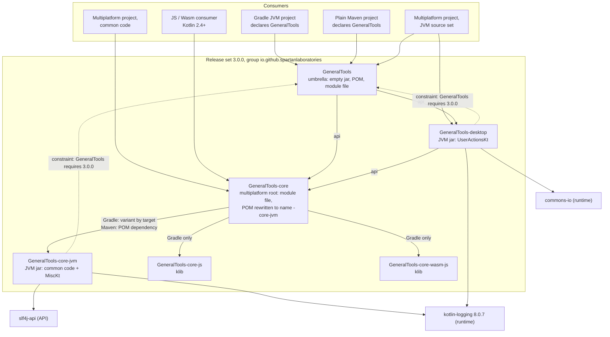
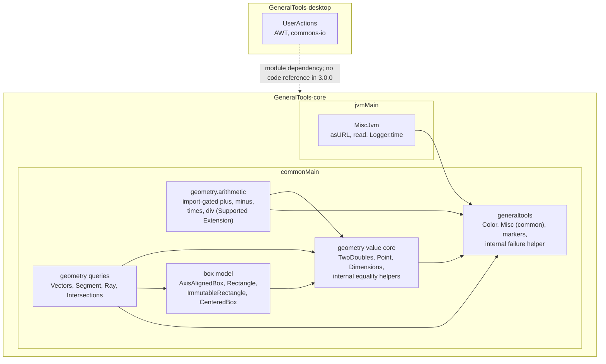
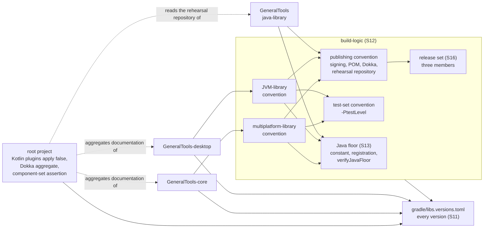
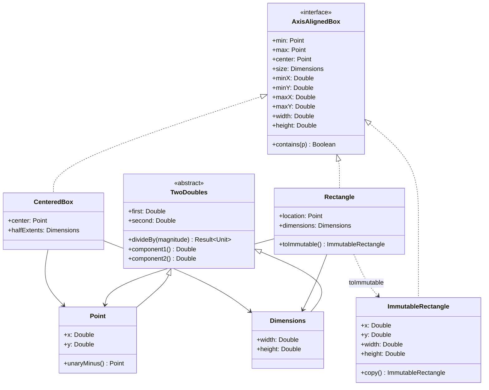
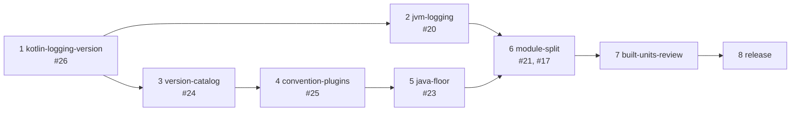

# Architecture: GeneralTools 3.0.0 on Kotlin Multiplatform, with immutable box copies

- **Covers:**
  - [SpartanLaboratories/GeneralTools#7](https://github.com/SpartanLaboratories/GeneralTools/issues/7),
    *"Make GeneralTools Kotlin Multiplatform (Color and geometry usable from common code)"*.
  - [SpartanLaboratories/GeneralTools#8](https://github.com/SpartanLaboratories/GeneralTools/issues/8),
    *"Read-only views for Point and Square so libraries can expose geometry without copying"*,
    which the built box model resolves.
  - The issues the remaining work resolves:
    [#21](https://github.com/SpartanLaboratories/GeneralTools/issues/21) (the module split, with
    [#17](https://github.com/SpartanLaboratories/GeneralTools/issues/17), the root artifact for plain
    Maven, folded in),
    [#20](https://github.com/SpartanLaboratories/GeneralTools/issues/20) (kotlin-logging in the JVM
    sources),
    [#23](https://github.com/SpartanLaboratories/GeneralTools/issues/23) (the Java floor),
    [#24](https://github.com/SpartanLaboratories/GeneralTools/issues/24) (the version catalog),
    [#25](https://github.com/SpartanLaboratories/GeneralTools/issues/25) (convention plugins) and
    [#26](https://github.com/SpartanLaboratories/GeneralTools/issues/26) (kotlin-logging 8.0.7).
- **Designs:** release `3.0.0` (a major version), published as one set of three modules:
  `GeneralTools-core` (Kotlin Multiplatform: `jvm`, `js`, `wasmJs`), `GeneralTools-desktop` (JVM) and
  a source-less `GeneralTools` umbrella over both. `Color`, the geometry package and the
  platform-neutral `Misc` helpers are common code; the listed set of API breaks; an immutable box
  copy and primitive box accessors for #8; import-gated arithmetic operators for `Point` and
  `Dimensions` as the first Supported Extension; a build whose versions live in a version catalog
  and whose shared configuration lives in convention plugins; a Java floor of 17 guarded in `check`;
  and the proof and release procedure that goes with them.
- **Baseline:** branch `feat/issue-7-kotlin-multiplatform` at `29dd4ff`. The branch started from
  `master` @ `17d30bc`, whose `src/main` is byte-identical to tag `2.2.0`, and has `master` @
  `c196d1a` merged in. Its head, `8a04f61`, adds research documents only. `master` stays at the
  released `2.2.0` until the release landing.
- **Status:** systems design - implementation plans to follow for the remaining units (section
  11.2). Seven units of this design are built and are part of the baseline (section 11.1).
- **Related:**
  - research: [`research/README.md`](research/README.md) and the findings files it links
    (cited below by file name);
  - the built units' plans, beside this document: [`plan-kmp-build.md`](plan-kmp-build.md),
    [`plan-explicit-api.md`](plan-explicit-api.md), [`plan-logging.md`](plan-logging.md),
    [`plan-commonize.md`](plan-commonize.md), [`plan-two-doubles.md`](plan-two-doubles.md),
    [`plan-box-model.md`](plan-box-model.md) and
    [`plan-generaltools-breaks.md`](plan-generaltools-breaks.md); what was built against them is in
    [`final-implementation.md`](final-implementation.md), and what the change does to its
    surroundings in [`impact.md`](impact.md);
  - the design this document replaces:
    [`superseded/architecture-2026-11-22.md`](superseded/architecture-2026-11-22.md);
  - earlier plans: [`../1-color-methods/plan.md`](../1-color-methods/plan.md),
    [`../3-geometry-primitives/plan.md`](../3-geometry-primitives/plan.md),
    [`../3-geometry-primitives/final-implementation.md`](../3-geometry-primitives/final-implementation.md).

---

## 1. Reading guide

Sections 2-5 state what must be true and what is known. Section 6 names the systems: S1 to S10 are
the systems of the library and its build as they stand on the branch, S11 to S16 the systems the
remaining work adds. Section 7 wires them, section 8 attaches them to what exists (including a
verdict for every existing class or file that touches a mechanism 3.0.0 replaces). Section 9 gives
each public surface its openness and stability tier. Section 11 records the seven built units and
cuts the remaining work into eight plannable units with a landing order; the order is a constraint,
because each unit's proof compares the published output before and after it and only holds when one
thing changes at a time (section 11.2).

---

## 2. Requirements

**Functional**

1. **Multiplatform, in modules.** The library is three Gradle modules published as one set at one
   version, group `io.github.spartanlaboratories`:
   - `GeneralTools-core`, a Kotlin Multiplatform module with `jvm` (bytecode 17), `js` and `wasmJs`
     targets, which publishes `GeneralTools-core` and the derived `GeneralTools-core-jvm`,
     `GeneralTools-core-js` and `GeneralTools-core-wasm-js`;
   - `GeneralTools-desktop`, a JVM module;
   - `GeneralTools`, a source-less umbrella that depends on both.

   There are no Android, native or browser targets. Every package name is unchanged, and
   `io.github.spartanlaboratories:GeneralTools` stays the coordinate a 2.x consumer declares, in
   Gradle and in plain Maven alike: either build gets real classes from it.
2. **Placement.** `Color`, the whole `com.spartanlabs.geometry` package and the platform-neutral
   `Misc` helpers are in common code and behave the same on all three targets (exceptions: number
   text formatting and `Float` precision on JS, both documented). `read`, `asURL` and the slf4j
   `Logger.time` extension are JVM-only and stay in the core module's JVM source set, on the facade
   class `MiscKt` they share with the common helpers. `UserActions` and its commons-io dependency
   are in `GeneralTools-desktop`, in the unchanged package `com.spartanlabs.generaltools`.
3. **Kotlin floor.** A JVM consumer on Kotlin 2.2.0 compiles against the JVM artifacts, and a
   consumer on Kotlin 2.1.20 can read their metadata. Web consumers need Kotlin 2.4. Consumers'
   slf4j backends keep working.
4. **Java floor.** Every JVM artifact runs on Java 17: its classes are class-file major 61 or
   lower, it uses no JDK API newer than 17, and every published JVM variant declares
   `org.gradle.jvm.version` 17. The floor is one constant, set apart from the JDK that runs the
   build, and a task in `check` guards it on every module. The released 2.2.0 was class-file major
   67 and declared `org.gradle.jvm.version` 23, so 3.0.0 lowers the JDK a consumer needs.
5. **The break set** - these breaks, and no others, each a clean break with no deprecation cycle:
   1. the library is multiplatform and is split into `GeneralTools-core` and `GeneralTools-desktop`;
      `GeneralTools` 3.0.0 is an umbrella over both, so its consumers keep their coordinate;
   2. `TwoDoubles` is no longer `sealed`; subclassing it is Experimental behind an ERROR-level opt-in;
   3. `TwoDoubles.divideBy` divides in place and returns `Result<Unit>` instead of throwing; a zero
      divisor leaves the value unchanged and is reported at WARN; it divides each component directly;
   4. `evaluateList` takes `(T) -> Boolean`, is not `inline`, and lives in common code;
   5. the `com.spartanlabs.logging` package is deleted;
   6. `Square` is renamed `Rectangle` with `val` references; `toSquare()` becomes `toRectangle()`;
   7. `TwoDoubles` equality becomes lawful (NaN equals NaN, `-0.0` hashes like `0.0`);
   8. `Color`'s public constructor validates its channels;
   9. `trimIfLongerThan` throws `IndexOutOfBoundsException` for a negative length on every platform;
   10. `capitalizeEveryWord` stops dropping commas that are part of its input.
6. **Kept as in 2.x.** `Point` and `Dimensions` stay mutable with every in-place member; `/=` with a
   zero divisor still throws `IllegalArgumentException("Cannot divide by zero")`; `Rectangle.min` and
   `size` still return the live `location` and `dimensions`; `Color` keeps its public constructor and
   public `copy`; `CenteredBox`, `Segment` and `Ray` keep their shapes and their "treat as immutable"
   KDoc.
7. **Additive (issue #8).** An immutable box copy (`ImmutableRectangle`, returned by
   `Rectangle.toImmutable()`); allocation-free primitive accessors on `AxisAlignedBox`; the operators
   that fit without making existing code ambiguous (`p in box`, `-p`, `val (x, y) = p`).
8. **Hand-out without copying (issue #8).** A library can give its callers a box they cannot mutate
   with one copy at construction and no copy per read, and the intersection functions read any
   `AxisAlignedBox` without per-call allocation.
9. **Opt-in arithmetic.** `plus`, `minus`, `times` and `div` for `Point` and `Dimensions` are
   available to a file that imports them, as a Supported Extension. A file that does not import them
   compiles and behaves exactly as in 2.x.
10. **Logging.** All Kotlin code, the JVM sources included, logs through kotlin-logging 8.0.7, an
    internal dependency that appears in no public signature. Logger names, levels and message texts
    are those of 2.x. `slf4j-api` stays the JVM contract: `Logger.time` keeps its slf4j receiver, and
    consumers keep their backend.
11. **Build structure.** `gradle/libs.versions.toml` holds the version of every dependency and
    plugin. The configuration the modules share lives in convention plugins in an included
    `build-logic` build. The Gradle wrapper stays at 9.0.0.
12. **API reference.** Every published component's javadoc jar is its Dokka output, generated with
    `failOnWarning`.

**Process and proof**

13. **Proof of the API change.** The committed JVM API dumps, one per module, together differ from
    the 2.2.0 baseline by exactly the signature part of the break set, reviewed against a break
    ledger. What a dump cannot show gets a check of its own: a test or a consumer-smoke check for
    sealed-ness, the opt-in gate and behaviour, and a publication check for the published shape
    (section 11.3).
14. **Tests.** Every test sits in `com.spartanlabs.testing.<set>.<package>`, one of the named test
    sets; pure tests run on all three targets; a `-PtestLevel` property selects test sets on every
    module's test tasks.
15. **Landing discipline.** `feat/issue-7-kotlin-multiplatform` is the integration branch. Each
    remaining unit branches from it and lands into it through its own pull request, and `master`
    stays at 2.2.0 meanwhile. After every unit the build passes on every target, and the union of the
    JVM dumps differs from the baseline by exactly the ledger rows. A unit that restructures the
    build leaves the published output identical except where it means to change it, and shows that
    by comparing the generated publication files before and after.
16. **Review of the built units.** The seven built units are reviewed as a unit of the remaining
    work, at their final paths after the module split and before the release: their tests against
    the named test sets, their code against their plans, and their documentation against the
    documentation standard. What the review finds is fixed before the release.
17. **Release.** One merge of the integration branch into `master` is the 3.0.0 release landing. The
    repository's standing automatic release releases it: one `publishAndReleaseToMavenCentral`
    invocation for the whole set, a bare `3.0.0` tag, and a GitHub release whose notes open with the
    CHANGELOG's 3.0.0 section. Everything that can fail runs before that landing, against a
    file-repository publication of the exact tree that lands. There is no CI publish and no
    pre-release version.
18. **Change record.** `CHANGELOG.md`, in the Keep a Changelog layout, lists every change of 3.0.0
    and links the README's migration notes. The README's migration notes are the one home of each
    break's symptom, cause and fix.

**Acceptance criteria** (for the finished release)

- `./gradlew build` is green on all three modules: the core module's `jvmTest`, `jsNodeTest` and
  `wasmJsNodeTest` and the desktop module's `test` all run, and `checkKotlinAbi` and
  `verifyJavaFloor` pass wherever they are registered.
- The baseline is the JVM dump of tag `2.2.0` as the Kotlin Gradle plugin lists it (S2, section
  3.4). The union of the core and desktop JVM dumps differs from it only by the rows in section
  11.3.
- The core module's klib dump contains no `read`, `asURL`, `Logger.time`, `UserActionsKt` or
  `com.spartanlabs.logging` entry.
- No main source file obtains a logger from slf4j; the only slf4j type in main code is the receiver
  of `Logger.time`.
- No dependency or plugin version is written outside `gradle/libs.versions.toml`, and no build
  script requests a toolchain.
- A file-repository publication of the landing tree holds exactly the six components
  `GeneralTools`, `GeneralTools-core`, `GeneralTools-core-jvm`, `GeneralTools-core-js`,
  `GeneralTools-core-wasm-js` and `GeneralTools-desktop`, each complete and signed, with the shape
  section 11.3 lists.
- Against that publication: a Kotlin 2.2.0 JVM project, a Kotlin 2.1.20 JVM project and a plain
  Maven project each resolve `GeneralTools` 3.0.0 and compile a one-screen usage of `Color`, `Point`,
  `Rectangle`, `read` and `cropImage`; a Kotlin 2.4 multiplatform project compiles the common types
  from `GeneralTools-core` in common code and `UserActions` from `GeneralTools-desktop` in its JVM
  source set; and a Gradle build that also pulls `GeneralTools:2.2.0` through `gametools` 5.1.0 ends
  with one copy of every GeneralTools class.
- The migrated scratch clone of MyGameTools builds against the new artifacts.
- `CHANGELOG.md` has a `[3.0.0]` section that names every break and every addition and links the
  README's migration notes.

---

## 3. Current state

### 3.1 This repository at the baseline

The baseline is the integration branch at `29dd4ff`. Seven units of this design are built there
(section 11.1), in the commits `8099065` to `7e171ab`.

**What the build proves there.**

- `./gradlew build` passes: 392 tests in `jvmTest`, 354 in `jsNodeTest` and 354 in `wasmJsNodeTest`,
  none failing or skipped, and `checkKotlinAbi` is green.
- The JVM dump differs from the restated 2.2.0 baseline (`3d25a7e`) by exactly the rows of the break
  ledger (section 11.3). The klib dump has no `read`, `asURL`, `Logger.time`, `UserActionsKt` or
  `com.spartanlabs.logging` entry.
- Compiling `js` and `wasmJs` at language and API version 2.2 under the Kotlin Gradle plugin 2.4.21
  works. The compiler arguments of the `js`, `wasmJs` and common-metadata compilations carry
  `-api-version 2.2 -language-version 2.2`.
- `@SubclassOptInRequired` on the abstract `TwoDoubles` forces the opt-in only on its subclasses, and
  the compiler accepts the `@Target()` marker at language version 2.2.
- The `Misc.kt` / `MiscJvm.kt` multifile facade leaves every public member of `MiscKt` unchanged.
  After the split the JVM file's private logger and its class initializer live in the part class
  `MiscKt__MiscJvmKt`, which is not API.
- An extension operator in `com.spartanlabs.geometry.arithmetic` takes part in resolving `a += b`
  only in a file that imports it: a non-importing test file with `var` `+=` compiles beside the
  package.
- `this::class` in `equals` and `hashCode` has a standing allocation test on the JVM
  (`TwoDoublesEqualsAllocationTest`, in the `nonfunctional` test set).
- On `js` and `wasmJs`, kotlin-logging prints its startup line once per process and renders each
  WARN line with the 2.x logger name. `js` writes it to standard error with the console level in
  front, and prints whole doubles without `.0`; `wasmJs` writes it to standard out and prints
  doubles as the JVM does.

**Build.** One Kotlin Multiplatform module at the repository root, configured in one script.

- `build.gradle.kts:16-17` applies `kotlin("multiplatform")` `2.4.21` and vanniktech `0.37.0`, each
  with a literal version. `group` and the version `3.0.0` are set on the project (`:20-21`).
- The floors are three values in the script (`:29-31`): language and API version 2.2, the published
  `kotlin-stdlib` requirement `2.2.0`, and `jvmFloor = 17`. `jvmFloor` feeds `jvmToolchain` (`:35`),
  the `jvm` target's `jvmTarget` (`:51`) and the by-hand `TargetJvmVersion` attribute (`:54`). The
  floor and the toolchain are therefore one setting. There is no `-Xjdk-release` and no guard in
  `check`.
- `explicitApi()` (`:38`), the language and API pins (`:44-45`), the targets `jvm()`,
  `js { nodejs() }` and `wasmJs { nodejs() }` (`:50-58`) and `abiValidation()` (`:63`) are on the
  `kotlin {}` extension.
- Dependencies by source set (`:67-91`), each with a literal version: `commonMain`
  `api(kotlin-stdlib:2.2.0)` and `implementation(kotlin-logging:8.0.4)` (`:74`); the web source sets
  `api(kotlin-stdlib)` at the plugin's version; `jvmMain` `api(slf4j-api:2.0.16)` and
  `implementation(commons-io:2.4)` (`:82-83`); `commonTest` `kotlin("test")`; `jvmTest` logback
  `1.5.13`.
- The `-PtestLevel` filter is a block of the same script (`:97-120`).
- Publishing (`:122-153`): `publishToMavenCentral()`, `signAllPublications()`,
  `coordinates(group, "GeneralTools", version)` (`:126`) and
  `KotlinMultiplatform(javadocJar = JavadocJar.Empty(), ...)` (`:127`), so the javadoc jars are empty.
- `settings.gradle.kts` applies the foojay toolchain resolver `1.0.0` (`:2`) and names the root
  project `GeneralTools` (`:4`). `gradle/` holds only the wrapper, at `9.0.0`.
- `api/GeneralTools.api` and `api/GeneralTools.klib.api` are committed, as is
  `kotlin-js-store/yarn.lock`. `.gitattributes:1-2` keeps `api/*.api` at LF; its comment says the
  build compares the dumps byte for byte, which `checkKotlinAbi` does not (section 3.4).
- `gradlew` is committed executable (mode `100755`, `3295908`). `.github/workflows/Build.yml:9-20`
  runs `./gradlew build` on every push with `actions/checkout@v7`, `actions/setup-java@v6` (Temurin
  17) and `gradle/actions/setup-gradle@v6`; it has no `chmod` step and does not publish.

**Sources.** `src/commonMain/kotlin/{generaltools,geometry}/` holds `Color`, the common `Misc.kt`,
the opt-in marker, `SupportedExtension`, the internal failure helper and the whole geometry package
with its `arithmetic` subpackage. `src/jvmMain/kotlin/generaltools/` holds `MiscJvm.kt` and
`UserActions.kt`. Directories do not mirror packages.

**Logging.** The common code logs through kotlin-logging 8.0.4 with explicit logger names. Two
files still obtain an slf4j logger: `MiscJvm.kt:18` (used at `:25`, `:33`, `:35`) and
`UserActions.kt:17` (used at ten sites). `MiscJvm.kt:39` declares `Logger.time` on the slf4j
`Logger`.

**`UserActions.kt`.** It uses no other declaration of the library. Its imports (`:3-14`) are
commons-io, slf4j, AWT, `java.io`, `java.net` and `javax.imageio`, and its `Rectangle` is the
imported `java.awt.Rectangle`. It is the only file that uses AWT and commons-io. Its JVM facade,
`UserActionsKt`, has seven public members.

**Tests.** `src/commonTest` holds the pure tests in `com.spartanlabs.testing.<set>.<package>`;
`src/jvmTest` holds the JVM-only ones (`AsUrlTest`, `LoggerTimeTest`, `ReadTest`, `UserActionsTest`,
the log-capture tests and the allocation test) with `logback-test.xml`.

**Documents.** The README describes one multiplatform module whose Maven consumers depend on
`GeneralTools-jvm`, names kotlin-logging 8.0.4, and describes a hand-run, staged release
(`README.md:103-119`). There is no `CHANGELOG.md`.

### 3.2 The released 2.2.0

Read from Maven Central ([`published-shape-after-the-split.md`](research/published-shape-after-the-split.md),
"Observed on Central"; [`java-floor-on-a-multiplatform-jvm-target.md`](research/java-floor-on-a-multiplatform-jvm-target.md) F9).

- One artifact, `GeneralTools`: a JVM jar, a POM and a Gradle module file. Its POM lists `slf4j-api`
  and `kotlin-stdlib` in compile scope and commons-io in runtime scope.
- Its classes are class-file major 67, and its module file declares `org.gradle.jvm.version` 23, the
  JDK that built it. A consumer on a JDK older than 23 cannot use it.
- Its manifest has no `Automatic-Module-Name`, so on the module path the jar is the automatic
  module `GeneralTools`.
- The jar holds `com/spartanlabs/generaltools/MiscKt.class` and `UserActionsKt.class` side by side.

### 3.3 Consumers at the baseline (read-only)

Details and sources: [`downstream-under-mutable-model.md`](research/downstream-under-mutable-model.md),
[`downstream-blast-radius.md`](research/downstream-blast-radius.md). Counts were read at MyGameTools
`dc5214f`, MyGameClient (`GameGraphics`) `8b428a4`, MyGameServer `9eef06b`, WebTools `d00cd0e` and
SpartanGraphics `50b61e2`; they can drift as those repositories move.

- **MyGameTools** (`SpartanLabsGaming`) pins GeneralTools `2.2.0` as an `api` dependency and builds
  with Kotlin 2.2.0. It names `Square` on 39 code lines in 14 files, assigns `area.dimensions` in
  `VisibleObject`, and has 40 in-place `Point`/`Dimensions` mutation sites in 17 files (6 in main
  sources).
- **MyGameClient** reaches GeneralTools through `gametools` 5.0.0 (which requires GeneralTools `2.0.1`)
  and builds with Kotlin 2.1.20. It names `Square` on 27 lines in 8 files.
- **MyGameServer, WebTools, SpartanGraphics** use none of the affected members.
- **Published `gametools` 5.0.0 and 5.1.0** reference `com/spartanlabs/geometry/Square`; 5.1.0 is on
  Maven Central and requires GeneralTools `2.2.0`.
- No downstream code uses `divideBy`, `/=`, `evaluateList`, `com.spartanlabs.logging`, `Color.copy`,
  `min` or `size` of a `Square`, an exhaustive `when` over `TwoDoubles`, or Java, declares its own
  operator on a GeneralTools type, destructures a `Point`, or implements `AxisAlignedBox`.
- Every 2.x consumer is a JVM build. No consumer uses the `js` or `wasmJs` variants yet.

### 3.4 Verified outside-world facts the design rests on

Each was re-opened at its source (see the verification tables in
[`research/README.md`](research/README.md)): the facts about Kotlin compatibility, logging,
behaviour across platforms, API mechanics and tests in October 2026; the facts about kotlin-logging
8.0.7, the published shape, the build structure and the Java floor on 2026-11-21 and 2026-11-22.

| Fact | Source |
|---|---|
| Kotlin 2.4.21 is the latest stable Kotlin; KGP 2.4.21 documents Gradle 9.0.0 as supported; vanniktech `0.37.0` is the latest release, needs Gradle 9.0.0 or newer and is documented as tested up to KGP 2.4.0; Dokka `2.3.0` is the latest release | [`kmp-build-and-kotlin-compat.md`](research/kmp-build-and-kotlin-compat.md) F6, [`build-logic-and-version-catalog.md`](research/build-logic-and-version-catalog.md) claims 13, 16, 17 |
| A Kotlin compiler reads class metadata up to one minor ahead of itself; the metadata a build writes follows its `languageVersion`; the stdlib a consumer sees comes from the library's own `kotlin-stdlib` requirement | `kmp-build-and-kotlin-compat.md` F1-F3 |
| `js`/`wasmJs` klibs carry the ABI version of the compiler that built them and `languageVersion` does not lower it, so web consumers need Kotlin 2.4 or newer; `coreLibrariesVersion` cannot be lowered for web compilations | `kmp-build-and-kotlin-compat.md` F4, F5 |
| Kotlin/JS is Stable and Kotlin/Wasm is Beta; klib binary-compatibility guarantees are not finalized | `research/README.md` "Sources reused"; `kmp-build-and-kotlin-compat.md` F7 |
| kotlin-logging publishes `jvm`, `js`, `wasmJs`; delegates to slf4j on the JVM and to the console elsewhere; its JVM artifact declares no slf4j dependency, so the library that uses it supplies `slf4j-api`; prints one startup line on first use unless `-Dkotlin-logging.logStartupMessage=false`; `implementation` in `commonMain` is runtime-only on the JVM variant; `KotlinLogging.logger {}` is unreliable on JS/Wasm so logger names are passed explicitly | [`kotlin-logging-adoption.md`](research/kotlin-logging-adoption.md) F1-F9 |
| kotlin-logging `8.0.7` is the latest release and the organization's one version; its JVM POM requires kotlin-stdlib 2.1.21, as 8.0.4's does, so it raises no consumer's stdlib floor. Every class of kotlin-stdlib 2.2.0, kotlin-logging-jvm 8.0.7, slf4j-api 2.0.16 and commons-io 2.4 is class-file major 61 or lower outside `META-INF/versions/`; kotlin-logging's `module-info.class` is exactly 61, so the floor cannot go below 17 while that dependency stays | `research/README.md`, "Logging" and "Java floor"; `java-floor-on-a-multiplatform-jvm-target.md` F8 |
| `Double.toString` prints `1.0` as `1` on JS; a `Float` is double precision on JS; `String.substring` with a negative length returns `""` on JS; `KClass.qualifiedName` is always `null` on JS; `minOf`/`maxOf` propagate NaN on all targets | [`cross-platform-behaviour-parity.md`](research/cross-platform-behaviour-parity.md) 3.1, 3.2, 3.3, 3.7, 3.13 |
| A member returning `Result` has a name-mangled JVM name (`distanceFrom-IoAF18A`, `asRay-d1pmJ48`); top-level functions are not mangled | [`idiomatic-kotlin-api-mechanics.md`](research/idiomatic-kotlin-api-mechanics.md) F2.1 |
| `@SubclassOptInRequired` (since Kotlin 2.1) gates subclassing of open and abstract classes only; using the type needs no opt-in; a marker with `@Target()` can only be passed to `@SubclassOptInRequired`/`@OptIn`; its annotation is absent from ABI dumps | `idiomatic-kotlin-api-mechanics.md` F5.1, F5.2 |
| The KGP JVM dumper and binary-compatibility-validator `0.18.2` list different members for the same class files. The plugin takes the visibility of a synthetic default-arguments constructor from the constructor it serves and leaves out a `protected` member of a sealed or enum class; binary-compatibility-validator counts every `protected` member as public. For the 2.2.0 classes the two dumps differ by one line, `TwoDoubles`' `public synthetic fun <init> (DDILkotlin/jvm/internal/DefaultConstructorMarker;)V`, which only binary-compatibility-validator lists. The plugin's klib dump lists no constructor of a sealed class | [`research/README.md`](research/README.md), "API mechanics and proof of the API change"; [`plan-kmp-build.md`](plan-kmp-build.md) section 3 |
| The KGP ABI validation (`abiValidation()`, `@since 2.4.0`) is Experimental and is wired into `check` as `checkKotlinAbi`. It is configured per module; it writes `<project dir>/api/<project name>.api` and, for klib targets, `<project name>.klib.api`, and needs a committed reference for every dump it writes. `checkKotlinAbi` compares the dumps line by line, so CRLF line endings cannot fail it while a missing or extra trailing newline can | `idiomatic-kotlin-api-mechanics.md` F6.1; `build-logic-and-version-catalog.md` 3.6; [`AbiToolsImpl.kt` at `v2.4.21`](https://github.com/JetBrains/kotlin/blob/v2.4.21/libraries/tools/abi-validation/abi-tools/src/main/kotlin/org/jetbrains/kotlin/abi/tools/impl/AbiToolsImpl.kt), `filesDiff` |
| The KGP Yarn lock check ignores line endings. KGP applies its Node and Yarn plugins to the root project from whichever module declares a web target, so `kotlin-js-store/` stays at the repository root. KGP adds `kotlin-dom-api-compat` to Kotlin/JS compilations by default | `plan-kmp-build.md` section 3; `build-logic-and-version-catalog.md` 3.7 |
| `a += b` on a `var` is an overload ambiguity when both `plusAssign` and a `plus` returning a subtype exist | [`mutable-geometry-model.md`](research/mutable-geometry-model.md) 3.3 |
| A `data class` cannot extend a type whose `componentN()` is `final` | <https://kotlinlang.org/docs/data-classes.html> |
| Backtick names consisting of letters, digits, spaces, hyphens and apostrophes are legal on JS and Wasm from language version 2.1; test-set selection by package filter reaches `jvmTest`, `jsNodeTest` and `wasmJsNodeTest` through `AbstractTestTask` | [`kmp-test-levels-and-names.md`](research/kmp-test-levels-and-names.md) F3, F5 |
| A multiplatform root artifact holds no classes for Maven: its POM lists only the common dependencies, and Maven does not read the Gradle module file that redirects to the `-jvm` artifact. Okio 3.18.2, on vanniktech `0.37.0`, rewrites its root POM to depend on its `-jvm` artifact and leaves the module file alone | [`published-shape-after-the-split.md`](research/published-shape-after-the-split.md) F1, claim 8 |
| vanniktech derives a multiplatform module's artifact ids from the Gradle project name (`<name>`, `<name>-jvm`, `<name>-js`, `<name>-wasm-js`); with `org.jetbrains.kotlin.jvm` or `java-library` it publishes the `java` component as one artifact; `JavadocJar.Dokka(task)` builds the javadoc jar of every publication from that Dokka task | `published-shape-after-the-split.md` F9, F10; `build-logic-and-version-catalog.md` 3.4, 3.5 |
| One Gradle invocation is one Central deployment: every module's upload registers in one shared build service, which zips and uploads once at the end of the build and drops the deployment if the build fails. The plugin does not check that the set is complete: a module the invocation does not reach is absent from the bundle. A Portal bundle may hold several components, and publish and drop act on the deployment | `published-shape-after-the-split.md` F8, claims 12-15 |
| A Gradle dependency constraint sets a version requirement without adding the dependency, is transitive, and is published only in Gradle module metadata; `kotlin-stdlib` publishes such constraints on its retired `-jdk7`/`-jdk8` artifacts. Capabilities fail the build when two providers meet and have no POM form | `published-shape-after-the-split.md` F2-F4 |
| Maven's dependency `type` defaults to `jar`; Central requires a jar for any packaging other than `pom` and accepts placeholder jars | `published-shape-after-the-split.md` claims 20, 21 |
| A jar without a module descriptor is an automatic module named by `Automatic-Module-Name`, or else from its file name; two automatic modules that hold the same package cannot be resolved together on the module path, whatever their names | `published-shape-after-the-split.md` F7 |
| A composite build substitutes `group:name` per project of the included build | `published-shape-after-the-split.md` F10, claim 19 |
| Gradle documents a `build-logic` included build for sharing build logic. An included build does not see the root catalog and imports it with `from(files("../gradle/libs.versions.toml"))`; a precompiled script plugin cannot use the generated catalog accessors or catalog plugin aliases, and reads entries through `VersionCatalogsExtension`; a plugin a convention applies is a dependency of `build-logic`; a settings file cannot use a catalog alias | `build-logic-and-version-catalog.md` 3.1, 3.2 |
| Dokka needs the Kotlin plugins on the root project's plugin classpath; without them it renders empty modules with only a configuration-time warning that `failOnWarning` does not catch. Aggregation is a `dokka(project(...))` dependency. `V2Enabled` is the documented end state of Dokka's plugin mode | `build-logic-and-version-catalog.md` 3.4, claims 9-11 |
| `jvmTarget` fixes the class-file version; `-Xjdk-release` also limits the visible JDK API to that release and must be given the same value as `jvmTarget`. It is an unstable `-X` flag with no typed Gradle option in KGP 2.4.21, it needs the compile JDK's `ct.sym`, and at the `kotlin {}` extension level it reaches the JS compilation, which warns. A toolchain sets the JDK home and the default `jvmTarget` together. Gradle 9.0.0 runs on JDK 17 to 24 | `java-floor-on-a-multiplatform-jvm-target.md` F1-F3, F6, F7 |
| KGP 2.4.21 never sets `org.gradle.jvm.version` on a multiplatform JVM target; an attribute set on the target reaches its API, runtime and sources variants in the root and the `-jvm` module files. For a module with the Java plugin, Gradle derives the attribute from the Java compile task's `options.release` | `java-floor-on-a-multiplatform-jvm-target.md` F4, F5 |
| Published `gametools-core` 5.1.0 and `gametools-world` 5.1.0 reference `com/spartanlabs/geometry/Square` at the named sites | `downstream-under-mutable-model.md` 3.3 |

Observed in scratch builds of the target layout, outside the repository (Gradle 9.0.0, KGP 2.4.21,
Dokka 2.3.0, vanniktech 0.37.0; nothing published, signed or uploaded):

- Moving the single module's configuration into a catalog and convention plugins left all eight
  generated POM and module files byte-identical, jar and klib hashes included.
- Dokka javadoc jars change only the javadoc jars; module files do not list them. The repository's
  present KDoc generated without a warning.
- After the split, the sorted lines of the core and desktop JVM dumps equal the sorted lines of the
  single module's dump, the klib dump differs only in the library's unique name, and the JVM class
  entries of the two jars equal the single jar's except for `META-INF/*.kotlin_module`.
- The same sources built at two different checkout paths give different klib hashes, because a
  klib records absolute source paths.
- The guard ported from WebTools passes on a multiplatform `jvm` target and on a Kotlin/JVM module,
  and fails on a jar with no class until it is told the jar is meant to be empty.

([`build-logic-and-version-catalog.md`](research/build-logic-and-version-catalog.md) 3.4-3.6, 6.6;
`java-floor-on-a-multiplatform-jvm-target.md` F6, F9.)

---

## 4. Assumptions

Each is relied on and has not been confirmed. The unit that confirms it is named (section 11.2).
The assumptions the built units confirmed are facts in section 3.1, and their numbers (A2, A4 to
A7, A10, A12) are not reused.

**Landing and release.** These four depend on how the repository's version control and its
standing release treat this issue's units.

| # | Assumption | If false | Confirmed in |
|---|---|---|---|
| A13 | The remaining units' branches start from the integration branch and merge into it, not into `master`. The repository's version-control rules cut every topic branch from the default branch and open every pull request against it, so this relies on an exception to those rules for this issue's units. | The integration branch merges into `master` once, with the build's version held at the released `2.2.0` so that the landing releases nothing. The remaining units then branch from `master` and land on it, each with the version still held although `master` carries the breaks, and the `release` unit's landing is the one that sets `3.0.0`. That trades one exception (the branch a unit targets) for a hold on the version at every later landing, and `master` stops matching the published 2.2.0 before 3.0.0 exists. Section 11.4's rehearsal and release are unchanged. | before `kotlin-logging-version` starts |
| A14 | A landing into the integration branch moves no version: `3.0.0` is already set on the branch and is released once. Each landing's CHANGELOG entry collects under `[Unreleased]`. A pull request into a branch that is not the default branch closes no issue, so the units' issues close at the release landing or by hand. | If a landing into the integration branch is treated as a release candidate, nothing may be published from it; the version is then held as in A13's fallback. If the issues must close at each landing, they are closed by hand with a link to the unit's pull request. | each remaining unit's landing |
| A15 | The standing release treats the release landing as one candidate that holds all three modules, reads the one version they share from wherever the build keeps it, and releases them in one `publishAndReleaseToMavenCentral` invocation. | The build makes the set complete without relying on which modules the invocation names (S16), so a release that names one module still uploads all six components. If the release cannot read the shared version from `gradle.properties`, the version moves to the place it reads, still written once for all modules. | `release` (rehearsal dry run, then the release) |
| A16 | This issue's planning documents ride the integration branch and reach `master` with the release landing. | They cannot reach `master` sooner through this branch, because a pull request of it carries its code. If they must, they are copied to a documents-only branch cut from `master`, and the two copies are reconciled at the release landing. | `release` |

**The Kotlin floor and the published shape.**

| # | Assumption | If false | Confirmed in |
|---|---|---|---|
| A3 | A Kotlin 2.2.0 JVM consumer and a Kotlin 2.1.20 JVM consumer compile against `GeneralTools` 3.0.0 (the core JVM artifact and the desktop artifact), built with KGP 2.4.21 at language 2.2 with `api(kotlin-stdlib:2.2.0)`. The Kotlin metadata flags the 2.4.21 compiler writes differently for data classes' generated members are not decoded; this check covers them. | The language/API pin or the stdlib pin is wrong; the pins move before the release landing. | `release` (smoke matrix) |
| A8 | The published module file of `GeneralTools-core-jvm` shows kotlin-logging only in the runtime variant, slf4j-api in the API variant, and a `kotlin-stdlib` requirement of 2.2.0. | The dependency scopes in `commonMain`/`jvmMain` are corrected. | `kotlin-logging-version` (publication comparison), `release` |
| A9 | vanniktech `0.37.0` signs and publishes all six components of the three modules with the keyring-file signing properties and Gradle's configuration cache. Its behaviour for a source-less JVM module and for several modules in one deployment is read from its source, not run. | The signing properties or the cache setting change; no source change. | `release` (rehearsal) |
| A11 | The downstream line counts in section 3.3 still describe the downstream repositories' current heads. | The throwaway migration in `release` reports the real number; the notes quote it. | `release` |
| A17 | The desktop module publishes a `kotlin-stdlib` requirement of 2.2.0. The Kotlin/JVM plugin adds `kotlin-stdlib` at its own version, 2.4.21, unless the module declares one; a scratch Kotlin/JVM module resolved `2.2.0 -> 2.4.21` (`java-floor-on-a-multiplatform-jvm-target.md` F8). An explicit declaration is expected to replace the plugin's default there, as it does in the multiplatform module. | A consumer on Kotlin 2.2.0 or 2.1.20 would get a 2.4 stdlib through `GeneralTools-desktop` and fail to read it. The plugin's default stdlib dependency is switched off for the desktop module, or its `coreLibrariesVersion` is lowered, which a JVM-only module allows. | `module-split` (publication check), `release` (smoke matrix) |
| A18 | Gradle writes the umbrella's and the desktop module's dependency on the multiplatform core project as the root coordinate `GeneralTools-core`, in the POM and in the module file. | The POM rewrite that points Maven at `GeneralTools-core-jvm` moves from the core root's POM to the POMs that name the core. | `module-split` (publication check) |
| A19 | A constraint declared on the API dependency scope of the core module's `jvm` target is published in the API and runtime variants of `GeneralTools-core-jvm`, and reaches a consumer that resolves through the root module file. No published multiplatform library was found that does this. | The constraint is declared on the configuration that does publish it. If none does, the desktop module alone carries it, and a graph that holds `GeneralTools-core` and `GeneralTools:2.2.0` without the desktop module is covered by the migration notes only. | `module-split` (publication check), `release` (mixed-graph smoke case) |
| A20 | Kotlin 2.2.0 and 2.1.20 compilers see the top-level functions of the one package `com.spartanlabs.generaltools` from two jars (`MiscKt` in the core JVM jar, `UserActionsKt` in the desktop jar), each through its own `.kotlin_module` file. | The two modules' Kotlin module names are set apart explicitly; if that is not enough, the placement of `UserActions` is reopened before the release. | `release` (smoke matrix) |
| A21 | The umbrella's sources jar can be folded from the core module's JVM sources variant, common sources included, and from the desktop module's sources. | The umbrella builds its sources jar from the two modules' source directories directly. The entry-count check (S14) holds either way. | `module-split` |
| A22 | The Central Portal validates the six components: three artifact names that are new in the namespace, and an umbrella whose class jar and sources jar hold no class. Sonatype documents publish and drop per deployment, so one failing component is taken to fail the whole deployment. | A failed validation drops the deployment and publishes nothing. The cause is fixed by a landing on `master` that moves no version, and the release is started again. If the Portal published part of a deployment, the missing components would be released at once in a second deployment of the same version. | `release` |
| A23 | No consumer puts GeneralTools on the Java module path. The core JVM jar and the desktop jar share a package, so the two cannot be resolved there together (section 12). | A consumer that needs both on the module path keeps the desktop jar on the class path. Removing the limit needs `UserActions` in a package of its own, a source and binary break for a later major. | not confirmed by this work; the migration notes state the limit |

**The build.**

| # | Assumption | If false | Confirmed in |
|---|---|---|---|
| A24 | The as-built KDoc generates no Dokka warning, as it did in a scratch copy of the target layout. | `convention-plugins` corrects the KDoc that warns; a comment-only change with no effect on the dumps. | `convention-plugins` |
| A25 | The web test tasks behave under the test-set convention as they do under today's script block; the scratch build compiled the web targets and did not run their tests. | The convention is corrected until `jsNodeTest` and `wasmJsNodeTest` run the same 354 tests each and `-PtestLevel` selects on them. | `convention-plugins` |
| A26 | `-Xjdk-release=17` is effective on the JDKs the build runs on: CI's Temurin 17, where the compiler skips it because the JDK is the floor, and a maintainer's newer JDK, which must ship `ct.sym`. | A JDK without `ct.sym` fails the build loudly. If the flag stops working in a later Kotlin, the guard still holds the class-file version, and CI on JDK 17 still fails on a newer JDK API. | `java-floor` |
| A27 | In build scripts and convention plugins, imports of the Gradle API count as third party and imports of the Kotlin Gradle plugin and the publishing plugin as the file's intended function, under the organization's import grouping, which gives no example for build scripts. | Only the region comments of those files change. | `convention-plugins` |
| A28 | Having a Central-bound task of any one module also run the other two modules' staging and upload-registration steps registers all three modules with the publishing plugin's shared service, whichever module an invocation names, without a task depending on itself. This is read from the plugin's source; an upload is the only run that shows it end to end. | The task-graph check still fails a Central-bound invocation whose graph does not hold every member of the release set, before anything is uploaded, and the release names all three modules' Central-bound tasks itself. | `module-split` (task graph of a dry run), `release` |

**Outside this repository.**

| # | Assumption | If false | Confirmed in |
|---|---|---|---|
| A29 | A build that resolves a published `gametools` 5.x beside GeneralTools 3.0.0 fails with `NoClassDefFoundError: com/spartanlabs/geometry/Square`. The error is derived from the bytecode references and has not been executed. | The migration notes quote whatever the run shows. | `release` |
| A30 | SpartanGraphics plans a type named `Rectangle`. The name comes from a planning draft that is not committed in that repository. | Nothing in this design changes; the note about aliasing one import loses one of its three examples. | not confirmed by this work |

---

## 5. Non-goals

- Android, native, browser (`browser()`) and WASI targets; a `webMain` source set unless a shared
  JS/Wasm `actual` is ever needed; `-android` and `-web` family modules, which the module names
  leave room for; a pre-release version; a CI publish workflow.
- A multiplatform umbrella: `GeneralTools` cannot be declared in the common code of a project with
  web targets. Such a project declares `GeneralTools-core` there.
- Java module descriptors (`module-info`), and moving `UserActions` to a package of its own so that
  core and desktop could share the module path.
- A toolchain for the build, a bill of materials, a published test-fixtures artifact, and tests of
  the convention plugins that drive a build (the publication comparison covers what those would).
- Anything on the Maven side that enforces one copy of the classes; Maven consumers get a migration
  note.
- The rest of the API-documentation standard: the Dokka job in CI, the project site, the Pages
  workflow and the branding. [#19](https://github.com/SpartanLaboratories/GeneralTools/issues/19)
  follows 3.0.0 on `master`. 3.0.0 ships the Dokka javadoc jars only.
- Regrouping the imports of the existing Kotlin files.
  [#22](https://github.com/SpartanLaboratories/GeneralTools/issues/22) follows 3.0.0 on `master`,
  as one change with no other edit. The remaining units write their new Kotlin files to the
  organization's import grouping from the start.
- Immutable `Point` or `Dimensions`; `ReadOnlyPoint`, `ReadOnlyDimensions`, `ReadOnlySquare` or any
  other read-only view type; an immutable twin of `Point`, `Segment`, `Ray` or `CenteredBox` in 3.0.0
  ([#15](https://github.com/SpartanLaboratories/GeneralTools/issues/15) tracks `Point` and `Segment`,
  [#13](https://github.com/SpartanLaboratories/GeneralTools/issues/13) `toImmutable()` for every box).
- Operators that are not offered:
  - member arithmetic operators (`plus`, `minus`, `times`, `div`) on `Point`/`Dimensions`, since the
    import-gated package carries them;
  - `Dimensions ± Point` and component-wise products;
  - arithmetic operators on boxes, segments and rays, which would mean translation and scaling;
  - arithmetic on consumers' own `TwoDoubles` subclasses;
  - `unaryPlus`, `inc`, `dec`, `compareTo`, `rangeTo`, `get` and `rem`.
- For issue #8, a read-only or immutable `Point`. `Point` and `Dimensions` stay mutable, so #8 is
  resolved for boxes (`ImmutableRectangle`, `toImmutable()` and the allocation-free accessors), and
  `Segment`, `Ray` and `CenteredBox` keep their "treat as immutable" KDoc. #8 closes once 3.0.0 is
  published, not at the release landing, with a comment that states this scope and points to #15 and
  #13.
- Making `Rectangle.min` and `size` return copies.
- A deprecated `typealias Square = Rectangle`, a deprecated `toSquare()` or any other shim.
- A `time` extension on kotlin-logging's logger: it would put kotlin-logging in the public API.
- Float32 emulation on JS; normalising `Double.toString` across platforms; per-logger log-level
  control on JS/Wasm.
- Parameterising `EPSILON`. It and the intersection tolerances stay public constants.
  [#11](https://github.com/SpartanLaboratories/GeneralTools/issues/11) tracks additive overloads
  defaulting to `EPSILON`, for a minor release after 3.0.0.
- An in-repository compile-fail test for the unsealing, the opt-in gate and the arithmetic import
  gating. The smoke project checks them once before the release, and a later regression would not
  fail CI, because the ABI dump records none of them.
  [#12](https://github.com/SpartanLaboratories/GeneralTools/issues/12) tracks a Gradle TestKit
  test in the integration set for a minor release after 3.0.0; the same harness can hold the
  arithmetic ambiguity.
- Other additions that wait for a minor after 3.0.0: a `screenshotArea` overload that takes an
  `AxisAlignedBox` ([#14](https://github.com/SpartanLaboratories/GeneralTools/issues/14)), a `Color`
  factory that returns a `Result`
  ([#16](https://github.com/SpartanLaboratories/GeneralTools/issues/16)), and caching the Node and
  Yarn downloads in CI ([#18](https://github.com/SpartanLaboratories/GeneralTools/issues/18)).
- Migrating MyGameTools, MyGameClient or any other downstream repository (they are read-only here);
  filing issues against them.

---

## 6. System inventory

Sixteen systems. Each has one responsibility; "owns" lists what lives there, "not" what it
explicitly does not do. S1 to S10 exist on the branch; where the remaining work changes one, its
entry says so and names the unit (section 11.2). S11 to S16 are new.

### S1. Target and compatibility configuration

- **Responsibility:** state what each module compiles for and against: its targets, the Kotlin
  floor, the dependencies of each source set, and how tests are selected.
- **Placement:** built in the root `build.gradle.kts`. The remaining work moves the versions into
  the catalog (S11) and the shared settings into the convention plugins (S12) without changing
  their values; a module script keeps only what is its own.
- **Owns:**
  - the Kotlin pins: `languageVersion` and `apiVersion` exactly 2.2 on the `kotlin {}` extension;
    `api(kotlin-stdlib:2.2.0)` in every module that compiles Kotlin (`commonMain` of the core
    module, `main` of the desktop module); `coreLibrariesVersion` is not lowered in the
    multiplatform module;
  - targets of the core module: `jvm()`, `js { nodejs() }`,
    `@OptIn(ExperimentalWasmDsl::class) wasmJs { nodejs() }`;
  - the web stdlib line: the web source sets declare `api(kotlin-stdlib)` at the plugin's version.
    It is required: declaring `kotlin-stdlib:2.2.0` in `commonMain` switches off the stdlib the
    plugin would add, and the JS and Wasm compilers reject a stdlib klib older than themselves.
    Gradle resolves the web compilations to the newer stdlib, and the duplicate requirement in the
    web variants is the shape Okio publishes
    ([`kmp-build-and-kotlin-compat.md`](research/kmp-build-and-kotlin-compat.md), recommendation).
    The plugin also adds `kotlin-dom-api-compat` at its own version to the `js` compilation, so the
    published `js` variant depends on `kotlin-dom-api-compat:2.4.21` too; a Kotlin/JS consumer's own
    plugin adds the same artifact;
  - dependencies that belong to one module, declared in that module's script:
    - core: `commonMain` `implementation(kotlin-logging)`; `jvmMain` `api(slf4j-api)`;
    - desktop: `api` on the core module, `implementation(kotlin-logging)` and
      `implementation(commons-io)` (S14);
    - tests: `kotlin("test")`, and logback for the JVM tests of both modules;
  - the `-PtestLevel=<set>[,<set>]` filter on every `AbstractTestTask` (test sets `gating`,
    `component`, `integration`, `deterministic`, `e2e`, `nonfunctional`, `uat`; an unknown set is a
    build error; `failOnNoMatchingTests = false`; unset runs everything);
  - CI: `.github/workflows/Build.yml` runs `./gradlew build` on Temurin 17, the floor JDK, with no
    Node step (the plugin downloads Node).
- **Not:** the Java floor (S13); the published shape (S14); any source semantics; any API.

### S2. API proof harness

- **Responsibility:** make the public API of every target a reviewed, committed artifact and fail the
  build on an unreviewed change.
- **Placement:** `kotlin { @OptIn(ExperimentalAbiValidation::class) abiValidation() }`; `check`
  depends on `checkKotlinAbi`; `updateKotlinAbi` rewrites the files. Built for the single module,
  with `api/GeneralTools.api` (JVM) and `api/GeneralTools.klib.api` (klib, `js` + `wasmJs`). After
  `module-split` both library conventions enable it and each module commits its own dumps:
  `GeneralTools-core/api/GeneralTools-core.api`, `GeneralTools-core/api/GeneralTools-core.klib.api`
  and `GeneralTools-desktop/api/GeneralTools-desktop.api`. The umbrella has none.
- **Owns:** the baseline dump: tag `2.2.0` recorded once by binary-compatibility-validator `0.18.2`
  with the tag's own build in a scratch copy (`8099065`), then restated as the plugin's own dump of
  the same classes (`3d25a7e`), both committed before any source or build change. The baseline is
  always the dump of the tool `check` runs. The restatement was admitted by comparing the class
  files of the two builds: the same files, the same members and descriptors, and the one line it
  drops naming a member with the same descriptor and access flags in both builds (section 3.4). S2
  also owns the break ledger (section 11.3), against which the **union** of the modules' JVM dumps
  is reviewed, and `explicitApi()`, so that a declaration is public only on purpose.
- **Not:** it does not see sealed-ness, annotations such as `@SubclassOptInRequired`, `operator`,
  KDoc, or behaviour; those are covered by tests and the consumer smoke checks (section 11.3). Nor
  does it see class-file changes the dump format has no word for, such as `ACC_BRIDGE` or Kotlin
  metadata. Nor does it see which artifact a class ships in, or anything else about the published
  shape; S16 covers that.

### S3. Failure and logging seam

- **Responsibility:** give every file one logging API, and report every expected failure the same
  way - one WARN line on the file's own logger and a `Result.failure(IllegalArgumentException)`
  carrying the same message.
- **Placement:** the helper is in the core module's `commonMain`, package
  `com.spartanlabs.generaltools`, in a file of `internal` declarations (`Failure.kt`; its facade has
  no public member and is not dumped). The logger convention applies to every Kotlin source file of
  every module.
- **Owns:**
  - `internal fun <T> KLogger.failure(message: String, detail: (() -> Any?)? = null): Result<T>`;
  - the per-file `private val log = KotlinLogging.logger("com.spartanlabs.<package>.<File>")`
    convention. The 2.x logger names stay unchanged, so consumers' logback rules keep matching, and
    JS/Wasm get real names. Built for the common code; `jvm-logging` brings `MiscJvm.kt` and
    `UserActions.kt` onto it, with their names (`com.spartanlabs.generaltools.Misc` and
    `com.spartanlabs.generaltools.UserActions`), levels and message texts unchanged, each call in
    kotlin-logging's lazy form;
  - the one kotlin-logging version, 8.0.7 (`kotlin-logging-version`), always `implementation`.
- **Contract:** `failure`
  - builds the exception from `message` alone;
  - logs at WARN lazily: `warn { if (detail == null) message else "$message: ${detail()}" }`, so
    `detail` is evaluated only when WARN is enabled and never reaches the exception;
  - attaches no throwable, so no stack trace points into the helper;
  - returns the failure.

  Public signatures never mention kotlin-logging, and no public `inline` function logs.
- **Call-site rule:** each site passes its 2.x exception message unchanged as `message`. Its
  `detail` is the diagnostics its 2.x WARN line carried: the function name and the offending values,
  as in `"segmentIntersectsSegment: NaN coordinate in $s1 or $s2"`. Exception texts are therefore
  byte-identical to 2.x, and the WARN line keeps the values.
- **Not:** it does not decide levels beyond WARN. The helper is not used by the throwing members
  (`/=`, the arithmetic `div`, `Color.fromHex`, `trimIfLongerThan`), which report by exception, and
  it is `internal` to the core module, so the desktop module does not see it and has no failure
  site that needs it. `Logger.time` is not part of this seam: its receiver is the slf4j `Logger`
  the caller holds, which is the JVM contract (S8).

### S4. Geometry value core

- **Responsibility:** the mutable coordinate-pair value types, their equality contract, and the
  import-gated arithmetic on them.
- **Placement:** `commonMain`:
  - `com.spartanlabs.geometry`: `TwoDoubles.kt`, `Point.kt` holding `Point` and `Dimensions`, and a
    new internal equality-helper file;
  - `com.spartanlabs.geometry.arithmetic`: one file, `geometry/arithmetic/Arithmetic.kt`, facade
    `ArithmeticKt`;
  - `com.spartanlabs.generaltools`: the opt-in marker and the `SupportedExtension` annotation.
- **Public shapes (contract with every other system):**

```kotlin
// com.spartanlabs.generaltools
@RequiresOptIn(level = RequiresOptIn.Level.ERROR, message = "Subclassing TwoDoubles is Experimental ...")
@Retention(AnnotationRetention.BINARY)
@Target()
public annotation class ExperimentalForInheritanceGeneralToolsApi

@MustBeDocumented
@Retention(AnnotationRetention.BINARY)          // kept in the compiled library, so a consumer's IDE shows it
@Target(AnnotationTarget.CLASS, AnnotationTarget.FUNCTION, AnnotationTarget.PROPERTY, AnnotationTarget.TYPEALIAS)
public annotation class SupportedExtension      // documents the tier; gates nothing; not an opt-in

// com.spartanlabs.geometry
@SubclassOptInRequired(ExperimentalForInheritanceGeneralToolsApi::class)
public abstract class TwoDoubles protected constructor(public var first: Double = 0.0, public var second: Double = 0.0) {
    protected constructor(doubles: TwoDoubles)                     // first/second are final properties
    public val containsNaN: Boolean
    public fun setTo(first: Double, second: Double); public infix fun setTo(new: TwoDoubles)
    public fun modBy(first: Double, second: Double); public infix fun modBy(change: TwoDoubles)
    public infix fun amplifyBy(magnitude: Double)
    public infix fun divideBy(magnitude: Double): Result<Unit>     // in place; 0.0 and -0.0 leave the value unchanged, WARN via S3
    public operator fun plusAssign(doubles: TwoDoubles); public operator fun minusAssign(doubles: TwoDoubles)
    public operator fun timesAssign(magnitude: Double)
    public operator fun divAssign(magnitude: Double)               // block body; throws IAE("Cannot divide by zero"), no log
    public operator fun component1(): Double; public operator fun component2(): Double   // final
    public final override fun equals(other: Any?): Boolean         // same concrete class; IEEE per component; NaN == NaN
    public final override fun hashCode(): Int                      // class folded in; -0.0 as 0.0; every NaN alike
    public override fun toString(): String                         // "first, second" in the platform's own number format
}
public class Point(x: Double = 0.0, y: Double = 0.0) : TwoDoubles { /* x, y, copy ctor, distanceFrom, */ public operator fun unaryMinus(): Point }
public class Dimensions(width: Double = 0.0, height: Double = 0.0) : TwoDoubles { /* width, height, copy ctor */ }

// com.spartanlabs.geometry.arithmetic - every function @SupportedExtension, non-inline, returns a new value
public operator fun Point.plus(other: Point): Point
public operator fun Point.plus(offset: Dimensions): Point
public operator fun Point.minus(other: Point): Point
public operator fun Point.minus(offset: Dimensions): Point
public operator fun Point.times(factor: Double): Point
public operator fun Point.div(divisor: Double): Point                  // 0.0 or -0.0: throws IAE("Cannot divide by zero"), no log
public operator fun Double.times(point: Point): Point
public operator fun Dimensions.plus(other: Dimensions): Dimensions
public operator fun Dimensions.minus(other: Dimensions): Dimensions
public operator fun Dimensions.times(factor: Double): Dimensions
public operator fun Dimensions.div(divisor: Double): Dimensions        // same zero policy
public operator fun Double.times(dimensions: Dimensions): Dimensions
```

- **Owns:** the equality contract (same concrete class, IEEE-equal components except NaN equals NaN,
  `-0.0` hashes like `0.0` and still equals it, every NaN hashes alike; no pair equal in 2.x becomes
  unequal) and the two `internal` helpers that implement it - a component comparison (`a == b ||
  both NaN`) and a component hash (`-0.0 -> 0.0`, canonical NaN) - which `ImmutableRectangle` reuses.
- **Owns, arithmetic:** the value-returning twins of the in-place members, for the combinations that
  have a geometric meaning in this library:
  - vector sum and difference;
  - a corner offset by a size (`Point ± Dimensions`, which are the library's own `Rectangle.max` and
    `CenteredBox.min`/`max` formulas);
  - sums and differences of sizes;
  - scaling, in both operand orders.

  Each operator leaves its operands unchanged. `div` divides each component directly, as `/=` does,
  so `p / k` equals what `p /= k` leaves. A zero divisor throws as `/=` does.
- **Import gating:** only a file that imports the package, or one of its members, sees the
  operators. Library code outside the package does not import it. The KDoc and the migration notes
  state the accepted costs:
  - in an importing file, `+=`, `-=`, `*=` and `/=` on a `var` `Point` or `Dimensions` holder are
    ambiguous and stop compiling; a `val` holder is unaffected;
  - a wildcard import of the package brings every operator in, and an IDE may add the import when
    `p + q` does not resolve;
  - a member operator added later would shadow the extension.

  `import com.spartanlabs.geometry.*` does not bring them in, because Kotlin star imports do not
  reach subpackages.
- **Not:** no factory hook and no abstract member (no member returns a new `TwoDoubles`); no member
  non-assigning arithmetic; no immutable twin.

### S5. Box model

- **Responsibility:** one shape contract for axis-aligned rectangles, three storage forms, and the
  conversions between them.
- **Placement:** `commonMain`, `com.spartanlabs.geometry`: `AxisAlignedBox.kt`, `Rectangle.kt`
  (renamed from `Square.kt`), `ImmutableRectangle.kt` (new), `CenteredBox.kt` (keeps its name so the
  facade `CenteredBoxKt` is unchanged).
- **Public shapes:**

```kotlin
public interface AxisAlignedBox {
    public val min: Point; public val max: Point; public val center: Point; public val size: Dimensions   // unchanged
    public val minX: Double get() = min.x     // new; defaults derive from min/max/size
    public val minY: Double get() = min.y
    public val maxX: Double get() = max.x
    public val maxY: Double get() = max.y
    public val width: Double get() = size.width
    public val height: Double get() = size.height
    public infix operator fun contains(p: Point): Boolean   // default reads the primitives; NaN anywhere -> false
}

public data class Rectangle(val location: Point = Point(), val dimensions: Dimensions = Dimensions()) : AxisAlignedBox {
    // min = location (live), size = dimensions (live), max/center fresh; minX..height override without allocating
    public fun toImmutable(): ImmutableRectangle
    // copy() is shallow: it shares location and dimensions; toString prints "Rectangle(...)"
}

public class ImmutableRectangle(public val x: Double, public val y: Double,
                                override val width: Double, override val height: Double) : AxisAlignedBox {
    public fun copy(x: Double = this.x, y: Double = this.y, width: Double = this.width, height: Double = this.height): ImmutableRectangle
    // minX = x, maxX = x + width, ...; min/max/center/size return fresh Point/Dimensions;
    // equals/hashCode/toString hand-written to the S4 contract; never equal to a Rectangle
}

// CenteredBox.kt (facade CenteredBoxKt)
public fun Rectangle.toCenteredBox(): CenteredBox
public fun AxisAlignedBox.toRectangle(): Rectangle     // independent mutable copy with fresh Point/Dimensions
```

- **Invariants:**
  - An accessor override must return exactly what the box's own `min`/`max`/`size` would, bit for bit.
    Where an implementor can, it derives `min`/`max`/`size` from its accessors (`CenteredBox`,
    `ImmutableRectangle`, `Rectangle.max`), so agreement holds by construction; `Rectangle.min` and
    `size` stay the live parts. A shared contract test runs against every implementor, including a
    defaults-only box.
  - `AxisAlignedBox` is a shape contract, not a read-only guarantee: a `Rectangle` handed out as
    `AxisAlignedBox` still exposes its live `location` and `dimensions` through `min` and `size`. The
    protection is the immutable copy, taken once at hand-out.
  - Equality and `hashCode` of `Rectangle` follow the current values of its parts; KDoc warns that a
    value used as a hash key must not change while it is in the map and points to `toImmutable()` as
    the safe key. `CenteredBox`, `Segment` and `Ray` keep their "treat as immutable" KDoc.
- **Not:** no `ReadOnly*` types; no `Rectangle.setTo`; no center primitives.

### S6. Geometry queries

- **Responsibility:** vector algebra, `Segment`, `Ray` and the intersection tests.
- **Placement:** `commonMain`, `com.spartanlabs.geometry`: `Vectors.kt` (`EPSILON`, `dot`, `cross`,
  `length`, `lengthSquared`, `normalized`, `projectedOnto`), `Segment.kt`, `Ray.kt`, `Intersections.kt`
  (`SegmentIntersection`, `segmentIntersectsSegment`, `segmentIntersectsBox`, `rayIntersectsBox`,
  private `boxProblem`).
- **Owns:** the failure sites (all reported through S3) and the NaN-safe slab arithmetic. After the
  accessor change the box tests read `minX`/`maxX`/`width`/`height` instead of `min`/`max`/`size`, with
  the same results and no per-read allocation.
- **Not:** signatures do not change; `SegmentIntersection` stays a `sealed interface` because the
  three-way result is part of the contract.

### S7. Color

- **Responsibility:** the validated RGBA value type with its transforms and codecs.
- **Placement:** `commonMain`, `com.spartanlabs.generaltools.Color`.
- **Owns:** the `0..255` invariant - an `init { require(...) }` on the public constructor throws
  `IllegalArgumentException` for any channel outside `0..255`; `copy` goes through the constructor and
  so validates; `Color.of` clamps; `toHex` renders each channel with `toString(16).padStart(2, '0')
  .uppercase()`; KDoc states that `Float` arithmetic in `lerp`/`luminance` is double precision on JS.
- **Not:** no copy-visibility annotation; no internal constructor.

### S8. Misc helpers

- **Responsibility:** the small general helpers, split by what they need from the platform.
- **Placement:** the core module: `Misc.kt` (common) and `MiscJvm.kt` (JVM source set), both starting
  with `@file:JvmMultifileClass` and `@file:JvmName("MiscKt")` (explicit `kotlin.jvm` imports), so
  every function stays on the facade `MiscKt`:
  - common: `capitalizeEveryWord`, `evaluateList(list: Iterable<T>, validator: (T) -> Boolean)`,
    `profile`, `onException` (public `inline`), `forEveryIndexed`, `forEvery`, `trimIfLongerThan`;
  - JVM: `String.asURL()`, `read(textFile)`, `Logger.time(...)`.
- **Owns:** the placement rule for the JVM file. `MiscJvm.kt` stays in the core module, because one
  facade class cannot span two jars: in another module its functions would compile into another
  class, a binary break outside the break set. The three functions are also general JVM helpers
  (files, URLs, a caller's slf4j logger), not desktop ones. It owns `api(slf4j-api)` in the core
  module's JVM source set, which `Logger.time` needs in its signature and which kotlin-logging needs
  at run time.
- **Changed by the remaining work:** `jvm-logging` replaces the JVM file's slf4j logger with a
  kotlin-logging logger of the same name. `Logger.time` keeps its slf4j receiver.
- **Not:** no new function; the other files keep their names, so no other JVM facade moves.

### S9. Desktop edge

- **Responsibility:** everything that drives a desktop: the screen, the mouse and keyboard, the
  browser and image files, through AWT and commons-io.
- **Placement:** built in the single module's JVM source set (`UserActions.kt`, facade
  `UserActionsKt`). `module-split` moves it to the `GeneralTools-desktop` module (S14), in the
  unchanged package `com.spartanlabs.generaltools`, so its facade keeps its name and every caller's
  import and every linked call site stay valid.
- **Owns:** `implementation(commons-io)`, the only place that dependency is visible, and the
  explicit `java.awt.Rectangle` import, which keeps the library's own `Rectangle` out of the file.
- **Changed by the remaining work:** `jvm-logging` replaces its slf4j logger with a kotlin-logging
  logger of the same name.
- **Not:** no geometry type in its API in 3.0.0 (#14 adds an `AxisAlignedBox` overload later); no
  caller inside the library.

### S10. Test suite

- **Responsibility:** prove each system's behaviour on every target it ships on, organised by test
  set.
- **Placement:** every class is in `com.spartanlabs.testing.<set>.<package>`, one class per file.
  - Core module: `commonTest` holds the pure tests, which run on all three targets; `jvmTest` holds
    the tests of `asURL`, `read` and `Logger.time`, the log-capture tests that pin logger names,
    levels and messages at the logback backend, and the allocation test.
  - Desktop module (after `module-split`): its `test` source set holds `UserActionsTest` and the
    log-capture test of `UserActions`.
  - Each module's JVM tests carry their own `logback-test.xml` and their own log-capture helper. No
    test-fixtures artifact is shared or published: a second published variant would need a
    capability, which has no Maven form.
- **Owns:** the test set a test belongs to. Common tests carry no slf4j field and no JUnit tag. Test
  names are legal on every target.
- **Changed by the remaining work:** `jvm-logging` adds log-capture tests for `asURL`, `read` and
  the `UserActions` functions that run headless, which pin what must not change; `module-split`
  moves the desktop tests; `built-units-review` audits the whole suite against the named test sets.

### S11. Version catalog

- **Responsibility:** hold the version of every dependency and every plugin once.
- **Placement:** `gradle/libs.versions.toml` (`version-catalog`).
- **Owns:** the versions: Kotlin 2.4.21; the Kotlin floor 2.2.0, which is both the language and API
  pin and the published `kotlin-stdlib` requirement; Dokka 2.3.0; vanniktech 0.37.0; kotlin-logging
  8.0.7; slf4j 2.0.16; logback 1.5.13; commons-io 2.4. It owns the library entries and the plugin
  aliases built from them.
- **Read by:** module and root scripts through the generated `libs` accessors; the convention
  plugins through the catalog's string API behind one small helper that names a missing alias;
  `build-logic`'s own build script, which turns the plugin aliases into its dependencies, so each
  plugin version exists once.
- **Not:** the Gradle version (the wrapper's), the Java floor (S13, a property of the output and not
  of a dependency), the CI action versions, or the project's own version. A settings file cannot
  read a catalog, so until `java-floor` removes the toolchain resolver its version stays a literal
  in `settings.gradle.kts`, the one version outside the catalog.

### S12. Build logic

- **Responsibility:** hold every piece of build configuration that more than one module needs, once,
  as convention plugins the modules apply.
- **Placement:** an included build, `build-logic/`, brought in through
  `pluginManagement { includeBuild("build-logic") }`. Precompiled script plugins are the entry
  points; logic that deserves a name or a test is a plain Kotlin class beside them
  (`convention-plugins`; the JVM-library convention arrives with its first module in
  `module-split`).
- **Owns:**
  - a **publishing convention**: the publishing plugin, signing of every publication, the shared POM
    metadata, Dokka with `failOnWarning` (S15) and the rehearsal repository (S16). It is
    platform-neutral: each library convention states its own platform and javadoc jar, because that
    call needs the Kotlin plugin applied first;
  - a **multiplatform-library convention**, applied by the core module: S1's pins and targets,
    `explicitApi()`, `abiValidation()`, the test dependencies, the Java floor (S13);
  - a **JVM-library convention**, applied by the desktop module: the same pins, `explicitApi()`,
    `abiValidation()`, the test dependencies, the Java floor;
  - a **test-set convention** for `-PtestLevel`, applied by both library conventions, with the
    parsing as a plain function;
  - the shared constants: the Java floor, the Dokka task name, the members of the release set.
- **Root project:** an unpublished aggregator with a name of its own. Its script applies both Kotlin
  plugins with `apply false` and Dokka, and aggregates the two library modules' documentation.
  `gradle.properties` sets the group, the one version and Dokka's V2 mode.
- **Not:** a module's own dependencies or coordinates, which stay in its script; the umbrella's
  configuration, which applies `java-library` and the publishing convention only and has no Kotlin
  plugin, so that an empty module gets no ABI dump and no explicit-API rules. It does not use the
  generated catalog accessors through an internal class, a third-party accessor plugin, `buildSrc`,
  or the publishing plugin's incubating platform detection.

### S13. Java floor

- **Responsibility:** make 17 the oldest Java release every JVM artifact runs on, state it once, and
  fail `check` when the built output or its dependencies break it.
- **Placement:** `build-logic` (`java-floor`): one constant, one registration entry point that every
  module publishing a JVM variant calls, and the guard task.
- **Owns:**
  - **compile settings**, both from the constant: `jvmTarget` and `-Xjdk-release` at the same value.
    In the multiplatform module they sit inside `jvm { compilerOptions }`, so the flag does not
    reach the web compilations; in the Kotlin/JVM module on the `kotlin {}` extension. The Java
    compile tasks of the desktop module and the umbrella set `options.release`;
  - **the published attribute:** `org.gradle.jvm.version` 17 on every published JVM variant. The
    multiplatform `jvm` target sets `TargetJvmVersion` by hand, because the Kotlin plugin never
    does; the desktop module and the umbrella get it from `options.release`;
  - **the guard**, `verifyJavaFloor`, in `check` on all three modules, after WebTools' task. It
    reads the class-file version of every class in the module's jar and in its main runtime
    classpath (`META-INF/versions/` excepted) and the `org.gradle.jvm.version` of every published
    JVM variant. For the umbrella, whose jar holds no class by design, a switch moves the
    "something was scanned" requirement to the runtime classpath.
- **No toolchain.** The build requests none, and the toolchain resolver leaves the settings. Gradle
  9.0.0 itself needs JDK 17 to 24, so the build JDK is never below the floor; CI runs the tests on
  JDK 17, and a newer local JDK still produces 17 bytecode against the 17 API.
- **Not:** it does not pick the JDK that runs the build or the tests, and it does not touch the
  `js` and `wasmJs` compilations.

### S14. Module layout and published shape

- **Responsibility:** decide which code ships in which artifact, how the artifacts depend on each
  other, and what a consumer's build resolves.
- **Placement:** three Gradle modules, each in a folder named after it, each project named after its
  artifact; the settings file; each module's own script (`module-split`).

| Module | Kind | Holds | Depends on | Publishes |
|---|---|---|---|---|
| `GeneralTools-core` | Kotlin Multiplatform (`jvm`, `js`, `wasmJs`) | the common code; `MiscJvm.kt` in the JVM source set | kotlin-stdlib 2.2.0 (API), slf4j-api (API, JVM), kotlin-logging (runtime) | `GeneralTools-core` (root), `GeneralTools-core-jvm`, `GeneralTools-core-js`, `GeneralTools-core-wasm-js` |
| `GeneralTools-desktop` | Kotlin/JVM | `UserActions.kt` | `GeneralTools-core` (API), kotlin-stdlib 2.2.0 (API), kotlin-logging and commons-io (runtime) | `GeneralTools-desktop`, one jar |
| `GeneralTools` | `java-library`, no sources | nothing | `GeneralTools-core` and `GeneralTools-desktop` (API) | `GeneralTools`: an empty jar, a POM and a Gradle module file, in 2.2.0's shape |

- **Owns:**
  - **the desktop module's dependency on the core module**, in API scope. A device-family module is
    the core's backend for that family, and the one line an application of that family declares, so
    it brings the core with it. `UserActions` uses no core declaration in 3.0.0; #14 puts `AxisAlignedBox` in its
    API in a minor, and the dependency a consumer resolves does not change shape then. It also gives
    the desktop module the `slf4j-api` that kotlin-logging needs at run time, from the one module
    that declares it;
  - **the umbrella:** `GeneralTools` serves JVM consumers: Gradle JVM projects, the JVM source sets
    of multiplatform projects, and plain Maven. Its sources jar and its javadoc jar are folded from
    both library modules. Because the two modules share a package, a check compares the number of
    source entries in the folded jar with the sum of the two modules', so an entry dropped as a
    duplicate fails the build;
  - **plain Maven (#17):** the root POM of `GeneralTools-core` is rewritten to hold one compile
    dependency, on `GeneralTools-core-jvm`. Maven then goes from `GeneralTools` to real classes in
    two jars, and a Maven consumer of `GeneralTools-core` or `GeneralTools-desktop` alone gets real
    classes too. The Gradle module files are left as generated;
  - **one copy of the classes:** the JVM variants of `GeneralTools-core` and the variants of
    `GeneralTools-desktop` publish a dependency constraint: `io.github.spartanlaboratories:GeneralTools`
    requires the module's own version. It is a string coordinate read from the one project version,
    and it is `require`, not `strictly`. A Gradle build that still asks for `GeneralTools:2.2.0`
    beside a new artifact then selects the 3.0.0 umbrella and holds one copy of every class. The
    constraint adds no dependency and makes no project cycle;
  - **module-path names:** the manifest of the core JVM jar carries the `Automatic-Module-Name`
    `com.spartanlabs.generaltools.core`, and the desktop jar's
    `com.spartanlabs.generaltools.desktop`. The umbrella's jar carries none and keeps deriving
    `GeneralTools`, as 2.x did;
  - **names:** the root project takes a name of its own (`GeneralTools-build`), so the umbrella is
    the only project named `GeneralTools` and a composite build's substitution of
    `io.github.spartanlaboratories:GeneralTools` has one answer. Each module declares its
    coordinates explicitly, with the artifact id equal to its project name, which is the name the
    publishing plugin derives the target artifacts from.
- **Not:** it renames no package and moves no class between packages. It does not serve web
  consumers through the umbrella. It does not make a published `gametools` 5.x work beside 3.0.0:
  the constraint gives such a build one copy of the classes, and the build then fails at its first
  use of `Square`.

### S15. API reference jars

- **Responsibility:** ship each published component's API reference as its javadoc jar.
- **Placement:** the publishing convention applies Dokka 2 in V2 mode and sets `failOnWarning`; each
  library convention, and the umbrella's script, names the Dokka publication task as the source of
  its javadoc jar; the root script aggregates the library modules and sets `failOnWarning` too
  (`convention-plugins`; the aggregation of two modules and the umbrella's jar arrive with
  `module-split`).
- **Owns:** the javadoc jars of all six components. Each of the core module's four carries the same
  Dokka output, with the pages of every target. The umbrella's carries both modules' pages. Two
  page-count checks guard what `failOnWarning` cannot see: one that the root aggregate holds more
  than its chrome pages (it renders empty when the Kotlin plugins are missing from the root's plugin
  classpath, with only a configuration-time warning), and one on the umbrella's jar.
- **Not:** the Dokka job in CI, the site, the Pages workflow and the branding, which are #19.

### S16. Publication proof and release set

- **Responsibility:** prove the published shape before anything is uploaded, and make an upload hold
  the whole set or nothing.
- **Placement:** the publishing convention and the root script. The comparison is a procedure, not
  a task, and every remaining unit that touches the build runs it, from `kotlin-logging-version`
  on. `convention-plugins` adds the rehearsal repository; `module-split` adds the release set and
  the component-set assertion; `release` runs the whole (section 11.4).
- **Owns:**
  - **the publication comparison:** the generated POM and Gradle module file of every publication,
    built at one checkout path before and after a unit, compared file by file. It is the proof of
    every unit that restructures the build (section 11.3);
  - **the rehearsal repository:** a file repository under the root project's build directory that
    the publishing convention defines for every module. One root invocation publishes the whole
    signed set to it, in Maven layout;
  - **the release set:** the three modules, listed once in `build-logic`. A Central-bound task of
    any one module also runs the steps that stage the other two modules' publications and register
    them for upload (never those modules' own Central-bound tasks, so no task waits on itself), so
    an invocation that names any one module uploads all three, as one deployment of six components.
    A Central-bound invocation whose task graph does not hold every member fails before anything is
    uploaded;
  - **the component-set assertion:** a root task that reads the rehearsal repository and fails
    unless it holds exactly the six components, each with its POM, its Gradle module file, its main
    artifact, its sources jar, a javadoc jar that holds Dokka pages, and its signatures, and unless
    the shape of section 11.3 is there: the constraint, the rewritten root POM, the two
    `Automatic-Module-Name` entries and `org.gradle.jvm.version` 17 on every JVM variant.
- **Not:** it does not prove the Portal's validation of the new artifact names, byte identity
  between the rehearsal and the upload, or how the Portal treats one failing component in a
  deployment of several. It uploads nothing itself.

---

## 7. Interactions

### 7.1 Published artifacts and what a consumer resolves



Reading the arrows:

- **Every JVM path ends in real classes.** Gradle follows the core root's module file to the variant
  of the consumer's target. Maven follows the rewritten root POM to `GeneralTools-core-jvm`. Both get
  the desktop jar through the umbrella.
- **The umbrella is JVM-only.** Its variants carry the JVM platform attribute, so a `js` or `wasmJs`
  resolution finds no candidate in it. Common code and web consumers declare `GeneralTools-core`.
- **The dotted arrows add no dependency.** A constraint only takes part when something else brings
  `GeneralTools` into the graph, as a published `gametools` 5.x does at `2.2.0`; it then raises the
  selection to the umbrella of the constraining module's version, which in turn brings core and
  desktop at that version. One version for every artifact is what makes this alignment sound.
- **kotlin-logging is an implementation detail** of both library modules: it never appears in a
  public signature, so it is absent from consumers' compile classpaths.

### 7.2 Code structure and dependency direction



- **Direction is acyclic.** `geometry` depends on `generaltools` (the opt-in marker and the internal
  failure helper); `generaltools` (`Color`, `Misc`) never depends on `geometry`. Within `geometry`:
  queries -> box model -> value core, and the arithmetic package -> value core. Nothing in the library
  imports the arithmetic package; only consumers' files do. The one file-level loop in 2.x
  (`CenteredBox.kt` converting to and from `Square`) stays inside the box model.
- **The JVM source set depends on common code, never the reverse.** `MiscJvm.kt` contributes to the
  same JVM facade as `Misc.kt` through `@JvmMultifileClass` and calls the common `profile`; it is
  not referenced from common code.
- **The desktop module depends on the core module, never the reverse**, and the umbrella on both.
  No code in the desktop module refers to a core declaration in 3.0.0, and it cannot see the core's
  `internal` helpers.

### 7.3 Build structure



An arrow reads "applies" or "reads". The catalog is the only source of versions; `build-logic` is the
only source of shared configuration; a module script holds its own dependencies, coordinates and
description. `check` on a library module runs its tests, `checkKotlinAbi` and `verifyJavaFloor`;
`check` on the umbrella runs `verifyJavaFloor` and the two count checks.

### 7.4 Boundary table

| Boundary | Kind | What crosses | Contract |
|---|---|---|---|
| Any failure site (S6, `TwoDoubles.divideBy`) -> S3 | call | `message: String` (the 2.x exception text) and an optional lazy `detail` (the 2.x WARN diagnostics); returns `Result<T>` | one WARN line on the caller's logger, `message` plus the rendered `detail`; `IllegalArgumentException(message)` |
| Any Kotlin source file -> logging backend | call | a lazy message on a named `KLogger` | JVM: delegated to slf4j under the unchanged logger name; JS/Wasm: console, one global level (INFO default) |
| Consumer file -> arithmetic package | import | `plus`/`minus`/`times`/`div` on `Point`/`Dimensions` | visible only where imported; results are new values; `div` by zero throws without logging; in that file, `+=`... on a `var` holder is ambiguous |
| S6 and `AxisAlignedBox.contains` -> S5 | call | the six primitive accessors | values equal the box's own `min`/`max`/`size` components; default bodies derive them, overrides must not differ |
| S5 `ImmutableRectangle` -> S4 | call (internal) | the two equality helpers | same equality contract as `TwoDoubles`; never equal across types |
| S5 `Rectangle` <-> caller | **shared mutable state** | live `location`, `dimensions`, and through them `min`, `size` | the one place callers alias library state on purpose; `toImmutable()` is the cut |
| S4 `Point` <-> callers | shared mutable state | in-place verbs on a `Point` several holders share (`VisibleObject` shares `area.location` with `GameObject`) | unchanged from 2.x; rename and `val` references must not copy `location` |
| S4 subclasses -> S4 | inheritance (Experimental) | `first`/`second` storage; the protected constructors | the subclass supplies no equality, hash or mutators; opt-in `@OptIn(ExperimentalForInheritanceGeneralToolsApi::class)` |
| S8 common <-> S8 JVM | same JVM facade | functions of one multifile class | facade name `MiscKt` fixed on both files; both files in one module |
| `Logger.time` <-> caller | call | the caller's slf4j `Logger` | the one public signature that names slf4j; the reason `slf4j-api` is an API dependency of the core JVM variant |
| Desktop module -> core module | module dependency (API) | nothing in 3.0.0; core types in desktop signatures from #14 on | a consumer of `GeneralTools-desktop` gets `GeneralTools-core` at the same version or newer |
| Umbrella -> core and desktop | module dependency (API) | both modules' whole API | a consumer of `GeneralTools` compiles against everything 2.x's one jar held |
| Core JVM variant, desktop -> `GeneralTools` | published constraint | a version requirement, no dependency | any `GeneralTools` in a Gradle graph is at least the constraining module's version |
| S11 -> S12, module scripts | read | versions, library coordinates, plugin aliases | every version is written once |
| Module script -> S12 | plugin application | the module's targets, pins, tests, publishing, floor | a module applies one library convention and adds only what is its own |
| S13 -> every module with a JVM variant | registration | compile settings, the published attribute, `verifyJavaFloor` in `check` | the constant is the only place the floor is written |
| S1 -> S2 | build wiring | compiled output of every target, per module | `check` runs `checkKotlinAbi`; `updateKotlinAbi` is a deliberate act |
| Any module's Central-bound task -> the other members of the release set | task dependency | the upload registration of every module | one invocation, one deployment, six components |
| Library -> consumers | artifact | the six components of section 7.1 | the JVM variants require `kotlin-stdlib` 2.2.0, `slf4j-api` (API, core), kotlin-logging and commons-io (runtime), and declare `org.gradle.jvm.version` 17 |

There are no events, no callbacks registered with the library, and no background work. The only
global state is the logging backend's configuration.

### 7.5 Type relationships



---

## 8. Integration with existing systems

### 8.1 This repository

- **Build files.** The one root script becomes a catalog (S11), a `build-logic` build (S12), a root
  aggregator script, and one script per module that holds only what is the module's own.
  `gradle.properties` gains the group, the one version and Dokka's plugin mode. `settings.gradle.kts`
  includes `build-logic` and the three modules, gives the root project its own name, and loses the
  toolchain resolver. The Gradle wrapper is untouched.
- **CI (`.github/workflows/Build.yml`).** No change. `./gradlew build` already means `check` on every
  project, so it runs each module's tests, `checkKotlinAbi`, `verifyJavaFloor` and the count checks
  as they appear. Temurin 17 makes CI the place where the JVM tests run on the floor JDK.
  `-PtestLevel` is not set in CI: every test set runs on every target. CI does not run the Dokka task
  on its own until #19 adds that job; until then each remaining unit runs the root Dokka task among
  its own checks, and the rehearsal builds every javadoc jar.
- **`.gitattributes`.** The dump rule matches `api/*.api`, which no longer matches once the dumps
  sit in module folders. `module-split` rewrites the rule to match them there and corrects its
  comment: the rule keeps the dumps at LF so that `git diff` stays clean after `updateKotlinAbi`,
  and `checkKotlinAbi` compares lines, so CRLF alone cannot fail it. The Yarn lock rule stays.
- **`.gitignore`.** `build/` and `.kotlin` are already ignored at any depth; `build-logic`'s build
  output is covered by the same patterns. The module `api/` folders and `kotlin-js-store/` are
  tracked.
- **README.** Each unit updates what it makes untrue, in the same change:
  - `kotlin-logging-version` and `jvm-logging`: the Logging section (the version; that every source
    set logs through kotlin-logging; the two JVM logger names);
  - `version-catalog` and `convention-plugins`: Build & test (where versions and shared
    configuration live; the Dokka task);
  - `java-floor`: the Java requirement and Build & test (no toolchain; any JDK from 17 to 24 builds;
    `verifyJavaFloor`);
  - `module-split`: the intro table, Maven coordinates (the six artifacts; `GeneralTools` for JVM
    builds in Gradle and Maven, `GeneralTools-core` for common code and the web), Modules (which
    artifact holds what), and the migration rows the split changes: the plain-Maven row, which no
    longer sends Maven consumers to another artifact; a row for a Maven build that holds
    `GeneralTools:2.2.0` beside a new artifact, with its `<exclusion>`; a row for the module path;
  - `built-units-review`: corrections the review finds;
  - `release`: the Releasing section, rewritten to the flow of section 11.4, and the final pass over
    the migration notes (who is affected, the clean-break statement, the published-`gametools`
    warning with the error the rehearsal captured, the kotlin-logging startup-line switch, the web
    Kotlin 2.4 floor, the equality and `divideBy` numerical notes).

  The rows (symptom, cause, fix) for the built breaks are in the README already; their source is
  [`downstream-under-mutable-model.md`](research/downstream-under-mutable-model.md) 3.8.
- **CHANGELOG.** `CHANGELOG.md` does not exist. The first remaining landing, `kotlin-logging-version`,
  creates it in the Keep a Changelog layout with an `[Unreleased]` section, and each landing adds
  its own entry there. `built-units-review` adds the entries of the built units: the ten breaks and
  the additions. `release` turns the section into `[3.0.0] - <date>`. The CHANGELOG names each
  change in a line and links the README's migration notes; it does not repeat a break's symptom,
  cause or fix.
- **Planning documents.** The built units' plans stay beside this document, and each names the
  single-module paths that were true at its commits. Each remaining unit is a sub-issue of #7 and is
  planned in a folder of its own, `docs/plans/7-kotlin-multiplatform/<number>-<slug>/`, with its own
  record of consequences. The earlier release plan,
  [`superseded/plan-release-2026-11-22.md`](superseded/plan-release-2026-11-22.md), describes a
  staged, hand-run publication of one module; no step of it was run, and the `release` unit's own
  plan replaces it.
- **Earlier plans.** `docs/plans/1-color-methods/plan.md` and
  `docs/plans/3-geometry-primitives/plan.md` each carry a dated pointer to this folder. Their bodies
  stay as they are. Conventions this design reuses from them: the `testing.<set>` layout and
  `X.of` clamping factory (#1), and "treat as immutable" for composites of mutable `Point`s (#3
  section 7).

### 8.2 Adoption verdicts

Every existing class or file that uses a mechanism 3.0.0 replaces or sits beside gets an answer.
"In scope" names the unit; "follow-up" names the work and its trigger. The tables down to "Other
files that touch the new surface" concern the mechanisms of the built units: the units they name
are built unless a row says otherwise, and their paths and line numbers are those of tag `2.2.0`.
The tables after them concern the mechanisms of the remaining work, with paths and line numbers at
`29dd4ff`.

**The 7 slf4j logger fields**

| File | Verdict |
|---|---|
| `geometry/TwoDoubles.kt:6` | In scope: `logging` (kotlin-logging, same name); the logger survives because `divideBy` reports through it (`two-doubles`). |
| `geometry/Point.kt:9` | In scope: `logging`. |
| `geometry/Segment.kt:6` | In scope: `logging`. |
| `geometry/Vectors.kt:7` | In scope: `logging`. |
| `geometry/Intersections.kt:7` | In scope: `logging`. |
| `generaltools/Misc.kt:22` | Split. The common file logs through kotlin-logging since `evaluateList`, the only common function that logs, moved there (`generaltools-breaks`). The JVM half, `MiscJvm.kt`, still holds an slf4j logger for `asURL` and `read`: in scope, `jvm-logging`. |
| `generaltools/UserActions.kt:17` | In scope: `jvm-logging`. One logging API in every source set, so code that later moves into common code needs no change. |

**The 12 failure sites**

| Site | Verdict |
|---|---|
| `Point.distanceFrom` (`Point.kt:31`), `Segment.asRay` (`Segment.kt:45`), `Point.normalized` (`Vectors.kt:74`), `segmentIntersectsSegment` x2, `segmentIntersectsBox` x2, `rayIntersectsBox` x4 (`Intersections.kt`) | In scope: `logging`; afterwards no `IllegalArgumentException(` construction remains outside the helper except the throwing members `TwoDoubles.divideBy` (until `two-doubles`) and `Color.fromHex` (a grep guard in that unit's plan). |
| `TwoDoubles.divideBy` (`TwoDoubles.kt:42`) | In scope: `two-doubles` (new semantics, same helper). |
| Throwing members that are not `Result`-returning: `divAssign`, `Color.fromHex` (`Color.kt:265`), `trimIfLongerThan` | Not adopted: they report by exception by contract; converting them is a further break. |

**Other replaced mechanisms**

| Mechanism | Where | Verdict |
|---|---|---|
| `com.spartanlabs.logging` | `logging/Logger.kt`, `logging/MessageBuilder.kt` | In scope: deleted in `logging`, as that unit's last commit; no in-repo or downstream user, no replacement. |
| `javaClass` equality | `TwoDoubles.kt:62`, `:73` | In scope: `commonize` swaps to `this::class` with identical semantics; `two-doubles` changes the contract. The data classes that hold `Point`s (`Rectangle`, `CenteredBox`, `Segment`, `Ray`, `SegmentIntersection.Touching`/`Overlapping`) inherit the new contract through `Point.equals` with no code change. |
| `String.format` | `Color.kt:149`, `:151` | In scope: `commonize`. |
| `java.util.function.Predicate` | `Misc.kt:10`, `:57` | In scope: `generaltools-breaks`. |
| `java.lang.Math.pow` import | `Point.kt:4` | In scope: `commonize`; `kotlin.math.pow` on `:5` stays. |
| deprecated `String.capitalize()` | `Misc.kt:28` | In scope: `generaltools-breaks` (replacement expression below). |
| `Thread.sleep`, JVM-only `assert`, slf4j fields and `@Tag` in tests | `MiscTest.kt:61`, `:69`; `geometry/Point.kt:14`; every test class | In scope: `commonize` for tests that move to `commonTest`. |
| comments that say `minOf`/`maxOf` "delegate to java.lang.Math" | `Intersections.kt:150`, `:213` | In scope: `commonize` rewrites them to the platform-neutral statement (NaN propagates on every target). |

`capitalizeEveryWord` becomes `split(' ').joinToString(" ") { it.replaceFirstChar { c -> if
(c.isLowerCase()) c.titlecase() else c.toString() } }`, which keeps commas and no longer depends on the
JVM default locale. `trimIfLongerThan` adds an explicit `IndexOutOfBoundsException` for a negative
length.

**Every `AxisAlignedBox` implementation**

| Implementation | Verdict |
|---|---|
| `Square` -> `Rectangle` | In scope (`box-model`): renamed, then overrides the six accessors, then gains `toImmutable()`. |
| `CenteredBox` (`CenteredBox.kt:22`) | In scope: `box-model` overrides the six accessors with the expressions its `min`/`max`/`size` already use (bit-identical). |
| `ImmutableRectangle` | New in `box-model`, overriding the accessors from construction. |
| Any other in-repo implementor | None exists in sources or tests; downstream none either. |

**The intersection functions**

| Function | Verdict |
|---|---|
| `segmentIntersectsBox`, `rayIntersectsBox`, `boxProblem`, `AxisAlignedBox.contains` | In scope: `box-model` switches them to the primitive accessors; results and exception messages unchanged. |
| `segmentIntersectsSegment` | No box involved; only the logger/helper change (`logging`). |

**`Square`'s users**

| User | Verdict |
|---|---|
| `CenteredBox.kt:67`, `:79` (`toCenteredBox`, `toSquare`) | In scope: `box-model`. |
| KDoc naming `Square`: `AxisAlignedBox.kt:5,11`, `CenteredBox.kt:7,62,76`, `Intersections.kt:121,175` | In scope: `box-model`. |
| Tests: `AxisAlignedBoxTest`, `CenteredBoxTest`, `SegmentBoxIntersectionTest`, `SquareTest` | In scope: `box-model`: the type, the imports, the seven names that mention `Square`/`toSquare`, and `SquareTest` -> `RectangleTest`. |
| `README.md` | In scope: `box-model`. |
| `docs/plans/3-geometry-primitives/plan.md` | Pointer note only. |
| MyGameTools (14 files), MyGameClient (8 files) | Follow-up in those repositories after 3.0.0 is published; this change only rehearses it in a scratch clone (`release`). |
| Published `gametools` 5.0.0/5.1.0 | Cannot be fixed from here; the release notes say none runs beside 3.0.0. |

**`Segment`, `Ray` and `CenteredBox` against the immutable-copy mechanism**

| Type | Verdict |
|---|---|
| `CenteredBox` | Not adopted now. Its parts are mutable `Point`/`Dimensions`, so a "frozen" `CenteredBox` has no immutable parts to hold; its "treat as immutable" KDoc stays accurate. A consumer that must hand one out converts `box.toRectangle().toImmutable()`. **Named follow-up:** an additive `toImmutable()` for every `AxisAlignedBox`, in a minor ([#13](https://github.com/SpartanLaboratories/GeneralTools/issues/13)). |
| `Segment`, `Ray` | Not adopted. They hold `Point`s and there is no immutable `Point` (section 5, which also gives issue #8's scope). **Named follow-up:** immutable counterparts for `Point` and `Segment` ([#15](https://github.com/SpartanLaboratories/GeneralTools/issues/15)). |

**Other files that touch the new surface**

| File | Verdict |
|---|---|
| `UserActions.kt` | Explicit-API modifiers (`explicit-api`). Its logger moves to kotlin-logging (`jvm-logging`), and the file moves to the desktop module, same package (`module-split`). Its `java.awt.Rectangle` import is explicit, so the new `com.spartanlabs.geometry.Rectangle` never collides with it. **Follow-up (additive):** a `screenshotArea` overload taking an `AxisAlignedBox` ([#14](https://github.com/SpartanLaboratories/GeneralTools/issues/14)). |
| `Ray.kt` | No change (no logger, no failure site). |
| `Color.kt` | `toHex` in `commonize`; validation in `generaltools-breaks`; the 14 companion constants and every transform already produce in-range channels. |

**Logging beside slf4j** (the mechanism of `jvm-logging`)

| Where | Verdict |
|---|---|
| `MiscJvm.kt:18`, `UserActions.kt:17` (the two slf4j logger fields left in main code) | In scope: `jvm-logging`. |
| `Logger.time` (`MiscJvm.kt:39`) | Not adopted. Its slf4j receiver is the public JVM contract, and a twin on kotlin-logging's logger would put an internal dependency in the public API. |
| The log-capture tests and `LogCapture` (core `jvmTest`), `LoggerTimeTest` | Not adopted, on purpose: they read events at the logback backend, which is where a consumer's rules apply, so they pin logger names, levels and messages whatever API produced them. |
| The common tests' recording `KLogger` fake | No change. |

**Version literals** (the mechanism of `version-catalog`)

| Where | Verdict |
|---|---|
| `build.gradle.kts:16-17` (the Kotlin and publishing plugins) | In scope: `version-catalog`, as plugin aliases. |
| `build.gradle.kts:29-30` (the language floor and the `kotlin-stdlib` floor) | In scope: `version-catalog`. One catalog version feeds both. |
| `build.gradle.kts:74`, `:82-83`, `:89` (kotlin-logging, slf4j-api, commons-io, logback) | In scope: `version-catalog`. kotlin-logging enters the catalog at 8.0.7, which `kotlin-logging-version` sets first. |
| `build.gradle.kts:31` (`jvmFloor`) | Not a catalog entry: the floor is a property of the output, not the version of a dependency. `convention-plugins` moves the constant to `build-logic`; `java-floor` changes what it drives. |
| `build.gradle.kts:20-21` (the group and the project version) | In scope: `convention-plugins` moves them to `gradle.properties`, where every module reads them. |
| `settings.gradle.kts:2` (the toolchain resolver, `1.0.0`) | Not adopted: a settings file cannot read the catalog. It stays a literal until `java-floor` removes the resolver. |
| `gradle/wrapper/gradle-wrapper.properties` (Gradle `9.0.0`) | Not adopted: the wrapper owns it. |
| `.github/workflows/Build.yml` (action versions, JDK 17) | Not adopted: a workflow cannot read the catalog. Its JDK 17 is the floor JDK on purpose, and it changes together with S13's constant if the floor ever moves. |

**The one build script** (the mechanism of `convention-plugins`)

| Block | Verdict |
|---|---|
| The pins, targets, `explicitApi()`, `abiValidation()`, the stdlib split and the test dependencies (`build.gradle.kts:34-93`) | In scope: `convention-plugins`, into the multiplatform-library convention. kotlin-logging, slf4j-api and commons-io stay in the module's script. |
| The `-PtestLevel` block (`:97-120`) | In scope: `convention-plugins`, into the test-set convention, with the parsing as a plain function. |
| `mavenPublishing {}` (`:122-153`) | In scope: `convention-plugins`. Signing and the shared POM go to the publishing convention, the platform line to the library convention, the coordinates and the description stay in the module's script. |
| `JavadocJar.Empty()` (`:127`) | In scope: `convention-plugins`: the Dokka output takes its place. |
| The comment on `kotlin-dsl` (`:13-15`) | In scope: `convention-plugins` drops it. `kotlin-dsl` is applied in `build-logic` only and never reaches a module's test classpath. |

**The floor's users** (the mechanism of `java-floor`)

| Where | Verdict |
|---|---|
| `jvmToolchain(jvmFloor)` (`build.gradle.kts:35`) | In scope: `java-floor` removes it, and the toolchain resolver with it. |
| `jvmTarget` on the `jvm` target (`:51`) | In scope: `java-floor`: joined by `-Xjdk-release` at the same value. |
| The by-hand `TargetJvmVersion` attribute (`:54`) | Kept, fed by the constant; the guard now asserts it. |
| The desktop module and the umbrella | In scope: `module-split` registers the floor for both when it creates them, through S13's entry point. |

**The single-module shape** (the mechanism of `module-split`)

| Where | Verdict |
|---|---|
| `coordinates(group, "GeneralTools", version)` (`build.gradle.kts:126`) | In scope: `module-split`. Each module declares its own coordinates. |
| `rootProject.name = "GeneralTools"` (`settings.gradle.kts:4`) | In scope: `module-split`. The root takes a name of its own. |
| `src/commonMain`, `src/commonTest`, `MiscJvm.kt`, and the core's JVM tests with `logback-test.xml` and `LogCapture` | In scope: `module-split` moves them into the core module's folder, unchanged. |
| `UserActions.kt`, `UserActionsTest` and the log-capture test of `UserActions` | In scope: `module-split` moves them into the desktop module's `main` and `test` source sets, same packages. The desktop tests get their own `logback-test.xml` and capture helper. |
| `api/GeneralTools.api`, `api/GeneralTools.klib.api` | In scope: `module-split`. They become the core module's dumps, less `UserActionsKt`, which becomes the desktop module's dump. |
| `.gitattributes:1-2` | In scope: `module-split` (section 8.1). |
| `kotlin-js-store/yarn.lock` | Not moved: the Kotlin plugin keeps it at the repository root. |
| The README's coordinates and its plain-Maven migration row | In scope: `module-split` (section 8.1). |

### 8.3 Downstream consumers

| Consumer | Effect of 3.0.0 | Work, and where it happens |
|---|---|---|
| MyGameTools (Kotlin 2.2.0, `api` dependency on `GeneralTools` `2.2.0`) | It keeps its coordinate: `GeneralTools:3.0.0` resolves to the umbrella, and through it to the core JVM jar and the desktop jar. 66 lines in 22 files stop compiling: 39 in 14 MyGameTools files and 27 in 8 MyGameClient files, all from the rename plus `VisibleObject`'s `area.dimensions = value`. Its 40 in-place mutations and every `Color(...)` call keep compiling. `Square` is in its public API, so its migration is a major for its own consumers. | Out of scope. Rehearsed in a throwaway scratch clone built through `--include-build`. Cross-repo follow-up: a MyGameTools release on 3.0.0. |
| MyGameClient (via `gametools`, Kotlin 2.1.20) | Compiles against `gametools` only; blocked until MyGameTools releases on 3.0.0. A Kotlin 2.1.20 compiler reads 2.2 metadata. `Portrait` builds a `Color` from network values: out-of-range input now throws; it belongs with `Color.of`. Its `Color.lightened` extension is already shadowed since 2.1.0. | Out of scope; migration notes carry the guidance. |
| MyGameServer, WebTools, SpartanGraphics | None. SpartanGraphics plans its own `Rectangle`; a file needing both aliases one import. | None. |
| Published `gametools` 5.0.0 / 5.1.0 beside a 3.0.0 artifact | In a Gradle build the constraint selects `GeneralTools` 3.0.0, so the build holds one copy of every class and fails with `NoClassDefFoundError: com/spartanlabs/geometry/Square` on constructing an `Actor`/`Alive`, a `TiledMap` or a `ZoneGrid` (derived, not executed; A29). In a Maven build that declares `GeneralTools` 3.0.0 itself, Maven picks one version of that artifact and the outcome is the same. In a Maven build that declares only `GeneralTools-core` or `GeneralTools-desktop` beside it, nothing aligns the two: it holds the 2.2.0 jar and the 3.0.0 jars together, with two copies of every class, until the consumer excludes `GeneralTools` 2.2.0. | Release notes state that no published `gametools` runs beside GeneralTools 3.0.0, and the migration notes show the Maven `<exclusion>`; the rehearsal loads `gametools-core` 5.1.0 once so the notes quote the real error. |
| A web consumer | New with 3.0.0. Declares `GeneralTools-core`, needs Kotlin 2.4. | None. |
| A consumer on the Java module path | Core and desktop cannot be resolved there together; either alone can, under its `Automatic-Module-Name`. No such consumer is known (A23). | Migration notes state the limit. |

Silent behaviour changes for consumers, each stated in the migration notes: `VisibleObject.dimensions =
d` becomes `area.dimensions.setTo(d)` (copies instead of adopting); `Actor.isAtDestination` differs only
for NaN positions; `Rectangle.toString()` prints `Rectangle(...)`; `divideBy` results can differ by one
unit in the last place; a failure now logs at WARN (previously the throwing `divideBy` logged ERROR);
kotlin-logging 8 prints one startup line per process; `trimIfLongerThan` with a negative length throws
a plain `IndexOutOfBoundsException` on the JVM, where 2.x threw its subtype
`StringIndexOutOfBoundsException`, so a `catch` of the subtype stops matching; `Color.fromHex` given a
`-` sign (`"#-1-1-1"`) throws where 2.x returned an out-of-range `Color`.

A change that helps without a migration: a consumer on JDK 17 to 22 can resolve and run 3.0.0, which
it could not do with 2.2.0.

---

## 9. Extension and stability

### 9.1 Openness by surface

| Surface | Kind | Open or closed, and why | Parameterised policy | Tier |
|---|---|---|---|---|
| The artifact coordinates: `GeneralTools-core` with `-jvm`, `-js`, `-wasm-js`; `GeneralTools-desktop`; `GeneralTools` | packaging | Closed. A coordinate is permanent on Maven Central and its spelling is case-sensitive, so the names are fixed with this release. One version for every artifact. The `js` and `wasmJs` artifacts carry a weaker practical promise than the JVM ones (section 12). | n/a | Stable Core |
| The `GeneralTools` umbrella | packaging | Closed: a source-less JVM artifact whose API dependencies are every JVM module of the library. A device-family module added later joins it only if a JVM consumer can use it; a web or Android family does not. Removing a module from it is a break. | n/a | Stable Core |
| Module names (`<library>-core`, `<library>-<family>`) | packaging seam | Open by naming: the organization's module names leave room for `-android` and `-web` beside `-desktop`, each added as a new artifact without touching the existing ones. A family module depends on the core in API scope. | which families exist | Stable Core for the names that exist |
| `Automatic-Module-Name` of the core JVM jar and the desktop jar | manifest entry | Closed. The names become the modules' names if module descriptors are ever added, and a module-path consumer writes them in its own descriptor. | n/a | Stable Core |
| The Java floor: class-file major 61 and `org.gradle.jvm.version` 17 on every JVM variant | packaging | Closed. Raising it stops consumers on an older JDK at resolution, so it rises only in a major; lowering it breaks no one. | one constant in `build-logic` | Stable Core |
| The published constraint on `GeneralTools` | published metadata | Closed. Consumers' Gradle builds rely on it to hold one copy of the classes; it has no Maven form. | `require`, never `strictly` | Stable Core |
| `ExperimentalForInheritanceGeneralToolsApi` | annotation | Closed (annotation). `@RequiresOptIn(ERROR)`, `@Retention(BINARY)`, `@Target()`: usable only as an argument of `@SubclassOptInRequired`/`@OptIn`, so it gates inheritance without gating use. Raising a level later would break consumers; lowering never does, so it starts at ERROR. | - | Stable Core (it is the mechanism that marks an Experimental seam) |
| `TwoDoubles` - use (`Point`, `Dimensions`, parameters, `divideBy`, operators, destructuring) | domain type | Abstract base: no instantiation of the bare base, no abstract members. | `/=` throws and `divideBy` reports - two spellings for two callers, no flag. | Stable Core |
| `TwoDoubles` - subclassing | domain type, inheritance | Open to subclassing behind the opt-in. **Kept safe:** `equals`/`hashCode` are `final` (same-class rule plus the hash fold are the invariant); `first`, `second`, every in-place verb, the four `*Assign` operators, `containsNaN`, `component1`/`component2` are final; constructors are `protected`; `toString` stays open because no contract depends on it. | - | **Experimental.** No consumer has subclassed it yet. Once one builds on it, it graduates to Supported Extension, moving from the opt-in marker to `@SupportedExtension`, and the release notes of that release record the promotion. |
| `Point`, `Dimensions` | domain value types | Final. Equality is keyed on the concrete class, so an open `Point` would let a subclass instance silently stop being equal to a `Point` everywhere a `Point` is a map key, a `Segment` end or a `Rectangle` part; a consumer that needs another coordinate pair extends `TwoDoubles` instead. Opening them later is source- and binary-compatible; closing is not. | - | Stable Core |
| `AxisAlignedBox` | interface (shape contract) | Open: consumers may implement it. The six accessors have default bodies so existing implementors keep compiling; an implementor that already declares `width`/`height`/`minX`... incompatibly would not (no such class is known). **Kept safe:** overrides must equal the box's own `min`/`max`/`size` components. Documented as a shape contract, not a read-only guarantee. | allocation behaviour is the implementor's: defaults allocate, overrides need not | Stable Core |
| `Rectangle` | domain value type | Final `data class` (generated `equals`/`copy`/`componentN` are part of its shape). `val` references stop holders swapping the parts; the parts stay mutable. | - | Stable Core |
| `ImmutableRectangle` | immutable value type | Final, hand-written `equals`/`hashCode`/`toString`, no `data` modifier so `copy(x, y, width, height)` can evolve. Not an extension seam, so an opt-in would only burden the libraries that expose it in public signatures. | - | Stable Core |
| `CenteredBox`, `Segment`, `Ray`, `SegmentIntersection` | value types | Unchanged. `SegmentIntersection` stays `sealed` - its three outcomes are the exhaustive result contract. | `EPSILON` is a shared public constant, not a parameter (non-goal) | Stable Core |
| Intersection functions, vector extensions | functions | Closed (top-level). | - | Stable Core |
| `SupportedExtension` | annotation | Closed (annotation). `@MustBeDocumented`, `BINARY` retention, and targets class, function, property and type alias. It is not an opt-in: it documents the tier and gates nothing. | - | Stable Core (it is the mechanism that marks the tier) |
| `com.spartanlabs.geometry.arithmetic` operators | top-level extension operators | Closed functions, gated by import: a file that does not import them resolves as in 2.x. **Accepted costs**, stated in the KDoc and the migration notes: in an importing file, `+=`, `-=`, `*=` and `/=` on a `var` `Point`/`Dimensions` holder are ambiguous; a wildcard import brings every operator in; a member operator added later would shadow them. They are not `inline`, so their bodies can change without recompiling consumers. | `div` shares `/=`'s zero policy | **Supported Extension** (`@SupportedExtension`): a likely but non-core need, with the same compatibility guarantee as Stable Core. The functions double as the worked example for a consumer adding the same operators to its own `TwoDoubles` subclass. |
| `Color` | value type | Final `data class`; the public constructor validates; `copy` stays public and validates through it. | `Color.of` clamps, the constructor rejects - the caller picks the policy. | Stable Core |
| `Misc` common helpers | functions | `evaluateList` takes a Kotlin lambda; `onException` stays `inline`. | - | Stable Core |
| `read`, `asURL`, `Logger.time` (core, JVM variant); `UserActions` (desktop) | JVM-only functions | Closed. Which artifact holds each is part of the surface: `MiscKt` stays in the core JVM jar and `UserActionsKt` in the desktop jar. | - | Stable Core (JVM only) |
| Logger names and WARN level | observable configuration | Names (`com.spartanlabs.<package>.<File>`) are unchanged from 2.x so existing backend rules match. | Level and sink are the backend's to configure on the JVM; JS/Wasm have one global level. | Stable Core (documented in the Boundary Ring KDoc and the migration notes) |
| `failure` helper, equality helpers, `-PtestLevel`, ABI files, the catalog, the convention plugins, `verifyJavaFloor`, the rehearsal repository, the root project's name | internal tooling | `internal` or build-only; not API. | - | - |

**Consequence for subclassers.** No subclass of `TwoDoubles` can be a `data class`: a data class's
generated `componentN()` cannot override the `final` `component1()`/`component2()` it inherits (source
in section 3.4). That fits the seam - a subclass's state lives in `first`/`second`, and `equals`/
`hashCode` are already final - and the KDoc on `TwoDoubles` says so.

**The first Supported Extension.** The `com.spartanlabs.geometry.arithmetic` operators are the first
surface in the Supported Extension tier. `@SupportedExtension`, in `com.spartanlabs.generaltools`
beside the opt-in marker, is introduced with them. The `TwoDoubles` subclassing seam moves onto the
same annotation when it graduates.

**Level-2 KDoc obligations on new or changed public surface:**
- `TwoDoubles`: the hash-key warning, platform `toString`, the final members, no data-class
  subclass, the opt-in;
- `Point.unaryMinus`;
- `divideBy`: what a zero divisor does, that a discarded result is harmless, and the last-ulp
  difference from 2.x;
- `divAssign`: it throws and does not log;
- `AxisAlignedBox`: the shape contract and accessor agreement;
- `Rectangle`: the shallow `copy()`, the live `min`/`size`, the hash-key warning, `toImmutable()`;
- `ImmutableRectangle`;
- `SupportedExtension`: what the tier means, that it carries the same guarantee as Stable Core, and
  that it is not an opt-in;
- each arithmetic operator: the result is a new value and the operands are unchanged, `div`'s zero
  policy, the three accepted costs, and the in-place members as the allocation-free alternative;
- `Color`: validation, `copy`, and `Float` precision on JS;
- `trimIfLongerThan`: the exception type.

**Boundary-Ring notes:** the WARN-per-failure side effect, the logger names and what the WARN line
carries; kotlin-logging's startup line; JS/Wasm console output.

**What the tiers mean for the packaging.** No packaging surface is an extension seam a consumer
implements, so none is a Supported Extension or Experimental. `@SupportedExtension` remains
documentation only: nothing in the build checks it, and a marked declaration is held to its promise
by the ABI dump and by review, exactly like Stable Core. It is `@MustBeDocumented`, so with the
Dokka javadoc jars it now shows in the generated reference as well as in a consumer's IDE.

---

## 10. Alternatives considered

| Alternative | Why it does not fit | What would have to be true for it to win |
|---|---|---|
| Immutable `Point`/`Dimensions` (studied in [`immutable-geometry-model.md`](research/immutable-geometry-model.md)) | Live state such as an entity position is updated in place without allocation, and code shares one `Point` between holders (`VisibleObject` hands `area.location` to `GameObject`, which `Alive` then mutates). Removing the in-place verbs would break the 40 mutation sites and every sharing holder, and `divideBy` would need a factory hook on an open base. | Consumers have moved to value semantics and allocation per update is acceptable; or hash-keyed geometry becomes the dominant use. |
| Read-only view interfaces (`ReadOnlyPoint`, `ReadOnlyDimensions`, `ReadOnlySquare`) | They would spread through every `Point` parameter (`distanceFrom`, `Segment`, `contains`, ...) or force overloads; an interface cannot carry `equals`, so a consumer's implementor would never equal a `Point` under the same-class rule; a read-only view is not an immutable value; as an untried seam each would need an opt-in, which defeats a type meant to be handed out. | The whole API took the read-only supertype (as the Kotlin stdlib takes `List`), and a consumer proved the need. |
| `Rectangle.min` and `size` return copies | Makes an `AxisAlignedBox`-typed handle sound as a live read-only view, but it is a behavioural change from the documented identity of `min`/`size` beyond the break set, and the immutable copy already gives a library a safe hand-out. | A consumer needs a live, non-copying, non-mutable view of a changing box, and no caller depends on `min`/`size` aliasing. |
| One `data class` of four `Double`s as the immutable copy | Generated equality uses `Double.equals`: `0.0` and `-0.0` would be unequal while `Point(0.0, 0.0) == Point(-0.0, 0.0)`, and the two box types would disagree on the same coordinates. Dropping `data` also keeps `copy` evolvable. | The equality contract treated signed zeros as distinct. |
| Immutable copy built from immutable point and size parts | Needs two more public types, each with its own equality and tier, for no consumer need. | An immutable `Point` already existed. |
| Member arithmetic operators | A member `plus` returning `Point` next to `plusAssign` makes `a += b` ambiguous on every `var` holder in every consumer file, and could never be added later in a minor; the import confines that cost to files that opt in. | `plusAssign` and its siblings did not exist. |
| Arithmetic typed on `TwoDoubles`, mirroring the members' parameter types | `Dimensions + Point` has no geometric meaning, and a `TwoDoubles` result would need a factory hook the base does not have. | The base had a factory, and every pair of subtypes combined meaningfully. |
| The arithmetic package as Experimental (`@RequiresOptIn`) | The import already gates the ambiguity, so a second gate adds friction without protecting anything; the need is likely and the shape small and conventional, which is the Supported Extension tier. | The operator set's shape were unproven. |
| Package name `com.spartanlabs.geometry.operators` | The operators that cause no ambiguity (`unaryMinus`, `componentN`, `contains`) stay members; the package holds only the value-returning arithmetic it gates, which `arithmetic` names. | Every operator lived in the package. |
| Translation and scaling operators on boxes, segments and rays | Scaling a box has no single meaning (about the origin, the corner or the centre), and translation is a separate feature from the `Point`/`Dimensions` arithmetic. | A consumer needed box arithmetic and one meaning were agreed. |
| A recursive generic `TwoDoubles<T>`, or an interface for `TwoDoubles` | The generic breaks every plain `TwoDoubles` reference; an interface cannot carry `equals`/`hashCode`. | Subclassing became the main use and plain references disappeared. |
| `Color` with an `internal` constructor and `@ExposedCopyVisibility` | Breaks every `Color(...)` call outside the library for no benefit over a validating public constructor, and the compiler still flags consumers' `copy` calls. | The constructor had to be removed to keep a factory-only API. |
| One module for everything, with the desktop code in its JVM source set | Every JVM consumer gets the AWT and commons-io code that drives a mouse, a keyboard and a screen along with the shared types, and a later Android family could not leave it out of the one `jvm` variant. Module and artifact names cannot change after 3.0.0 without a break, so the split is cheapest before the first multiplatform release. | No second device family were ever planned, and the desktop code had no dependency of its own. |
| `MiscJvm.kt` in the desktop module | `read`, `asURL` and `Logger.time` compile into the facade class `MiscKt`, which the common `Misc.kt` also compiles into, and one class cannot span two jars. In another module they would land in another class, a binary break outside the break set. They are also general JVM helpers, of use to a server or an Android consumer, not desktop ones. | The binary break were acceptable and the three functions drove a desktop. |
| A package of its own for the desktop code | It would remove the split package, and with it the module-path limit, but it renames `UserActionsKt`'s package: a source and binary break for every caller, outside the break set, to help a way of consuming the library that no consumer uses. | A consumer needed core and desktop together on the module path. |
| The desktop module without a dependency on the core module | `UserActions` uses no core declaration today, so the dependency carries nothing yet. Without it, an application that declares only its family's artifact gets no `Color` or geometry; the desktop module would declare for itself the `slf4j-api` that kotlin-logging needs; and #14 would add the dependency in a minor, changing what a consumer of the desktop artifact resolves after the release that fixed the shape. | The desktop code were a standalone tool with consumers that must not receive the core. |
| A version per module | The modules are one library cut by device family, not independent libraries: the umbrella would need a compatibility table, the constraint could not name "the module's own version", and one tag, one GitHub release and one CHANGELOG section per release would stop describing what was published. A release uploads the set in one deployment anyway. | The modules had different release cadences and consumers of only one of them. |
| Lowercase artifact names (`generaltools-core`) | The umbrella keeps the mixed-case `GeneralTools` so that 2.x consumers keep their coordinate; lowercase modules beside it would give one library two spellings, permanently, since coordinates are case-sensitive and cannot be withdrawn. The organization's module names derive from the library's name. | The umbrella's coordinate were changing too. |
| No `GeneralTools` 3.0.0 at all: consumers move to the new artifacts | Every 2.x consumer would change its coordinate, in Gradle and in Maven. A build that still held `GeneralTools:2.2.0`, through a published `gametools` 5.x, beside the new artifacts would have two copies of every class and nothing to align them: the constraint needs a 3.0.0 `GeneralTools` to select. | No 2.x consumer existed. |
| A multiplatform umbrella (`jvm` variant on core and desktop, web variants on core) | Three more Central components (`GeneralTools-jvm`, `-js`, `-wasm-js`), two empty klibs that tie the umbrella to Kotlin 2.4 on the web, and a source-less multiplatform publication for which no prior art was found. Every 2.x consumer is a JVM build, and web consumers are new and can declare `GeneralTools-core`. | A project with web targets had to declare the one line `GeneralTools` in its common code. |
| A metadata-only umbrella (a POM with no jar) | Maven's dependency type defaults to `jar`, so a consumer that keeps its 2.x declaration asks for `GeneralTools-3.0.0.jar` and fails. An empty jar costs nothing, and `kotlin-stdlib-jdk8` 1.8.0 is the precedent. | Maven consumers declared `<type>pom</type>`. |
| The umbrella as a Kotlin/JVM module | Applying the Kotlin plugin to a module with no source writes an empty ABI dump and puts explicit-API rules on it. `java-library` publishes the same files. | The umbrella held Kotlin source. |
| Capabilities for duplicate protection | To collide with `GeneralTools:2.2.0`, core and desktop would both declare the capability `GeneralTools`. They would then collide with each other, and with the 3.0.0 umbrella, in every ordinary build. Capabilities have no Maven form either. | One module alone replaced the old artifact. |
| The desktop module as a multiplatform module with only a `jvm()` target | It adds an empty root artifact and a `-jvm` artifact, and brings the empty-root problem back for Maven consumers of the desktop artifact, for no gain while the desktop family has one target. | The desktop family gained a second target. |
| Per-platform `expect`/`actual` logging or an in-house reporter instead of kotlin-logging | More code per platform, and the JVM side would have to re-implement the slf4j bridge so consumers' backends keep working. | kotlin-logging's startup line or maintenance became unacceptable. |
| A Kotlin Gradle plugin older than 2.4.21 (2.2.0, 2.3.21) | 2.2.0 has pre-Beta Wasm, no `webMain`, and Gradle 9.0.0 outside its documented range; 2.3.21 works only while the build sits exactly one minor above its oldest consumer. | All consumers sat on one fixed minor. |
| A global `coreLibrariesVersion` pin | The JS and Wasm compilers reject an older stdlib klib. | Only the JVM target existed. |
| Renaming the JVM-only `Misc` functions' facade (`MiscJvmKt`) instead of a multifile class | Moves `read`, `asURL` and `Logger.time` to a new class: a binary break outside the break set. | The binary break were acceptable. |
| binary-compatibility-validator as the standing dump tool | In maintenance mode; it needs an extra plugin, and the KGP tool emits the same text format and covers klibs from one pin. It is used once, to record tag `2.2.0` with the tag's own build; the baseline that `check` compares against is that record restated in the KGP tool's listing (S2). | The KGP tool's DSL churned past what pinning KGP exactly can absorb. |
| Per-set Gradle test tasks; JUnit tags | Web test tasks cannot be registered by hand, each test would run once per set under `check`, and tags do not exist in common code. | The test runtime were JVM-only. |
| Staging the work as a single plannable unit | The work spans a build migration, mechanical edits to every public declaration, six independently verifiable API changes and an operational release; one plan would bury the per-break commit and per-break ledger discipline. | The team were one person landing one branch in one sitting with no review. |
| A `0.x`/pre-release version for the smoke test | A published pre-release is permanent and its bytes differ from the release. | Central allowed deleting a version. |
| slf4j called directly in the JVM-only files | Two logging APIs in one library, and a function that later moves from a JVM source set into common code would need its logging rewritten. kotlin-logging runs on the same slf4j logger under the same name, so a consumer's backend sees no difference. | The JVM files could never move and kotlin-logging were not already a dependency of both modules. |
| `jvmToolchain(17)` as the Java floor | One setting for two things: the next toolchain bump would raise the shipped bytecode without anyone deciding it, and a clean machine must download a JDK to build. It also leaves the floor of the dependencies unchecked. | The build JDK were fixed at the floor for good. |
| `jvmTarget` alone, without `-Xjdk-release` | It fixes the class-file version and leaves every newer JDK API callable from a newer build JDK; the failure then shows only at run time on Java 17. | The build always ran on JDK 17. |
| `buildSrc`, or one plugin class for every module | The organization's convention names a `build-logic` build, and a change to `buildSrc` invalidates the whole build. One plugin for every module would force the Kotlin plugin onto the umbrella. | The build had one kind of module. |
| Typed catalog accessors inside the convention plugins, through the generated class or a third-party plugin | The first relies on an internal generated class and on one catalog name; the second puts a young plugin in the build path to save a handful of string lookups. | Gradle made the accessors available to precompiled script plugins. |
| A staged upload, tested through the Portal before pressing Publish | It would prove the Portal's validation and the exact bytes before the release, which the rehearsal cannot. It needs a hand-run release, and this repository's release is the standing automatic one, which publishes in the same invocation that uploads. A failed validation publishes nothing, so what the staged step protects against is a valid but wrong artifact, which the rehearsal of the same tree covers. | The repository released by hand. |
| A Dokka job in `check` for 3.0.0 | It would catch a broken KDoc link on every push instead of at a unit's own checks and at the rehearsal, at the cost of a Dokka run on every build, and it is the CI job #19 defines with the site and the workflow around it. | #19 landed before the release. |
| The review of the built units folded into the `release` unit | One very large review, of the seven built units' 34 commits, would be mixed into the unit whose landing is the irreversible release. Its findings would reopen the release's rehearsal and documents at the last step, and its fixes would land in the same change as the release instead of before anything is rehearsed. A unit of its own reviews the code at the paths it ships from and lands its fixes first. | The built units were small enough to review inside the release's own checks, or a release on Maven Central could be withdrawn. |
| The built units taken as they are | The seven built units' 34 commits, ten breaks among them, would ship in a major release that cannot be withdrawn from Maven Central without an audit of their tests against the named test sets, a review of their code against their plans, or a review of their documentation against the documentation standard, while every later unit gets all three. Their CHANGELOG entries would be missing too. | The built units had already been through those three reviews. |

---

## 11. Decomposition

### 11.1 The built units

Seven units are built and are part of the baseline at `29dd4ff`. They are not units of the
remaining work. Each has a plan beside this document, and what was built against it is recorded in
[`final-implementation.md`](final-implementation.md).

| Order | Slug | What it built | Commits |
|---|---|---|---|
| 1 | `kmp-build` | The 2.2.0 baseline dump, restated as the plugin's own dump (S2); the move to one Kotlin Multiplatform module with every source still JVM-only; the ABI check in `check`; the `-PtestLevel` filter; the multiplatform publication; version `3.0.0`; the committed Yarn lock; CI on Temurin 17 with an executable wrapper. | `8099065`, `3d25a7e`, `0f6ddde`, `6b4c35f`, `8d9a580`, `5b7ffe7`, `8332f96`, `0553423`, `3295908` |
| 2 | `explicit-api` | `explicitApi()` and the modifiers it demands, with no API change. | `0b37e98` |
| 3 | `logging` | kotlin-logging in common code, the internal failure helper (S3), the eleven `Result.failure` sites routed through it, and the removal of `com.spartanlabs.logging` (break 5). | `d178280`, `978c4a6`, `d424aaf` |
| 4 | `commonize` | Everything that can be common, common: the `Misc.kt`/`MiscJvm.kt` facade split, the replacements for JVM-only calls, the tests sorted into test sets and moved to `commonTest`, the first klib dump. | `9626505`, `0512f3c`, `0d9c088`, `a2be75e`, `0ee0d3a`, `213e950`, `ebb2528`, `5eef2dc` |
| 5 | `two-doubles` | S4: the unsealing behind the opt-in (break 2), `divideBy` (break 3), the equality contract (break 7), destructuring and `unaryMinus`, `SupportedExtension` and the import-gated arithmetic. | `51173ad`, `9ebb980`, `b4bd08e`, `717d812`, `b06d245` |
| 6 | `box-model` (issue #8) | S5: `Square` renamed `Rectangle` with `val` references (break 6), the primitive accessors and operator `contains`, `ImmutableRectangle` and `toImmutable()`. | `b9e8c2e`, `b51243f`, `1d23b7a` |
| 7 | `generaltools-breaks` | The S7 and S8 breaks: `evaluateList` (break 4), `trimIfLongerThan` (break 9), `capitalizeEveryWord` (break 10), `Color` validation (break 8). | `8c1bffd`, `169ac66`, `57e03e0`, `7e171ab` |

The neutral steps were kept apart from the breaks, and each break landed in a commit of its own, so
that the dump diff of each break could be read against its ledger row. The remaining work keeps
that property for the published output: each unit changes one thing, and its proof compares the
output before and after.

### 11.2 Remaining units and landing order

Eight units remain. Each is a sub-issue of #7, branches from the integration branch and lands into
it through its own pull request (A13), and is planned in its own folder,
`docs/plans/7-kotlin-multiplatform/<number>-<slug>/`. Six map to an existing issue; the review and
the release need an issue each before they are planned.

| Order | Slug | Issue | Scope | Blocked by | What the unit leaves provable |
|---|---|---|---|---|---|
| 1 | `kotlin-logging-version` | [#26](https://github.com/SpartanLaboratories/GeneralTools/issues/26) | Move the kotlin-logging dependency from 8.0.4 to 8.0.7. Update the README's Logging section. Create `CHANGELOG.md` with its `[Unreleased]` section and this unit's entry. | nothing; it starts once A13 holds | The build is green on every target. In the publication comparison only the kotlin-logging version differs, and it stays a runtime-only dependency of the JVM variant (A8). Both dumps are unchanged. |
| 2 | `jvm-logging` | [#20](https://github.com/SpartanLaboratories/GeneralTools/issues/20) | Replace the slf4j loggers of `MiscJvm.kt` and `UserActions.kt` with kotlin-logging loggers of the same names; turn each call into the lazy form with the same level and the same rendered text. Add log-capture tests that pin name, level and text for `asURL`, `read` and the `UserActions` functions that run headless. README Logging section; CHANGELOG entry. | 1 | No main source file obtains a logger from slf4j. The JVM dump is unchanged, `Logger.time`'s descriptor included. The publication files are unchanged. The capture tests pass against the logback backend. |
| 3 | `version-catalog` | [#24](https://github.com/SpartanLaboratories/GeneralTools/issues/24) | Add `gradle/libs.versions.toml` with the version of every dependency and plugin (S11) and make the build read it. No value changes. README Build & test. | 1, for order only: both edit the kotlin-logging line, and the catalog is written once with 8.0.7. Independent of 2. | The publication comparison is byte-identical for every POM and module file. Both dumps are unchanged. The only version literal left outside the catalog is the toolchain resolver's, in the settings file. |
| 4 | `convention-plugins` | [#25](https://github.com/SpartanLaboratories/GeneralTools/issues/25) | Add the `build-logic` build with the publishing, multiplatform-library and test-set conventions and the shared constants (S12), and make the one module apply them; move the group and the version to `gradle.properties`. Then replace the empty javadoc jars with the Dokka output, with `failOnWarning` and Dokka's V2 mode (S15), and define the rehearsal repository (S16). README Build & test; CHANGELOG entry for the API reference. | 3 | Two comparisons, one per step. After the conventions: every POM and module file byte-identical, jar and klib hashes included. After Dokka: the same files identical, and only the javadoc jars differ, from empty to Dokka pages. The as-built KDoc passes `failOnWarning` (A24). `jsNodeTest` and `wasmJsNodeTest` still run 354 tests each, and `-PtestLevel` still selects on every test task (A25). |
| 5 | `java-floor` | [#23](https://github.com/SpartanLaboratories/GeneralTools/issues/23) | S13 on the one module: the constant drives `jvmTarget` and `-Xjdk-release` inside the `jvm` target and the by-hand attribute; `jvmToolchain` and the toolchain resolver go; `verifyJavaFloor`, with the switch for a jar that is empty by design, joins `check`. README Java requirement and Build & test; CHANGELOG entry. | 4 | The classes are class-file major 61 whether the build runs on JDK 17 or on a newer one, and a probe that calls a JDK 21 API does not compile on the newer one (A26). Every JVM variant still declares `org.gradle.jvm.version` 17, and the POMs are unchanged. The guard fails when the target or the attribute is taken away. No dependency or plugin version is left outside the catalog. |
| 6 | `module-split` | [#21](https://github.com/SpartanLaboratories/GeneralTools/issues/21), with [#17](https://github.com/SpartanLaboratories/GeneralTools/issues/17) folded in | S14 in full: the three modules, the root aggregator and its own name, the JVM-library convention, the sources and tests moved unchanged, the desktop module's dependency on the core, the umbrella with its folded sources and javadoc jars and their count checks, the rewritten root POM, the constraint, the `Automatic-Module-Name` entries, the floor registered for the desktop module and the umbrella, the per-module dumps, the root Dokka aggregate. S16's release set and component-set assertion. The `.gitattributes` rule and its comment. README intro, coordinates, Modules and the migration rows the split changes; CHANGELOG entry. | 2 and 5 (and through 5, 3 and 4) | The sorted lines of the two JVM dumps equal the sorted lines of the dump before the split, and the klib dump differs only in the library's unique name. The class entries of the core JVM jar and the desktop jar together equal the single jar's, `META-INF/*.kotlin_module` aside. A rehearsal publication passes the component-set assertion, which reads the shape of section 11.3 (A17 to A19, A21). A dry run of a Central-bound task of any one module shows every member's upload registration on the task graph (A28). `verifyJavaFloor` passes on all three modules. |
| 7 | `built-units-review` | new | Review the seven built units at their final paths: audit their tests against the named test sets, review their code against their plans, and review their KDoc and comments against the documentation standard. Fix what the review finds. Add the CHANGELOG entries of the built units: the ten breaks and the additions. | 6 | The build is green. Every finding is fixed or recorded as a follow-up. Any dump line a fix changes is a ledger row with a migration note; a fix that would need a break outside the break set is not made in 3.0.0 and becomes a follow-up issue. The CHANGELOG names each of the ten breaks and each addition. |
| 8 | `release` | new | Operational, no feature code (section 11.4): the throwaway MyGameTools migration, the rehearsal and the smoke matrix; the README's Releasing section and the final pass over the migration notes; the CHANGELOG's `[3.0.0]` section; this folder's `final-implementation.md` reconciled into the as-built record of the seven built units, and `impact.md` brought up to date with the build; then the release landing. | 1-7 | Section 11.4's gate, then the six components on Maven Central. |



**Why this order.**

- **The version first.** `kotlin-logging-version` is one line, and everything after it then logs
  through, and is compared against, the version that ships.
- **The source change before any file moves.** `jvm-logging` is verified by tests where the two
  files stand. The split then moves them unchanged, and its proof (the same classes, the same dump
  lines) is not blurred by a rewrite.
- **The build restructuring in three steps, in this sequence.** The catalog comes before the
  conventions because `build-logic` reads it. The conventions come before the floor because the
  floor's constant and its guard live in `build-logic`. Each step leaves the publication files
  identical, or changes exactly one thing in them, and that is only checkable while the module
  layout holds still.
- **The floor before the split.** The desktop module and the umbrella are then created at the floor,
  through the entry point `java-floor` built, and never need a toolchain of their own that a later
  unit would remove. `java-floor` proves the mechanism and the guard on the module that exists;
  `module-split` extends them to the two it adds, and `verifyJavaFloor` on all three is part of its
  proof.
- **The JVM-library convention with the split.** It is written in `module-split`, with the first
  module that applies it. A convention that no module applies has no publication to compare and
  nothing to run.
- **The split last among the build units.** It is the one unit that changes coordinates, and it
  starts from a build whose versions, conventions and floor are already in place, so its comparison
  shows the split and nothing else.
- **The review after the split, the release after the review.** The review reads the code at the
  paths it ships from, and its fixes land before anything is rehearsed.

Units 2 and 3 do not depend on each other and can be worked on side by side. On one integration
branch they land in the order shown.

### 11.3 Break ledger and proof

**The ledger.** Rows are the differences from the committed 2.2.0 baseline in the plugin's listing,
the built unit that landed them, and the proof for what the dump cannot show. The build confirmed
them: at `29dd4ff` the JVM dump differs from the baseline by exactly these rows.

| Break | JVM dump rows | Unit | Proof for what the dump hides |
|---|---|---|---|
| 1 Multiplatform, in modules | none (dump neutral); klib dump created. After `module-split` the rows of this table are read from the union of the two modules' JVM dumps | `kmp-build`, `commonize`, `module-split` | the published-shape table below; the consumer smoke matrix; the class-file comparison behind the restated baseline, which also records what the 2.4.21 compiler changes outside the dump (`ACC_BRIDGE` on `Square.contains(Point)` and `CenteredBox.contains(Point)`, Kotlin metadata; `plan-kmp-build.md` section 3) |
| 2 Unseal + marker | `TwoDoubles`: loses its two synthetic accessor constructors `(DDLkotlin/jvm/internal/DefaultConstructorMarker;)V` and `(Lcom/spartanlabs/geometry/TwoDoubles;Lkotlin/jvm/internal/DefaultConstructorMarker;)V`; gains three `protected` constructors, `()V` (new: the JVM backend adds a parameterless constructor once the class is not sealed), `(DD)V` and `(Lcom/spartanlabs/geometry/TwoDoubles;)V`, and the line `public synthetic fun <init> (DDILkotlin/jvm/internal/DefaultConstructorMarker;)V` (a constructor 2.2.0 already has, which the plugin lists once the class is not sealed); marker class added; header stays `public abstract class` | `two-doubles` | smoke source: `class Foo : TwoDoubles()` fails without `@OptIn`, compiles with it; `Point(1.0, 2.0)` and a `TwoDoubles` parameter need no opt-in; an exhaustive `when` over `TwoDoubles` without `else` stops compiling |
| 3 `divideBy` | `divideBy (D)V` replaced by `divideBy-IoAF18A (D)Ljava/lang/Object;` | `two-doubles` | unit tests: value changes on success; unchanged on `0.0` and `-0.0` with `isFailure` and `IllegalArgumentException`; one WARN line; a `49.0` case; `/=` by zero still throws and does not log |
| 4 `evaluateList` | `MiscKt.evaluateList` descriptor `Predicate` -> `Function1` | `generaltools-breaks` | existing `evaluateList` tests (trailing lambdas) |
| 5 logging package | `Logger`, `LoggerKt`, `MessageBuilder`, `IJColor` removed (18 members) | `logging` | grep: no user in any repository |
| 6 `Square` -> `Rectangle` | `Square` (19 members) removed; `Rectangle` (17 members after the rename, 24 after the accessors and `toImmutable`) added; `CenteredBoxKt`: `toCenteredBox` receiver and `toSquare` -> `toRectangle` | `box-model` | tests; `rect.min`/`size` identity assertions (`assertSame`) keep the live-parts contract |
| 7 Equality | `TwoDoubles.equals`/`hashCode` become `final` | `two-doubles` | tests: `Point(NaN, 0.0) == Point(NaN, 0.0)`, `Point(0.0, 0.0) == Point(-0.0, 0.0)` with equal hashes, `Point != Dimensions` with equal values, an `ImmutableRectangle != Rectangle` with equal numbers |
| 8 `Color` validation | none (constructor, `copy`, `component1..4` stay) | `generaltools-breaks` | tests: `Color(300, 0, 0)` and `Color(0, 0, 0).copy(alpha = 256)` throw `IllegalArgumentException`; `Color.of` clamps; `fromHex` with a sign character throws |
| 9 `trimIfLongerThan` | none | `generaltools-breaks` | test on every target |
| 10 `capitalizeEveryWord` | none | `generaltools-breaks` | comma test on every target |
| Additive: accessors | `AxisAlignedBox` +6 getters, listed as `public fun get... ()D` without `abstract`: each has a default body, so it compiles to a JVM default method, as `contains` does; `$DefaultImpls` +6; `CenteredBox` +6; `Rectangle` +6 | `box-model` | contract test over all implementors; a class compiled against 2.2.0's `AxisAlignedBox` still links (JVM default methods) |
| Additive: `ImmutableRectangle`, `toImmutable` | class (19 members; one constructor, `(DDDD)V`, with no defaults) and one `Rectangle` member | `box-model` | round-trip and equality tests |
| Additive: `SupportedExtension` | annotation class added | `two-doubles` | - |
| Additive: import-gated arithmetic | facade `com/spartanlabs/geometry/arithmetic/ArithmeticKt` added with twelve functions (`plus`/`minus` for `Point`+`Point`, `Point`+`Dimensions`, `Dimensions`+`Dimensions`; `times`/`div` on each type with a `Double`; `times` with a `Double` receiver for each type) | `two-doubles` | unit tests of every operator, including `div` by `0.0` and `-0.0` throwing without a log line; a non-importing test file with `var` `+=` compiles; the smoke project shows `+=` on a `var` holder failing in an importing file |
| Additive: operators | `TwoDoubles` +`component1 ()D`, `component2 ()D`; `Point` +`unaryMinus ()Lcom/spartanlabs/geometry/Point;`; `operator` on `contains` is not recorded | `two-doubles`, `box-model` | compile tests of `-p`, `val (x, y) = p`, `p in box`, `box contains p` |
| Unchanged | `Dimensions`, `Segment`, `Ray`, `Color`, `Color$Companion`, `CenteredBox$Companion`, `IntersectionsKt`, `SegmentIntersection` and subclasses, `VectorsKt`, `UserActionsKt`, every other `Point` and `MiscKt` line | - | any other changed line is an error or a missing migration note |

A dump diff can be satisfied by the wrong change (a source-compatible overload hiding a break), so the
ledger is compared against intent, not against zero diff.

Against binary-compatibility-validator's record of tag `2.2.0`, the `TwoDoubles` synthetic
default-arguments line shows no change: that tool lists it for the sealed class too. Only the
restated baseline omits it, which is why row 2 shows it as gained.

**Reading the klib dump.** The klib dump is one flat list sorted by declaration kind and then by
text, with no block per package. A class's `final` members come before its `open` ones, its
constructors print without a visibility keyword, and the `operator` modifier is never printed. A
change of modality or kind therefore shows as a block removed in one place and added in another,
and the klib dump is reviewed by content, not by position. It stays in the core module, the only
module with klib targets.

**Across modules.** After `module-split` the JVM API is two committed dumps. `UserActionsKt`, with
its seven members, is the whole of the desktop module's dump and shows no difference from 2.2.0;
every other class is in the core module's dump. The proof is unchanged in substance: the sorted
lines of the two dumps together are compared with the 2.2.0 baseline, and the difference is the
ledger. Which dump a class is in is itself a fact the release fixes: a class that moved between the
two would leave the union unchanged and still be a binary break for a consumer of one module, so the
review of a dump change after 3.0.0 reads each module's diff on its own.

**What the dumps cannot show for the published shape.** Each row is checked where the published
files exist: by the publication comparison in the unit that makes the change, by the component-set
assertion on the rehearsal repository (S16), and by the smoke matrix (section 11.4).

| What | Expected | Check |
|---|---|---|
| Coordinates | Exactly six components under `io.github.spartanlaboratories` at `3.0.0`: `GeneralTools`, `GeneralTools-core`, `GeneralTools-core-jvm`, `GeneralTools-core-js`, `GeneralTools-core-wasm-js`, `GeneralTools-desktop`, each with its POM, Gradle module file, main artifact, sources jar, javadoc jar and signatures | component-set assertion; publication comparison in `module-split` |
| The umbrella | `GeneralTools-3.0.0.jar` holds no class. Its POM has compile dependencies on `GeneralTools-core` and `GeneralTools-desktop`; its module file's API and runtime variants require both at `3.0.0`. Its sources jar holds every source entry of both modules | component-set assertion; the entry-count check in `check`; smoke: a Kotlin 2.2.0, a Kotlin 2.1.20 and a plain Maven project on `GeneralTools` each compile calls into the common code, `read` and `cropImage` |
| The class set | The class entries of `GeneralTools-core-jvm` and `GeneralTools-desktop` together are the single-module jar's; `MiscKt` is in the first and `UserActionsKt` in the second | publication comparison in `module-split`; smoke: both resolve from one package through two `.kotlin_module` files (A20) |
| The constraint | The API and runtime variants of `GeneralTools-core-jvm` and of `GeneralTools-desktop` carry the dependency constraint `GeneralTools` requires `3.0.0` | component-set assertion; smoke: a Gradle build that declares `GeneralTools-core:3.0.0` and `gametools:5.1.0` selects `GeneralTools` 3.0.0 and has one `com/spartanlabs/geometry/Point.class` on its runtime classpath |
| The rewritten root POM (#17) | `GeneralTools-core-3.0.0.pom` has one dependency, compile scope, on `GeneralTools-core-jvm:3.0.0`; the core's module files are as generated | component-set assertion; smoke: the plain Maven project resolves the core JVM jar and the desktop jar and compiles |
| `Automatic-Module-Name` | `com.spartanlabs.generaltools.core` in the core JVM jar's manifest, `com.spartanlabs.generaltools.desktop` in the desktop jar's, none in the umbrella's | component-set assertion |
| The floor on every JVM variant | `org.gradle.jvm.version` 17 on the `jvm` variants of the core's root and `-jvm` module files and on the variants of `GeneralTools-desktop` and `GeneralTools`; every class in the jars and on their runtime classpaths at major 61 or lower | `verifyJavaFloor` in `check` on all three modules; component-set assertion; smoke: the JVM projects resolve and run on JDK 17 |
| The Kotlin floor | A `kotlin-stdlib` requirement of `2.2.0` in the JVM variants of `GeneralTools-core-jvm` and `GeneralTools-desktop` (A17) | publication comparison in `module-split`; smoke: the Kotlin 2.2.0 and 2.1.20 projects compile (A3) |
| The Dokka javadoc jars | Every component's javadoc jar holds Dokka pages; the umbrella's holds both modules'; the root aggregate holds more than its chrome pages | the two page-count checks; component-set assertion |
| The logging dependencies | kotlin-logging `8.0.7` in the runtime variants only of `GeneralTools-core-jvm` and `GeneralTools-desktop`; `slf4j-api` in the API variant of `GeneralTools-core-jvm` (A8) | publication comparison in `kotlin-logging-version` and `module-split`; component-set assertion |
| The web artifacts | The `js` and `wasmJs` variants are reachable from `GeneralTools-core` and from nothing else | smoke: a Kotlin 2.4 multiplatform project with `GeneralTools-core` in common code compiles on `jvm`, `js` and `wasmJs`; the same project with `GeneralTools` in common code fails on `js`, as a recorded negative control |
| What a break hides from every dump | sealed-ness and the opt-in gate, the import gating of the arithmetic operators | smoke sources: `class Foo : TwoDoubles()` fails without `@OptIn` and compiles with it; an exhaustive `when` over `TwoDoubles` needs an `else`; `var` `+=` compiles without the arithmetic import and is ambiguous with it |

### 11.4 `release` in detail

The unit has no feature code. It proves the tree that will land, finishes the documents that
describe it, and then lands it. The smoke project and the MyGameTools clone live outside the
repository and are discarded afterwards.

**Gate, before anything else.** Units 1 to 7 have landed in the integration branch, and the branch
holds everything `master` has. `./gradlew build` is green. The union of the JVM dumps is reconciled
with the ledger, line by line. The CHANGELOG's `[Unreleased]` section names every change. The
namespace has room for one release event in the month the landing falls in (section 12).

**Steps.**

1. **Throwaway MyGameTools migration**, in a scratch clone built against this repository through
   `--include-build`, where `io.github.spartanlaboratories:GeneralTools` substitutes to the umbrella
   project. It exposes API gaps while additions are still free, and it measures the migration the
   notes describe (A11).
2. **Rehearsal publication.** One root invocation publishes the whole signed set to the rehearsal
   repository. The component-set assertion then reads it (section 11.3).
3. **Smoke matrix**, resolved from the rehearsal repository, which each project lists first and
   filters to the group, before `mavenCentral()`:
   - a Kotlin 2.2.0 JVM project and a Kotlin 2.1.20 JVM project on `GeneralTools`, on JDK 17;
   - a Kotlin 2.4 multiplatform project with `GeneralTools-core` in common code and
     `GeneralTools-desktop` in its JVM source set, with the negative control of section 11.3;
   - a plain Maven project on `GeneralTools`;
   - a Gradle build that also pulls `GeneralTools:2.2.0` through `gametools` 5.1.0, and a Maven
     build with the same pair, which records the duplicate the migration notes cover and shows the
     `<exclusion>` removing it;
   - the smoke sources for what no dump shows;
   - the migrated clone of step 1, built again against the repository;
   - a published `gametools-core` 5.1.0 loaded once beside the new artifacts, so the notes quote the
     real error (A29).
4. **Dry run of the release invocation.** A dry run of the Central-bound task, naming one module
   only, lists every member's upload registration, which is the release set holding by construction
   (A28). It writes nothing and uploads nothing.
5. **The last documents**, as this unit's landing into the integration branch: the README's
   Releasing section, rewritten to this flow; the final pass over the migration notes with what
   steps 1 and 3 measured and captured; the CHANGELOG's `[Unreleased]` section turned into
   `[3.0.0] - <date>`, the date being the day of the release landing; this folder's
   `final-implementation.md` reconciled into the as-built record of the seven built units, with
   the corrections the review made; and `impact.md` brought up to date with the build.
6. **The same tree.** The rehearsal that gates the release is the one run on the exact commit that
   lands. Step 5 changes the tree, and so does any fix a step calls for, so steps 2 to 4 run again
   on the resulting head, and the release landing names that commit.
7. **The release landing.** The integration branch merges into `master` as one merge commit, the
   first commit on `master` whose version is `3.0.0`. CI runs green on it.
8. **The automatic release.** The repository's standing release takes that landing: it builds and
   tests the modules, then runs one `publishAndReleaseToMavenCentral` invocation, which uploads the
   six components as one deployment and publishes it when the Portal has validated it. It tags the
   merge commit with a bare `3.0.0`, as `2.2.0` is tagged on `master`, and creates the GitHub
   release, whose notes open with the CHANGELOG's `[3.0.0]` section.
9. **Afterwards.** Once Central serves the files, the set is resolved once from plain
   `mavenCentral()`. #8 is closed with a comment that states its scope (boxes, through
   `ImmutableRectangle`) and points to #15 and #13. #7 and the units' issues are closed if the
   landing did not close them (A14). The scratch clone and the smoke project are discarded.

**What can fail, and where it stops.**

- Steps 1 to 4 fail before anything leaves the machine. The fix lands in the integration branch as a
  change of the unit that owns the failing part, and the steps run again.
- The release gate or the Portal's validation fails at step 8. Nothing is published, since a failed
  deployment is dropped whole, and no release event is spent. `master` then holds `3.0.0`
  unreleased. The cause is fixed by a landing on `master` that moves no version, and the release is
  started again for the same version.
- After the Portal publishes, nothing can be withdrawn. A defect found then is fixed in a later
  version.

**What the rehearsal proves and what it does not.** It proves the generated POM and module file of
every component, the resolution of the set by Gradle and by Maven from a Maven-layout repository,
the completeness of the set, the signing path, and the presence of the sources and Dokka jars. It
does not prove the Portal's validation of the three artifact names that are new in the namespace,
byte identity with the upload (the release builds again, and the Central bundle carries fewer
checksum types than a file repository), or the Portal's handling of one failing component among
several (A22).

---

## 12. Risks at the systems level

**Breaking changes and consumers**

- Source and binary breaks are the point of the release; the full list is the break set in section 2
  (requirement 5). The migration notes lead with who is affected and carry a symptom -> cause -> fix
  table.
- **Mixed graphs with `GeneralTools:2.2.0`.** No published `gametools` runs beside 3.0.0, and
  MyGameClient is blocked until MyGameTools releases on 3.0.0. A build that holds a published
  `gametools` 5.x and a 3.0.0 artifact meets one of three outcomes:
  - in Gradle, with `GeneralTools` 3.0.0 or a constraining module in the graph, one copy of the
    classes and a `NoClassDefFoundError` at the first use of `Square`: a failure at run time, not at
    resolution, but a clear one;
  - in Maven, with `GeneralTools` 3.0.0 declared, the same;
  - in Maven, with only `GeneralTools-core` or `GeneralTools-desktop` declared beside it, two copies
    of every class on the class path and behaviour that depends on their order. Nothing the library
    publishes can prevent it; the migration notes show the `<exclusion>`.

  The constraint's reach in Gradle rests on A19.
- **The split package.** `com.spartanlabs.generaltools` is in the core JVM jar and in the desktop
  jar. On the class path, where every known consumer is, nothing changes. On the Java module path
  the two jars cannot be resolved together under any names; the `Automatic-Module-Name` entries make
  each usable alone and keep its name stable. The limit can only be removed by a package move in a
  later major (A23).
- Web consumers need Kotlin 2.4 or newer (klib ABI version); Kotlin/Wasm is Beta and klib
  binary-compatibility guarantees are not finalized, so the `js` and `wasmJs` artifacts carry a
  weaker practical promise than the JVM ones. The README says so. No current consumer uses them.
- The `Rectangle` name collides with `java.awt.Rectangle` (imported in this library's `UserActions.kt`),
  libGDX and SpartanGraphics' planned shape; a file that needs two aliases one import.
- The arithmetic package's accepted costs land on consumers who import it:
  - their `var` holders' compound assignments stop compiling in that file;
  - an IDE may add the import when `p + q` does not resolve, which opts the file in without a
    deliberate decision;
  - a member operator added in a later release would shadow the extension silently.

  The KDoc and migration notes state all three. MyGameTools has no `var` holder that uses a compound
  operator, so it can import the package without that cost.
- **The Kotlin floor of the desktop module.** A Kotlin/JVM module takes the plugin's own
  `kotlin-stdlib` unless it declares one. If the desktop artifact published a 2.4 stdlib
  requirement, every Kotlin 2.2.0 and 2.1.20 consumer of `GeneralTools` would fail to compile, and
  only a consumer build shows it (A17). `module-split` reads the requirement in the generated
  files, and the smoke matrix compiles against it.

**Cross-repo impact**

- MyGameTools (`SpartanLabsGaming`): a migration and a release on 3.0.0 (about 17 files and 45 lines
  plus its own changelog; a major for its consumers). It keeps the coordinate `GeneralTools`.
  MyGameClient follows through `gametools`. Neither is changed here; nothing is filed against them.
  Any issue to track the migration is the maintainer's to open.
- SpartanLaboratories/SpartanGraphics: may adopt GeneralTools types later, from `GeneralTools-core`
  in its common code; its own `Rectangle` needs an import alias then.
- SpartanLaboratories/WebTools: `verifyJavaFloor` is ported from its `build-logic`, with one switch
  added. The two copies can drift; nothing here changes WebTools, and its copy would need the same
  switch only if it gains a source-less module.

**Concurrency and performance**

- No new shared mutable state. `Point`/`Dimensions` stay unsynchronised exactly as in 2.x; `Color` and
  `ImmutableRectangle` are immutable; the internal helpers are stateless; loggers are file-level values.
- Hot paths: `rayIntersectsBox` and `segmentIntersectsBox` stop allocating per read (up to 9 and 13
  allocations on a non-`Rectangle` box in 2.x). Cost added: `this::class` per `equals`/`hashCode` on
  the JVM, which a standing test watches; true division in place of reciprocal multiplication (two
  divides instead of two multiplies); a lazy `warn { }` check on failure paths only.
- Failure logging: every expected failure is a WARN line. A loop that probes degenerate input floods the
  log; JVM consumers silence `com.spartanlabs.geometry` in their backend, JS/Wasm have only one global
  level. `divideBy(0.0)` builds an exception (and captures a stack trace on the JVM) per call, so
  divisors that can be zero are tested first in hot loops. The KDoc and notes say so.
- Hash keys: `Point`, `Dimensions` and `Rectangle` are mutable and hash by value; mutating one while it
  is a key in a hash collection is undefined, as in 2.x. KDoc points to `toImmutable()`.

**The build**

- **`-Xjdk-release` is an unstable flag.** Kotlin documents `-X` options as open to change without
  notice and this one as not guaranteed to be effective for every JDK distribution; it needs the
  compile JDK's `ct.sym`, and there is no typed Gradle option for it. A JDK without `ct.sym` fails
  the build loudly. If a later Kotlin drops or renames the flag, the guard still holds the
  class-file version and the published attribute, and CI on JDK 17 still fails on a call to a newer
  JDK API. The known open issues with the flag concern the Java module system and Android, which
  this build does not use (A26).
- **Dokka's `failOnWarning` on the existing KDoc.** The as-built KDoc generated cleanly in a scratch
  copy, but the real run is `convention-plugins`' (A24), and from then on a broken KDoc link in any
  unit fails every task that builds a javadoc jar. CI does not run the Dokka task until #19, so
  between `convention-plugins` and the release a broken link is caught by the unit's own Dokka run
  or, at the latest, by the rehearsal. Two failures `failOnWarning` cannot see are covered by the
  page-count checks (S15).
- `ExperimentalAbiValidation` is Experimental and its DSL changed between Kotlin 2.2 and 2.4. KGP is
  pinned exactly, in one catalog entry, and the DSL is re-read on every bump. The text format is
  shared with binary-compatibility-validator, which remains a fallback, but the two tools list
  `protected` members of sealed and enum classes differently (section 3.4). A switch therefore
  compares the fallback's dump of the then-current classes with the committed files before it
  replaces them. The dump files are named after the Gradle project, so renaming a module renames its
  dump.
- The dump has no word for some class-file changes a compiler upgrade makes. The move to the 2.4.21
  compiler added `ACC_BRIDGE` to `Square.contains(Point)` and `CenteredBox.contains(Point)` and
  changed Kotlin metadata; the restatement's class-file comparison recorded these once. A later KGP
  bump can bring more of the same kind with no dump change. Callers link by name and descriptor; the
  smoke matrix checks that Kotlin 2.2.0 and 2.1.20 consumers read the metadata (A3).
- **The publication comparison depends on the checkout path.** A klib records absolute source paths,
  so the same sources built in two directories give different klib hashes and different module
  files. Both sides of a comparison are built at one path, in sequence.
- The publishing plugin at `0.37.0` is documented as tested up to KGP 2.4.0, and its behaviour for
  several modules in one deployment and for a source-less module is read from its source (A9).
- The build depends on first-run network downloads (Node, Yarn); `kotlin-js-store/yarn.lock` is
  committed at the root, and a KGP bump needs `./gradlew kotlinUpgradeYarnLock`. The Kotlin plugin
  applies its Node and Yarn plugins to the root project from the core module, which a later move to
  Gradle's project isolation would not allow.
- CI time grows by the two web test runs, the ABI checks and the floor guards.

**Landing and release**

- **Release-set completeness.** The publishing plugin uploads whatever modules an invocation
  reaches and does not check the set. An upload that held the umbrella without the modules it
  depends on would put a `GeneralTools` 3.0.0 on Central that no build can resolve, for good. The
  release set (S16) removes the dependence on how the invocation is written, the dry run shows it on
  the task graph, and the component-set assertion counts the six components in the rehearsal. None
  of the three is an upload; the first real one is the release (A28).
- **The Portal's validation of new artifact names.** `GeneralTools-core`, its three target
  artifacts and `GeneralTools-desktop` are new in the namespace, and the umbrella's class and
  sources jars hold no class. No rehearsal reaches the Portal. A failed validation publishes
  nothing (A22), so the cost is a second attempt, not a bad release.
- **Release timing.** Releases to a Maven Central namespace are budgeted per calendar month, and
  `io.github.spartanlaboratories` is shared with the organization's other libraries. A release
  landing made when the month's budget is spent waits on `master` until the budget allows it:
  `master` and its README then say 3.0.0 while Central does not have it. The gate of section 11.4
  checks for room before the landing.
- **A long-lived integration branch.** `master` can move while the units land. The branch takes
  `master` in before the rehearsal, so the release landing is a merge with no surprise in it; a
  change on `master` that touches the build or the sources reopens the rehearsal.
- **Issues do not close on their own** at a landing into the integration branch (A14); the unit's
  pull request and its issue are linked by hand until the release landing.
- **The release is irreversible.** Everything that can fail is run before the release landing for
  that reason, and what cannot be run before it (the Portal) fails closed.

**Migration**

- `Color` validation can turn a silent out-of-range value into an exception at a distance (MyGameClient
  `Portrait`); the notes direct untrusted input to `Color.of`.
- `divideBy` ulp differences and the NaN equality change are stated as contract changes.

---

## 13. Considerations

None. No trade-off in this design is open.
