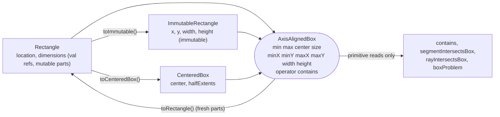

# Plan: `box-model` - `Square` becomes `Rectangle`, primitive box accessors, and `ImmutableRectangle`

- **Covers:**
  - [SpartanLaboratories/GeneralTools#8](https://github.com/SpartanLaboratories/GeneralTools/issues/8),
    *"Read-only views for Point and Square so libraries can expose geometry without copying"* - this unit
    resolves it, for boxes (scope in section 4).
  - [SpartanLaboratories/GeneralTools#7](https://github.com/SpartanLaboratories/GeneralTools/issues/7),
    *"Make GeneralTools Kotlin Multiplatform (Color and geometry usable from common code)"* - this unit is
    one of its eight; it carries break 6 of the break set.
- **Architecture:** [`architecture.md`](architecture.md), unit `box-model` (section 11.2 row 6), system S5
  (Box model) and the S6 intersection functions where they read the accessors.
- **Unit position:** 6 of 8 in the landing order (`kmp-build`, `explicit-api`, `logging`, `commonize`,
  `two-doubles`, **`box-model`**, `generaltools-breaks`, `release`). Depends on `commonize` and
  `two-doubles`.
- **Starts from:** the tree after `two-doubles`:
  - one multiplatform module, `explicitApi()` on, `abiValidation()` wired into `check`;
  - every geometry file in `src/commonMain/kotlin/geometry/`;
  - `TwoDoubles` unsealed, with final equality and `component1`/`component2`;
  - `src/commonMain/kotlin/geometry/ComponentEquality.kt` providing `internal fun componentEquals(a: Double,
    b: Double): Boolean` and `internal fun componentHash(value: Double): Int`;
  - the geometry tests in `src/commonTest/kotlin/com/spartanlabs/testing/component/geometry/`, including
    `SquareTest`, `AxisAlignedBoxTest`, `CenteredBoxTest`, `SegmentBoxIntersectionTest` and
    `RayBoxIntersectionTest`, with no slf4j field and no `@Tag`;
  - `master` (`c196d1a`) merged into the branch.
- **Branch:** `feat/issue-7-kotlin-multiplatform` (the shared feature branch; no branch of its own).
- **Commit:** TBD (three commits, section 10). **PR:** TBD.
- **Plan binding:** this document is committed in the same commit as stage (a), so `git log --follow` ties
  the plan to the code.
- **Status:** planning only. Nothing is uploaded or published until the maintainer explicitly starts the
  release (`release` unit).
- **Target release:** `3.0.0`.

---

## 1. Requirements

**R1. Break 6: `Square` is `Rectangle`.**
- `public data class Rectangle(public val location: Point = Point(), public val dimensions: Dimensions =
  Dimensions()) : AxisAlignedBox`. The two references are `val`; the `Point` and `Dimensions` they hold stay
  mutable.
- `min` returns `location` itself and `size` returns `dimensions` itself (the live parts, as in 2.x); `max`
  and `center` return fresh points.
- `copy()` is a shallow copy that shares the parts, and its KDoc says so. `toString` prints
  `Rectangle(...)`.
- The KDoc warns that a `Rectangle` used as a hash key must not change while it is in the collection.
- `Rectangle.toCenteredBox()` and `AxisAlignedBox.toRectangle()` replace the `Square` conversions.
  `toRectangle()` builds an independent mutable copy with fresh `Point` and `Dimensions` values.
- There is no `typealias Square`, no deprecated `toSquare()`, no other shim.

**R2. Additive: allocation-free primitive access.**
- `AxisAlignedBox` gains `minX`, `minY`, `maxX`, `maxY`, `width` and `height`, each with a default body
  derived from `min`/`max`/`size`.
- `contains` becomes `public infix operator fun`, so `p in box` and `box contains p` both compile. Its
  default body reads the primitives; a `NaN` anywhere gives `false`.
- `Rectangle` and `CenteredBox` override all six without allocating, and each returns exactly (bit for bit)
  the matching component of its own `min`/`max`/`size`.
- `segmentIntersectsBox`, `rayIntersectsBox` and the private `boxProblem` read the primitives instead of
  `min`/`max`/`size`. Their results and every exception message are byte-identical to 2.x.
- `AxisAlignedBox` is documented as a shape contract, not a read-only guarantee.

**R3. Additive: the immutable copy.**
- `public class ImmutableRectangle(public val x: Double, public val y: Double, override val width: Double,
  override val height: Double) : AxisAlignedBox` - final, Stable Core, no `data` modifier, with a
  hand-written `copy(x, y, width, height)`.
- `minX`/`minY` are `x`/`y`, `maxX = x + width`, `maxY = y + height`; `min`, `max`, `center` and `size`
  return a fresh value on every read.
- `equals`, `hashCode` and `toString` are hand-written to the `TwoDoubles` equality contract (IEEE-equal
  components except that NaN equals NaN; `-0.0` hashes like `0.0`), through `componentEquals` and
  `componentHash`. It is never equal to a `Rectangle` (or to any other type).
- `Rectangle.toImmutable()` returns it; `AxisAlignedBox.toRectangle()` converts back.

**R4. Issue #8 is resolved for boxes.** A library can hand its callers a box they cannot mutate with one
copy at construction and no copy per read, and the intersection functions read any `AxisAlignedBox` without
per-call allocation.

**Acceptance checks** (each is run by the commit that introduces it, section 10):

| # | Check | Proof |
|---|---|---|
| A1 | `grep -rnw "Square\|toSquare" src` prints nothing after (a); `README.md` mentions `Square` only in the migration rows | grep |
| A2 | `./gradlew check` is green on `jvmTest`, `jsNodeTest`, `wasmJsNodeTest` and `checkKotlinAbi` after each commit | build |
| A3 | The `api/GeneralTools.api` diff of each commit contains exactly the rows in section 10, nothing else | `git diff -- api/` against section 10 |
| A4 | `assertSame(rect.location, rect.min)` and `assertSame(rect.dimensions, rect.size)` pass | `RectangleTest` |
| A5 | Every accessor of every implementor (`Rectangle`, `CenteredBox`, `ImmutableRectangle`, a defaults-only box) equals the matching `min`/`max`/`size` component bit for bit | `AxisAlignedBoxAccessorContractTest` |
| A6 | `contains`, `segmentIntersectsBox` and `rayIntersectsBox` never read `min`/`max`/`size`/`center` of a box that overrides the primitives | `BoxPrimitiveReadsTest` |
| A7 | All existing intersection tests pass unchanged; the failure messages are the 2.x strings | existing suites, `BoxFailureMessagesTest` |
| A8 | `ImmutableRectangle` is never equal to a `Rectangle` with the same numbers; `0.0`/`-0.0` equal with equal hashes; NaN equals NaN | `ImmutableRectangleTest` |
| A9 | `rect.toImmutable().toRectangle() == rect` | `ImmutableRectangleTest` |

---

## 2. Current state

Baseline: `master` @ `17d30bc`, whose `src/main` equals tag `2.2.0`. Line numbers below are in today's
single-module sources; the units that land before this one move files and shift lines, so the implementer
locates each site by symbol.

**`Square`** (`src/main/kotlin/geometry/Square.kt`)
- `data class Square(var location: Point = Point(0.0, 0.0), var dimensions: Dimensions = Dimensions(0.0,
  0.0)) : AxisAlignedBox` at `:16-21`; both references are `var`.
- `min` returns `location` itself (`:23`); `size` returns `dimensions` itself (`:34`); `max` (`:26-27`) and
  `center` (`:30-31`) build new `Point`s. The KDoc at `:3-15` says "The fields and constructor are unchanged,
  so this is purely additive" and describes `min`/`size` as the live parts.
- The file declares no top-level function, so its JVM facade does not exist and the rename moves none.

**`AxisAlignedBox`** (`AxisAlignedBox.kt`)
- `interface AxisAlignedBox` at `:14-37`: abstract `min`, `max`, `center`, `size`, and `infix fun
  contains(p: Point)` with a body that reads `min.x`, `max.x`, `min.y`, `max.y` (`:35-36`), allocating on any
  box that builds them per read.
- The KDoc at `:3-13` calls it a "Read-only contract" and names `Square` (`:5`, `:11`).

**`CenteredBox`** (`CenteredBox.kt`)
- `data class CenteredBox(override val center: Point, val halfExtents: Dimensions)` at `:22-25`. `min`
  (`:27-28`), `max` (`:31-32`) and `size` (`:35-36`, `Dimensions(halfExtents.width * 2, halfExtents.height *
  2)`) build a fresh value on each read. The companion `fromCorners` (`:38-58`) has locals named `minX`,
  `minY`, `maxX`, `maxY`; they sit in the companion, so the new instance properties do not collide with them.
- `Square.toCenteredBox()` (`:67-71`) and `AxisAlignedBox.toSquare()` (`:79-80`) are top-level functions, so
  their JVM facade is `CenteredBoxKt`, which keeps its name.
- KDoc names `Square` at `:7`, `:62`, `:76`; lines `:12-13` refer to "plan section 7 / decision D-mut", a
  process reference inside public KDoc.

**`Intersections.kt`**
- `segmentIntersectsBox` (`:131-170`): `boxProblem(box)` first; then a degenerate-segment check; then
  `box contains s.a || box contains s.b` (`:145`); then the slab test reading `box.min.x`, `box.max.x`,
  `box.min.y`, `box.max.y` (`:158-166`).
- `rayIntersectsBox` (`:188-237`): `boxProblem`; a finite-corner check reading `box.min.x`, `box.min.y`,
  `box.max.x`, `box.max.y` (`:193`) whose WARN line prints `box.min` and `box.max` (`:194`); ray checks; the
  slab test reading the same four values (`:222-230`).
- `boxProblem` (`:249-258`): `val size = box.size`; returns `"Box size must be finite"` when
  `size.containsNaN` or either component is not finite, `"Box size must be non-negative"` when either is
  negative, else `null`.
- On a `CenteredBox` that is up to nine allocations per `rayIntersectsBox` call and thirteen per
  `segmentIntersectsBox` call (`research/mutable-geometry-model.md` section 3.4; reasoned from the code, not
  measured).
- KDoc names `Square` at `:121`, `:175` and says "only [AxisAlignedBox.min] / [AxisAlignedBox.max] are
  read".

**Tests** (today's paths; `commonize` moves them to `src/commonTest/kotlin/com/spartanlabs/testing/component/geometry/`)
- `src/test/kotlin/geometry/SquareTest.kt`: four tests; the last assigns `square.location = Point(9.0, 9.0)`
  (`:39`).
- `AxisAlignedBoxTest.kt`: imports `Square` (`:7`); `private val square` (`:23`); test name
  `Square satisfies the AxisAlignedBox contract` (`:37`).
- `CenteredBoxTest.kt`: imports `Square` (`:6`) and `toSquare` (`:8`); `Square(...)` at `:56`, `:64`; test
  name `toCenteredBox then toSquare round-trips the footprint` (`:62`).
- `SegmentBoxIntersectionTest.kt`: import (`:8`), `squareBox` (`:29`); test name `the CenteredBox and the
  equivalent Square agree` (`:87`).
- `RayBoxIntersectionTest.kt`, `SegmentSegmentIntersectionTest.kt` and `RayTest.kt` do not name `Square`.
- No test asserts any box failure message today.

**Documentation.** `README.md` names `Square` in the Modules list (`:37`) and the Geometry quick reference
(`:108`, `:111-114`).

**Other users of the name.** `UserActions.kt` imports `java.awt.Rectangle` explicitly (`:6`) and nothing
from `com.spartanlabs.geometry`, so the new `com.spartanlabs.geometry.Rectangle` never collides with it.
Downstream (read-only): MyGameTools names `Square` on 39 lines in 14 files and MyGameClient on 27 lines in 8
files; neither reads `Square.min` or `size`, neither implements `AxisAlignedBox`.

**Verified facts this unit rests on**
- Kotlin 2.2 compiles an interface member with a body as a JVM default method and keeps a
  `$DefaultImpls` class and class-side bridges for compatibility (`research/mutable-geometry-model.md`,
  claim 14; the build does not set `-jvm-default`: no occurrence in `build.gradle.kts` or
  `gradle.properties` at the baseline).
- `CenteredBox.contains` is an `invokespecial` bridge to the interface default in 2.2.0
  (`research/downstream-under-mutable-model.md` section 3.5), which is why the 2.2.0 `Square` has 19 dump
  members including `contains`.
- A `data class` over `var`s generates `setLocation`/`setDimensions`; over `val`s it does not.

---

## 3. Assumptions

| # | Assumption | If false |
|---|---|---|
| A10 | `ImmutableRectangle` has no constructor defaults, and the dump counts follow the member lists in section 10 (`Rectangle` 17 after (a), 23 after (b), 24 after (c); `ImmutableRectangle` 19). Resolved here: the constructor takes four required parameters (section 5.4). | The ledger counts in architecture section 11.3 are corrected from the generated dump; the public shape is not affected. |
| B1 | The build leaves `-jvm-default` at the Kotlin 2.2 default, so `AxisAlignedBox$DefaultImpls` and class-side bridges appear as in section 10. | The `$DefaultImpls` rows are absent or the bridge counts differ; the ledger rows for the additive accessors are corrected, the source is not. |
| B2 | A klib dump (`api/GeneralTools.klib.api`) lists the six properties and their getters for `AxisAlignedBox`, `Rectangle`, `CenteredBox` and `ImmutableRectangle`, and may or may not record the `operator` modifier. The plan predicts no klib line counts. | None; the implementer reviews the klib diff line by line against the same intent as the JVM diff. |
| B3 | Doubles built from `0.1`/`0.2`/`0.4` sums and halvings give the literal IEEE results used in `BoxAccessorTableTest` on all three targets. | A literal that differs on one target is a finding about that target, to be reported; the test is not loosened. |
| B4 | No consumer class implements `AxisAlignedBox` and declares `width`/`height`/`minX`/`minY`/`maxX`/`maxY` (grep over MyGameTools, MyGameClient, MyGameServer, WebTools and SpartanGraphics found none). | The implementor needs `override` or a rename; the migration row added in (b) covers it. |

---

## 4. Non-goals

- **Issue #8's scope.** `Point` and `Dimensions` stay mutable with no read-only view and no immutable twin.
  `Segment`, `Ray` and `CenteredBox` keep their "treat as immutable" KDoc and shapes. There are no
  `ReadOnlyPoint`, `ReadOnlyDimensions`, `ReadOnlySquare` or other read-only view types, and no immutable
  `Point`. #8 is resolved for boxes: `ImmutableRectangle`, `toImmutable()` and the allocation-free accessors.
- `Rectangle.min` and `size` returning copies.
- Arithmetic operators on boxes (translation, scaling).
- `Rectangle.setTo` or any other setter; center primitives (`centerX`, `centerY`).
- `toImmutable()` for every `AxisAlignedBox`, including `CenteredBox` (named follow-up, section 12; #13).
- A deprecated `typealias Square = Rectangle`, a deprecated `toSquare()`, or any other shim.
- Parameterising `EPSILON` or the intersection tolerances (issue #11).
- A compile-fail test for the `val` references (issue #12 tracks the harness).
- Migrating MyGameTools, MyGameClient or any other downstream repository; filing anything against them.
- The `Point`/`Dimensions` equality contract, `componentEquals`/`componentHash` themselves, the failure
  helper and the arithmetic package (sibling units). This unit never imports
  `com.spartanlabs.geometry.arithmetic`.

---

## 5. Design

### 5.1 Shape



`Rectangle` is the one place callers alias library state on purpose (live `location`, `dimensions`, and
through them `min` and `size`); `toImmutable()` is the cut.

### 5.2 Principles applied

- **One source of truth per implementor.** Where an implementor can derive `min`/`max`/`size` from its
  primitives, it does (`CenteredBox`, `ImmutableRectangle`, and `Rectangle.max`): `min = Point(minX, minY)`,
  `max = Point(maxX, maxY)`, `size = Dimensions(width, height)`. The accessor equals the matching component
  by construction, so the "same expression" invariant cannot drift. `Rectangle.min`/`size` cannot be
  derived: they must return the live parts.
- **Open by default, closed where the invariant lives.** `AxisAlignedBox` stays open (an implementor adds
  its own storage and overrides the six accessors); `Rectangle` and `ImmutableRectangle` are final.
- **Expected failures versus programmer error.** Nothing new in this unit fails at runtime. Constructors and
  conversions accept any `Double`; an unusable box (negative or non-finite size) is reported where it is
  used, by the existing `Result.failure(IllegalArgumentException)` of the intersection functions. The only
  programmer error is an implementor that derives `min` from `minX` and also leaves `minX` at its default
  (infinite recursion); the `AxisAlignedBox` KDoc forbids it and `AxisAlignedBoxAccessorContractTest` covers
  the legitimate defaults-only case.
- **Immutability and concurrency.** `ImmutableRectangle` has four `val` `Double` fields (final on the JVM,
  so safely published); it is safe to share across threads. `Rectangle` and the `Point`/`Dimensions` it holds
  are unsynchronised, as in 2.x. The tests that count reads use a mutable counter in a test-private class.

### 5.3 Signatures and their failure behaviour

| Signature | Returns on failure | Expected failures (`Result`) | Programmer error (throws) | Where a `Result` is unwrapped |
|---|---|---|---|---|
| `AxisAlignedBox.minX/minY/maxX/maxY/width/height: Double` (`val`, default body) | cannot fail; yields NaN, infinities or negatives if the box holds them | none | none, except the derive-min-from-minX recursion noted above | n/a |
| `AxisAlignedBox.contains(p: Point): Boolean` (`infix operator`) | `false` when `p` or the box has a NaN | none | none | n/a |
| `Rectangle(location, dimensions)`, `Rectangle.copy`, `Rectangle.toImmutable(): ImmutableRectangle` | cannot fail | none (no validation, like `Point`/`CenteredBox`) | none | n/a |
| `ImmutableRectangle(x, y, width, height)`, `copy(...)`, `min`/`max`/`center`/`size`, `equals`, `hashCode`, `toString` | cannot fail | none | none | n/a |
| `Rectangle.toCenteredBox(): CenteredBox`, `AxisAlignedBox.toRectangle(): Rectangle` | cannot fail | none | none | n/a |
| `segmentIntersectsBox(...)`, `rayIntersectsBox(...)` | unchanged: `Result.failure(IllegalArgumentException(<2.x message>))` | degenerate or non-finite segment/ray, unusable box | none | by callers (`getOrThrow`/`fold`); tests use `getOrThrow` and `fold` |
| `private fun boxProblem(box: AxisAlignedBox): String?` | `null` means "no problem"; a non-null message becomes the `Result.failure` | the two 2.x box messages | none | consumed by `?.let` in the two callers |

### 5.4 `ImmutableRectangle` constructor shape (A10)

The four parameters are required: `ImmutableRectangle(x, y, width, height)`.

- A default-constructed immutable rectangle is an empty box at the origin, which has no use as an immutable
  value; `Rectangle()` has defaults because a mutable value is built and then filled. With defaults,
  `ImmutableRectangle(x = 1.0, y = 2.0)` compiles to a zero-size box when the size was forgotten; without
  them it is a compile error.
- Adding defaults later is source- and binary-compatible (additive); removing them is a break. Starting
  without is the reversible choice.
- Defaults would add a no-argument `<init> ()V` and the synthetic `<init> (DDDDILkotlin/jvm/internal/
  DefaultConstructorMarker;)V` to the dump (19 members become 21), for a constructor nothing needs.
- `copy` keeps defaults (`copy(x = this.x, ...)`): it is the "change some components" operation, where each
  default is the existing value.

### 5.5 Sequencing inside the unit

Three commits, each building and passing on its own: (a) rename, (b) accessors and `operator contains`,
(c) `ImmutableRectangle`. KDoc that would point at a symbol from a later commit does not: (a)'s hash-key
warning names no `toImmutable()`, and (c) amends the KDoc of `Rectangle` and `AxisAlignedBox` to point at it.

---

## 6. File-by-file changes

Paths are the post-`commonize` paths. Edits are described against the state in "Starts from".

### 6.1 Commit (a): the rename (break 6)

**`src/commonMain/kotlin/geometry/Square.kt` -> `src/commonMain/kotlin/geometry/Rectangle.kt`** (`git mv`, then
edit; history follows the file).

```kotlin
package com.spartanlabs.geometry

/**
 * An axis-aligned rectangle defined by a top-left [location] and its [dimensions]; the mutable box form.
 *
 * [location] is the **top-left corner** - the [min] corner in [AxisAlignedBox] terms. For centre-origin work
 * use [CenteredBox], or convert with [toCenteredBox].
 *
 * **Mutability.** [location] and [dimensions] are `val` references: a holder cannot swap them. The [Point]
 * and [Dimensions] they hold are mutable and stay so; change them in place
 * (`rectangle.location.setTo(...)`), and every holder of this `Rectangle`, or of the same part instance,
 * sees the change. [min] returns [location] itself and [size] returns [dimensions] itself - the live
 * parts - while [max] and [center] return new points. A `Rectangle` handed out as an [AxisAlignedBox]
 * therefore still exposes its live parts through `min` and `size`.
 *
 * **Copying.** [copy] is a shallow copy: the copy shares this rectangle's [location] and [dimensions]
 * instances. `Rectangle(Point(location), Dimensions(dimensions))`, or `toRectangle()` on any
 * [AxisAlignedBox], builds an independent mutable copy.
 *
 * **Equality.** [equals] and [hashCode] follow the current values of the parts. A `Rectangle` used as a key
 * in a hash-based collection must not be changed - through [location], [dimensions], [min] or [size] -
 * while it is in the collection.
 *
 * Nothing is validated: a negative or `NaN` size is accepted here and reported by the intersection
 * functions, which return a failed `Result` for it.
 *
 * @property location the top-left (minimum-x, minimum-y) corner; a live, mutable [Point].
 * @property dimensions the width and height; a live, mutable [Dimensions].
 */
public data class Rectangle(
    public val location: Point = Point(x = 0.0, y = 0.0),
    public val dimensions: Dimensions = Dimensions(width = 0.0, height = 0.0),
) : AxisAlignedBox {
    /** The top-left corner, i.e. [location] itself (not a copy). */
    override val min: Point get() = location

    /** The bottom-right corner, `location + dimensions`, as a new point on every read. */
    override val max: Point
        get() = Point(location.x + dimensions.width, location.y + dimensions.height)

    /** The geometric centre, `location + dimensions / 2`, as a new point on every read. */
    override val center: Point
        get() = Point(location.x + dimensions.width / 2.0, location.y + dimensions.height / 2.0)

    /** The width and height, i.e. [dimensions] itself (not a copy). */
    override val size: Dimensions get() = dimensions
}
```

- Failure behaviour: none; construction and every member are total. Mutability: the two references are
  `val`; the parts are mutable; the properties are computed, not stored.
- Removals: the setters `setLocation`/`setDimensions` (they follow from `var` -> `val`); the name `Square`.
- Logging: none. Constructors, accessors and equality are hot, allocation-conscious paths and report no
  event; the intersection functions that consume a `Rectangle` keep their WARN lines.
- Dump: section 10, commit (a).

**`geometry/AxisAlignedBox.kt`** - KDoc only: replace `[Square]` with `[Rectangle]` at the two places
(`:5`, `:11`). The "Read-only contract" wording stays until (b) rewrites it.

**`geometry/CenteredBox.kt`**
- KDoc: `[Square]` -> `[Rectangle]` at `:7` and in the converter docs (`:62`, `:76`). Delete the process
  reference at `:12-13` ("see plan section 7 / decision D-mut"); the sentence "Treat `CenteredBox` as
  immutable" stays. Add a one-line KDoc to the companion object, which has none today ("Factories for
  [CenteredBox]").
- Code:

```kotlin
/**
 * This [Rectangle] as a [CenteredBox] covering the same footprint (same [Rectangle.min] and [Rectangle.max]).
 *
 * @receiver the rectangle to convert; not changed.
 * @return a new centre-origin box over the same area. It shares no part with the receiver.
 */
public fun Rectangle.toCenteredBox(): CenteredBox =
    CenteredBox(
        Point(location.x + dimensions.width / 2.0, location.y + dimensions.height / 2.0),
        Dimensions(dimensions.width / 2.0, dimensions.height / 2.0),
    )

/**
 * This box as a top-left-origin [Rectangle] covering the same footprint.
 *
 * @receiver any [AxisAlignedBox]; not changed.
 * @return an independent, mutable [Rectangle] whose `location` is a new [Point] holding [AxisAlignedBox.min]
 *   and whose `dimensions` is a new [Dimensions] holding [AxisAlignedBox.size]; later changes to either
 *   side do not reach the other.
 */
public fun AxisAlignedBox.toRectangle(): Rectangle =
    Rectangle(Point(min.x, min.y), Dimensions(size.width, size.height))
```

  The facade stays `CenteredBoxKt`. Both functions are total.

**`geometry/Intersections.kt`** - KDoc only: `[Square]` -> `[Rectangle]` at `:121`, `:175`.

**README.md** (same commit)
- Modules: the `AxisAlignedBox` bullet becomes "shared box contract, implemented by `Rectangle` (top-left
  origin) and `CenteredBox` (centre origin)".
- Geometry quick reference: replace the `Square(location, dimensions)` bullet with `Rectangle(location,
  dimensions)` - top-left origin; `location` and `dimensions` are `val` references to mutable parts, changed
  in place (`rect.location.setTo(...)`); `min`/`size` return those live parts, `max`/`center` return new
  points; `copy()` shares the parts; a `Rectangle` or `Point` used as a hash key must not change while in the
  collection. The `AxisAlignedBox` paragraph names `Rectangle` and the conversions
  `Rectangle.toCenteredBox()` / `AxisAlignedBox.toRectangle()` (an independent mutable copy).
- `## 3.0.0 migration notes` table, append:

| Symptom | Cause | Fix |
|---|---|---|
| `Unresolved reference: Square` (or `toSquare`) | `Square` is renamed `Rectangle`, and `AxisAlignedBox.toSquare()` is `toRectangle()`. No deprecated alias exists. | Rename imports and uses; `Rectangle(location, dimensions)` has the same constructor and members. |
| `Val cannot be reassigned` on `r.location = p` or `r.dimensions = d` | `Rectangle.location` and `.dimensions` are `val`. | `r.location.setTo(p)` / `r.dimensions.setTo(d)`. This copies the values into the existing part instead of adopting the instance you pass: a later change to `p` or `d` does not reach `r`, and every other holder of the old part sees the new values. |
| `Rectangle` names the wrong class, or is reported as ambiguous, in a file that also uses `java.awt.Rectangle` or another `Rectangle` | The new name is shared with those types. | Import one under an alias: `import com.spartanlabs.geometry.Rectangle as GeoRectangle`. |
| A string or log assertion on `toString()` fails: `Rectangle(location=..., dimensions=...)` where 2.x printed `Square(...)` | The class is renamed. | Update the expected text. |

**Tests** - see section 8: `RectangleTest` (renamed), `AxisAlignedBoxTest`, `CenteredBoxTest`,
`SegmentBoxIntersectionTest`.

### 6.2 Commit (b): the accessors and `operator contains`

**`geometry/AxisAlignedBox.kt`** - rewritten:

```kotlin
package com.spartanlabs.geometry

/**
 * The shape contract common to every axis-aligned rectangle in this package, however it stores its origin:
 * top-left for [Rectangle], centre for [CenteredBox].
 *
 * **A shape contract, not a read-only guarantee.** The interface has no setters, but the values it returns
 * need not be copies: a [Rectangle] handed out as an `AxisAlignedBox` still exposes its live
 * [Rectangle.location] and [Rectangle.dimensions] through [min] and [size], and a [CenteredBox] exposes its
 * stored [center]. To give callers a box they cannot change, hand out a copy.
 *
 * **Primitive accessors.** [minX], [minY], [maxX], [maxY], [width] and [height] read one coordinate without
 * building a [Point] or [Dimensions]. Their default bodies derive them from [min], [max] and [size] (and
 * allocate if those are built per read), so an existing implementor keeps compiling. An implementor that
 * stores scalars should override all six without allocating. Every accessor must return exactly - bit for
 * bit - the matching component: `minX == min.x`, `minY == min.y`, `maxX == max.x`, `maxY == max.y`,
 * `width == size.width`, `height == size.height`. [contains], [segmentIntersectsBox] and
 * [rayIntersectsBox] read only the accessors. An implementor must not define [min], [max] or [size] in terms
 * of the accessors while also leaving those accessors at their defaults; that recurses without end.
 *
 * Adding the six accessors in 3.0.0 breaks an implementor only if it already declares a member with one of
 * these names.
 */
public interface AxisAlignedBox {
    /** The corner with the smallest `x` and `y`. */
    public val min: Point

    /** The corner with the largest `x` and `y`. */
    public val max: Point

    /** The geometric centre, `(min + max) / 2`. */
    public val center: Point

    /** Width and height (`max - min`); non-negative for a valid box. */
    public val size: Dimensions

    /**
     * The smallest `x`; defaults to `min.x`.
     *
     * @since 3.0.0
     */
    public val minX: Double get() = min.x

    /**
     * The smallest `y`; defaults to `min.y`.
     *
     * @since 3.0.0
     */
    public val minY: Double get() = min.y

    /**
     * The largest `x`; defaults to `max.x`.
     *
     * @since 3.0.0
     */
    public val maxX: Double get() = max.x

    /**
     * The largest `y`; defaults to `max.y`.
     *
     * @since 3.0.0
     */
    public val maxY: Double get() = max.y

    /**
     * The horizontal extent; defaults to `size.width`.
     *
     * @since 3.0.0
     */
    public val width: Double get() = size.width

    /**
     * The vertical extent; defaults to `size.height`.
     *
     * @since 3.0.0
     */
    public val height: Double get() = size.height

    /**
     * Whether [p] lies inside this box or on its boundary
     * (`minX <= p.x <= maxX` and `minY <= p.y <= maxY`). Usable as `p in box` and `box contains p`.
     *
     * @param p the point to test.
     * @return `true` if [p] is inside or on the edge; `false` otherwise, including when any coordinate
     *   involved is `NaN`.
     */
    public infix operator fun contains(p: Point): Boolean =
        p.x >= minX && p.x <= maxX && p.y >= minY && p.y <= maxY
}
```

The `operator` modifier is not recorded in the JVM dump.

**`geometry/Rectangle.kt`** - add the six overrides and derive `max` from them:

```kotlin
/** The smallest `x`, `location.x`. */
override val minX: Double get() = location.x
/** The smallest `y`, `location.y`. */
override val minY: Double get() = location.y
/** The largest `x`, `location.x + dimensions.width`. */
override val maxX: Double get() = location.x + dimensions.width
/** The largest `y`, `location.y + dimensions.height`. */
override val maxY: Double get() = location.y + dimensions.height
/** The horizontal extent, `dimensions.width`. */
override val width: Double get() = dimensions.width
/** The vertical extent, `dimensions.height`. */
override val height: Double get() = dimensions.height

override val max: Point get() = Point(maxX, maxY)   // was Point(location.x + dimensions.width, ...): same values
```

`min`, `size` and `center` are unchanged. No override allocates. The values are the same expressions `max`
used, so they are bit-identical.

**`geometry/CenteredBox.kt`**

```kotlin
override val minX: Double get() = center.x - halfExtents.width
override val minY: Double get() = center.y - halfExtents.height
override val maxX: Double get() = center.x + halfExtents.width
override val maxY: Double get() = center.y + halfExtents.height
override val width: Double get() = halfExtents.width * 2
override val height: Double get() = halfExtents.height * 2

override val min: Point get() = Point(minX, minY)
override val max: Point get() = Point(maxX, maxY)
override val size: Dimensions get() = Dimensions(width, height)
```

- The accessor expressions are the ones `min`/`max`/`size` used (`halfExtents.width * 2` keeps its `Int`
  literal); `min`/`max`/`size` now call them, so agreement holds by construction. `center` stays the stored
  field. `fromCorners` is untouched.
- `AxisAlignedBox.toRectangle()` reads the primitives: `Rectangle(Point(minX, minY), Dimensions(width,
  height))`. The values are identical to the `min`/`size` form; the change drops two intermediate
  allocations on a `CenteredBox` and keeps `Rectangle` and `ImmutableRectangle` receivers allocation-light.
  `Rectangle.toCenteredBox()` is unchanged (it already reads the fields directly).

**`geometry/Intersections.kt`**
- Leave every `failure(...)` call, message and `detail` exactly as `logging` wrote it.
- `segmentIntersectsBox`: keep `box contains s.a || box contains s.b` as is (the default `contains` now reads
  the accessors). After that early return, read each primitive once and use it in the slab test:

```kotlin
val boxMinX = box.minX; val boxMaxX = box.maxX
val boxMinY = box.minY; val boxMaxY = box.maxY
val tx1 = (boxMinX - s.a.x) * invDx
val tx2 = (boxMaxX - s.a.x) * invDx
// ... same min/max folding ...
val ty1 = (boxMinY - s.a.y) * invDy
val ty2 = (boxMaxY - s.a.y) * invDy
```
- `rayIntersectsBox`: replace the finite-corner test by `!box.minX.isFinite() || !box.minY.isFinite() ||
  !box.maxX.isFinite() || !box.maxY.isFinite()` (reading each once into the same four locals and reusing
  them in the slab test). The WARN `detail` for that site keeps printing `box.min` and `box.max`: it runs only
  when WARN is enabled on a failing call, and keeping it leaves the log line byte-identical.
- `boxProblem`:

```kotlin
private fun boxProblem(box: AxisAlignedBox): String? {
    val width = box.width
    val height = box.height
    // NaN is not finite, so this one test covers the 2.x "contains NaN or is infinite" condition.
    if (!width.isFinite() || !height.isFinite()) return "Box size must be finite"
    if (width < 0.0 || height < 0.0) return "Box size must be non-negative"
    return null
}
```
- KDoc: replace "only [AxisAlignedBox.min] / [AxisAlignedBox.max] are read" with "only the primitive
  accessors ([AxisAlignedBox.minX], [AxisAlignedBox.minY], [AxisAlignedBox.maxX], [AxisAlignedBox.maxY], and
  [AxisAlignedBox.width]/[AxisAlignedBox.height] for validation) are read, so a box that overrides them is
  queried without allocating".
- Logging events: unchanged - WARN on `com.spartanlabs.geometry.Intersections` at every existing failure
  site, message and detail as before. No new event.

**README.md** (same commit)
- Geometry quick reference: the `AxisAlignedBox` paragraph lists `min`, `max`, `center`, `size`, the six
  accessors (`minX`, `minY`, `maxX`, `maxY`, `width`, `height`: no allocation on `Rectangle`/`CenteredBox`)
  and `contains(p)` (`p in box` or `box contains p`), and states "a shape contract, not a read-only
  guarantee".
- Migration table, append:

| Symptom | Cause | Fix |
|---|---|---|
| A class implementing `AxisAlignedBox` stops compiling after declaring `width`, `height`, `minX`, `minY`, `maxX` or `maxY` | `AxisAlignedBox` now has these six members with default bodies. | Add `override` and return the box's own value, or rename your member. |

### 6.3 Commit (c): the immutable copy

**`geometry/ImmutableRectangle.kt`** - new.

```kotlin
package com.spartanlabs.geometry

/**
 * An immutable axis-aligned rectangle: a top-left corner ([x], [y]) and a size ([width], [height]).
 * Use it to hand a box to callers who must not change it: copy once with [Rectangle.toImmutable] when the
 * box is built, then return the copy on every read - no per-read copy is needed.
 *
 * - **Immutable.** All four values are fixed at construction; [min], [max], [center] and [size] return a
 *   new [Point]/[Dimensions] on every read, so changing a returned value cannot reach the rectangle.
 *   Safe to share between threads.
 * - **Value equality.** [equals] and [hashCode] follow the same contract as [Point] and [Dimensions]:
 *   components are IEEE-equal except that `NaN` equals `NaN`, and `-0.0` equals and hashes like `0.0`. An
 *   `ImmutableRectangle` is never equal to a [Rectangle], a [CenteredBox] or any other type, even over the
 *   same numbers; compare footprints through [toRectangle] or the accessors. It is a stable hash key.
 * - **Unvalidated.** Negative, `NaN` and infinite components are accepted, as in [Rectangle] and
 *   [CenteredBox]; the intersection functions return a failed `Result` for an unusable size.
 * - **[toString]** prints `ImmutableRectangle(x=..., y=..., width=..., height=...)` with each number in the
 *   platform's own format (on JavaScript, `1.0` prints as `1`).
 *
 * @property x the smallest `x` (the left edge).
 * @property y the smallest `y` (the top edge in this library's top-left convention).
 * @property width the horizontal extent.
 * @property height the vertical extent.
 * @since 3.0.0
 */
public class ImmutableRectangle(
    public val x: Double,
    public val y: Double,
    override val width: Double,
    override val height: Double,
) : AxisAlignedBox {
    override val minX: Double get() = x
    override val minY: Double get() = y
    override val maxX: Double get() = x + width
    override val maxY: Double get() = y + height

    /** The low corner `(x, y)`, as a new point on every read. */
    override val min: Point get() = Point(minX, minY)
    /** The high corner `(x + width, y + height)`, as a new point on every read. */
    override val max: Point get() = Point(maxX, maxY)
    /** The centre `(x + width / 2, y + height / 2)`, as a new point on every read. */
    override val center: Point get() = Point(x + width / 2.0, y + height / 2.0)
    /** The size `(width, height)`, as a new value on every read. */
    override val size: Dimensions get() = Dimensions(width, height)

    /**
     * A copy with the named components replaced and the rest kept.
     * @return a new `ImmutableRectangle`; this instance is unchanged.
     */
    public fun copy(
        x: Double = this.x,
        y: Double = this.y,
        width: Double = this.width,
        height: Double = this.height,
    ): ImmutableRectangle = ImmutableRectangle(x, y, width, height)

    override fun equals(other: Any?): Boolean =
        this === other || (other is ImmutableRectangle &&
            componentEquals(x, other.x) && componentEquals(y, other.y) &&
            componentEquals(width, other.width) && componentEquals(height, other.height))

    override fun hashCode(): Int =
        ((componentHash(x) * 31 + componentHash(y)) * 31 + componentHash(width)) * 31 + componentHash(height)

    override fun toString(): String = "ImmutableRectangle(x=$x, y=$y, width=$width, height=$height)"
}
```

- Failure behaviour: every member is total; there is no `Result`. The class is final, so `other is
  ImmutableRectangle` makes it never equal to a subtype or another box type. `hashCode` is a pure expression
  (no allocation, no mutable local). It does not fold in a class marker: the class is final and only equal
  to itself.
- `x`, `y`, `width`, `height` are the stored fields; `minX` equals `x` and `maxX` equals `x + width` by
  definition, `center` uses the same expression as `Rectangle.center`, so a `Rectangle` and its
  `toImmutable()` copy report bit-identical values.
- Logging: none (value type; no lifecycle, no failure).

**`geometry/Rectangle.kt`**
- Add:

```kotlin
/**
 * An immutable copy of this rectangle's current values, for handing out or for use as a hash key.
 *
 * The copy takes the four numbers now; it shares no part with this rectangle, so later changes to
 * [location] or [dimensions] do not reach it, and changes to it are impossible.
 *
 * @return a new [ImmutableRectangle] with `x = location.x`, `y = location.y`, `width = dimensions.width`,
 *   `height = dimensions.height`.
 * @since 3.0.0
 */
public fun toImmutable(): ImmutableRectangle = ImmutableRectangle(minX, minY, width, height)
```
- KDoc: the Equality paragraph's hash-key warning now ends "... use [toImmutable] for a key that cannot
  change"; the Copying paragraph also names `toImmutable().toRectangle()` as an independent mutable copy.
  Total; allocates one object.

**`geometry/AxisAlignedBox.kt`** - KDoc only: the class summary adds "origin-plus-size for
[ImmutableRectangle]"; the shape-contract paragraph ends with "To give callers a box they cannot change, copy
it once with [Rectangle.toImmutable] and hand out the [ImmutableRectangle]".

**`geometry/CenteredBox.kt`** - KDoc of `toRectangle` mentions that an [ImmutableRectangle] converts back
the same way. No code change.

**README.md** (same commit)
- Modules: the `AxisAlignedBox` bullet lists `Rectangle`, `ImmutableRectangle` and `CenteredBox`.
- Geometry quick reference: add the `ImmutableRectangle(x, y, width, height)` bullet (immutable; `copy(...)`;
  value equality including `-0.0`/NaN; never equal to a `Rectangle`) and `Rectangle.toImmutable()` /
  `AxisAlignedBox.toRectangle()`, with the hand-out example:

```kotlin
class Zone(bounds: Rectangle) {
    val bounds: ImmutableRectangle = bounds.toImmutable()   // one copy at construction, none per read
}
val key = zone.bounds                                        // a stable hash key
val inside = Point(1.0, 2.0) in zone.bounds                  // allocation-free
```
- No migration row: `ImmutableRectangle` and `toImmutable()` are additions with nothing to migrate.

### 6.4 Files this unit does not touch

`TwoDoubles.kt`, `Point.kt`, `ComponentEquality.kt` (consumed), `Segment.kt`, `Ray.kt`, `Vectors.kt`, `Color.kt`,
`Misc*.kt`, `UserActions.kt`, `build.gradle.kts`, `Build.yml`. `Segment`/`Ray` keep their "treat as immutable"
KDoc.

---

## 7. Documentation impact

**Ring 1 (in editor).** The existing `//region` structure in `Intersections.kt` stays. One Level-1 comment
above the slab reads in each of `segmentIntersectsBox` and `rayIntersectsBox` ("each primitive is read once;
a box that overrides the accessors is not allocated per call") and the NaN comment in `boxProblem`. No
`TODO`/`FIXME` is left behind.

**Ring 2 (KDoc).** Level 2 on every public declaration added or changed:

| Declaration | Commit | Must state |
|---|---|---|
| `Rectangle` (class + `@property`s), `min`, `max`, `center`, `size` | (a) | `val` references, mutable parts, live `min`/`size`, fresh `max`/`center`, shallow `copy()`, hash-key warning, no validation |
| `Rectangle.toCenteredBox`, `AxisAlignedBox.toRectangle` | (a) | `@receiver`, `@return`, independence of the result |
| `AxisAlignedBox` (class), six accessors, `contains` | (b) | shape contract not read-only; accessor agreement bit for bit; defaults allocate, overrides need not; recursion warning; `@since 3.0.0`; `p in box`; NaN gives `false` |
| `Rectangle` six overrides | (b) | the expression each returns |
| `CenteredBox` six overrides | (b) | the expression each returns |
| `ImmutableRectangle` (class, `copy`, `min`/`max`/`center`/`size`) | (c) | immutability, equality contract, never equal to another type, unvalidated, `toString` format and platform number format, fresh values, `@since 3.0.0` |
| `Rectangle.toImmutable` | (c) | copy semantics, `@return`, `@since 3.0.0` |

The KDoc that names `Square` is rewritten: `AxisAlignedBox.kt:5,11`, `CenteredBox.kt:7,62,76`,
`Intersections.kt:121,175` (today's numbering), plus `Square.kt:4-15`, the `Square` class summary.

**Ring 3 (boundary / integration).** Documented in the same KDoc and in the README migration notes:
- `Rectangle` is the one shared-mutable-state boundary between the library and its callers (live parts);
  `toImmutable()` is the cut.
- The hash-key hazard of a mutable value; the safe key.
- `toString` prints numbers in the platform's own format (JavaScript prints `1.0` as `1`).
- A source break for an `AxisAlignedBox` implementor that already declares one of the six names.
- WARN failure lines of the intersection functions, their logger name and their messages are unchanged.

**Ring 4 (architecture).** No change to `architecture.md`. If a generated dump count differs from section 10
the deviation goes into `final-implementation.md` at the moment it is found, and the `release` unit corrects
the ledger. The Mermaid diagram in section 5.1 is the topology of this unit.

**README currency.** The README changes in all three commits, each in the same commit as the code that
invalidates it (sections 6.1-6.3). Sections touched: Modules, Geometry quick reference, 3.0.0 migration notes.

---

## 8. Test plan

All new tests are `kotlin.test` classes in `commonTest`, one class per file, with no slf4j field and no
`@Tag`, each with a KDoc line naming its level. They therefore run on `jvmTest`, `jsNodeTest` and
`wasmJsNodeTest`. MockK is JVM-only and is not used: every collaborator is a pure value.

### 8.1 Level 1 - local gating

No test class lives at `testing.gating`; the level is the sequence run before each commit (bash; in
PowerShell use `.\gradlew`):

```sh
./gradlew jvmTest -PtestLevel=component,deterministic,e2e   # fast JVM loop while editing
./gradlew updateKotlinAbi                                    # regenerate api/GeneralTools.api and .klib.api
git diff -- api/                                             # review against the rows in section 10
./gradlew check                                              # jvmTest + jsNodeTest + wasmJsNodeTest + checkKotlinAbi
grep -rnw "Square\|toSquare" src                             # after (a): prints nothing
```

### 8.2 Level 2 - isolated component behaviour (`testing.component.geometry`)

Directory: `src/commonTest/kotlin/com/spartanlabs/testing/component/geometry/`.

**Commit (a)**

`RectangleTest.kt` (`git mv` from `SquareTest.kt`; class `RectangleTest`):

| Backtick name | Asserts |
|---|---|
| `default rectangle has zeroed location and dimensions` (renamed from `default square ...`) | as before, with `Rectangle()` |
| `rectangles with the same location and dimensions are equal` (renamed) | as before |
| `rectangles with different dimensions are not equal` (renamed) | as before |
| `mutating a rectangle's location updates its properties` (renamed) | `rectangle.location.setTo(Point(9.0, 9.0))` replaces `rectangle.location = Point(9.0, 9.0)`; the reads of `x` and `y` are unchanged |
| `min is the live location and size is the live dimensions` (new) | `assertSame(rect.location, rect.min)`; `assertSame(rect.dimensions, rect.size)` |
| `changing the point returned by min moves the rectangle` (new) | `rect.min.setTo(5.0, 6.0)` makes `rect.location` equal `Point(5.0, 6.0)` |
| `max and center are fresh points that do not write back` (new) | `assertNotSame(rect.max, rect.max)`; values `(location + dimensions)` and `(location + dimensions / 2)`; setting the returned `max` leaves the rectangle unchanged |
| `copy shares the location and dimensions with the original` (new) | `assertSame` on both parts of `rect.copy()`; a change through the original's `location` is visible through the copy |
| `toString prints Rectangle and the parts` (new) | `Rectangle(location=1.5, 2.5, dimensions=3.5, 4.5)` for `Rectangle(Point(1.5, 2.5), Dimensions(3.5, 4.5))` (values with one decimal digit print alike on all targets) |
| `a rectangle destructures into its location and dimensions` (new) | `val (l, d) = rect` yields the same instances |

`AxisAlignedBoxTest.kt` (edited): `Square` -> `Rectangle`, field `square` -> `rectangle`; the test
`Square satisfies the AxisAlignedBox contract` is renamed `Rectangle satisfies the AxisAlignedBox contract`.
Every other name stays.

`CenteredBoxTest.kt` (edited): imports `Rectangle` and `toRectangle`; the test
`toCenteredBox then toSquare round-trips the footprint` is renamed `toCenteredBox then toRectangle
round-trips the footprint`; its body uses `toRectangle()`. New:
`toRectangle returns a copy that shares no parts with the source` (assertNotSame on `location` and
`dimensions`; equal values; changing the copy leaves the source unchanged).

`SegmentBoxIntersectionTest.kt` (edited): `Square` -> `Rectangle`, field `squareBox` -> `rectangleBox`; the
test `the CenteredBox and the equivalent Square agree` is renamed `the CenteredBox and the equivalent
Rectangle agree`.

The seven renamed names are exactly: `Rectangle satisfies the AxisAlignedBox contract`,
`toCenteredBox then toRectangle round-trips the footprint`, `the CenteredBox and the equivalent Rectangle
agree`, `default rectangle has zeroed location and dimensions`, `rectangles with the same location and
dimensions are equal`, `rectangles with different dimensions are not equal`, `mutating a rectangle's
location updates its properties`. No other existing name changes.

**Commit (b)**

`BoxFixtures.kt` (test support, not a test class):

```kotlin
/** A box that implements only min, max, center and size: exercises every default body of AxisAlignedBox. */
internal class DefaultsOnlyBox(private val x: Double, private val y: Double,
                               private val w: Double, private val h: Double) : AxisAlignedBox {
    override val min: Point get() = Point(x, y)
    override val max: Point get() = Point(x + w, y + h)
    override val center: Point get() = Point(x + w / 2.0, y + h / 2.0)
    override val size: Dimensions get() = Dimensions(w, h)
}

internal object BoxFixtures {
    /** One box per implementor, each describing the footprint (x, y, w, h) in its own storage form. */
    fun forFootprint(x: Double, y: Double, w: Double, h: Double): List<Pair<String, AxisAlignedBox>> = listOf(
        "Rectangle" to Rectangle(Point(x, y), Dimensions(w, h)),
        "CenteredBox" to CenteredBox(Point(x + w / 2.0, y + h / 2.0), Dimensions(w / 2.0, h / 2.0)),
        "defaults-only box" to DefaultsOnlyBox(x, y, w, h),
    )   // commit (c) appends "ImmutableRectangle" to ImmutableRectangle(x, y, w, h)
}
```

`AxisAlignedBoxAccessorContractTest.kt` - each box is compared with its own components, using
`toBits()` so `0.0`/`-0.0` and NaN are distinguished:

| Backtick name | Asserts |
|---|---|
| `Rectangle accessors equal its min max and size components` | over footprints: ordinary, negative origin, fractional (`0.1, 0.2, 0.2, 0.4`), signed zero, NaN size, infinite, overflow (`1e308, 1e308, 1e308, 1e308`), negative size |
| `CenteredBox accessors equal its min max and size components` | same footprints |
| `a box that only implements min max center and size derives the accessors from them` | the defaults return `min.x` ... `size.height` |
| `accessors follow in-place changes to the live parts` | after `rect.location.setTo(...)`, `rect.minX` and `rect.maxX` change; likewise `CenteredBox.center.setTo(...)` |

`AxisAlignedBoxContainsTest.kt` (over `BoxFixtures.forFootprint(1.0, 2.0, 4.0, 2.0)` and variants):

| Backtick name | Asserts |
|---|---|
| `p in box and box contains p agree for every implementor` | both spellings, and `!in`, over a grid of points |
| `a point on the boundary is contained` | each edge and corner |
| `a point outside on any side is not contained` | four sides |
| `a point with a NaN coordinate is never contained` | NaN x, NaN y |
| `a box with a NaN part contains no point` | footprint with NaN width |
| `a box with negative size contains no point` | footprint `(0, 0, -2, -2)` |
| `contains gives the same answers as comparing against min and max` | compares with `p.x >= box.min.x && ...` over the grid |

`BoxPrimitiveReadsTest.kt` (private nested `CountingBox` overriding the six accessors from stored numbers; its
`min`, `max`, `center`, `size` return fresh values and increment a `derivedReads` counter):

| Backtick name | Asserts |
|---|---|
| `contains reads only the primitive accessors` | `derivedReads == 0` after `p in box` |
| `segmentIntersectsBox reads only the primitive accessors` | `derivedReads == 0` for a contained segment, a crossing segment and a miss |
| `rayIntersectsBox reads only the primitive accessors` | `derivedReads == 0` for a hit, a miss and an origin-inside ray |

`BoxIntersectionAgreementTest.kt` (footprint `(-1, -1, 2, 2)` from `BoxFixtures`; compares through a private
`Result<T>.summary()` = `fold({ "ok($it)" }, { "failure(${it.message})" })`):

| Backtick name | Asserts |
|---|---|
| `every implementor gives the same segmentIntersectsBox result for the same footprint` | contained, through, outside, parallel-outside, corner-touching, degenerate and NaN segments: one summary |
| `every implementor gives the same rayIntersectsBox result for the same footprint` | hit, origin-inside, behind, parallel-outside, origin on a face plane (the `0 * Infinity` grazing miss), zero direction, non-finite ray: one summary |

`BoxFailureMessagesTest.kt` (exact 2.x strings and `IllegalArgumentException`):

| Backtick name | Asserts |
|---|---|
| `a box with a NaN size fails with the finite-size message` | `Box size must be finite`, both functions |
| `a box with an infinite size fails with the finite-size message` | same string |
| `a box with a negative size fails with the non-negative message` | `Box size must be non-negative` |
| `a box with a non-finite corner fails rayIntersectsBox with the corners message` | footprint `(+Infinity, 0, 1, 1)`: `Box corners must be finite` |
| `a bad box is reported before a bad segment` | a negative-size box with a degenerate segment fails with the box message |

Every existing intersection test (`RayBoxIntersectionTest`, `SegmentBoxIntersectionTest`,
`SegmentSegmentIntersectionTest`, `RayTest`, `SegmentTest`) is unchanged by (b): their passing is the proof
that results are unchanged.

**Commit (c)**

`BoxFixtures.kt` gains the `ImmutableRectangle` entry, which extends every parametrised test above to the
new implementor without editing them.

`ImmutableRectangleTest.kt`:

| Backtick name | Asserts |
|---|---|
| `stores x y width and height as given` | the four properties |
| `min max center and size are derived from the four values` | `Point(x, y)`, `Point(x + w, y + h)`, `Point(x + w / 2, y + h / 2)`, `Dimensions(w, h)` |
| `min max center and size return fresh values on every read` | `assertNotSame` on two reads; changing a returned value changes neither the rectangle nor the next read |
| `equal components give equal rectangles with equal hash codes` | |
| `a difference in any one component makes rectangles unequal` | each of the four |
| `positive and negative zero components are equal and hash alike` | `ImmutableRectangle(0.0, ...) == ImmutableRectangle(-0.0, ...)`, equal hashes |
| `NaN components are equal and hash alike` | `Double.NaN` and `0.0 / 0.0`, equal and equal hashes |
| `an ImmutableRectangle is never equal to a Rectangle with the same numbers` | both directions of `equals` |
| `an ImmutableRectangle is never equal to a CenteredBox over the same footprint` | both directions |
| `equals is false for null and for unrelated types` | |
| `toString prints the class name and the four components` | `ImmutableRectangle(x=1.5, y=2.5, width=3.5, height=4.5)` |
| `copy with no arguments returns an equal but distinct instance` | `assertEquals`, `assertNotSame` |
| `copy replaces only the components that are named` | each parameter in turn |
| `usable as a hash key` | a `HashMap` finds an equal fresh instance; `0.0` and `-0.0` keys collapse in a `HashSet` |
| `construction does not validate its components` | negative, NaN and infinite components construct without throwing |
| `toRectangle returns an equal mutable rectangle` | equals `Rectangle(Point(x, y), Dimensions(w, h))`; two calls share no part |
| `a Rectangle survives toImmutable then toRectangle` | `rect.toImmutable().toRectangle() == rect` |
| `an ImmutableRectangle survives toRectangle then toImmutable` | including NaN and `-0.0` components |

`RectangleTest.kt` (edited): `toImmutable copies the current location and dimensions values` and
`a change to the rectangle after toImmutable does not reach the copy`. The `Rectangle` KDoc wording is not
tested.

`AxisAlignedBoxTest.kt` (edited): new tests `ImmutableRectangle satisfies the AxisAlignedBox contract`
(reusing `assertBoxShape`) and `all three implementors describe the same box`. The existing `both
implementors describe the same box` keeps its name.

### 8.3 Level 3 - integration

None. The unit has no external interface: no I/O, no network, no logging backend assertion. The one
cross-boundary claim - a class compiled against 2.2.0's `AxisAlignedBox` still links against 3.0.0 - needs a
2.2.0-compiled class and belongs to the `release` unit's consumer smoke matrix.

### 8.4 Level 4a - deterministic (`testing.deterministic.geometry`)

`src/commonTest/kotlin/com/spartanlabs/testing/deterministic/geometry/BoxAccessorTableTest.kt` pins literal
input -> output pairs, so the IEEE expressions cannot drift without a visible diff:

| Backtick name | Commit | Asserts |
|---|---|---|
| `Rectangle accessors give the literal IEEE results for fractional parts` | (b) | `Rectangle(Point(0.1, 0.2), Dimensions(0.2, 0.4))`: `minX 0.1`, `minY 0.2`, `maxX 0.30000000000000004`, `maxY 0.6000000000000001`, `width 0.2`, `height 0.4`, `center (0.2, 0.4)` |
| `CenteredBox accessors give the literal IEEE results for fractional parts` | (b) | `CenteredBox(Point(0.1, 0.2), Dimensions(0.2, 0.4))`: `minX -0.1`, `minY -0.2`, `maxX 0.30000000000000004`, `maxY 0.6000000000000001`, `width 0.4`, `height 0.8` |
| `ImmutableRectangle accessors give the literal IEEE results for fractional parts` | (c) | `ImmutableRectangle(0.1, 0.2, 0.2, 0.4)`: the `Rectangle` values |

### 8.5 Level 4b - end to end (`testing.e2e.geometry`)

`src/commonTest/kotlin/com/spartanlabs/testing/e2e/geometry/BoxHandOutTest.kt` (commit (c)) walks the #8
scenario through the real types with a private `Region` class that copies once at construction:

| Backtick name | Asserts |
|---|---|
| `a library hands out an immutable copy and its callers cannot change the box` | after changing the source `Rectangle` and changing every value read from the copy, `bounds` is unchanged |
| `a live Rectangle handed out as AxisAlignedBox still exposes its parts` | changing `view.min` moves the source rectangle (documented shape-contract behaviour, as in 2.x) |
| `queries against the handed-out copy match queries against the original footprint` | `segmentIntersectsBox`, `rayIntersectsBox` and `in` agree between the source and its copy |
| `an ImmutableRectangle stays a usable hash key while its source rectangle changes` | the map entry is still found by an equal fresh copy; no assertion about a mutated live key (undefined) |

### 8.6 Level 4c - non-functional

No automated test. The claim "no per-call allocation" is a structural one and is proved at level 2 by
`BoxPrimitiveReadsTest` (the functions never call the allocating members of an overriding box). Allocation
volume depends on JIT escape analysis, on a result boxed into `Result<Double?>`, and on the target, and is
reasoned from the code, not measured; a JVM allocation counter would be flaky and a JS/Wasm one does not
exist. Thread safety of `ImmutableRectangle` follows from immutability and is not stress-tested.

### 8.7 Level 5 - UAT

No in-repository UAT. The consumer-facing checks are owned by `release`: the throwaway MyGameTools migration
(rename, `area.dimensions.setTo(...)`, and optionally `ZoneGrid`/`Zone.bounds` on `toImmutable()`), and the
smoke projects that compile `p in box` and the hand-out example against the published-to-a-file-repository
artifacts.

### 8.8 What cannot be tested automatically

- That `Rectangle.location`/`dimensions` are `val`: a compile-fail check; the dump (no `setLocation` or
  `setDimensions` row) is the proof here, and issue #12 tracks the harness.
- That `contains` is an `operator`: the dump does not record it; the compile of `p in box` in
  `AxisAlignedBoxContainsTest` is the proof.
- The `ImmutableRectangle.toString` number format on JS/Wasm for integral values (`1.0` prints as `1`): the
  test uses values with a fractional digit; the format is documented.
- Binary linkage of a 2.2.0-compiled `AxisAlignedBox` implementor: `release`.

---

## 9. Risks and edge cases

- **Source break for implementors.** A class implementing `AxisAlignedBox` that declares `width`, `height`,
  `minX`, `minY`, `maxX` or `maxY` stops compiling (under `-jvm-default=enable`, as an accidental override).
  None exists in the five known repositories (B4); the migration row covers it.
- **Silent behaviour of `area.dimensions = d`.** Becomes `area.dimensions.setTo(d)`, which copies values
  instead of adopting the instance. The migration row says so; MyGameTools has exactly one site
  (`VisibleObject`).
- **Aliasing through `AxisAlignedBox`.** Typing a property `AxisAlignedBox` does not protect a live
  `Rectangle`. Documented as the shape contract; `toImmutable()` is the protection. `Rectangle.min`/`size`
  keep returning the live parts.
- **Hash keys.** `Rectangle` (like `Point`) hashes by current value; changing a key in a map is undefined.
  KDoc warns; `ImmutableRectangle` is the safe key.
- **Name collision.** `Rectangle` shares its name with `java.awt.Rectangle` (`UserActions.kt` imports it
  explicitly and is unaffected), libGDX and SpartanGraphics' planned shape. Migration row: import under an
  alias.
- **Mutual recursion.** An implementor deriving `min` from `minX` while keeping the default `minX` recurses
  infinitely. KDoc forbids it; the in-repo classes override both sides.
- **Accessor drift.** An override whose value differs from `min`/`max`/`size` would make `contains` and the
  intersection tests disagree. Prevented by construction where the box derives `min`/`max`/`size` from the
  accessors, and checked by the contract test.
- **Dump prediction.** Counts are hand-derived (A4, A10, B1). Any generated row outside section 10 is an
  error or a missing note, not something to absorb.
- **Floating point.** `ImmutableRectangle.maxX = x + width` is the same sum `Rectangle.maxX` computes; storing
  edges instead would not have kept `width` exact. NaN/infinite inputs are accepted and surface as failed
  `Result`s from the intersection functions, with the 2.x messages.
- **Performance.** `contains` and the slab tests now read six or four primitives instead of building up to
  nine points on a `CenteredBox`; a default-only implementor still allocates per accessor read (and now reads
  each accessor at most once per call in the intersection functions). Unmeasured.
- **Cross-repo.** MyGameTools (14 files, 39 lines) and MyGameClient (8 files, 27 lines) migrate in their own
  repositories after 3.0.0 is published; nothing is changed or filed here. The published `gametools` 5.0.0 and
  5.1.0 reference `com/spartanlabs/geometry/Square` and cannot run beside 3.0.0; the `release` unit owns that
  warning.
- **Planning documents.** `architecture.md`, `impact.md` and the dated pointers on the two earlier plans
  land in the first `kmp-build` commit; this plan lands in commit (a). No other planning document rides in a
  `box-model` commit.

---

## 10. Version control

Branch: `feat/issue-7-kotlin-multiplatform`, with `master` already merged. Three commits, each with the
regenerated `api/GeneralTools.api` and `api/GeneralTools.klib.api`, the README change it needs, and no
attribution trailer. The plan document is committed in (a); the other planning documents ride with the
units that own them (section 9).

### (a) `feat(geometry)!: rename Square to Rectangle with val references`

Contents: the `git mv` of `Square.kt` and `SquareTest.kt`; `Rectangle.kt`; the KDoc and converters in
`AxisAlignedBox.kt`, `CenteredBox.kt`, `Intersections.kt`; the test edits and 7 new tests of section 8.2;
README (Modules, Geometry quick reference, four migration rows); this plan.

Expected JVM dump delta (architecture section 11.3, break 6):
- `com/spartanlabs/geometry/Square` removed: 19 members.
- `com/spartanlabs/geometry/Rectangle` added: 17 members:
  `<init> ()V`; `<init> (Point;Dimensions)V`; synthetic `<init> (Point;Dimensions;I;DefaultConstructorMarker)V`;
  `component1`; `component2`; `copy`; synthetic `copy$default`; `equals`; `getCenter`; `getDimensions`;
  `getLocation`; `getMax`; `getMin`; `getSize`; `hashCode`; `toString`; `contains` (the bridge). The two
  setters are absent.
- `CenteredBoxKt`: `toCenteredBox (Square)CenteredBox` and `toSquare (AxisAlignedBox)Square` replaced by
  `toCenteredBox (Rectangle)CenteredBox` and `toRectangle (AxisAlignedBox)Rectangle`.
- Nothing else. The klib dump shows the same rename and conversion rows as property/function lines.

Proof: `git diff -- api/` equals the rows above; `./gradlew check` green on all targets; grep A1 clean;
`RectangleTest` `assertSame` tests pass; the seven names match section 8.2 exactly.

### (b) `feat(geometry): add AxisAlignedBox accessors and operator contains`

Contents: `AxisAlignedBox.kt`; the overrides in `Rectangle.kt` and `CenteredBox.kt` (and the derived `min`/
`max`/`size`/`toRectangle`); `Intersections.kt`; the 23 new tests of section 8.2 and 8.4 including
`BoxFixtures.kt`; README (accessors, `p in box`, one migration row).

Expected JVM dump delta (A4, B1):
- `AxisAlignedBox` +6: `getHeight`, `getMaxX`, `getMaxY`, `getMinX`, `getMinY`, `getWidth` (`()D`, abstract).
- `AxisAlignedBox$DefaultImpls` +6: the static forms taking the receiver.
- `CenteredBox` +6, `Rectangle` +6 (17 -> 23): the same six getters as overrides.
- `contains` keeps its line; the `operator` modifier is not recorded. The klib dump may record it; if so the
  only `contains` change is that modifier.
- Nothing else.

Proof: `git diff -- api/` equals the rows above; `./gradlew check` green; `BoxPrimitiveReadsTest`,
`AxisAlignedBoxAccessorContractTest` and every unchanged intersection suite pass; `BoxFailureMessagesTest`
pins the 2.x strings.

### (c) `feat(geometry): add ImmutableRectangle and Rectangle.toImmutable`

Contents: `ImmutableRectangle.kt`; `Rectangle.toImmutable()`; the KDoc amendments to `Rectangle`,
`AxisAlignedBox`, `CenteredBox`; the `BoxFixtures` entry; the 27 new tests of section 8; README (Modules,
Geometry quick reference, hand-out example).

Expected JVM dump delta:
- `com/spartanlabs/geometry/ImmutableRectangle` added, `public final class ... : AxisAlignedBox`, 19 members:
  `<init> (DDDD)V`; `copy (DDDD)ImmutableRectangle`; synthetic `copy$default`; `contains`; `equals`;
  `getCenter`; `getHeight`; `getMax`; `getMaxX`; `getMaxY`; `getMin`; `getMinX`; `getMinY`; `getSize`;
  `getWidth`; `getX`; `getY`; `hashCode`; `toString`. No constructor with defaults, no `componentN`.
- `Rectangle` +1: `toImmutable ()Lcom/spartanlabs/geometry/ImmutableRectangle;` (23 -> 24).
- Nothing else.

Proof: `git diff -- api/` equals the rows above; `./gradlew check` green; `ImmutableRectangleTest` equality
tests; the contract and agreement tests now cover four implementors.

---

## 11. Interfaces with sibling units

**Expected from earlier units**
- `commonize`: every geometry file in `src/commonMain/kotlin/geometry/` (`Square.kt`, `AxisAlignedBox.kt`,
  `CenteredBox.kt`, `Intersections.kt`); the geometry tests in `src/commonTest/kotlin/com/spartanlabs/testing/
  component/geometry/` in package `com.spartanlabs.testing.component.geometry`, free of slf4j fields and
  `@Tag`; `Point.toString` test layout-only.
- `explicit-api`: `public` modifiers and explicit types on every public declaration; this unit follows the
  same conventions in new code.
- `logging`: the intersection failure sites already go through `KLogger.failure(message, detail)`; this unit
  leaves every one of them unchanged.
- `two-doubles`: `ComponentEquality.kt` with `internal fun componentEquals(a: Double, b: Double): Boolean` and
  `internal fun componentHash(value: Double): Int` (exact names); `Point`/`Dimensions` equality with NaN equal
  to NaN, used by `Rectangle`'s generated `equals` and the round-trip tests; `Point.setTo` and
  `Dimensions.setTo`. The arithmetic package and `unaryMinus` are not used.
- `kmp-build`: the `-PtestLevel` filter, `updateKotlinAbi`/`checkKotlinAbi`, the committed `api/` files, the
  README sections and the `## 3.0.0 migration notes` table (Symptom | Cause | Fix) that this unit appends to.

**Provided to later units**
- `generaltools-breaks`: no shared file. Both units append to the same README migration table; the second to
  land keeps both sets of rows.
- `release`:
  - ledger rows for break 6 and the additive rows with counts: `Square` (19) out; `Rectangle` 17 after (a),
    23 after (b), 24 after (c); `AxisAlignedBox` +6; `AxisAlignedBox$DefaultImpls` +6; `CenteredBox` +6;
    `ImmutableRectangle` 19; `CenteredBoxKt` two rows replaced;
  - what the dump hides and how it is proved: `val` references (absence of setters), `operator contains`
    (compile in a test), linkage of a 2.2.0-compiled implementor (smoke);
  - smoke-project content: `p in box`, `Rectangle().location.setTo(...)`, the `toImmutable()` hand-out
    example in the README;
  - the migration rows already written (rename, `val` references, alias for name collision, `toString`,
    implementor accessor clash); `release` adds the `NoClassDefFoundError: com/spartanlabs/geometry/Square`
    row for the published `gametools`;
  - the wording for closing issue #8 (section 12).

---

## 12. Sequencing and follow-ups

Order: (a), then (b), then (c); each builds and passes alone. `generaltools-breaks` is independent of this
unit and can land before or after it; `release` follows both.

Follow-ups, not part of this unit:
- **`toImmutable()` for every `AxisAlignedBox`** (additive, a minor;
  [#13](https://github.com/SpartanLaboratories/GeneralTools/issues/13)); until then
  `box.toRectangle().toImmutable()`.
- **Immutable counterparts for `Point` and `Segment`**
  ([#15](https://github.com/SpartanLaboratories/GeneralTools/issues/15)).
- **A `screenshotArea` overload taking an `AxisAlignedBox`** for `UserActions`
  ([#14](https://github.com/SpartanLaboratories/GeneralTools/issues/14)).
- **Issue #8 closes at publication**, not at the PR merge. The `manager` closes it once 3.0.0 is on Maven
  Central, with the comment drafted in `plan-release.md` section 11 (row 7), which points to #15 for
  `Point`/`Segment` and #13 for any-box `toImmutable()`. This plan files nothing.
- `final-implementation.md` gets each deviation from this plan the moment it is made.

---

## 13. Known gaps

- Every dump row and member count is a prediction (A4, A10, B1); nothing has been compiled. The klib dump
  rows for the accessors, `operator contains` and the rename are not predicted line by line (B2).
- Allocation behaviour and speed are reasoned from the code, not measured; no benchmark is planned.
- The `BoxAccessorTableTest` literals rest on IEEE behaviour that has been derived by hand and not run on JS
  or Wasm (B3).
- The `ImmutableRectangle.toString` format for integral values on JS/Wasm is documented but only checked on
  values with a fractional digit.
- Linkage of a class compiled against 2.2.0's `AxisAlignedBox` is not tested here.
- `docs/plans/3-geometry-primitives/plan.md` (58 mentions of `Square`) gets its pointer note outside every
  unit; this plan does not edit it.

---

## 14. Considerations

None. No call in this unit is open.
