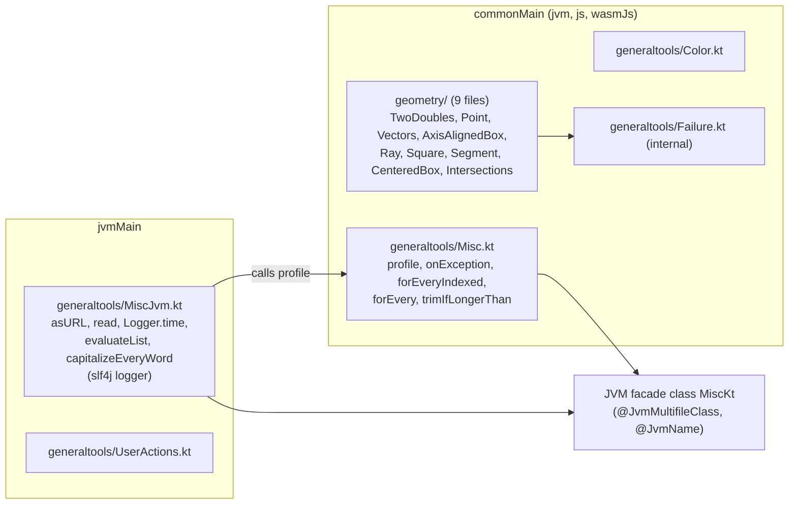
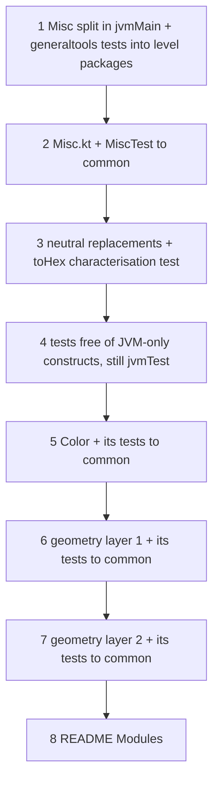

# Plan: `commonize` - make everything that can be common, common

- **Covers:**
  - [SpartanLaboratories/GeneralTools#7](https://github.com/SpartanLaboratories/GeneralTools/issues/7),
    *"Make GeneralTools Kotlin Multiplatform (Color and geometry usable from common code)"*.
  - [SpartanLaboratories/GeneralTools#8](https://github.com/SpartanLaboratories/GeneralTools/issues/8),
    *"Read-only views for Point and Square so libraries can expose geometry without copying"*, which
    the same release resolves. This unit changes nothing that #8 asks for; it is the neutral
    checkpoint that puts the code #8 builds on into common code.
- **Architecture:** [`architecture.md`](architecture.md), unit `commonize` (§11.2 row 4 and the
  common-code readiness table under it), systems S6 to S10, boundary table §7.2, adoption verdicts
  §8.2, ledger §11.3, assumption A7.
- **Position in the landing order:** unit 4 of 8. Depends on `logging` (3); `two-doubles` (5) and
  `generaltools-breaks` (7) build on it.
- **State this unit starts from:** the tree after `kmp-build`, `explicit-api` and `logging`, with
  `master` (`c196d1a`) already merged:
  - every main source file sits under `src/jvmMain/kotlin/<same subdirectory>/` with explicit-API
    modifiers; `src/commonMain/kotlin/generaltools/Failure.kt` exists and
    `src/jvmMain/kotlin/logging/` is gone;
  - the five geometry files log through kotlin-logging and report their 11 failure sites through
    `failure(...)`; `Misc.kt` and `UserActions.kt` still use slf4j;
  - every pre-existing test sits under `src/jvmTest/kotlin/<same subdirectory>/`, unchanged, plus the
    tests `logging` added (`FailureTest`, `RecordingKLogger` in `commonTest`; `LogCapture`,
    `FailureSitesLoggingTest`, `DivideByLoggingTest` in `jvmTest`, which stay where they are);
  - `src/jvmTest/resources/logback-test.xml` is in place; `api/GeneralTools.api` is committed and
    `checkKotlinAbi` is part of `check`.
- **Branch:** `feat/issue-7-kotlin-multiplatform` (all units land on it).
- **Commit:** TBD (this plan document is committed with commit 1 of section 11).
- **PR:** TBD
- **Status:** planning only.
- **Release:** `3.0.0`. Nothing is uploaded or published until the maintainer explicitly starts the
  release.

This unit is **API-neutral**. It changes no public signature, so the JVM dump `api/GeneralTools.api`
stays byte-identical after every commit. It gives `api/GeneralTools.klib.api` its first declarations and
ends with all code that can be common in `commonMain`.

---

## 1. Requirements

| # | Requirement | Acceptance check |
|---|---|---|
| R1 | Every main file except `UserActions.kt` and `MiscJvm.kt` is in `src/commonMain/kotlin/<same subdirectory>/` and compiles on `jvm`, `js` and `wasmJs`: `TwoDoubles.kt`, `Point.kt`, `Segment.kt`, `Vectors.kt`, `Intersections.kt`, `Ray.kt`, `AxisAlignedBox.kt`, `Square.kt`, `CenteredBox.kt`, `Color.kt`, and the common `Misc.kt`. | `find src/jvmMain/kotlin -name '*.kt'` lists exactly `generaltools/UserActions.kt` and `generaltools/MiscJvm.kt`; `./gradlew compileCommonMainKotlinMetadata compileKotlinJvm compileKotlinJs compileKotlinWasmJs` is green. |
| R2 | The neutral replacements land with unchanged semantics: `javaClass` becomes `this::class` in `TwoDoubles.equals`/`hashCode`; `String.format` becomes `toString(16).padStart(2, '0').uppercase()` in `Color.toHex`; `import java.lang.Math.pow` leaves `Point.kt`; the two stale comments in `Intersections.kt` stop saying `minOf`/`maxOf` delegate to `java.lang.Math`. | Grep G1 of section 9 prints nothing. |
| R3 | `Misc` is split: `Misc.kt` (common) holds `profile`, `onException`, `forEveryIndexed`, `forEvery`, `trimIfLongerThan`; `MiscJvm.kt` (JVM) holds `asURL`, `read`, `Logger.time`, `evaluateList`, `capitalizeEveryWord` (the last two with their 2.x bodies). Both files carry `@file:JvmMultifileClass` and `@file:JvmName("MiscKt")`, so every function stays on the JVM facade `MiscKt`. | The `MiscKt` lines of `api/GeneralTools.api` are unchanged (A7); `javap -s` of `MiscKt` before and after the split is identical (section 9). |
| R4 | The JVM dump is byte-identical after every commit. | After `./gradlew updateKotlinAbi`, `git diff --exit-code HEAD -- api/GeneralTools.api` exits 0, in every commit. |
| R5 | `api/GeneralTools.klib.api` gains its first declarations, is reviewed and is committed. It holds the common surface and has no `read`, `asURL`, `Logger.time`, `UserActionsKt` or `com.spartanlabs.logging` entry (and, until `generaltools-breaks`, no `evaluateList` and no `capitalizeEveryWord`). | The grep of section 9 prints nothing; the review list of section 9 is satisfied. |
| R6 | Every test sits in `com.spartanlabs.testing.<level>.<package>`, one class per file. Pure tests are in `commonTest` and run on all three targets; file, URL, AWT and slf4j tests are in `jvmTest`. | The mapping in section 7.3; `jsNodeTest` and `wasmJsNodeTest` run 175 tests plus `logging`'s common ones. |
| R7 | The tests that moved lose their slf4j `LoggerFactory` fields with their `log.` calls, `@Tag`, `Thread.sleep` and the JVM-only `assert`; they keep their "Level 2 (Isolated Component Behaviour)" KDoc line (and gain it where the flat classes lacked it). The stray class `Point` folds into `PointTest` (`assert` becomes `assertTrue`); `MiscKtTest` is deleted; `MiscJvmTest` is created; the `Point.toString` test checks layout only. | Grep G2 of section 9 prints nothing for the files this unit moved. |
| R8 | Every pre-existing test name is unchanged. | The name comparison of section 9 shows no removed or renamed name. |
| R9 | README "Modules" marks which items are JVM-only. | Section 8. |

---

## 2. Current state

Citations are to the baseline `17d30bc` (identical to tag `2.2.0` under `src/main`). `explicit-api`
and `logging` shift lines and add modifiers; the implementer finds each site by the quoted symbol or
phrase.

**JVM-only uses in files that become common** (the architecture's readiness table, re-read here):

- `src/main/kotlin/geometry/TwoDoubles.kt:62` `other.javaClass != this.javaClass` and `:73`
  `javaClass.hashCode()`.
- `src/main/kotlin/generaltools/Color.kt:147-153` `toHex`: `String.format("#%02X%02X%02X%02X", ...)`
  at `:149` and `String.format("#%02X%02X%02X", ...)` at `:151`.
- `src/main/kotlin/geometry/Point.kt:4` `import java.lang.Math.pow`; `:5` `import kotlin.math.pow`
  stays (the calls `.pow(2.0)` at `:35` resolve to the Kotlin extension).
- `src/main/kotlin/geometry/Intersections.kt:149-150` and `:212-214` say that `minOf`/`maxOf` on
  `Double` "delegate to java.lang.Math.min / max".
- `src/main/kotlin/generaltools/Misc.kt`: `java.io`/`java.net` imports `:5-9`, `Predicate` `:10`,
  slf4j `:18-19`, the logger `:22`, `capitalizeEveryWord` `:27-30` (deprecated `capitalize()`),
  `asURL` `:35-38`, `read` `:43-48`, `evaluateList` `:57-64`, `profile` `:72-73`, `Logger.time` `:75`,
  `onException` `:84-91` (`inline`, public), `forEveryIndexed` `:95-98`, `forEvery` `:102`,
  `trimIfLongerThan` `:108`.
- `src/main/kotlin/generaltools/UserActions.kt` is AWT, commons-io and slf4j throughout and stays in
  `jvmMain` untouched.

**Cross-file dependencies inside `geometry`** (code references only; KDoc links excluded), which fix
the move order:

| File | Code depends on |
|---|---|
| `TwoDoubles.kt` | - (the `failure` helper and the logger) |
| `Point.kt` | `TwoDoubles` |
| `Vectors.kt` | `Point` |
| `AxisAlignedBox.kt` | `Point`, `Dimensions` |
| `Ray.kt` | `Point`, `Vectors` (`normalized`) |
| `Square.kt` | `Point`, `Dimensions`, `AxisAlignedBox` |
| `Segment.kt` | `Point`, `Ray`, `Vectors` |
| `CenteredBox.kt` | `Point`, `Dimensions`, `Square`, `AxisAlignedBox` |
| `Intersections.kt` | `Segment`, `Ray`, `AxisAlignedBox`, `Point`, `Vectors` |

`Color.kt` and the common half of `Misc.kt` depend on nothing in `geometry`. A file may move to
`commonMain` once everything it references is already there; `jvmMain` may reference `commonMain`,
never the reverse.

**Tests at the baseline** (185 `@Test` methods; counted with `grep -c "@Test"`):

| Location | Class (package) | Tests |
|---|---|---|
| `src/test/kotlin/com/spartanlabs/testing/component/generaltools/` | `ColorTest` | 67 |
| `src/test/kotlin/com/spartanlabs/testing/component/geometry/` | `AxisAlignedBoxTest` 4, `CenteredBoxTest` 7, `PointVectorOpsTest` 11, `RayBoxIntersectionTest` 11, `RayTest` 5, `SegmentBoxIntersectionTest` 9, `SegmentSegmentIntersectionTest` 11, `SegmentTest` 6, `TwoDoublesHashCodeTest` 6 | 70 |
| `src/test/kotlin/generaltools/` | `MiscKtTest` (package `generaltools`, no test), `MiscTest` and `UserActionsTest` (package `com.spartanlabs.generaltools`) | 14 + 5 |
| `src/test/kotlin/geometry/` | `Point` (package `geometry`, 3 tests, `Point.kt:14` uses the JVM-only `assert`), `PointTest`, `SquareTest`, `TwoDoublesTest` (package `com.spartanlabs.geometry`) | 3 + 15 + 4 + 7 |

In those classes: an slf4j `LoggerFactory` field and `log.info("...")` lines (one single-line call per
test; `MiscTest.kt:69` additionally uses the field as the receiver of `Logger.time`), `@Tag("component")`
on the ten classes already in level packages, `Thread.sleep` at `MiscTest.kt:61` and `:69`, and one
format-dependent assertion, `PointTest.kt:119-122` (`assertEquals("1.0, 2.0", Point(1.0, 2.0).toString())`).
Only `UserActionsTest` uses JUnit API (`Assumptions.assumeFalse`) and AWT.

**Verified outside-world facts this unit rests on:**

- `JvmName` and `JvmMultifileClass` are `@OptionalExpectation expect annotation class` in the common
  stdlib; common code does not import `kotlin.jvm.*` by default, so both files import them
  explicitly. Okio ships the same split (`Okio.kt` common, `JvmOkio.kt` JVM, both
  `@file:JvmMultifileClass`/`@file:JvmName("Okio")`):
  [`research/idiomatic-kotlin-api-mechanics.md`](research/idiomatic-kotlin-api-mechanics.md), lines 86-88.
- `Int.toString(16).padStart(2, '0').uppercase()` is common API, equals `%02X` for `0..255`, and
  differs from `%02X` only for out-of-range channels:
  [`research/cross-platform-behaviour-parity.md`](research/cross-platform-behaviour-parity.md) §3.6.
- `KClass.equals`/`hashCode` distinguish concrete classes on all three targets; `this::class` allocates a
  `ClassReference` per call on the JVM (A5): same file §3.7.
- `minOf`/`maxOf` on `Double` propagate NaN on all three targets ("If either value is `NaN`, returns
  `NaN`"): same file §3.2.
- `measureTime` is stable since Kotlin 1.9, `TimeSource.Monotonic` works on both web targets: same file §3.10.
- Test level selection by package filter reaches `jvmTest`, `jsNodeTest` and `wasmJsNodeTest`; all 182
  backtick names are legal on the web targets from language version 2.1; a test class in `commonTest`
  needs a public or internal no-argument constructor:
  [`research/kmp-test-levels-and-names.md`](research/kmp-test-levels-and-names.md) F2, F3, F5.

---

## 3. Assumptions

| # | Assumption | If false |
|---|---|---|
| A2 | (architecture) `js` and `wasmJs` compile at language/API 2.2 under KGP 2.4.21. This unit puts the first substantial common code through those compilers. | Commit 2 (or the first commit that fails) cannot land; the fallback of A2 (pins on the JVM compilation only) is applied by `kmp-build` and this plan's commands do not change. |
| A4 | (architecture) The ledger predicts the dump. For this unit the prediction is "no JVM change". | Any JVM dump line that moves is an error in the commit, not a ledger correction; the commit is fixed or reverted. |
| A5 | (architecture) `this::class` in `equals`/`hashCode` costs nothing measurable on the JVM. The change lands here; the contingency (an `internal expect fun sameClass`) is exercised in `two-doubles`. | No effect on this unit; the contingency replaces the two expressions later. |
| A7 | (architecture) The multifile split leaves every `MiscKt` line of the JVM dump unchanged, including the `inline` `onException` and the `@Throws` `asURL`. | Commit 1 and commit 2 do not land; see Known gaps for the state of the fallback. |
| U1 | The `logging` unit removed the `com.spartanlabs.logging` bullet from README "Modules". | The README edit of commit 8 deletes the bullet as well. |
| U2 | `api/GeneralTools.klib.api` holds no declaration when this unit starts: `kmp-build` C3 commits it empty, and `logging` commit 1 commits what the plugin then writes (expected: the header alone). | If it already lists declarations, the review of section 9 applies to the whole file instead of the additions. |
| U3 | The Gradle tasks `compileCommonMainKotlinMetadata`, `compileKotlin{Jvm,Js,WasmJs}`, `compileTestKotlin{Jvm,Js,WasmJs}`, `jvmTest`, `jsNodeTest`, `wasmJsNodeTest`, `updateKotlinAbi` and `checkKotlinAbi` exist under those names. | Substitute the names `./gradlew tasks --all` shows; no plan content changes. |
| U4 | The moved tests pass unchanged on `js` and `wasmJs`, as the parity findings predict (nothing has been run there). | A failing test blocks its commit; the case is reported. No expectation is edited without a new design call (section 10). |

---

## 4. Non-goals

- Any public signature, KDoc contract or behaviour change. Equality semantics, `divideBy`, `Color`
  validation, `trimIfLongerThan`'s negative-length check, `capitalizeEveryWord`'s comma handling and
  `evaluateList`'s lambda type belong to `two-doubles` and `generaltools-breaks`.
- Moving `evaluateList` or `capitalizeEveryWord` to common code (they stay in `MiscJvm.kt` with their 2.x
  bodies, including the deprecated `capitalize()` and the `Predicate` parameter).
- Any change to `build.gradle.kts`, `settings.gradle.kts`, `gradle.properties`, the CI workflow or the
  `api/GeneralTools.api` dump. Only `api/GeneralTools.klib.api` changes. The one exception is `kmp-build`'s
  U1/U5 contingency, under which commit 2 adds the web targets and `kotlin-js-store/` (section 12).
- Moving `UserActions.kt`, `LogCapture`, `FailureSitesLoggingTest` or `DivideByLoggingTest`.
- Touching `src/test/resources/keys.txt` (already deleted by `master`, which is merged first). Only
  `logback-test.xml` was ever in scope for a resource move, and `kmp-build` has already moved it.
- Renaming `Square`, `SquareTest` or any test name that mentions it (`box-model`).
- Removing `@OptIn(ExperimentalTime::class)` from `profile`. It is unnecessary on current Kotlin, harmless
  to keep, and the move stays verbatim.
- Adding a `this === other` shortcut to `equals`. It would change `Point(NaN, 0.0) == itself` from
  `false` to `true`, which is the equality contract `two-doubles` owns.

---

## 5. Design

### 5.1 Source-set layout when the unit ends



### 5.2 Commit order



Why this order:

- **Commits 1 and 2 first.** A7 is the one assumption that can force a redesign, and it is decided by
  the real source-set arrangement. Commit 1 proves the split inside one source set; commit 2 proves it
  across `commonMain` and `jvmMain`.
- **Edit in place, then move.** Commits 3 and 4 change content while the files are still in `jvmMain`
  and `jvmTest`; commits 2, 5, 6 and 7 are pure `git mv`s (plus the klib dump), so a reviewer reads each
  move as a rename with no content change and git keeps the history (`git log --follow`).
- **Every commit compiles on every target.** `commonMain` only ever receives files whose code
  references are already there (table in section 2). Layer 1 (commit 6) is
  `TwoDoubles.kt`, `Point.kt`, `Vectors.kt`, `AxisAlignedBox.kt`, `Ray.kt`, `Square.kt`; layer 2 (commit
  7) is `Segment.kt`, `CenteredBox.kt`, `Intersections.kt`.
- **A test follows its subject.** A test moves to `commonTest` in the commit that puts its last
  referenced production type into `commonMain`, after it has lost its JVM-only constructs (commit 4).

### 5.3 The replacements

**`TwoDoubles.equals` and `hashCode`** (semantics identical to the `javaClass` forms):

```kotlin
override operator fun equals(other: Any?): Boolean {
    if (other == null || other::class != this::class) return false
    other as TwoDoubles
    return first == other.first && second == other.second
}

override fun hashCode(): Int =
    31 * (31 * this::class.hashCode() + first.hashCode()) + second.hashCode()
```

On the JVM `ClassReference.equals` compares `javaObjectType`, and `ClassReference.hashCode` is
`javaObjectType.hashCode()`, so both expressions yield the values the `javaClass` forms yielded (the
`Class` identity hash). Everything else in the two members, including the absence of an identity
shortcut and IEEE `==` on the components, is unchanged. Only the expression changes; the two members'
visibility modifiers and KDoc stay as `explicit-api` and `logging` left them.

**`Color.toHex`** (the whole `return if (includeAlpha) { String.format ... } else { ... }` block is
replaced; the signature and KDoc are unchanged):

```kotlin
public fun toHex(includeAlpha: Boolean = false): String {
    val channels = if (includeAlpha) listOf(alpha, red, green, blue) else listOf(red, green, blue)
    return channels.joinToString(separator = "", prefix = "#") { channel ->
        channel.toString(16).padStart(2, '0').uppercase()
    }
}
```

`uppercase()` is locale-invariant. For every channel in `0..255` the result equals `%02X` digit for
digit. For a channel outside that range (only reachable today through the unvalidated constructor) the
text differs from `%02X` for negative values (`-5` renders as `-5`, `%02X` rendered `FFFFFFFB`) and
agrees for values above 255 (`300` renders as `12C`). `generaltools-breaks` makes such channels
unrepresentable.

**`Point.kt`:** delete the line `import java.lang.Math.pow`; keep `import kotlin.math.pow`.

**`Intersections.kt`:** replace the two comment blocks that contain "delegate to ... java.lang.Math.min /
max" (find them by that phrase) with:

```kotlin
    // invD may be +/-Infinity for an axis-parallel segment: intentional under
    // IEEE-754 (see plan §2.1). minOf / maxOf on Double propagate NaN on every
    // Kotlin target (documented: "If either value is NaN, returns NaN"), so a
    // 0 * Infinity that arises when an endpoint sits exactly on a slab plane
    // collapses the interval and the final `tmax >= tmin` test cleanly reports
    // "no overlap".
```

and, in `rayIntersectsBox`:

```kotlin
    // invD is +/-Infinity for an axis-parallel ray: intentional under IEEE-754
    // (a parallel-and-outside slab leaves tmin/tmax at -/+Infinity -> miss; a
    // parallel-and-inside slab leaves the constraint inert). The one hazard is
    // 0 * Infinity = NaN when the origin lies exactly on a slab plane; because
    // minOf / maxOf on Double PROPAGATE NaN on every Kotlin target (documented:
    // "If either value is NaN, returns NaN"; unlike SSE minps/maxps), that NaN
    // reaches the final test and `tmax >= maxOf(tmin, 0.0)` evaluates false ->
    // a deterministic clean miss. See plan §2.1.
```

### 5.4 The `Misc` split

Both files start with the same two file annotations and imports; the order is annotations, `package`,
imports.

```kotlin
@file:JvmMultifileClass
@file:JvmName("MiscKt")

package com.spartanlabs.generaltools

import kotlin.jvm.JvmMultifileClass
import kotlin.jvm.JvmName
```

- **`Misc.kt` (common)** keeps, verbatim in body and signature (with the modifiers and explicit return
  types `explicit-api` gave them), `profile` (with its `@OptIn(ExperimentalTime::class)`), `onException`
  (public `inline`), `forEveryIndexed`, `forEvery` and `trimIfLongerThan`, plus the imports they need
  (`kotlin.reflect.KClass`, `kotlin.time.ExperimentalTime`, `kotlin.time.measureTime`). It has no logger
  and no `java.*`/slf4j import. The old import-group comments (`// Intended Function`, `// Java Standard
  Library`) are dropped because they no longer describe the file. A line comment under the annotations
  states why the two annotations are there: `// Shares the JVM facade class MiscKt with MiscJvm.kt; keep
  the two file annotations in step.`
- **`MiscJvm.kt` (JVM)** holds, verbatim, `capitalizeEveryWord`, `asURL` (with `@Throws`), `read`,
  `evaluateList` (parameter `Predicate<T>`), `Logger.time`, the imports they need (`java.io.*`,
  `java.net.*`, `java.util.function.Predicate`, `org.slf4j.Logger`, `org.slf4j.LoggerFactory`), and the
  slf4j logger `private val log: Logger = LoggerFactory.getLogger("com.spartanlabs.generaltools.Misc")`
  with its KDoc. The logger name is unchanged from 2.x, so consumers' backend rules keep matching. The same
  line comment about the facade sits under its annotations.
- **`onException` KDoc:** the sentence "it can't reference the file's private [log] instance directly -
  logging around exception recovery is left to the caller" becomes "it can't reference a file-private
  logger directly - logging around exception recovery is left to the caller", because the common file has
  no `log` to link to.

Nothing else in either file changes.

### 5.5 Error handling and logging

This unit adds or changes no public signature, so there are no new failure paths to design. The
touched functions keep the failure behaviour they had:

| Function | Failure behaviour (unchanged) | Expected vs programmer error |
|---|---|---|
| `TwoDoubles.equals`, `hashCode` | total; never throw | - |
| `Color.toHex` | total; never throws | - |
| `profile`, `forEvery`, `forEveryIndexed` | rethrow whatever the lambda throws | caller's lambda |
| `onException` | returns `Result`; unmatched exception is rethrown by `recoverCatching` | expected failure is carried in the `Result` |
| `trimIfLongerThan` | JVM: `StringIndexOutOfBoundsException` for a negative length; JS returns `""` (the explicit check on every target is `generaltools-breaks`) | programmer error |
| `asURL` | throws `MalformedURLException` (`@Throws`) | expected, documented |
| `read` | throws `IOException` subtypes (missing file) | expected, documented |
| `evaluateList` | total apart from the predicate | - |
| `Logger.time` | propagates the action's exception; logs nothing in that case | caller's lambda |

No new log event is introduced. The existing ones stay: `MiscJvm.kt` keeps `debug` for `asURL`/`read` and
`trace` for `evaluateList` on logger `com.spartanlabs.generaltools.Misc`; the five geometry loggers keep
the kotlin-logging names `logging` gave them (the `git mv` must not touch them); `UserActions.kt` keeps its
slf4j logger. Where a `Result` is unwrapped: nowhere in production code of this unit; tests unwrap with
`getOrThrow`/`isFailure` as before.

---

## 6. Staging

Eight independently landable commits (section 11), each green on all three targets with the JVM dump
unchanged. Commits 1 to 4 can land without commits 5 to 8; commit 8 is last because it states the end state.

---

## 7. File-by-file changes

Paths are relative to the repository root. "Move" means `git mv` with no content change. `$SRC` below
abbreviates `src/jvmMain/kotlin`, `$COM` abbreviates `src/commonMain/kotlin`.

### 7.1 Production files, in commit order

**Commit 1 - `Misc` split inside `jvmMain`**

1. `$SRC/generaltools/Misc.kt` - becomes the common half (section 5.4). Remove the slf4j logger, the
   `java.*` and slf4j imports, `capitalizeEveryWord`, `asURL`, `read`, `evaluateList`, `Logger.time`. Add
   the two file annotations, the two `kotlin.jvm` imports, the facade comment and the KDoc edit of
   `onException`.
2. `$SRC/generaltools/MiscJvm.kt` - new (section 5.4).

**Commit 2 - `Misc.kt` to common**

3. Move `$SRC/generaltools/Misc.kt` to `$COM/generaltools/Misc.kt`.
4. `api/GeneralTools.klib.api` - created or updated by `./gradlew updateKotlinAbi`: gains `profile`,
   `onException`, `forEveryIndexed`, `forEvery`, `trimIfLongerThan` under `com.spartanlabs.generaltools`.

**Commit 3 - neutral replacements (all still in `jvmMain`)**

5. `$SRC/geometry/TwoDoubles.kt` - `equals` and `hashCode` per section 5.3.
6. `$SRC/geometry/Point.kt` - delete `import java.lang.Math.pow`.
7. `$SRC/geometry/Intersections.kt` - the two comment blocks per section 5.3.
8. `$SRC/generaltools/Color.kt` - `toHex` body per section 5.3.

**Commit 5 - `Color` to common**

9. Move `$SRC/generaltools/Color.kt` to `$COM/generaltools/Color.kt`.
10. `api/GeneralTools.klib.api` - gains `Color` and `Color.Companion`.

**Commit 6 - geometry layer 1**

11. Move to `$COM/geometry/`: `TwoDoubles.kt`, `Point.kt`, `Vectors.kt`, `AxisAlignedBox.kt`, `Ray.kt`,
    `Square.kt`.
12. `api/GeneralTools.klib.api` - gains `TwoDoubles`, `Point`, `Dimensions`, `AxisAlignedBox`, `Ray`,
    `Square`, `EPSILON`, `dot`, `cross`, `length`, `lengthSquared`, `normalized`, `projectedOnto`.
    The sealed `TwoDoubles` gets no constructor entry: the klib dump lists no constructor of a sealed
    class (architecture section 3.3); `two-doubles` adds them when it unseals the class.

**Commit 7 - geometry layer 2**

13. Move to `$COM/geometry/`: `Segment.kt`, `CenteredBox.kt`, `Intersections.kt`.
14. `api/GeneralTools.klib.api` - gains `Segment`, `CenteredBox` (and its companion),
    `SegmentIntersection` with `None`/`Touching`/`Overlapping`, `segmentIntersectsSegment`,
    `segmentIntersectsBox`, `rayIntersectsBox`, `toCenteredBox`, `toSquare`.

**Not moved:** `$SRC/generaltools/UserActions.kt`, `$SRC/generaltools/MiscJvm.kt`.

After commit 7 the `jvmMain` tree holds exactly those two files.

### 7.2 Test files, in commit order

Abbreviations: `$JT` = `src/jvmTest/kotlin`, `$CT` = `src/commonTest/kotlin`,
`$T` = `com/spartanlabs/testing`.

**Commit 1 - Misc and UserActions tests, all `jvmTest`**

- Delete `$JT/generaltools/MiscKtTest.kt` (an empty class with no test).
- Move `$JT/generaltools/MiscTest.kt` to `$JT/$T/component/generaltools/MiscTest.kt`, set the package to
  `com.spartanlabs.testing.component.generaltools`, and cut it down to the seven pure tests (mapping below).
  Imports: `com.spartanlabs.generaltools.{forEvery, forEveryIndexed, onException, profile,
  trimIfLongerThan}`, `kotlin.test.{Test, assertEquals, assertTrue}`. Remove the `LoggerFactory`/`java.*`
  imports, the `log` field and every `log.` line. In `profile reports the action name and a duration`,
  the action `{ Thread.sleep(1) }` becomes `{ }`. KDoc: `Level 2 (Isolated Component Behaviour) coverage
  for the platform-neutral helpers in Misc.kt. They take lambdas as their only collaborators, so there is
  nothing to mock.`
- New `$JT/$T/component/generaltools/MiscJvmTest.kt`, package
  `com.spartanlabs.testing.component.generaltools`. Holds exactly `capitalizeEveryWord capitalizes each
  word`, `evaluateList returns true when a predicate matches`, `evaluateList returns false when no
  predicate matches`, with the bodies of the old tests minus the `log` lines. Imports:
  `com.spartanlabs.generaltools.{capitalizeEveryWord, evaluateList}`, `kotlin.test.{Test, assertEquals,
  assertFalse, assertTrue}`. KDoc: `Level 2 (Isolated Component Behaviour) coverage for the helpers whose
  implementations are still JVM-only (Predicate and the deprecated capitalize()). Interim class: each test
  moves into the common MiscTest when its subject becomes common, and this class is then deleted.`
- New `$JT/$T/component/generaltools/AsUrlTest.kt`: `asURL parses a valid URL`, `asURL throws on an
  invalid URL`. Imports `com.spartanlabs.generaltools.asURL`, `java.net.MalformedURLException`,
  `kotlin.test.*` members used. KDoc: Level 2 coverage for `asURL`; it only parses and opens no
  connection.
- New `$JT/$T/component/generaltools/LoggerTimeTest.kt`: `Logger time logs the profiled action without
  throwing`. The slf4j `Logger` is the receiver under test, so the class builds one locally:
  `val logger = LoggerFactory.getLogger(LoggerTimeTest::class.java)` inside the test, then
  `logger.time("sample action") { }`. Imports `com.spartanlabs.generaltools.time`,
  `org.slf4j.LoggerFactory`, `kotlin.test.Test`.
- New `$JT/$T/integration/generaltools/ReadTest.kt`: `read returns each line of the file`. Imports
  `com.spartanlabs.generaltools.read`, `java.io.File`, `kotlin.test.{Test, assertEquals}`. KDoc: Level 3
  (Integration & External Interfaces) coverage; reads a real file from the file system.
- Move `$JT/generaltools/UserActionsTest.kt` to `$JT/$T/integration/generaltools/UserActionsTest.kt`, set
  the package to `com.spartanlabs.testing.integration.generaltools`, add imports
  `com.spartanlabs.generaltools.{cropImage, saveTo, screenshotArea, screenshotFull, to}`, drop the
  `LoggerFactory` import, field and `log` lines, keep `Assumptions.assumeFalse`. KDoc: Level 3 coverage;
  writes and copies real files, captures the real screen (skipped when headless).

**Commit 2 - pure move**

- Move `$JT/$T/component/generaltools/MiscTest.kt` to `$CT/$T/component/generaltools/MiscTest.kt`.

**Commit 3 - new characterisation test**

- New `$JT/$T/deterministic/generaltools/ColorHexEncodingTest.kt`, package
  `com.spartanlabs.testing.deterministic.generaltools`. KDoc: `Level 4a (Deterministic Logic /
  Input-to-Output Mapping) coverage for Color.toHex: every channel value maps to exactly two upper-case
  hex digits, identically on every target.` The class keeps a digit table and an oracle that does not use
  the code under test:

  ```kotlin
  private val digits = "0123456789ABCDEF"
  private fun pair(channel: Int): String = "${digits[channel / 16]}${digits[channel % 16]}"
  ```

  - `toHex renders every channel value as two upper-case hex digits`: for each `c` in `0..255`,
    `Color(c, 255 - c, (c * 7) % 256).toHex()` equals `"#" + pair(c) + pair(255 - c) + pair((c * 7) % 256)`;
    built with `map` over the range and one `assertEquals` on the two lists.
  - `toHex with alpha renders every alpha value first`: for each `c` in `0..255`,
    `Color(255 - c, c, (c * 7) % 256, (c * 13) % 256).toHex(includeAlpha = true)` equals
    `"#" + pair((c * 13) % 256) + pair(255 - c) + pair(c) + pair((c * 7) % 256)`.

  The class uses only `kotlin.test`, so it moves to `commonTest` unchanged in commit 5.

**Commit 4 - geometry and Color tests lose their JVM-only constructs (still `jvmTest`)**

- In place, in `$JT/$T/component/generaltools/ColorTest.kt` and the nine classes under
  `$JT/$T/component/geometry/` (`AxisAlignedBoxTest`, `CenteredBoxTest`, `PointVectorOpsTest`,
  `RayBoxIntersectionTest`, `RayTest`, `SegmentBoxIntersectionTest`, `SegmentSegmentIntersectionTest`,
  `SegmentTest`, `TwoDoublesHashCodeTest`): remove `import org.junit.jupiter.api.Tag`, `import
  org.slf4j.LoggerFactory`, the `@Tag("component")` line, the `private val log = ...` line, every
  `log.info("...")` line (all are single-line statements), and the blank line the field leaves under the
  class header. The KDoc already says "Level 2 (Isolated Component Behaviour)". The mechanical form:

  ```sh
  sed -i -E '/^[[:space:]]*log\.info\(".*"\)[[:space:]]*$/d;
             /^import org\.slf4j\.LoggerFactory$/d;
             /^import org\.junit\.jupiter\.api\.Tag$/d;
             /^@Tag\("component"\)$/d;
             /^[[:space:]]*private val log = LoggerFactory\.getLogger\(.*\)$/d' <file>
  # then delete the blank line directly under the class header if one remains
  ```
- Move `$JT/geometry/PointTest.kt` to `$JT/$T/component/geometry/PointTest.kt`; package becomes
  `com.spartanlabs.testing.component.geometry`; imports `com.spartanlabs.geometry.{Dimensions, Point}`;
  remove the logger; add the KDoc `Level 2 (Isolated Component Behaviour) coverage for [Point] and
  [Dimensions]. Pure value types - nothing to mock.`
  - `toString formats x and y` becomes layout-only:

    ```kotlin
    @Test
    fun `toString formats x and y`() {
        // Layout only: Double.toString differs per platform (JS prints 1.0 as 1), so the values below are
        // ones that print identically on every target.
        assertEquals("1.5, -2.25", Point(1.5, -2.25).toString())
    }
    ```
  - Fold in the three tests of the stray class (`testCompareTo`, `testModBy`, `testSetTo`), appended after
    the existing tests inside `//region Former top-level class geometry.Point` ... `//endregion`, with
    their names and bodies unchanged except that `assert(point1 == point2 && point1 != point3)` becomes
    `assertTrue(point1 == point2 && point1 != point3)`.
- Delete `$JT/geometry/Point.kt` (the stray class).
- Move `$JT/geometry/SquareTest.kt` to `$JT/$T/component/geometry/SquareTest.kt`; package
  `com.spartanlabs.testing.component.geometry`; imports `com.spartanlabs.geometry.{Dimensions, Point,
  Square}`; remove the logger; KDoc `Level 2 ... coverage for [Square]. Pure value type - nothing to mock.`
  The class keeps the name `SquareTest` and the test `mutating a square's location updates its
  properties`; `box-model` renames both.
- Move `$JT/geometry/TwoDoublesTest.kt` to `$JT/$T/component/geometry/TwoDoublesTest.kt`; package
  `com.spartanlabs.testing.component.geometry`; import `com.spartanlabs.geometry.Point`; remove the
  logger; prepend the sentence `Level 2 (Isolated Component Behaviour) coverage for TwoDoubles.` to the
  existing class KDoc and leave the rest of that KDoc as is (`two-doubles` rewrites it).
- After commit 4 `$JT/geometry/` and `$JT/generaltools/` no longer exist.

**Commits 5 to 7 - pure moves from `jvmTest` to `commonTest`** (each path keeps its name):

| Commit | Move `$JT/$T/...` to `$CT/$T/...` |
|---|---|
| 5 | `component/generaltools/ColorTest.kt`, `deterministic/generaltools/ColorHexEncodingTest.kt` |
| 6 | `component/geometry/PointTest.kt`, `TwoDoublesTest.kt`, `PointVectorOpsTest.kt`, `RayTest.kt`, `SquareTest.kt` |
| 7 | `component/geometry/SegmentTest.kt`, `CenteredBoxTest.kt`, `AxisAlignedBoxTest.kt`, `TwoDoublesHashCodeTest.kt`, `SegmentSegmentIntersectionTest.kt`, `SegmentBoxIntersectionTest.kt`, `RayBoxIntersectionTest.kt` |

`$JT/$T/integration/...` (`ReadTest`, `UserActionsTest`, and `logging`'s three classes), `AsUrlTest`,
`LoggerTimeTest` and `MiscJvmTest` stay in `jvmTest`.

### 7.3 Complete test mapping

Every row keeps the method names listed in Appendix A verbatim. "Level" is the test level;
`$CT/$T` and `$JT/$T` are as in 7.2.

| Old class (old package) @ old path | Tests | New class | New package | Source set | Level | New path |
|---|---|---|---|---|---|---|
| `ColorTest` | 67 | `ColorTest` | `com.spartanlabs.testing.component.generaltools` | commonTest | 2 | `$CT/$T/component/generaltools/ColorTest.kt` |
| `AxisAlignedBoxTest` | 4 | same | `...component.geometry` | commonTest | 2 | `$CT/$T/component/geometry/AxisAlignedBoxTest.kt` |
| `CenteredBoxTest` | 7 | same | `...component.geometry` | commonTest | 2 | `$CT/$T/component/geometry/CenteredBoxTest.kt` |
| `PointVectorOpsTest` | 11 | same | `...component.geometry` | commonTest | 2 | `$CT/$T/component/geometry/PointVectorOpsTest.kt` |
| `RayBoxIntersectionTest` | 11 | same | `...component.geometry` | commonTest | 2 | `$CT/$T/component/geometry/RayBoxIntersectionTest.kt` |
| `RayTest` | 5 | same | `...component.geometry` | commonTest | 2 | `$CT/$T/component/geometry/RayTest.kt` |
| `SegmentBoxIntersectionTest` | 9 | same | `...component.geometry` | commonTest | 2 | `$CT/$T/component/geometry/SegmentBoxIntersectionTest.kt` |
| `SegmentSegmentIntersectionTest` | 11 | same | `...component.geometry` | commonTest | 2 | `$CT/$T/component/geometry/SegmentSegmentIntersectionTest.kt` |
| `SegmentTest` | 6 | same | `...component.geometry` | commonTest | 2 | `$CT/$T/component/geometry/SegmentTest.kt` |
| `TwoDoublesHashCodeTest` | 6 | same | `...component.geometry` | commonTest | 2 | `$CT/$T/component/geometry/TwoDoublesHashCodeTest.kt` |
| `PointTest` (`com.spartanlabs.geometry`) @ `src/test/kotlin/geometry/PointTest.kt` | 15 | `PointTest` | `...component.geometry` | commonTest | 2 | `$CT/$T/component/geometry/PointTest.kt` |
| `Point` (`geometry`) @ `src/test/kotlin/geometry/Point.kt` | 3 (`testCompareTo`, `testModBy`, `testSetTo`) | folded into `PointTest` | `...component.geometry` | commonTest | 2 | same file as `PointTest` |
| `SquareTest` (`com.spartanlabs.geometry`) | 4 | `SquareTest` | `...component.geometry` | commonTest | 2 | `$CT/$T/component/geometry/SquareTest.kt` |
| `TwoDoublesTest` (`com.spartanlabs.geometry`) | 7 | `TwoDoublesTest` | `...component.geometry` | commonTest | 2 | `$CT/$T/component/geometry/TwoDoublesTest.kt` |
| `MiscKtTest` (`generaltools`) | 0 | deleted | - | - | - | - |
| `MiscTest` (`com.spartanlabs.generaltools`) | 14, split below | | | | | |
| - `profile reports the action name and a duration`, `onException transforms a matching exception`, `onException rethrows an unmatched exception`, `forEveryIndexed provides the index and item for each element`, `forEvery visits every item`, `trimIfLongerThan trims strings longer than the given length`, `trimIfLongerThan leaves shorter strings unchanged` | 7 | `MiscTest` | `...component.generaltools` | commonTest | 2 | `$CT/$T/component/generaltools/MiscTest.kt` |
| - `capitalizeEveryWord capitalizes each word`, `evaluateList returns true when a predicate matches`, `evaluateList returns false when no predicate matches` | 3 | `MiscJvmTest` (interim) | `...component.generaltools` | jvmTest | 2 | `$JT/$T/component/generaltools/MiscJvmTest.kt` |
| - `asURL parses a valid URL`, `asURL throws on an invalid URL` | 2 | `AsUrlTest` | `...component.generaltools` | jvmTest | 2 | `$JT/$T/component/generaltools/AsUrlTest.kt` |
| - `Logger time logs the profiled action without throwing` | 1 | `LoggerTimeTest` | `...component.generaltools` | jvmTest | 2 | `$JT/$T/component/generaltools/LoggerTimeTest.kt` |
| - `read returns each line of the file` | 1 | `ReadTest` | `...integration.generaltools` | jvmTest | 3 | `$JT/$T/integration/generaltools/ReadTest.kt` |
| `UserActionsTest` (`com.spartanlabs.generaltools`) | 5 | `UserActionsTest` | `...integration.generaltools` | jvmTest | 3 | `$JT/$T/integration/generaltools/UserActionsTest.kt` |
| new | 2 | `ColorHexEncodingTest` | `...deterministic.generaltools` | commonTest | 4a | `$CT/$T/deterministic/generaltools/ColorHexEncodingTest.kt` |

Totals: 185 pre-existing tests = 173 in `commonTest` + 12 in `jvmTest`; plus 2 new in `commonTest`.

### 7.4 README (commit 8)

`README.md`, section "Modules" only. Read the section as `kmp-build`, `logging` and the later units left
it, keep their text, and make these changes:

- Add, directly under the "Modules" heading, `Everything below is common code, available on the `jvm`,
  `js` and `wasmJs` targets, except the items marked **JVM only**, which exist only in the `jvm` variant
  (`GeneralTools-jvm`).`
- `Misc` entry, rewritten to: "`Misc` - string, list and timing helpers: `profile`, `onException`,
  `forEvery`, `forEveryIndexed` and `trimIfLongerThan` are common; **JVM only:** `asURL`, `read`, the
  slf4j `Logger.time` extension, `evaluateList` and `capitalizeEveryWord`."

- `UserActions` entry: append `**JVM only.**`
- `Color` entry and the `com.spartanlabs.geometry` heading: no marker (common).
- If the `com.spartanlabs.logging` bullet is still present (U1), delete it.

No other README section changes in this unit.

---

## 8. Documentation impact

| Ring | What moves |
|---|---|
| 1 Inner core | Two comment blocks in `Intersections.kt` (section 5.3); the facade comment in `Misc.kt`/`MiscJvm.kt`; a `//region` around the folded stray tests in `PointTest`. |
| 2 Component | `onException` KDoc wording (no dangling `[log]`); Level-2/3/4a KDoc line on every moved or created test class, including the flat classes that had none; the interim-class KDoc on `MiscJvmTest`. No public KDoc contract changes: no signature or behaviour contract changes in this unit. |
| 3 Boundary | The JVM facade `MiscKt` is shared by two source sets; the two file annotations and the explaining comment are the boundary documentation. The logger name `com.spartanlabs.generaltools.Misc` stays in `MiscJvm.kt`. |
| 4 Architectural | `architecture.md` stays accurate as written; the one statement that cannot be executed as worded (the fallback of A7) is recorded in Known gaps, and this unit does not edit the architecture. |

README: "Modules" (section 7.4) in commit 8. The README sections owned by other units are untouched.
`docs/plans/7-kotlin-multiplatform/final-implementation.md` receives one dated entry for every deviation
from this plan, with its reasoning, at the moment it is made.

---

## 9. Test plan by level

### Level 1 - Local gating (before every commit)

No test classes sit in `testing.gating`. The gate is the following command set, run per target, before
each commit of section 11.

```sh
# G1: no JVM-only call left in geometry/Color sources (run after commit 3 and again after commit 7)
git grep -n -E 'javaClass|String\.format|java\.lang\.Math' -- src/commonMain src/jvmMain/kotlin/geometry src/jvmMain/kotlin/generaltools/Color.kt
# G2: no JVM-only construct in the commonTest files this unit moved (logging's FailureTest and
#     RecordingKLogger are not expected to match either)
git grep -n -E 'slf4j|org\.junit|@Tag|Thread\.|[^a-zA-Z]assert\(' -- src/commonTest

# 1. Compile every target (the metadata compilation rejects any JVM-only call in commonMain)
./gradlew compileCommonMainKotlinMetadata compileKotlinJvm compileKotlinJs compileKotlinWasmJs
./gradlew compileTestKotlinJvm compileTestKotlinJs compileTestKotlinWasmJs

# 2. Tests, per target
./gradlew jvmTest            # JVM:   commonTest + jvmTest
./gradlew jsNodeTest         # JS:    commonTest only
./gradlew wasmJsNodeTest     # Wasm:  commonTest only

# 3. API proof
./gradlew updateKotlinAbi
git diff --exit-code HEAD -- api/GeneralTools.api     # JVM dump must not change: exit 0
git diff --stat HEAD -- api/GeneralTools.klib.api     # klib: only the additions the commit predicts
./gradlew checkKotlinAbi

# 4. Whole build, once per commit
./gradlew build
```

Expected test counts. `Lc` is the number of tests `logging` added to `commonTest` (it runs on all three
targets), `Lj` the number it added to `jvmTest` only; read both from the last green build before this unit
starts.

| After commit | `jvmTest` | `jsNodeTest` and `wasmJsNodeTest` |
|---|---|---|
| 1 | 185 + Lc + Lj | Lc |
| 2 | 185 + Lc + Lj | 7 + Lc |
| 3 | 187 + Lc + Lj | 7 + Lc |
| 4 | 187 + Lc + Lj | 7 + Lc |
| 5 | 187 + Lc + Lj | 76 + Lc |
| 6 | 187 + Lc + Lj | 121 + Lc |
| 7, 8 | 187 + Lc + Lj | 175 + Lc |

Per-commit extra checks:

- **Commit 1 and 2 (A7).** Compare the public view of the facade before and after, with a scratch
  directory outside the repository:

  ```sh
  # at the commit before: ./gradlew compileKotlinJvm
  javap -s -cp build/classes/kotlin/jvm/main com.spartanlabs.generaltools.MiscKt | sort > "$SCRATCH/miscKt-before.txt"
  # at the new commit:    ./gradlew compileKotlinJvm
  javap -s -cp build/classes/kotlin/jvm/main com.spartanlabs.generaltools.MiscKt | sort > "$SCRATCH/miscKt-after.txt"
  diff "$SCRATCH/miscKt-before.txt" "$SCRATCH/miscKt-after.txt"      # expected: no output
  ```

  (`javap` without `-p` lists public members only, so the moved private `log` field does not appear.)
  Then `git diff HEAD -- api/GeneralTools.api` is empty.
- **Commit 3 (characterise first).** Create `ColorHexEncodingTest` first and run
  `./gradlew jvmTest -PtestLevel=deterministic` while `Color.toHex` still uses `String.format`: both tests
  pass, proving the test encodes the 2.x behaviour. Then replace `toHex` and run it again: still green.
- **Commit 4.** `grep -c "@Test"` of `PointTest` is 18; `git grep -n -E "^class Point\b" -- src/jvmTest src/commonTest`
  prints nothing (the stray class is gone); G2 prints nothing for the ten level-package classes and the
  three classes moved in this commit.
- **Commit 7 (end of the geometry move).**
  1. `find src/jvmMain/kotlin -name '*.kt'` lists `generaltools/MiscJvm.kt` and
     `generaltools/UserActions.kt` only.
  2. Klib dump review (R5), in `api/GeneralTools.klib.api`:

     ```sh
     grep -nE "generaltools/(read|asURL|time|evaluateList|capitalizeEveryWord)\b|UserActions|spartanlabs\.logging" api/GeneralTools.klib.api   # prints nothing
     ```

     and read the file once: it lists `Color` (+ companion), the nine geometry files' public types and
     functions, and the five common `Misc` functions; every `Result`-returning function appears with its
     plain name (no JVM name mangling in a klib); the header names both targets `js` and `wasmJs`.
  3. Name comparison (R8), scratch directory outside the repository:

     ```sh
     git grep -h -o -E 'fun (`[^`]*`|test[A-Za-z]+)' 17d30bc -- src/test/kotlin | sort > "$SCRATCH/names-before.txt"
     git grep -h -o -E 'fun (`[^`]*`|test[A-Za-z]+)' HEAD -- src/commonTest src/jvmTest | sort > "$SCRATCH/names-after.txt"
     diff "$SCRATCH/names-before.txt" "$SCRATCH/names-after.txt"
     ```

     Expected: only added lines (the two `ColorHexEncodingTest` names and the tests `logging` added).
     No line is removed or changed.
  4. Level filters: `./gradlew jvmTest jsNodeTest wasmJsNodeTest -PtestLevel=deterministic` runs the 2
     new tests on each target; `-PtestLevel=integration` runs `ReadTest` and `UserActionsTest` (plus
     `logging`'s integration classes) on the JVM and zero tests, green, on `js` and `wasmJs`.

### Level 2 - Isolated component behaviour

All tests of 7.3 at level 2: the 173 pre-existing tests in `commonTest` run on all three targets; the
12 `jvmTest` classes' level-2 members (`MiscJvmTest` 3, `AsUrlTest` 2, `LoggerTimeTest` 1) run on the
JVM. Behaviours locked down by the changed or new assertions:

- `PointTest` `toString formats x and y`: the layout `"<first>, <second>"` with a comma and one space
  holds on every target for values that print identically (`1.5`, `-2.25`).
- `PointTest` `testCompareTo` (via `assertTrue`): equal points are `==`, a different point is not.
- `TwoDoublesTest` equality tests and `TwoDoublesHashCodeTest` (`Point and Dimensions with the same
  values hash differently`, map and set round trips): the `this::class` form keeps "same concrete class"
  equality and a class-dependent hash on every target.
- `ColorTest` `toHex ...` tests: unchanged expectations against the new `toHex`.
- `MiscTest` `profile ...`: without a sleep, the result still starts with `sample action took` and ends
  with `ms`.

No mocks are needed; MockK is not used (these are pure value types and lambdas).

### Level 3 - Integration and external interfaces

- `ReadTest` (read a real temp file) and `UserActionsTest` (real files, real screen, skipped when
  headless), both `jvmTest`, unchanged in behaviour.
- `logging`'s `FailureSitesLoggingTest` and `DivideByLoggingTest` keep running in `jvmTest` against the
  geometry code that has moved to `commonMain`; they are the regression guard that the move kept the
  logger names, WARN levels and message texts.

### Level 4a - Deterministic

`ColorHexEncodingTest` (2 tests, `commonTest`): `Color.toHex` over every channel value and position,
against an oracle that shares no code with it.

### Level 4b - End to end

None. The library has no application flow; consumer-level end-to-end checks (published artifacts, Maven
and Gradle consumers) belong to `release`.

### Level 4c - Non-functional

None automated. The only non-functional change is the per-call `ClassReference` allocation of `this::class`
on the JVM (A5); it is not measured here and `two-doubles` owns the contingency.

### Level 5 - UAT and exploratory

Not a release gate for this unit. One observation is made by hand and recorded in
`final-implementation.md`: after commit 7, run `./gradlew jsNodeTest wasmJsNodeTest -i` and read the
console lines that kotlin-logging prints for the failure sites the geometry tests exercise (for example
`distanceFrom fails when either point contains NaN`, `asRay of a zero-length segment fails`). Record the
rendering of one WARN line per target (`logging` could not observe it because geometry was not common
code yet) and the kotlin-logging startup line.

### Cannot be automated

- The A7 `javap` comparison and the klib dump review (a human reads the dump once).
- The web console rendering above.
- Whether the README reads correctly.

---

## 10. Risks and edge cases

- **A7 fails.** The multifile facade may not reproduce the `MiscKt` dump lines. Detection is at commit 1
  and 2; neither commit lands with a changed JVM dump.
- **A web target rejects or fails a moved test.** Test names are verbatim and expectations are not edited.
  If a name does not compile or a test fails on `js` or `wasmJs`, the commit stops; the failing name or
  case is reported with the target. Fixing it needs a design call (rename, platform-specific expectation
  or library change), which this plan does not make.
- **`toHex` for negative channels** differs from 2.x (`-5` renders as `-5`, was `FFFFFFFB`). Only the
  unvalidated 2.x constructor can produce such a value; `generaltools-breaks` removes the possibility.
  No test covers it.
- **`this::class` cost** on every `equals`/`hashCode` on the JVM. Downstream `Actor.isAtDestination`
  compares points every frame (architecture A5). Not measured here.
- **Internal visibility across source sets.** `failure(...)` is `internal` in `commonMain`; callers move
  from `jvmMain` to `commonMain` with no visibility change. Private top-level `log` values with the same
  name in several files of one package are file-scoped and compile on all three targets.
- **Kotlin/JS test constraints.** Test classes need a public or internal no-argument constructor and
  must not declare top-level `@Test` functions; all moved classes comply. The `PointTest`
  `toString` expectation uses values whose text is platform-independent, so it holds on all three.
- **Same class name in `commonTest` and `jvmTest`** is a redeclaration. No class is in both:
  `MiscTest` is common and `MiscJvmTest` is JVM-only.
- **`trimIfLongerThan` on JS.** Once common, a negative length returns `""` on JS and throws on the JVM
  and Wasm until `generaltools-breaks` adds the explicit check. No test covers it and 2.x had no JS target.
- **Timing and ordering.** The `profile` test no longer sleeps, so the measured duration may be `0ms`;
  the assertion only checks the prefix and the `ms` suffix.
- **JS and Wasm cost.** The web test tasks compile and link a klib and start Node; the unit adds
  roughly 175 tests to each. No `-PtestLevel` is set in CI, so every level runs on every target.
- **Cross-repo impact:** none. No downstream repository is touched, and nothing is filed against one.
  The packages, class names and JVM facade names are unchanged, so a JVM consumer sees no difference.

---

## 11. Version control

- **Branch:** `feat/issue-7-kotlin-multiplatform`. `master` (`c196d1a`) is merged into it before the
  first implementation commit, so no commit of this unit touches `src/test/resources/keys.txt`.
- **Plan document:** `docs/plans/7-kotlin-multiplatform/plan-commonize.md` is committed with commit 1.
- **Other planning documents:** `architecture.md`, `impact.md` and the dated pointers on the two earlier
  plans landed in the first `kmp-build` commit; each other plan lands in its own unit's first commit.
- **Commits** (Conventional-Commit subjects, no attribution trailers; the `manager` agent performs the
  git steps). The "dump delta" column is the expected change after `updateKotlinAbi`; the "check" column
  is the proof.

| # | Subject | Contents | Dump delta (JVM / klib) | Check |
|---|---|---|---|---|
| 1 | `refactor(misc): split off MiscJvm.kt and sort the tests into levels` | this plan; `Misc.kt` (common half), new `MiscJvm.kt`; `MiscKtTest` deleted; `MiscTest` moved and cut to 7; new `MiscJvmTest`, `AsUrlTest`, `LoggerTimeTest`, `ReadTest`; `UserActionsTest` moved | none / none | Level 1 set; `javap` facade diff empty; `git diff --exit-code HEAD -- api/` exits 0 |
| 2 | `refactor(misc): move the platform-neutral Misc helpers to common code` | `git mv` `Misc.kt` to `commonMain`, `MiscTest.kt` to `commonTest`; klib dump | none / the five `Misc` functions appear | Level 1 set; `javap` diff empty; JVM dump exit 0; `jsNodeTest` and `wasmJsNodeTest` run `MiscTest` |
| 3 | `refactor: replace JVM-only calls in TwoDoubles, Point and Color` | `TwoDoubles.kt`, `Point.kt`, `Intersections.kt`, `Color.kt` edits; new `ColorHexEncodingTest` (jvmTest) | none / none | characterisation-first run (Level 1); JVM dump exit 0; R2 grep prints nothing |
| 4 | `test: free the geometry and Color tests of JVM-only constructs` | in-place edits of the 10 level-package classes; `PointTest`, `SquareTest`, `TwoDoublesTest` moved into level packages; stray `Point` folded; `toString` layout-only | none / none | Level 1 set; `jvmTest` count unchanged from commit 3; R7 grep over the files that will move prints nothing |
| 5 | `refactor(color): move Color and its tests to common code` | `git mv` `Color.kt`, `ColorTest.kt`, `ColorHexEncodingTest.kt`; klib dump | none / `Color`, `Color.Companion` | Level 1 set; 76 + Lc tests on both web targets |
| 6 | `refactor(geometry): move value types, vectors, Ray and Square to common` | `git mv` six sources and five test classes; klib dump | none / the types and functions of those six files | Level 1 set; 121 + Lc web tests |
| 7 | `refactor(geometry): move Segment, CenteredBox, Intersections to common` | `git mv` three sources and seven test classes; klib dump | none / the remaining geometry surface | Level 1 set; klib grep (R5), name diff (R8), `-PtestLevel` filters; 175 + Lc web tests; Level 5 observation recorded |
| 8 | `docs(readme): mark the JVM-only items in Modules` | `README.md` "Modules" | none / none | read the section; `./gradlew build` still green |

If any step deviates from the plan, the implementer appends the deviation and its reasoning to
`docs/plans/7-kotlin-multiplatform/final-implementation.md` in the same commit.

---

## 12. Interfaces with sibling units

**Expected from earlier units**

- `kmp-build`: the source sets `commonMain`, `commonTest`, `jvmMain`, `jvmTest` and the empty `jsMain`/`wasmJsMain`
  compilations. If `kmp-build`'s spike found that the ABI tool cannot run with empty web compilations, it
  declared `jvm()` only (its U1). Commit 2 here then also adds `js { nodejs() }`,
  `@OptIn(ExperimentalWasmDsl::class) wasmJs { nodejs() }`, the `jsMain`/`wasmJsMain` `api(kotlin-stdlib)`
  lines and `kotlin-js-store/`, all exactly as `kmp-build`'s section 6.2 writes them, together with the
  first common sources; it is then the one `build.gradle.kts` change of this unit. Likewise, if `kmp-build`
  could not produce `kotlin-js-store/yarn.lock` (its U5), the first commit with web tests commits it.
  `commonTest` has `kotlin("test")` and `jvmTest` has logback and `useJUnitPlatform()`;
  `src/jvmTest/resources/logback-test.xml`; the `-PtestLevel` filter; `abiValidation()` with
  `updateKotlinAbi` and `checkKotlinAbi` wired into `check`; the committed README sections "Maven coordinates",
  "Modules", "Build & test", "Releasing", "`Color` quick reference", "Geometry quick reference" and
  `## 3.0.0 migration notes`; `build.gradle.kts` needs no change from this unit.
- `explicit-api`: every declaration in the files this unit moves already has explicit visibility and
  return types, so they satisfy `explicitApi()` in `commonMain` unchanged.
- `logging`: `src/commonMain/kotlin/generaltools/Failure.kt`; the five geometry loggers as
  `KotlinLogging.logger("<2.x name>")`; the 11 failure sites on `failure(...)`; `logging/*.kt` deleted and
  its README bullet removed; `FailureTest` and `RecordingKLogger` in `commonTest`, and
  `FailureSitesLoggingTest`, `DivideByLoggingTest`, `LogCapture` in `jvmTest` (they stay there).
  `Misc.kt` still has its slf4j logger when this unit starts.

**Provided to later units**

- To `two-doubles`:
  - `src/commonMain/kotlin/geometry/TwoDoubles.kt` and `Point.kt`; `equals` and `hashCode` already use
    `this::class` with no identity shortcut, so `Point(NaN, 0.0) == Point(NaN, 0.0)` is still `false` when
    that unit starts.
  - Tests at `src/commonTest/kotlin/com/spartanlabs/testing/component/geometry/PointTest.kt` (18 tests,
    including `testCompareTo`, `testModBy`, `testSetTo`), `TwoDoublesTest.kt` (7; its KDoc still says
    "sealed") and `TwoDoublesHashCodeTest.kt` (6).
  - `toString formats x and y` asserts `"1.5, -2.25"` for `Point(1.5, -2.25)`.
  - `TwoDoubles.kt` and `Point.kt` have no JVM-only import left.
- To `box-model`:
  - `src/commonMain/kotlin/geometry/{Square,CenteredBox,AxisAlignedBox,Segment,Ray,Intersections}.kt`
    (unchanged content, new location).
  - Tests at `src/commonTest/kotlin/com/spartanlabs/testing/component/geometry/{SquareTest,AxisAlignedBoxTest,CenteredBoxTest,SegmentBoxIntersectionTest}.kt`
    with every name verbatim, including the seven that name `Square`/`toSquare`.
  - `UserActions.kt` stays in `jvmMain` with its explicit `java.awt.Rectangle` import.
- To `generaltools-breaks`:
  - `src/commonMain/kotlin/generaltools/Misc.kt` (five functions, no logger, facade annotations and
    `kotlin.jvm` imports) and `src/jvmMain/kotlin/generaltools/MiscJvm.kt` (`asURL`, `read`,
    `Logger.time`, `evaluateList`, `capitalizeEveryWord` with their 2.x bodies; the slf4j
    `private val log` named `com.spartanlabs.generaltools.Misc`).
  - `src/commonTest/kotlin/com/spartanlabs/testing/component/generaltools/MiscTest.kt` holds exactly 7
    tests: `profile reports the action name and a duration`, `onException transforms a matching
    exception`, `onException rethrows an unmatched exception`, `forEveryIndexed provides the index and
    item for each element`, `forEvery visits every item`, `trimIfLongerThan trims strings longer than the
    given length`, `trimIfLongerThan leaves shorter strings unchanged`.
  - `src/jvmTest/kotlin/com/spartanlabs/testing/component/generaltools/MiscJvmTest.kt` holds exactly
    `capitalizeEveryWord capitalizes each word`, `evaluateList returns true when a predicate matches`,
    `evaluateList returns false when no predicate matches`; each moves into `MiscTest` when its
    subject becomes common, and the class is deleted after the last one.
  - `Color.toHex` is already the common form; `src/commonMain/kotlin/generaltools/Color.kt` and
    `src/commonTest/kotlin/com/spartanlabs/testing/component/generaltools/ColorTest.kt` carry no slf4j
    field, `log.` call or `@Tag`; `ColorHexEncodingTest` exists at
    `src/commonTest/kotlin/com/spartanlabs/testing/deterministic/generaltools/ColorHexEncodingTest.kt`.
  - `api/GeneralTools.klib.api` exists and lacks `evaluateList` and `capitalizeEveryWord`; their commits
    add them.
  - README "Modules" names `evaluateList` and `capitalizeEveryWord` as **JVM only**; the commit that
    moves each deletes its name from that list.
  - `onException`'s KDoc says "a file-private logger" (no `[log]` link).
- To `release`: the JVM dump identical to the one `logging` left; `api/GeneralTools.klib.api`
  reviewed; the manual console observation in `final-implementation.md`.

---

## 13. Sequencing and follow-ups

- Land after `logging` and before `two-doubles`; commits in the order of section 11. Commits 1 to 4
  do not depend on commits 5 to 8.
- Follow-ups left to other units: the equality contract, `divideBy`, arithmetic, `Rectangle`, the
  `Misc` and `Color` breaks and the release procedure.
- Optional cleanup, not planned: drop the redundant `@OptIn(ExperimentalTime::class)` on `profile`; switch
  `Point.distanceFrom` from `pow(2.0)` to products if last-bit stability ever matters (the parity findings
  show `pow(x, 2.0) == x * x` on all three targets in practice).

---

## 14. Known gaps

- **Text of the files after `kmp-build`, `explicit-api` and `logging` was not visible.** Locations are
  cited at the baseline `17d30bc`; moved declarations are specified as "verbatim as left by the earlier
  units". The implementer locates each edit by symbol or phrase.
- **`Lc` and `Lj`** (the test counts `logging` adds) are read from the last green build, so the counts in
  section 9 are relative.
- **A7 has not been run here.** kotlinx.coroutines 1.11.0 shares one facade between a common and a
  platform source set the same way (`common/src/channels/Channels.common.kt` and
  `concurrent/src/channels/Channels.kt`, both `@file:JvmMultifileClass @file:JvmName("ChannelsKt")`). No
  other split keeps every function on `MiscKt`, so if commit 1 or 2 shows a changed `MiscKt` line, this unit
  does not land that commit and the choice of which functions move goes to the user first (architecture A7).
- **Initial state of `api/GeneralTools.klib.api`** (empty, or the plugin's header from `logging` commit 1) and
  the exact line format of extension functions in a klib dump were not seen; the review checks names, not text.
- **Web behaviour is unexecuted.** That the 173 moved tests pass on `js` and `wasmJs`, that all backtick
  names compile there, and the kotlin-logging console rendering are predictions from the research until
  commits 2 to 7 run.
- **`this::class` cost** on the JVM is not measured (A5, `two-doubles`).

---

## 15. Considerations

None.

---

## Appendix A. Every test name, by new class

All names are unchanged from the baseline (`17d30bc`); each class keeps its methods in the order they have
today. The check is the name comparison of section 9.

**`ColorTest`** (67): `normalized maps channels 0-255 to 0f-1f`, `normalized converts a partial channel`,
`lightened default fraction moves toward white`, `lightened rounds half up`, `lightened preserves alpha`,
`lightened with fraction 1 yields white RGB and original alpha`, `lightened with fraction 0 yields an equal colour`,
`lightened clamps fraction above 1`, `lightened clamps fraction below 0`, `lightened treats NaN as identity`,
`lightened treats infinities as identity`, `lightened output channels stay in range`,
`lightened does not mutate the receiver`, `darkened default fraction moves toward black`,
`darkened rounds half up`, `darkened preserves alpha`,
`darkened with fraction 1 yields black RGB and original alpha`, `darkened with fraction 0 yields an equal colour`,
`darkened clamps out-of-range fraction`, `darkened treats NaN and infinities as identity`,
`darkened output channels stay in range`, `darkened does not mutate the receiver`,
`withAlpha replaces alpha and keeps RGB`, `withAlpha clamps above 255`, `withAlpha clamps below 0`,
`inverted inverts RGB and keeps alpha`, `inverted is an involution for in-range colours`,
`grayscale applies BT601 weight to pure red`, `grayscale applies BT601 weight to pure green`,
`grayscale leaves white unchanged and preserves alpha`, `lerp with fraction 0 yields this`,
`lerp with fraction 1 yields target`, `lerp midpoint black to white`, `lerp interpolates alpha too`,
`lerp clamps fraction`, `lerp treats NaN as identity`, `lerp treats infinity as identity not target`,
`luminance of white is 1`, `luminance of black is 0`, `luminance of pure red uses its weight`,
`luminance ignores alpha`, `toPackedInt of transparent black is 0`, `toPackedInt of opaque white is -1`,
`toPackedInt places channels in ARGB order`, `fromPackedInt inverts toPackedInt`,
`fromPackedInt of -1 is opaque white`, `toHex emits upper-case RGB`, `toHex zero-pads`,
`toHex alpha form is AARRGGBB`, `toHex round-trips through fromHex with alpha`,
`toHex round-trips through fromHex without alpha`, `companion constants have expected channels`,
`primary constructor does not clamp out-of-range channels`, `of passes through in-range channels`,
`of defaults alpha to opaque`, `of clamps channels high and low`, `fromNormalized defaults alpha to opaque`,
`fromNormalized honours an explicit zero alpha`, `fromNormalized clamps out-of-range floats`,
`fromNormalized treats non-finite channels as zero`, `fromHex parses RRGGBB`, `fromHex expands RGB shorthand`,
`fromHex parses AARRGGBB with alpha first`, `fromHex accepts a 0x prefix`, `fromHex accepts no prefix`,
`fromHex rejects an invalid length`, `fromHex rejects non-hex digits`.

**`AxisAlignedBoxTest`** (4): `Square satisfies the AxisAlignedBox contract`,
`CenteredBox satisfies the AxisAlignedBox contract`, `both implementors describe the same box`,
`a helper taking AxisAlignedBox behaves the same for either implementor`.

**`CenteredBoxTest`** (7): `min max center and size are derived from centre and half-extents`,
`contains covers interior boundary and exterior`, `fromCorners is order-independent`,
`toCenteredBox keeps the same footprint`, `toCenteredBox then toSquare round-trips the footprint`,
`a zero half-extent box contains only its centre`, `equal boxes have equal hashCode`.

**`PointVectorOpsTest`** (11): `dot of two vectors`, `dot of orthogonal vectors is zero`,
`cross sign and magnitude`, `length and lengthSquared`, `normalized yields a unit vector`,
`normalized of the zero vector fails`, `normalized of a sub-EPSILON vector fails`,
`normalized of a NaN vector fails`, `projectedOnto an axis`, `projectedOnto a zero axis is the zero vector`,
`dot and cross propagate NaN`.

**`RayBoxIntersectionTest`** (11): `a ray hitting from outside returns the entry distance`,
`a ray whose origin is inside the box returns zero`, `a box entirely behind the origin is a miss`,
`a ray parallel to a face and outside the slab misses`, `a ray parallel to a face but within the slab hits`,
`origin on a face plane travelling along that face is a deterministic miss`,
`origin on a face travelling into the box returns zero`, `t is measured in units of direction length`,
`a zero-direction ray fails`, `a non-finite ray or box fails`, `a diagonal ray through a corner is deterministic`.

**`RayTest`** (5): `pointAt the origin`, `pointAt scales a non-unit direction`,
`unit normalises the direction and preserves the line`, `unit of a zero-direction ray fails`,
`equal rays have equal hashCode`.

**`SegmentBoxIntersectionTest`** (9): `a fully contained segment intersects`,
`a segment fully outside with no crossing misses`, `a segment passing straight through both faces intersects`,
`a segment crossing one face intersects`, `an endpoint exactly on a face intersects`,
`a segment parallel to and outside a face misses`, `a degenerate segment fails`,
`a box with negative size fails`, `the CenteredBox and the equivalent Square agree`.

**`SegmentSegmentIntersectionTest`** (11): `proper crossing yields a touching point`,
`disjoint non-parallel segments do not meet`, `parallel non-collinear segments do not meet`,
`collinear overlapping segments yield the shared sub-segment`, `collinear disjoint segments do not meet`,
`collinear end-to-end segments touch at the shared point`, `shared endpoint non-collinear segments touch`,
`T-junction touches where an endpoint meets an interior`, `a zero-length segment fails`,
`a NaN coordinate fails`, `near-parallel within EPSILON is treated as collinear deterministically`.

**`SegmentTest`** (6): `delta length and lengthSquared`, `pointAt endpoints and midpoint`,
`asRay of a proper segment succeeds`, `asRay of a zero-length segment fails`,
`equal segments have equal hashCode`, `copy replaces one endpoint`.

**`TwoDoublesHashCodeTest`** (6): `equal Points share a hashCode`, `equal Dimensions share a hashCode`,
`Point and Dimensions with the same values hash differently`, `a Segment round-trips as a HashMap key`,
`a CenteredBox round-trips as a HashMap key`, `a HashSet collapses equal CenteredBoxes`.

**`PointTest`** (18): `constructor sets x and y`, `copy constructor copies x and y`,
`distanceFrom computes the euclidean distance`, `distanceFrom fails when either point contains NaN`,
`setTo updates x and y`, `modBy adjusts x and y by the given amounts`, `plusAssign adds another point's values`,
`minusAssign subtracts another point's values`, `timesAssign multiplies x and y by a magnitude`,
`divAssign divides x and y by a magnitude`, `divAssign throws when dividing by zero`,
`equals returns false for a different type with the same values`, `toString formats x and y`,
`Dimensions constructor sets width and height`, `Dimensions copy constructor copies width and height`, then the
folded `testCompareTo`, `testModBy`, `testSetTo`.

**`SquareTest`** (4): `default square has zeroed location and dimensions`,
`squares with the same location and dimensions are equal`, `squares with different dimensions are not equal`,
`mutating a square's location updates its properties`.

**`TwoDoublesTest`** (7): `containsNaN is true when either value is NaN`, `containsNaN is false for regular numbers`,
`infix setTo copies another instance's values`, `infix modBy adjusts by another instance's values`,
`amplifyBy multiplies both values`, `equals is false when compared to null`,
`equals is true for the same values and type`.

**`MiscTest`** (7, commonTest), **`MiscJvmTest`** (3), **`AsUrlTest`** (2), **`LoggerTimeTest`** (1),
**`ReadTest`** (1): the names listed in section 7.3. **`UserActionsTest`** (5, jvmTest):
`cropImage returns an image with the requested dimensions`, `BufferedImage to saves a png file at the given path`,
`File saveTo copies a file with a png extension`, `screenshotFull captures an image the size of the screen`,
`screenshotArea captures the requested region`.

**`ColorHexEncodingTest`** (2, new): `toHex renders every channel value as two upper-case hex digits`,
`toHex with alpha renders every alpha value first`.
