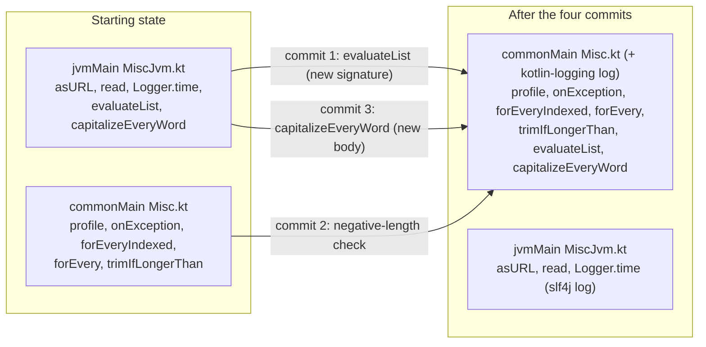

# Plan: `generaltools-breaks` - the `Misc` and `Color` API breaks

- **Covers:**
  - [SpartanLaboratories/GeneralTools#7](https://github.com/SpartanLaboratories/GeneralTools/issues/7),
    *"Make GeneralTools Kotlin Multiplatform (Color and geometry usable from common code)"*. This unit
    plans breaks 4, 8, 9 and 10 of its break set.
  - [SpartanLaboratories/GeneralTools#8](https://github.com/SpartanLaboratories/GeneralTools/issues/8),
    *"Read-only views for Point and Square so libraries can expose geometry without copying"*, which
    the same change resolves. This unit contains no part of #8; the `box-model` unit resolves it.
- **Architecture:** [`architecture.md`](architecture.md), unit `generaltools-breaks` (section 11.2,
  row 7), systems S7 (Color) and S8 (Misc helpers), the readiness table's `Misc.kt` row, the adoption
  verdicts in section 8.2, the tiers and KDoc obligations in section 9, and ledger rows 4, 8, 9 and 10
  in section 11.3.
- **Position in the landing order:** unit 7 of 8. It depends on `logging` (unit 3) and `commonize`
  (unit 4) and is independent of `two-doubles` (5) and `box-model` (6); on the single linear branch it
  lands after them and before `release` (8).
- **State this unit starts from:** the tree after `kmp-build`, `explicit-api`, `logging` and
  `commonize`, with `master` (`c196d1a`) already merged.
  - `src/commonMain/kotlin/generaltools/Misc.kt` holds `profile`, `onException`, `forEveryIndexed`,
    `forEvery` and `trimIfLongerThan`.
  - `src/jvmMain/kotlin/generaltools/MiscJvm.kt` holds `asURL`, `read`, `Logger.time`, the slf4j
    logger, and `evaluateList` and `capitalizeEveryWord` with their 2.x bodies. Both files start with
    `@file:JvmMultifileClass` and `@file:JvmName("MiscKt")`.
  - `src/commonMain/kotlin/generaltools/Color.kt` already renders `toHex` with
    `toString(16).padStart(2, '0').uppercase()`.
  - `commonTest` holds `com.spartanlabs.testing.component.generaltools.MiscTest` (the pure `Misc`
    tests) and `...ColorTest`; `jvmTest` holds the interim `...MiscJvmTest` with
    `capitalizeEveryWord capitalizes each word`, `evaluateList returns true when a predicate matches`
    and `evaluateList returns false when no predicate matches`.
  - `api/GeneralTools.api` and `api/GeneralTools.klib.api` are committed and `checkKotlinAbi` is part
    of `check`.
- **Branch:** `feat/issue-7-kotlin-multiplatform` (all units land on it).
- **Commit:** TBD (this plan document is committed in the same commit as break 4, the first of the four
  commits below).
- **PR:** TBD.
- **Status:** planning only. Nothing is uploaded or published until the maintainer explicitly starts
  the release.
- **Release:** 3.0.0.

Four commits, one per break, in this order: `evaluateList` (break 4), `trimIfLongerThan` (break 9),
`capitalizeEveryWord` (break 10), `Color` validation (break 8). The order makes every commit compile and
pass on `jvm`, `js` and `wasmJs`, and each commit's dump change matches exactly one ledger row.

---

## 1. Requirements

1. **`evaluateList` (break 4).** `public fun <T> evaluateList(list: Iterable<T>, validator: (T) -> Boolean): Boolean`
   lives in common `Misc.kt`, is not `inline`, and logs its two TRACE events through a kotlin-logging
   logger named `com.spartanlabs.generaltools.Misc`. Trailing-lambda callers compile unchanged.
   - Acceptance: the JVM dump changes by exactly one line, the `MiscKt.evaluateList` descriptor
     `Ljava/util/function/Predicate;` to `Lkotlin/jvm/functions/Function1;`; the klib dump gains the
     `evaluateList` entry; the two moved `evaluateList` tests pass on all three targets; a JVM test sees
     both TRACE events on the logger `com.spartanlabs.generaltools.Misc`.
2. **`trimIfLongerThan` (break 9).** A negative `length` throws `IndexOutOfBoundsException` on every
   target, through an explicit check that runs before anything else.
   - Acceptance: the dump is unchanged; the new tests pass on `jvmTest`, `jsNodeTest` and
     `wasmJsNodeTest`; the KDoc names the exception type.
3. **`capitalizeEveryWord` (break 10).** The function lives in common `Misc.kt`, keeps commas that are
   part of its input, and does not depend on the JVM default locale. Its body is
   `split(' ').joinToString(" ") { it.replaceFirstChar { c -> if (c.isLowerCase()) c.titlecase() else c.toString() } }`.
   - Acceptance: the JVM dump is unchanged; the klib dump gains the `capitalizeEveryWord` entry; the
     moved test and the new comma test pass on all three targets; a JVM test shows the result is the
     same under a Turkish default locale; `MiscJvmTest` no longer exists.
4. **`Color` validation (break 8).** `public data class Color(public val red: Int, public val green: Int, public val blue: Int, public val alpha: Int = 255)`
   rejects any channel outside `0..255` in its public constructor with `IllegalArgumentException`
   whose message names the channel and the value. `copy` validates through the constructor and stays
   public. `Color.of` still clamps. `fromHex("#-1-1-1")` throws `IllegalArgumentException`.
   - Acceptance: the dump is unchanged; `primary constructor rejects out-of-range channels` replaces
     the inverted test; every other existing `ColorTest` name and assertion is unchanged and passes
     on all three targets; the new `Color` tests below pass on all three targets.
5. **Documentation moves with the code.** Level-2 KDoc on every declaration touched; the README
   "`Color` quick reference" and "Modules" text, and migration-note rows, change in the same commit as
   the break they describe.
6. **Test names.** Every existing test name stays verbatim except the one renamed above.

## 2. Current state

Citations are to the 2.x baseline sources (`master` @ `17d30bc`, equal to tag `2.2.0`). The prior units
move and re-modify these files; the lines below locate the code the units before this one carry
forward, and the starting state is the one in the header.

- **`evaluateList`** takes `Predicate<T>` (`src/main/kotlin/generaltools/Misc.kt:57`), a
  `java.util.function.Predicate` import (`Misc.kt:10`), and logs through the file's slf4j logger
  (`Misc.kt:22`, calls at `:59` and `:62`) with the messages `Item '{}' satisfied the predicate` and
  `No items satisfied the predicate`. Nothing in `src/main` calls it; its only callers are the two
  tests in `src/test/kotlin/generaltools/MiscTest.kt:47-56`, both with trailing lambdas.
- **`trimIfLongerThan`** is `infix fun String.trimIfLongerThan(length:Int) = if(this.length > length) substring(0,length) else this`
  (`Misc.kt:108`). For a negative `length` the condition is always true, so the outcome is
  `substring(0, negative)`: `StringIndexOutOfBoundsException` on the JVM, an `IndexOutOfBounds`
  exception on `wasmJs`, and `""` on `js` (research: `cross-platform-behaviour-parity.md` 3.3, 3.8
  and section 4). It has two tests (`MiscTest.kt:106-115`) and no other caller.
- **`capitalizeEveryWord`** is `split(' ').map{it.capitalize()}.toString().let { it.substring(1,it.length-1).replace(",","") }`
  (`Misc.kt:27-30`). It builds the result from `List.toString()` and then deletes every comma, so a
  comma in the input is lost (`"hello, world"` gives `"Hello world"`); `String.capitalize()` is
  deprecated and uses the JVM default locale. One test (`MiscTest.kt:16-19`) with a comma-free input.
  No other caller.
- **`Color`** (`src/main/kotlin/generaltools/Color.kt:23`) is a `data class` whose KDoc says
  the constructor "does not validate" (`:8-9`, `:17-20`); `Color.of` clamps (`:185-191`);
  `toPackedInt` KDoc says channels are "the caller's responsibility" (`:134`).
  - Every factory and transform produces in-range channels: `lightened`/`darkened`/`grayscale`/`lerp`
    end in `coerceIn(0, 255)` (`:49`, `:66`, `:92`, `:112`); `inverted` is `255 - c` of in-range
    channels (`:83`); `withAlpha` coerces (`:76`); `fromNormalized` clamps to `0f..1f` before scaling
    (`:211`); `fromPackedInt` masks with `0xFF` (`:224-227`); the 14 companion constants are literals
    in range.
  - The one exception is `fromHex` with a sign character. For six and eight digits each channel is a
    two-character `toInt(16)` parse (`:253-262`), and `"-1"` parses to `-1`, so `"#-1-1-1"` returns
    `Color(-1, -1, -1)` today. A three-digit input repeats one character (`:247-249`), so `"--"` fails
    to parse and cannot produce a negative channel. A leading `+` parses to the same non-negative value
    as without it and is unaffected.
  - Only one test in the repository constructs an out-of-range `Color` on purpose:
    `ColorTest.kt:376-380` (`primary constructor does not clamp out-of-range channels`, asserting
    `300`). No source in `src/main` outside `Color.kt` refers to `Color`.
- **Downstream (read-only, nothing is filed):** no downstream repository calls `evaluateList`,
  `capitalizeEveryWord` or `trimIfLongerThan` (`research/downstream-under-mutable-model.md` section 3,
  `research/downstream-blast-radius.md`). MyGameTools and MyGameClient make 19 `Color(...)` calls in
  6 files (MyGameClient, per `downstream-under-mutable-model.md`) and 2 in MyGameTools main, every one
  with in-range literals or computed in-range values except MyGameClient's `Portrait`, which builds a
  `Color` from network snapshot values and would now throw on an out-of-range value.
- **Verified outside facts this unit rests on:**
  - `Char.titlecase()`, `Char.isLowerCase()` and `String.replaceFirstChar` are common API; `titlecase()`
    uses the invariant locale; the expression reproduces the old titlecasing of lowercase letters and
    leaves uppercase letters alone (`cross-platform-behaviour-parity.md` 3.8, sources linked there).
  - `String.substring` with a negative length returns `""` on JS (same file, 3.3 and the parity table);
    `IndexOutOfBoundsException` is a common Kotlin class.
  - On JS a `Float` is a double-precision number, so `Color.lerp` and `Color.luminance` do their
    intermediate arithmetic in double precision there. Over 6,619,136 probed `lerp` cases the JS and JVM
    channels differed by one in 676 (0.010%), with a literal fraction such as `0.21f` (same file, 3.3).
  - `Int.toString(radix)` and `String.toInt(radix)` (sign characters included) behave the same on all
    three targets (same file, 3.5).
  - kotlin-logging 8.0.4 is the logger library; `KotlinLogging.logger(name)` passes the name to slf4j
    unchanged on the JVM; `trace { ... }` evaluates its lambda only when TRACE is enabled
    (`kotlin-logging-adoption.md` F1-F9).
  - A public `inline` function that logs would force a `@PublishedApi` logger into the ABI; that is why
    `evaluateList` is not `inline` (`idiomatic-kotlin-api-mechanics.md` F3).

## 3. Assumptions

| # | Assumption | If false |
|---|---|---|
| G1 | A private top-level `log` in `Misc.kt` (kotlin-logging) and another in `MiscJvm.kt` (slf4j) compile side by side in one `@JvmMultifileClass` facade. (Precedent: `Point.kt` and `TwoDoubles.kt` each declare a private `log` in one package.) | Rename the JVM file's logger to `jvmLog` in the commit that fails; no public signature changes. |
| G2 | The `MiscKt` dump lines for `capitalizeEveryWord` and `trimIfLongerThan` are identical before and after the edits (same JVM names and descriptors; return type `String` was inferred and is now explicit). Architecture A4/A7. | The extra or missing line is an error in this plan or a defect in the commit; compare against the ledger and correct before committing. |
| G3 | The commonize unit stripped `log` fields, `log.info(...)` calls and `@Tag` from `MiscTest` and `ColorTest`, so the edits below are made to class bodies that do not mention `log`. | Delete any leftover `log` use in the same edit; it is not part of the contract. |
| G4 | The existing `ColorTest` `lerp`/`luminance` assertions pass on `js` and `wasmJs` as they do on the JVM (parity findings 3.3). | The failing assertion is a parity finding for `commonize`, not this unit; this unit's new tests do not depend on it. |
| G5 | The README has the sections "Maven coordinates", "Modules", "Build & test", "Releasing", "`Color` quick reference", "Geometry quick reference", `## Logging` and `## 3.0.0 migration notes` (a table `Symptom | Cause | Fix`), as the earlier units leave it. | Create the missing section with the same headings and columns. |
| G6 | A logback `ListAppender` attached to `com.spartanlabs.generaltools.Misc` sees the kotlin-logging TRACE events on the JVM (kotlin-logging delegates to slf4j, logback is the `jvmTest` backend). | The test is rewritten around whatever kotlin-logging 8.0.4 exposes on the JVM; the logger-name contract still needs a test. |

## 4. Non-goals

- Converting `trimIfLongerThan` or `Color`'s constructor to `Result`. They report by exception by
  contract (architecture 8.2, "Throwing members").
- Using the `logging` unit's `KLogger.failure` helper. None of the four functions has a `Result`-returning
  failure path.
- Any change to `Color.of`, `fromNormalized`, `fromPackedInt`, `toHex` or the transforms, other than KDoc.
  `@ExposedCopyVisibility`, `@ConsistentCopyVisibility`, an `internal` constructor and a `Color.copy`
  override are not used: the public constructor validates and `copy` stays as the compiler generates it.
- Making `evaluateList` `inline`, adding a `Predicate` overload, or a deprecation shim (clean break).
- Float32 emulation on JS; changing `lerp`/`luminance` arithmetic.
- The `Square`/`Rectangle`, `TwoDoubles` and logging-package breaks, and the other units' README rows.
- Migrating MyGameTools, MyGameClient or any downstream repository. Nothing is filed against them.
- A `CHANGELOG.md`; migration notes live in the README and the GitHub release.

## 5. Design

### 5.1 File movement



Both files keep `@file:JvmMultifileClass` and `@file:JvmName("MiscKt")`, so every function stays on the
JVM facade `MiscKt`. `Color.kt` is edited in place in commit 4.

### 5.2 Signatures, error handling and mutability

All declarations are `public` with explicit return types (`explicitApi()` is on). None holds mutable
state; `evaluateList`'s loop is the only local mutation (an iteration), and its logger is a file-level
`val`.

**Commit 1 - `evaluateList`** (in `Misc.kt`, common):

```kotlin
private val log = KotlinLogging.logger("com.spartanlabs.generaltools.Misc")

public fun <T> evaluateList(list: Iterable<T>, validator: (T) -> Boolean): Boolean
```

- Returns `true` as soon as `validator` returns `true` for an item, otherwise `false`; an empty `list`
  gives `false`. It has no expected failure, so it does not return a `Result`.
- A throwing `validator` or `Iterable` is a programmer error and propagates unchanged; the function
  neither catches nor wraps it. Nothing unwraps a `Result` because none exists.
- Body (loop with early return, kept from 2.x because a `firstOrNull`/`any` form either loses the item for the
  log or cannot tell a `null` item from no match):

```kotlin
for (item in list) {
    if (validator(item)) {
        log.trace { "Item '$item' satisfied the predicate" }
        return true
    }
}
log.trace { "No items satisfied the predicate" }
return false
```

- Logging events: two TRACE events on logger `com.spartanlabs.generaltools.Misc`, message text identical
  to 2.x (`Item '2' satisfied the predicate`, `No items satisfied the predicate`). The `trace { }`
  lambda renders `item.toString()` only when TRACE is enabled. No other event: a match and a miss are
  results, not failures.
- The kotlin-logging type appears in no public signature, and the function is not `inline`.
- `import io.github.oshai.kotlinlogging.KotlinLogging` is added to `Misc.kt`. `MiscJvm.kt` loses the
  `java.util.function.Predicate` import and the function; its slf4j `log` stays (used by `asURL` and
  `read`).
- KDoc (Level 2), required content:
  - one-sentence behaviour and "stops at the first match";
  - `@param T`, `@param list` (iterated at most once; a one-shot `Iterable` is consumed up to and
    including the first match), `@param validator` (called at most once per item, never after a
    match);
  - `@return`, including the empty-list case;
  - `@throws` stating that exceptions from `validator` and the iterator propagate;
  - Boundary Ring note: the two TRACE events, the logger name (unchanged from 2.x, so existing backend
    rules still match), and that the item's `toString()` is rendered only when TRACE is on;
  - a note that the parameter was `java.util.function.Predicate<T>` in 2.x.

**Commit 2 - `trimIfLongerThan`** (in `Misc.kt`):

```kotlin
public infix fun String.trimIfLongerThan(length: Int): String {
    // Explicit check: substring(0, negative) throws on the JVM and wasmJs but returns "" on Kotlin/JS,
    // so the contract is enforced here instead of being inherited from the platform.
    if (length < 0) throw IndexOutOfBoundsException("length must be >= 0 but was $length")
    return if (this.length > length) substring(0, length) else this
}
```

- Returns the first `length` characters when the receiver is longer, otherwise the receiver itself.
- A negative `length` is a programmer error and throws `IndexOutOfBoundsException`, on every target and
  for every receiver (the check comes first, so `"".trimIfLongerThan(-1)` also throws). It does not
  return a `Result`: it keeps reporting by exception, as `substring` does. There is nothing to unwrap.
- On the JVM the thrown instance is now a plain `IndexOutOfBoundsException`; 2.x threw its subtype
  `StringIndexOutOfBoundsException`. Code catching the supertype keeps working; code catching the
  subtype does not (migration row).
- No logging: a thrown programmer error is not logged, matching the other throwing members.
- The JVM descriptor `(Ljava/lang/String;I)Ljava/lang/String;` and the `infix` modifier are unchanged.
- KDoc: behaviour; `@param length` (must be `>= 0`); `@return`; `@throws IndexOutOfBoundsException` if
  `length` is negative, on every platform, naming the JVM subtype change.

**Commit 3 - `capitalizeEveryWord`** (moved to `Misc.kt`):

```kotlin
public fun String.capitalizeEveryWord(): String =
    split(' ').joinToString(" ") { it.replaceFirstChar { c -> if (c.isLowerCase()) c.titlecase() else c.toString() } }
```

- Total function: it has no failure path and returns no `Result`. The receiver is not modified.
- Only the space character separates words (tabs and newlines do not), exactly as in 2.x. Commas,
  repeated spaces and leading or trailing spaces are preserved. The mapping is the invariant-locale
  Unicode one: `"istanbul"` becomes `"Istanbul"` under every default locale (2.x gave `"İstanbul"`
  under a Turkish default).
- `replaceFirstChar` has a `Char` and a `CharSequence` overload; the lambda returns `String` in both
  branches, which selects the `CharSequence` overload (the form the stdlib itself documents as the
  replacement for `capitalize()`).
- No logging.
- The JVM descriptor `(Ljava/lang/String;)Ljava/lang/String;` is unchanged.
- KDoc: behaviour as above; `@receiver`/`@return`; a note that commas are kept (2.x removed them) and
  that the result does not depend on the default locale.

**Commit 4 - `Color`** (in `Color.kt`, common):

```kotlin
public data class Color(public val red: Int, public val green: Int, public val blue: Int, public val alpha: Int = 255) {
    init {
        require(red in 0..255) { "red must be in 0..255 but was $red" }
        require(green in 0..255) { "green must be in 0..255 but was $green" }
        require(blue in 0..255) { "blue must be in 0..255 but was $blue" }
        require(alpha in 0..255) { "alpha must be in 0..255 but was $alpha" }
    }
    ...
}
```

- An out-of-range channel is a programmer error at the call site and throws
  `IllegalArgumentException` (from `require`), naming the first offending channel in the order red,
  green, blue, alpha. It does not return a `Result`: the type is a constructor. Expected invalid input
  (parsed or received values) is handled by choosing `Color.of`, which clamps and cannot fail; a caller
  that wants a failure value wraps the call in `runCatching`, and that is the place any such `Result`
  would be unwrapped.
- Literals `0..255` rather than a companion constant: the companion's property initialisers
  (`WHITE = Color(...)`) construct `Color`s while the companion is being initialised, so a constant declared
  later in the companion would be unset when those constructors run. `x in 0..255` compiles to two
  comparisons with no allocation.
- `copy` is the compiler-generated function and calls the constructor, so it validates; it stays
  public with no copy-visibility annotation. The dump shows no change (constructor, `copy`,
  `copy$default` and `component1..4` keep their signatures).
- The four `require` messages are lazy (`require`'s lambda is only evaluated on failure).
- `fromHex`: no code change. The six- and eight-digit branches pass a parsed `-1` to the constructor, which
  now throws `IllegalArgumentException` (the type its KDoc already promises for non-hex input).
- No logging: `Color` is an immutable value type and every failure is a thrown programmer error.
- KDoc to change in `Color.kt` (Level 2):
  - class KDoc: replace "the primary constructor does not validate them; use [Color.of] to clamp
    untrusted input" with: the constructor validates and throws `IllegalArgumentException` for a
    channel outside `0..255`, the message names the channel and the value; `copy` is generated through
    the constructor and validates the same way; use `Color.of` to clamp untrusted input instead of
    rejecting it; on Kotlin/JS a `Float` is double precision, so `lerp` and `luminance()` can differ
    from the JVM and Wasm results in the last digits (and a `lerp` channel can differ by one for some
    fractions);
  - add `@throws IllegalArgumentException` on the class;
  - the four `@property` lines: drop "not validated by the constructor";
  - `Color.of` KDoc: drop "the constructor performs no validation"; say the constructor rejects what
    `of` clamps;
  - `lerp` and `luminance()` KDoc: the JS `Float` note;
  - `toPackedInt` KDoc: replace "assumed to be in `0..255` - the caller's responsibility" with "always in
    `0..255` by construction";
  - `fromHex` KDoc `@throws`: add "or a sign character makes a channel negative (for example
    `"#-1-1-1"`)".
  - the companion object and the thirteen named constants (`WHITE` ... `DARK_GRAY`), which have no KDoc
    today: a one-line KDoc on the companion ("Named colours and the factories that build a [Color]") and on
    each constant, giving its channels (for example `/** Opaque white, `(255, 255, 255)`. */`).

### 5.3 Migration rows (appended to `## 3.0.0 migration notes`, `Symptom | Cause | Fix`)

Each row lands in the commit of its break. The "Cause" cell states whether the break is source,
binary or behavioural.

| Commit | Symptom | Cause | Fix |
|---|---|---|---|
| 1 | Type mismatch naming `Predicate` on a call to `evaluateList`, or `NoSuchMethodError: evaluateList(Iterable, Predicate)` from code compiled against 2.x | `evaluateList` now takes `(T) -> Boolean` and lives in common code (source and binary break; the JVM descriptor changes from `Predicate` to `Function1`) | A trailing lambda compiles unchanged: `evaluateList(items) { it > 0 }`. For a `Predicate` variable pass `predicate::test`; replace `Predicate { ... }` with a plain lambda. Recompile every caller; a Java caller passes a lambda for the Kotlin function type. |
| 2 | `IndexOutOfBoundsException` from `trimIfLongerThan` with a negative length (no compile error); on Kotlin/JS the old result `""` is gone | A negative length is rejected on every platform. On the JVM the exception is now a plain `IndexOutOfBoundsException`, no longer its subtype `StringIndexOutOfBoundsException` (behavioural break) | Pass a length of `0` or more (`maxOf(0, n)`); catch `IndexOutOfBoundsException`, not the subtype. |
| 3 | `capitalizeEveryWord` output contains commas it used to lose: `"a, b"` gives `"A, B"` (2.x: `"A B"`) | 2.x built the result from `List.toString()` and deleted every comma, including the input's own (behavioural break). It also no longer uses the JVM default locale (a Turkish default no longer produces a dotted capital `İ`) | If you relied on the removal, call `.replace(",", "")` on the result. |
| 4 | `IllegalArgumentException: red must be in 0..255 but was 300` (or green/blue/alpha) from `Color(...)` or `color.copy(...)` | The public constructor validates its channels, and `copy` goes through it (behavioural break; no signature changes) | Pass in-range channels. For values you do not control (parsed text, network or user input) use `Color.of(...)`, which clamps; MyGameClient's `Portrait`, which builds a `Color` from network snapshot values, is the typical case. |
| 4 | `Color.fromHex("#-1-1-1")` throws `IllegalArgumentException`; 2.x returned `Color(-1, -1, -1)` | A sign character makes a channel parse as negative, which the constructor now rejects | Validate or strip the sign before parsing; `fromHex` has always documented `IllegalArgumentException` for malformed input. |

## 6. File-by-file changes

Paths are the post-`commonize` paths (header). "KDoc" means the Level-2 content in section 5.2.
Every commit also stages the regenerated `api/` files named under it.

### Commit 1 - `evaluateList`

1. **`src/commonMain/kotlin/generaltools/Misc.kt`**
   - Add `import io.github.oshai.kotlinlogging.KotlinLogging`.
   - Add the file-level `private val log = KotlinLogging.logger("com.spartanlabs.generaltools.Misc")`
     with a one-line KDoc (diagnostic output of this file's functions; name unchanged from 2.x).
   - Add `evaluateList` as in 5.2 with its KDoc.
   - If `onException`'s KDoc still says it cannot reference the file's private `[log]`, it is accurate again
     and stays; do not edit it.
2. **`src/jvmMain/kotlin/generaltools/MiscJvm.kt`**
   - Remove `evaluateList` and the `java.util.function.Predicate` import. Keep the slf4j `log`,
     `asURL`, `read`, `Logger.time`, `capitalizeEveryWord`.
3. **`src/commonTest/kotlin/com/spartanlabs/testing/component/generaltools/MiscTest.kt`**
   - Add the two moved tests and two new ones (test plan, section 8).
4. **`src/jvmTest/kotlin/com/spartanlabs/testing/component/generaltools/MiscJvmTest.kt`**
   - Delete `evaluateList returns true when a predicate matches` and
     `evaluateList returns false when no predicate matches` (moved, not copied). The class keeps
     `capitalizeEveryWord capitalizes each word`.
5. **`src/jvmTest/kotlin/com/spartanlabs/testing/integration/generaltools/EvaluateListLoggingTest.kt`** (new)
   - Level 3 test of the logger name and TRACE events (section 8).
6. **`api/GeneralTools.api`, `api/GeneralTools.klib.api`**
   - Regenerate with `./gradlew updateKotlinAbi`; review against 11.
7. **`README.md`**
   - "Modules": read the `Misc` entry as `commonize` left it. If it names `evaluateList` among the
     JVM-only items, move that name to the platform-neutral items. If it names only categories (string,
     URL, file, list, timing helpers) and marks the JVM-only ones by name, `evaluateList` was never listed
     as JVM-only and nothing changes. `capitalizeEveryWord` follows the same rule in commit 3.
   - Append the commit-1 migration row.
8. **`docs/plans/7-kotlin-multiplatform/plan-generaltools-breaks.md`** - this plan, in this commit.

### Commit 2 - `trimIfLongerThan`

1. **`src/commonMain/kotlin/generaltools/Misc.kt`** - replace the expression body with the block body and
   explicit check of 5.2; rewrite the KDoc.
2. **`src/commonTest/kotlin/com/spartanlabs/testing/component/generaltools/MiscTest.kt`** - add the three
   `trimIfLongerThan` tests (section 8). The two existing `trimIfLongerThan` tests are untouched.
3. **`README.md`** - append the commit-2 migration row.
4. **`api/`** - regenerate; expected: no change (`git diff --exit-code -- api/`).

### Commit 3 - `capitalizeEveryWord`

1. **`src/commonMain/kotlin/generaltools/Misc.kt`** - add `capitalizeEveryWord` with the replacement body
   and KDoc. Keep functions in the file's existing order, `capitalizeEveryWord` first.
2. **`src/jvmMain/kotlin/generaltools/MiscJvm.kt`** - remove `capitalizeEveryWord`. The file now holds only
   `asURL`, `read`, `Logger.time` and the slf4j logger.
3. **`src/commonTest/kotlin/com/spartanlabs/testing/component/generaltools/MiscTest.kt`** - add the
   moved `capitalizeEveryWord capitalizes each word` (verbatim name and assertion) and the new comma test.
4. **`src/jvmTest/kotlin/com/spartanlabs/testing/component/generaltools/MiscJvmTest.kt`** - delete the
   file (empty after the move).
5. **`src/jvmTest/kotlin/com/spartanlabs/testing/deterministic/generaltools/CapitalizeEveryWordLocaleTest.kt`** (new)
   - Level 4a test of locale independence (section 8).
6. **`README.md`** - "Modules": `capitalizeEveryWord` is a common helper (same rule as commit 1); append
   the commit-3 migration row.
7. **`api/GeneralTools.api`, `api/GeneralTools.klib.api`** - regenerate; expected: the JVM dump is unchanged
   and the klib dump gains the `capitalizeEveryWord` entry.

### Commit 4 - `Color` validation

1. **`src/commonMain/kotlin/generaltools/Color.kt`** - add the `init` block; apply the KDoc changes of 5.2.
   No other code change.
2. **`src/commonTest/kotlin/com/spartanlabs/testing/component/generaltools/ColorTest.kt`**
   - Rename `primary constructor does not clamp out-of-range channels` to exactly
     `primary constructor rejects out-of-range channels` and invert its assertion.
   - Add the new tests of section 8. Add `assertFailsWith`/`assertTrue` imports only if not yet imported
     (both already are).
3. **`src/commonTest/kotlin/com/spartanlabs/testing/deterministic/generaltools/ColorTransformRangeTest.kt`** (new)
   - Level 4a sweep proving no factory or transform can now throw.
4. **`README.md`**
   - "`Color` quick reference": in the "Factories:" paragraph replace "use it for untrusted input; the
     primary constructor does not validate" with "use it for untrusted input; the primary constructor
     and `copy` throw `IllegalArgumentException` for a channel outside `0..255`". Add one sentence after
     the paragraph: a `Float` is double precision on Kotlin/JS, so `lerp` and `luminance()` can differ
     in the last digits there. Add one example line to the code block:
     `// Color(300, 0, 0)  // throws IllegalArgumentException - use Color.of for untrusted values`.
   - Append the two commit-4 migration rows.
5. **`api/`** - regenerate; expected: no change.

## 7. Documentation impact

- **Ring 1 (in-editor).** Level-1 comments on the non-obvious lines: the `trimIfLongerThan` check (why it
  is explicit), the `capitalizeEveryWord` lambda (why `isLowerCase` guards `titlecase()`: it keeps
  uppercase letters as they are, as 2.x did), the `Color` `init` (why literals and not a companion
  constant), the `evaluateList` loop (why not `any`).
- **Ring 2 (component KDoc).** Level-2 KDoc on `evaluateList`, `trimIfLongerThan`, `capitalizeEveryWord`,
  `Color` (class, `@property`, `@throws`), `Color.of`, `lerp`, `luminance`, `toPackedInt` and `fromHex`, as in 5.2.
  The `copy` contract is stated in the class KDoc because KDoc cannot attach to the generated `copy`.
- **Ring 3 (boundary).** The `com.spartanlabs.generaltools.Misc` TRACE events and logger name (in the
  `evaluateList` KDoc), the JS `Float` precision note, and the migration rows. The kotlin-logging
  startup line and WARN-level notes belong to the `logging` and `release` units.
- **Ring 4 (topology).** No new component or dependency edge: `Misc.kt` already depends on kotlin-logging
  and `Color` on nothing. The architecture document's S7 and S8 already describe the end state; no
  change is needed to it.
- **README** (same commit as each change): "Modules" (the two moved helpers, per the rule in commit 1),
  "`Color` quick reference", and five migration rows (section 5.3). "Build & test" and "Releasing" are
  not touched.
- **Other documents.** `docs/plans/1-color-methods/plan.md` still says the constructor is left
  untouched; that stays as history and its pointer note belongs to the work outside every unit.

## 8. Test plan

All tests use `kotlin.test` (`@Test`, `assertEquals`, `assertFailsWith`, `assertTrue`, `assertFalse`),
one class per file, and carry the "Level N" KDoc line. `commonTest` classes run on `jvmTest`,
`jsNodeTest` and `wasmJsNodeTest`; `jvmTest` classes run on the JVM only.

### Level 1 - local gating (before each commit)

Run from the repository root; every command must pass before the commit is made.

```sh
./gradlew jvmTest jsNodeTest wasmJsNodeTest -PtestLevel=component,deterministic,integration
./gradlew updateKotlinAbi          # commits 1 and 3 only; then review the diff against section 11
git diff --exit-code -- api/       # commits 2 and 4: must exit 0 (no dump change)
./gradlew build                    # all targets, all levels, and checkKotlinAbi, against the committed dump
```

For commits 1 and 3 `updateKotlinAbi` runs first and its output is staged with the commit; `build` then
proves the committed dump matches. For commits 2 and 4 `build` runs `checkKotlinAbi` against the dump that
must already be correct.

### Level 2 - isolated component behaviour (`commonTest`, `testing.component.generaltools`)

**`MiscTest`** (`src/commonTest/kotlin/com/spartanlabs/testing/component/generaltools/MiscTest.kt`; 7 tests
at the start of this unit, 16 at its end).

| Commit | Test | Asserts |
|---|---|---|
| 1 | `evaluateList returns true when a predicate matches` (moved, verbatim) | `evaluateList(listOf(1, 2, 3)) { it == 2 }` is `true` |
| 1 | `evaluateList returns false when no predicate matches` (moved, verbatim) | `evaluateList(listOf(1, 2, 3)) { it == 5 }` is `false` |
| 1 | `evaluateList returns false for an empty list` | `evaluateList(emptyList<Int>()) { true }` is `false` and the validator is never called |
| 1 | `evaluateList stops at the first match` | with a counting validator over `listOf(1, 2, 3)` that matches `2`, the result is `true` and the validator was called exactly twice |
| 2 | `trimIfLongerThan throws for a negative length` | `assertFailsWith<IndexOutOfBoundsException> { "hello".trimIfLongerThan(-1) }` |
| 2 | `trimIfLongerThan throws for a negative length on an empty string` | `assertFailsWith<IndexOutOfBoundsException> { "".trimIfLongerThan(-1) }` (the check precedes the length comparison) |
| 2 | `trimIfLongerThan to zero yields the empty string` | `"hello".trimIfLongerThan(0)` is `""` |
| 3 | `capitalizeEveryWord capitalizes each word` (moved, verbatim) | `"hello world foo".capitalizeEveryWord()` is `"Hello World Foo"` |
| 3 | `capitalizeEveryWord keeps commas that are part of the input` | `"hello, world, foo"` gives `"Hello, World, Foo"` and `"one,two three"` gives `"One,two Three"` |

The negative-length tests are the proof for break 9 on every target: on `js` the unchecked 2.x code
returned `""`, so those tests fail there without the explicit check. The comma test is the proof for
break 10. The existing `trimIfLongerThan trims strings longer than the given length` and
`... leaves shorter strings unchanged` use the infix form (`"hello world" trimIfLongerThan 5`) and stay as written.

**`ColorTest`** (`src/commonTest/kotlin/com/spartanlabs/testing/component/generaltools/ColorTest.kt`; 67
tests today, 76 after commit 4). All Commit 4.

| Test | Asserts |
|---|---|
| `primary constructor rejects out-of-range channels` (renamed from `primary constructor does not clamp out-of-range channels`) | `assertFailsWith<IllegalArgumentException> { Color(300, 0, 0) }` |
| `primary constructor accepts the boundary values 0 and 255` | `Color(0, 0, 0, 0)` and `Color(255, 255, 255, 255)` construct and report their channels |
| `primary constructor rejects each channel below 0` | `Color(-1, 0, 0, 0)`, `Color(0, -1, 0, 0)`, `Color(0, 0, -1, 0)` and `Color(0, 0, 0, -1)` each throw `IllegalArgumentException` |
| `primary constructor rejects each channel above 255` | the same four positions with `256` each throw `IllegalArgumentException` |
| `primary constructor names the offending channel and value` | `Color(0, 300, 0)` fails with a message containing `green` and `300` |
| `copy rejects an out-of-range channel` | `Color(0, 0, 0).copy(alpha = 256)` throws `IllegalArgumentException` |
| `copy keeps a valid replacement` | `Color(1, 2, 3, 4).copy(red = 9)` equals `Color(9, 2, 3, 4)` |
| `of clamps extreme Int values without throwing` | `Color.of(Int.MIN_VALUE, Int.MAX_VALUE, 0)` equals `Color(0, 255, 0, 255)` |
| `fromHex rejects a sign character that parses to a negative channel` | `Color.fromHex("#-1-1-1")` throws `IllegalArgumentException` |
| `fromHex rejects a sign character in the alpha pair` | `Color.fromHex("#-1FFFFFF")` throws `IllegalArgumentException` |

Unchanged and required to pass: `of clamps channels high and low`, `of passes through in-range channels`,
`of defaults alpha to opaque`, all `withAlpha`, `lightened`, `darkened`, `lerp`, `fromNormalized`,
`fromPackedInt`, `toHex` and `fromHex` tests, and `companion constants have expected channels`.

### Level 3 - integration (`jvmTest`)

**`EvaluateListLoggingTest`** (`src/jvmTest/kotlin/com/spartanlabs/testing/integration/generaltools/EvaluateListLoggingTest.kt`).
It crosses the boundary with the slf4j/logback backend. Setup uses `LogCapture` (provided by the
`logging` unit at `src/jvmTest/kotlin/com/spartanlabs/testing/integration/generaltools/LogCapture.kt`)
to attach a list appender to `com.spartanlabs.generaltools.Misc`, and sets that logback logger's level
to `Level.TRACE`; the teardown closes the capture and restores the previous level.

| Test | Asserts |
|---|---|
| `evaluateList logs the satisfying item at TRACE on the Misc logger` | after `evaluateList(listOf(1, 2, 3)) { it == 2 }` the appender holds one event at `Level.TRACE` whose formatted message is `Item '2' satisfied the predicate` |
| `evaluateList logs a miss at TRACE on the Misc logger` | after `evaluateList(listOf(1, 2, 3)) { it == 5 }` the appender holds one event at `Level.TRACE` with message `No items satisfied the predicate` |

This is the proof that the 2.x logger name survives the move to kotlin-logging. It uses a real logback
backend in memory and needs no network or file.

### Level 4a - deterministic mapping

- **`CapitalizeEveryWordLocaleTest`** (`src/jvmTest/kotlin/com/spartanlabs/testing/deterministic/generaltools/CapitalizeEveryWordLocaleTest.kt`):
  `capitalizeEveryWord gives the same result under a Turkish default locale` sets
  `Locale.setDefault(Locale.forLanguageTag("tr-TR"))`, asserts `"istanbul izmir".capitalizeEveryWord()` is
  `"Istanbul Izmir"`, and restores the previous default in a `finally`. JVM only because `java.util.Locale`
  is JVM API; the other targets have no default locale to vary. JUnit runs the JVM tests sequentially
  (no parallel execution is configured), so the global default is safe to change for the test's duration.
- **`ColorTransformRangeTest`** (`src/commonTest/kotlin/com/spartanlabs/testing/deterministic/generaltools/ColorTransformRangeTest.kt`):
  `every transform of an in-range colour yields an in-range colour`. For every channel value `a` in
  `0..255` and every `b` in `{0, 1, 85, 127, 128, 170, 254, 255}`, build `Color(a, b, 255 - a, 255 - b)`
  and apply `lightened(0.0/0.35/1.0)`, `darkened(0.0/0.35/1.0)`, `inverted()`, `grayscale()`, `withAlpha(a)`,
  `lerp(Color(b, a, b, a), 0f/0.21f/0.5f/1f)` and `Color.fromPackedInt(toPackedInt())`; assert that none
  throws and that every result channel is in `0..255`. Also `Color.fromNormalized` with
  `-1f, 0f, 0.5f, 1f, 2f, NaN, Infinity`. It exists because a transform that produced an out-of-range
  channel used to be stored silently and now throws, on every target, including JS where `lerp` does its
  arithmetic in double precision.

### Levels 4b, 4c, 5

- **4b (end to end):** none. The unit has no application flow. The cross-artifact end-to-end proof is
  the `release` unit's consumer smoke matrix, which compiles `Color` usage and an `evaluateList` call with
  a lambda against the published-to-a-file artifacts.
- **4c (non-functional):** none. Validation adds four integer comparisons per construction, and
  `evaluateList`'s `trace { }` lambda is evaluated only when TRACE is enabled, so no measurement is
  warranted.
- **5 (UAT):** none. There is no interactive behaviour.

### What cannot be tested automatically

- The consumer-visible compile break for a `Predicate` argument to `evaluateList` (needs a compile-fail
  harness; [SpartanLaboratories/GeneralTools#12](https://github.com/SpartanLaboratories/GeneralTools/issues/12)
  tracks one for a later minor). The `release` smoke project records it once by hand.
- The JS last-digit `Float` difference in `lerp`/`luminance`: documented, not asserted (existing
  assertions use exact values that hold on every target, or a `1e-4` tolerance).
- Other default locales: only Turkish is exercised.

## 9. Risks & edge cases

- **Runtime break without a compile break (`Color`).** Any consumer or serialization path that builds a
  `Color` from untrusted ints now throws at the call site, which can be far from where the bad value
  was created (MyGameClient `Portrait`). Binary compatibility is preserved (constructor, `copy` and
  `component1..4` keep their signatures), so a compiled 2.x caller links and then throws. The migration
  rows direct untrusted input to `Color.of`.
- **`copy` bypass is closed, not just the constructor.** `Color(0, 0, 0).copy(alpha = 256)` throws.
  `withAlpha` is unaffected because it coerces before calling `copy`.
- **`fromHex` stays lenient where it was.** `"#+f+f+f"` still parses to `Color(15, 15, 15)`; only inputs
  that yield a negative channel (a `-` sign) change. A three-digit sign input already failed to parse.
- **`Color` initialisation order.** Using literals in the `init` avoids reading a companion property
  during companion initialisation; do not replace them with a companion constant.
- **`evaluateList` binary break.** Compiled 2.x callers fail with `NoSuchMethodError` until recompiled;
  Java callers must pass a Kotlin function type. Kotlin callers with trailing lambdas recompile
  unchanged. Callers holding a `Predicate` variable must adapt.
- **TRACE cost.** Message construction is lazy; with TRACE off the cost is one level check per call. On
  JS and Wasm kotlin-logging writes to the console with one global level, so a TRACE-level consumer on
  those targets sees these events too (Boundary Ring, `logging` unit).
- **`trimIfLongerThan` exception subtype on the JVM.** Plain `IndexOutOfBoundsException` replaces
  `StringIndexOutOfBoundsException`; a `catch (e: StringIndexOutOfBoundsException)` stops matching.
  Listed in the migration row.
- **`capitalizeEveryWord` Unicode tables.** `isLowerCase`/`titlecase` use the JDK's tables on the JVM and
  the Kotlin stdlib's on `js`/`wasmJs`; a character added in a newer Unicode version than the running
  JDK's can differ between targets. Tested inputs are ASCII.
- **One-to-many title case.** `ß` and ligatures expand to several characters, as in 2.x.
- **Concurrency.** None of the four functions holds shared mutable state; `Color` is immutable. The
  locale test mutates the JVM default locale and restores it.
- **Cross-repo.** No downstream repository calls these three `Misc` functions. MyGameTools and
  MyGameClient `Color(...)` calls keep compiling; `Portrait` is the one runtime-exposure site. Nothing
  is filed against them.
- **Merge hazard.** The README migration table is appended to by several units; on the linear branch
  there is no conflict, but each commit must append, not reorder, rows.

## 10. Staging note

The four commits are the stages; each is independently landable and leaves the build green on all
targets. Commit 3 is the only one that depends on a previous commit's test-file state (it deletes the
`MiscJvmTest` that commit 1 reduced to one test).

## 11. Version control

Branch: `feat/issue-7-kotlin-multiplatform`. The `manager` agent performs every git step; messages carry
no attribution trailers. Planning documents ride with the work they plan: `architecture.md`, `impact.md`
and the dated pointers on the two earlier plans land in the first `kmp-build` commit, and each
`plan-<unit>.md` lands in its unit's first commit, so this plan lands in commit 1 here.
`src/test/resources/keys.txt` is never touched (it is gone from the tree once `master` is merged).

| # | Subject | Contents | Expected dump delta (architecture 11.3) | Check |
|---|---|---|---|---|
| 1 | `feat!: take a Kotlin lambda in evaluateList and move it to common code` | `Misc.kt`, `MiscJvm.kt`, `MiscTest.kt`, `MiscJvmTest.kt`, `EvaluateListLoggingTest.kt`, `README.md` (row 1, Modules), `api/GeneralTools.api`, `api/GeneralTools.klib.api`, and this plan document | Ledger row 4. JVM: exactly one line pair in `com/spartanlabs/generaltools/MiscKt`, `evaluateList (Ljava/lang/Iterable;Ljava/util/function/Predicate;)Z` becomes `evaluateList (Ljava/lang/Iterable;Lkotlin/jvm/functions/Function1;)Z`. klib: gains the `evaluateList` function entry. | `git diff -U0 api/GeneralTools.api` shows one removed and one added line, both on `evaluateList`; `git diff api/GeneralTools.klib.api` adds only the `evaluateList` entry (for `js` and `wasmJs`); `./gradlew build` green |
| 2 | `fix!: reject a negative length in trimIfLongerThan on every platform` | `Misc.kt`, `MiscTest.kt`, `README.md` (row 2) | Ledger row 9: none | `git diff --exit-code -- api/` exits 0; `./gradlew build` green, the negative-length tests having run on `jvmTest`, `jsNodeTest` and `wasmJsNodeTest` |
| 3 | `fix!: keep commas in capitalizeEveryWord and move it to common code` | `Misc.kt`, `MiscJvm.kt`, `MiscTest.kt`, `MiscJvmTest.kt` (deleted), `CapitalizeEveryWordLocaleTest.kt`, `README.md` (row 3, Modules), `api/GeneralTools.klib.api` | Ledger row 10: JVM none; klib gains the `capitalizeEveryWord` entry | `git diff --exit-code -- api/GeneralTools.api` exits 0; `git diff api/GeneralTools.klib.api` adds only the `capitalizeEveryWord` entry; `./gradlew build` green; `MiscJvmTest.kt` absent |
| 4 | `feat!: validate Color channels in the public constructor` | `Color.kt`, `ColorTest.kt`, `ColorTransformRangeTest.kt`, `README.md` (quick reference, rows 4 and 5) | Ledger row 8: none (constructor, `copy`, `component1..4` unchanged) | `git diff --exit-code -- api/` exits 0; `./gradlew build` green on all three targets; `grep -rn "does not clamp" src/` finds nothing |

The plan document is committed in commit 1 so `git log --follow` binds it to the first stage.

## 12. Interfaces with sibling units

**Expected from `logging`:**
- `commonMain` has `implementation("io.github.oshai:kotlin-logging:8.0.4")` (artifact
  `kotlin-logging`), so `io.github.oshai.kotlinlogging.KotlinLogging` compiles in `Misc.kt` on all
  targets.
- The convention `private val log = KotlinLogging.logger("com.spartanlabs.<package>.<File>")` with
  the 2.x logger name; this unit adds `com.spartanlabs.generaltools.Misc` to it.
- `KLogger.failure` is not used by this unit.
- `LogCapture` (`src/jvmTest/kotlin/com/spartanlabs/testing/integration/generaltools/LogCapture.kt`)
  for `EvaluateListLoggingTest`.
- The README `## Logging` section, which already names `com.spartanlabs.generaltools.Misc`; this unit
  does not edit it.

**Expected from `commonize`:**
- The `Misc.kt` / `MiscJvm.kt` split of the header, both with `@file:JvmMultifileClass` and
  `@file:JvmName("MiscKt")` and explicit `kotlin.jvm` imports; `Misc.kt` carries `public` modifiers
  and explicit return types for what it holds.
- `evaluateList` and `capitalizeEveryWord` in `MiscJvm.kt` with their 2.x bodies, and `MiscJvm.kt`'s
  slf4j `log`.
- `MiscTest` in `commonTest` and the interim `MiscJvmTest` in `jvmTest` with the three tests named in
  the header; `ColorTest` in `commonTest`; both without slf4j fields, `log.` calls or `@Tag`.
- `api/GeneralTools.klib.api` already present, so this unit's klib changes are additions to it.
- A README with the sections of G5, `commonize` having marked JVM-only items in "Modules".

**Expected from `kmp-build` / `explicit-api`:** `-PtestLevel`, `checkKotlinAbi`/`updateKotlinAbi` wired to
`check`, `explicitApi()` on, `jvmTest`/`jsNodeTest`/`wasmJsNodeTest`, logback `1.5.13` on `jvmTest`.

**Provided to `release`:**
- Ledger rows 4, 8, 9 and 10 land as the four commits of section 11, with the dump deltas stated there;
  `release` reconciles the combined diff against them. The only JVM dump line this unit changes is the
  `MiscKt.evaluateList` descriptor.
- Five migration rows in the README (section 5.3), one per break plus the `fromHex` and untrusted-input
  rows for `Color`; `release` carries them into the GitHub release body unchanged.
- Smoke-matrix candidates: a Kotlin 2.2.0 JVM consumer calling `evaluateList(list) { ... }` and
  `Color(...)`/`Color.of(...)`.
- The behaviour proofs for breaks 8, 9 and 10 are tests in `commonTest` (run on all three targets);
  the logger-name proof is a `jvmTest`.

**Provided to `two-doubles` and `box-model`:** nothing; they do not depend on this unit and it touches
none of their files. It lands after them, and the only shared files are `README.md` (appended rows and
the quick-reference text of its own sections) and `api/` (disjoint dump entries).

## 13. Sequencing & follow-ups

- Order: commit 1, 2, 3, 4 on the branch, after units 5 and 6 and before `release`. The order among the
  four can be changed only if commit 3 stays after commit 1 (it deletes the file commit 1 shrinks).
- Follow-ups outside this unit:
  - MyGameClient's `Portrait` should move to `Color.of` once it adopts 3.0.0 (cross-repo, after
    publication; nothing is filed from here).
  - [SpartanLaboratories/GeneralTools#12](https://github.com/SpartanLaboratories/GeneralTools/issues/12)
    (compile-fail harness) would cover the `Predicate` argument break.
  - A `Color` factory that returns a `Result` (a non-throwing, strict sibling of the constructor), additive,
    for a later minor: [SpartanLaboratories/GeneralTools#16](https://github.com/SpartanLaboratories/GeneralTools/issues/16).

## 14. Known gaps

- **Klib dump entry text.** The exact `.klib.api` lines for `evaluateList` and `capitalizeEveryWord` are
  not predicted here; the plan states only that each gains one top-level function entry. They are
  reviewed once when generated.
- **Starting-state details are assumed from the header,** not read from the tree: the exact imports and
  comments `commonize` left in `Misc.kt`, `MiscJvm.kt`, `MiscTest.kt`, `ColorTest.kt` and the README
  text. The edits are written relative to the contracts in the header; any mismatch is a mechanical fix.
- **Two private `log` properties in one multifile facade** (G1) are expected to compile but have not
  been compiled.
- **`logback` `ListAppender` against kotlin-logging 8.0.4 on the JVM** (G6) has not been run.
- **JS/Wasm TRACE output** (console, one global level) is not tested.

## 15. Considerations

None. No trade-off in this unit needs the maintainer's call.
