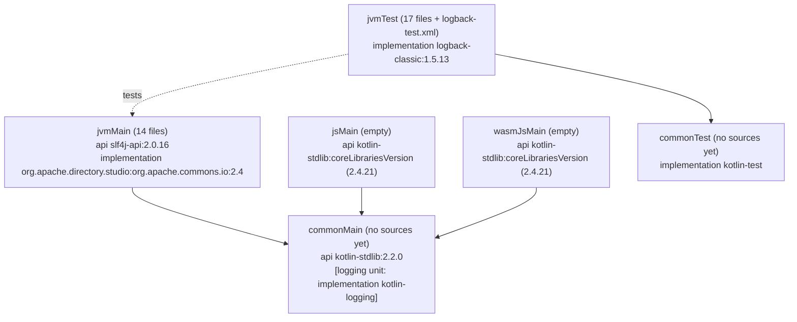
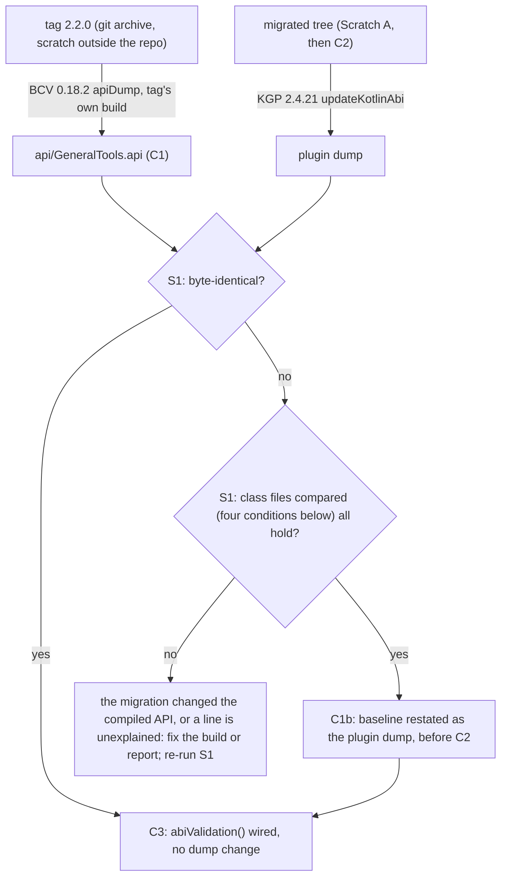

# Plan: `kmp-build` - the Kotlin Multiplatform build and the API proof harness

- **Covers:**
  - [SpartanLaboratories/GeneralTools#7](https://github.com/SpartanLaboratories/GeneralTools/issues/7),
    *"Make GeneralTools Kotlin Multiplatform (Color and geometry usable from common code)"*: the build,
    publication and proof-harness part of it.
  - [SpartanLaboratories/GeneralTools#8](https://github.com/SpartanLaboratories/GeneralTools/issues/8),
    *"Read-only views for Point and Square so libraries can expose geometry without copying"*, is
    resolved by the `box-model` unit; this unit touches none of its code.
- **Architecture:** [`architecture.md`](architecture.md), unit `kmp-build` (§11.2 row 1), systems **S1**
  (build and target configuration) and **S2** (API proof harness). Landing order: **unit 1 of 8**; every
  other unit builds on the tree this one leaves.
- **Branch:** `feat/issue-7-kotlin-multiplatform`.
- **Commit:** TBD (this plan is committed in the first commit listed in section 11, with the baseline dump
  it describes, so `git log --follow` binds the two).
- **PR:** TBD.
- **Status:** planning only.
- **Target release:** `3.0.0`.
- **Starts from:** the branch head `a0ca73e`, the merge of `master` (`c196d1a`) into the branch (C0), which
  removed `src/test/resources/keys.txt` from the tree; CI is green on it. `src/main` equals tag `2.2.0`; `./gradlew build` passes with
  185 tests (137 of them in the ten classes under `testing.component`).
- **What it plans:** the 2.2.0 baseline API dump and its restatement as the Kotlin plugin's own dump of the
  same classes; the replacement of the JVM-only Gradle build by one
  Kotlin Multiplatform module (`jvm`, `js`, `wasmJs`); every source and test moved, unchanged, to
  `jvmMain`/`jvmTest`; the ABI-validation harness; the `-PtestLevel` filter; the vanniktech 0.37.0 publication
  configuration; CI; the committed Yarn lock; the README sections this touches; the class-file comparison that
  admits the restated baseline; and the spikes that settle assumptions A2, A8 (as far as a local publish shows
  it) and A9.

---

## 2. Requirements

| # | Requirement | Acceptance check |
|---|---|---|
| R1 | `api/GeneralTools.api` holds the JVM API of tag `2.2.0`, committed before any source or build change: first as the binary-compatibility-validator `0.18.2` dump made with the tag's own build in a scratch copy outside the repository (C1), then restated as the dump the Kotlin Gradle plugin writes for the same classes (C1b), which is the file `checkKotlinAbi` compares against. The restatement is admitted only by the class-file comparison of section 6.3. | `git diff --stat 2.2.0 HEAD -- src/main` is empty at both commits; the file contains the `MiscKt`, `Square`, `logging/Logger` and `distanceFrom-IoAF18A` lines; C1b removes exactly one line (the `TwoDoubles` synthetic default-arguments constructor, section 3) and its body carries the evidence of section 6.3. |
| R2 | The module is `kotlin("multiplatform") 2.4.21` with targets `jvm()`, `js { nodejs() }` and `@OptIn(ExperimentalWasmDsl::class) wasmJs { nodejs() }`; `kotlin("jvm")` and `java-library` are gone. No Android, native or browser target. The Gradle wrapper stays 9.0.0. | `./gradlew tasks --all` lists `jvmTest`, `jsNodeTest`, `wasmJsNodeTest`; the R2 grep of section 9 (Level 1, C2) prints nothing: no line outside a comment names `java-library` or `kotlin("jvm")` (the `plugins {}` comment of 6.2 names both to explain the replacement). |
| R3 | `languageVersion` and `apiVersion` are exactly 2.2 on the `kotlin {}` extension; `commonMain` declares `api(kotlin-stdlib:2.2.0)`; `jsMain` and `wasmJsMain` declare `api(kotlin-stdlib)` at the plugin's version; `coreLibrariesVersion` is not lowered. | `dependencies --configuration jvmCompileClasspath` shows `kotlin-stdlib:2.2.0` with no `->`; `jsCompileClasspath` and `wasmJsCompileClasspath` show `2.2.0 -> 2.4.21`. |
| R4 | JVM output is bytecode 17 (toolchain 17, `jvmTarget` 17) and the JVM variant carries an explicit `org.gradle.jvm.version = 17`. | `javap -v` on a compiled class: `major version: 61`, `mv=[2,2,0]`; the published `-jvm` module lists `org.gradle.jvm.version` 17 (spike S4). |
| R5 | Dependencies sit in source sets: `jvmMain` `api(slf4j-api:2.0.16)` and `implementation(org.apache.directory.studio:org.apache.commons.io:2.4)`; `commonTest` `implementation(kotlin("test"))`; `jvmTest` `implementation(logback-classic:1.5.13)`. kotlin-logging is **not** added (the `logging` unit adds it). | The `-jvm` module metadata (spike S4) lists slf4j-api in the API variant, commons-io only in the runtime variant. |
| R6 | `@OptIn(ExperimentalAbiValidation::class) abiValidation()` is configured; `check` runs `checkKotlinAbi`; the JVM dump the migrated build writes is byte-identical to the baseline as C1b restates it. | `./gradlew updateKotlinAbi && git diff --exit-code -- api/` exits 0; `./gradlew check --dry-run` lists `checkKotlinAbi`. |
| R7 | `-PtestLevel=<level>[,<level>]` adds `includeTestsMatching("com.spartanlabs.testing.<level>.*")` to every `AbstractTestTask` and sets `failOnNoMatchingTests = false`; levels are `gating`, `component`, `integration`, `deterministic`, `e2e`, `nonfunctional`, `uat`; an unknown level fails the build; unset runs everything. | The matrix in section 9 (Level 1, C4). |
| R8 | The `mavenPublishing {}` block stays; vanniktech is `0.37.0`; `group` and `version` are set on the project and feed `coordinates(...)`; `configure(KotlinMultiplatform(javadocJar = JavadocJar.Empty(), sourcesJar = SourcesJar.Sources()))` pins the empty-javadoc policy. The publication setup lands at version `2.2.0` (C5a), and the bump to `3.0.0` is a commit of its own (C5b). The artifacts are `GeneralTools`, `GeneralTools-jvm`, `GeneralTools-js`, `GeneralTools-wasm-js`. Nothing is uploaded or published until the maintainer explicitly starts the release. | After C5a, `./gradlew properties -q` prints `group: io.github.spartanlaboratories` and `version: 2.2.0`; after C5b, `version: 3.0.0`; the file-repository rehearsal (S4) shows the four artifact directories. No command in this plan names a `MavenCentral` task. |
| R9 | CI uses `actions/checkout@v7`, `actions/setup-java@v6` (Temurin 17), `gradle/actions/setup-gradle@v6`, no Node step, no `chmod` step; the executable bit of `gradlew` is committed. | `git ls-files -s gradlew` prints `100755`; the first Actions run is green on `ubuntu-latest`. |
| R10 | `kotlin-js-store/yarn.lock` (and whatever else the Kotlin plugin writes into `kotlin-js-store/`) is committed, stored with LF line endings. The empty `kotlin-js-store/wasm/` directory the plugin creates has nothing to commit. | After `./gradlew build` on a clean checkout, `git status --short kotlin-js-store` is empty; `git ls-files --eol kotlin-js-store/yarn.lock` shows `i/lf`. |
| R11 | All 14 main files move to `src/jvmMain/kotlin` and all 17 test files to `src/jvmTest/kotlin`, each keeping its subdirectory and **unchanged**; `src/test/resources/logback-test.xml` moves to `src/jvmTest/resources/`. Nothing is common yet; `js`/`wasmJs` compile empty. | `git diff --cached -M --name-status` shows 32 `R100` lines for the moves; `src/main` and `src/test` no longer exist; 185 tests pass in `jvmTest`. |
| R12 | README: rewritten intro; "Maven coordinates", "Build & test" and "Releasing" rewritten; `## 3.0.0 migration notes` created with this unit's three rows (Maven artifact, web Kotlin 2.4 floor, JVM metadata floor). | Proof-read; section 8. |
| R13 | The spikes of section 9 (Level 3) are run before the commits they gate, and their outcomes are recorded in the commit bodies. | Commit bodies of C1b, C2, C3 and C5a carry the S1/S2/S3/S4 outcomes. |

---

## 3. Current state

All paths are at the start of the unit (after the `master` merge); line numbers are today's.

**Build**

- `build.gradle.kts:1-11` applies `kotlin("jvm") 2.2.0`, `java-library` and vanniktech `0.36.0`; the comment at
  `:2-7` explains why `kotlin-dsl` is not used. `:13` sets `group`; `:15-17` `mavenCentral()`.
- `:19-27` dependencies: `api(slf4j-api:2.0.16)`, `implementation(org.apache.directory.studio:org.apache.commons.io:2.4)`,
  `testApi(kotlin("test"))`, `testImplementation(logback-classic:1.5.13)`.
- `:29-59` `mavenPublishing { publishToMavenCentral(); signAllPublications(); coordinates("io.github.spartanlaboratories", "GeneralTools", "2.2.0"); pom {...} }`.
- `:61-63` `tasks.test { useJUnitPlatform() }`. No toolchain, no `jvmTarget`, no `abiValidation`.
- `settings.gradle.kts:1-4`: foojay resolver `1.0.0`, `rootProject.name = "GeneralTools"`. `gradle.properties`: `kotlin.code.style=official` only.
  `gradle/wrapper/gradle-wrapper.properties`: Gradle 9.0.0.
- `.github/workflows/Build.yml:7-16`: `actions/checkout@v2`, `actions/setup-java@v2` (`adopt`, 17), `chmod +x ./gradlew`, `./gradlew build`; trigger `on: [push]`.
- `git ls-files -s gradlew` is `100644`. `api/` and `kotlin-js-store/` do not exist. `.gitignore` ignores `build/` and `.kotlin`
  and neither new directory; there is no `.gitattributes`. `core.autocrlf` is `true` on the maintainer's machine.
- The maintainer's `~/.gradle/gradle.properties` defines `mavenCentralUsername`, `mavenCentralPassword`,
  `signing.keyId`, `signing.password`, `signing.secretKeyRingFile` and `org.gradle.configuration-cache`
  (only the names matter here; no value is to be read or recorded). Local runs therefore sign with a key ring
  file and probably run with the configuration cache; any task whose name contains `MavenCentral` would upload.

**Sources and tests** (all unchanged by this unit apart from their path)

- `src/main/kotlin/{generaltools (Color, Misc, UserActions), geometry (AxisAlignedBox, CenteredBox,
  Intersections, Point, Ray, Segment, Square, TwoDoubles, Vectors), logging (Logger, MessageBuilder)}`: 14 files.
  Directories do not mirror packages.
- `src/test/kotlin`: ten classes under `com/spartanlabs/testing/component/{generaltools,geometry}/` (137 tests), plus
  flat `generaltools/{MiscKtTest (0 tests), MiscTest (14), UserActionsTest (5)}` and
  `geometry/{Point (3, package `geometry`), PointTest (15), SquareTest (4), TwoDoublesTest (7)}` (48 tests): 17 files, 185 tests.
- `src/test/resources/logback-test.xml` sets `com.spartanlabs` to TRACE; with it the MiscTest output carries
  ` TRACE com.spartanlabs.generaltools.Misc` lines (logback's no-file default is DEBUG, so those lines prove the file loaded).

**README** (`README.md`): sections at `:1` intro, `:7` Maven coordinates (2.2.0), `:29` Modules, `:47` Build & test
(`./gradlew build`, `./gradlew test`), `:56` Releasing (names in-memory signing keys), `:71` `Color`, `:98` Geometry.

**The 2.2.0 API in the two dump tools**

- C1 (`8099065`) holds `api/GeneralTools.api` as binary-compatibility-validator `0.18.2` writes it for the classes that
  the tag's own build compiles (run on JDK 17).
- For the same sources, moved as in C2 and compiled by the 6.2 build (Scratch A, section 9), the plugin's `updateKotlinAbi`
  writes the same file without one line, line 235 of C1's file:
  `public synthetic fun <init> (DDILkotlin/jvm/internal/DefaultConstructorMarker;)V` in
  `public abstract class com/spartanlabs/geometry/TwoDoubles`. It is the synthetic default-arguments constructor of
  `sealed class TwoDoubles(var first: Double = 0.0, var second: Double = 0.0)`. The plugin takes its visibility from the
  primary constructor, which is `protected` in a sealed class, and leaves out `protected` members of sealed and enum
  classes; binary-compatibility-validator lists them (sources in the facts below).
- The two builds compile the same 28 class files, `javap -p -s` prints the same text for every one, and that constructor
  has descriptor `(DDILkotlin/jvm/internal/DefaultConstructorMarker;)V` and flags `(0x1001) ACC_PUBLIC, ACC_SYNTHETIC` in both.
- Neither dump records the other differences between the two builds' class files:
  - `contains(Lcom/spartanlabs/geometry/Point;)Z` in `Square` and in `CenteredBox` (the class-side method whose body calls the
    interface's default `AxisAlignedBox.contains` through `invokespecial`, the same in both builds) has flags `ACC_PUBLIC` in the
    tag's build and `ACC_PUBLIC, ACC_BRIDGE` in the migrated one;
  - the Kotlin metadata names the module `io.github.spartanlaboratories:GeneralTools` instead of `GeneralTools`, and the
    module file is `META-INF/io.github.spartanlaboratories_GeneralTools.kotlin_module` instead of
    `META-INF/GeneralTools.kotlin_module`;
  - `AxisAlignedBox$DefaultImpls` carries metadata `xi=816` instead of `xi=48`, and the metadata flags of the data classes'
    generated `equals`, `hashCode` and `toString` differ;
  - one local-variable name in the debug information of `TwoDoubles` differs.

  A caller links by name and descriptor, and those are unchanged. Kotlin consumers' reading of the metadata is what the
  `release` smoke matrix checks (architecture A3).

**What the migrated build does while the web targets have no sources** (the C2 tree, and Scratch A as section 9 defines it)

- `./gradlew build` runs `kotlinNodeJsSetup`, `kotlinYarnSetup`, `kotlinNpmInstall` and `kotlinStoreYarnLock`, and `jsNodeTest` and
  `wasmJsNodeTest` report SKIPPED. The build writes `kotlin-js-store/yarn.lock` (the Mocha tooling closure; the same file S2 wrote with
  its spike tests) and an empty `kotlin-js-store/wasm/` into the repository. On Windows the lock has CRLF line endings, as yarn writes
  `build/js/yarn.lock` there. The wasm lock (`build/wasm/yarn.lock`) holds no package, so the plugin stores none.
- With `abiValidation()`, `updateKotlinAbi` writes `api/GeneralTools.klib.api` as an empty (0-byte) file and leaves
  `api/GeneralTools.api` byte-identical to C1b. `checkKotlinAbi` fails while the klib file is missing (`Expected file with ABI
  declarations 'api\GeneralTools.klib.api' does not exist.`) and passes once it exists. With a public common function, the klib dump is
  a header (`// Klib ABI Dump`, `// Targets: [js, wasmJs]`, the signature version,
  `// Library unique name: <io.github.spartanlaboratories:GeneralTools>`) plus one line for the function.
- Gradle 9.0.0 fails `./gradlew checkKotlinAbi updateKotlinAbi` run as one invocation ("Task ':checkKotlinAbi' uses this output of task
  ':updateKotlinAbi' without declaring an explicit or implicit dependency"); run as separate invocations, both tasks work.
- A signed publish of the 21 published files to a file repository writes, beside each file, its `.asc` and the checksums `.md5`, `.sha1`,
  `.sha256` and `.sha512`, and the same four checksums beside each `.asc`: Gradle's own checksum set for any repository.
- The published `GeneralTools-js` module also depends on `org.jetbrains.kotlin:kotlin-dom-api-compat:2.4.21`.

**Verified outside-world facts this unit rests on** (sources and quotes in
[`research/kmp-build-and-kotlin-compat.md`](research/kmp-build-and-kotlin-compat.md) and
[`research/kmp-maven-central-publishing.md`](research/kmp-maven-central-publishing.md); checked again for this plan
where noted):

- Latest releases on 2026-10-19 (`gh api .../releases/latest`): `actions/checkout` v7.0.1, `actions/setup-java` v6.1.0,
  `gradle/actions` v6.4.0. The repository is public.
- `ExperimentalAbiValidation` is `org.jetbrains.kotlin.gradle.dsl.abi.ExperimentalAbiValidation`; `abiValidation()` and
  `abiValidation(Action)` exist on the `kotlin {}` extension `@since 2.4.0`; its `enabled` property is an error
  ([KotlinTopLevelExtension.kt @ v2.4.21](https://github.com/JetBrains/kotlin/blob/v2.4.21/libraries/tools/kotlin-gradle-plugin-api/src/common/kotlin/org/jetbrains/kotlin/gradle/dsl/KotlinTopLevelExtension.kt)).
  With one JVM target the JVM dump is `api/<project>.api`; klib dumps are `api/<project>.klib.api`.
- The plugin's JVM dumper and binary-compatibility-validator `0.18.2` write the same text format but list different members.
  The plugin treats a `protected` member of a sealed or enum class as not public (`isEffectivelyInternal` in
  [KotlinMetadataVisibilities.kt @ v2.4.21](https://github.com/JetBrains/kotlin/blob/v2.4.21/libraries/tools/abi-validation/abi-tools/src/main/kotlin/org/jetbrains/kotlin/abi/tools/impl/jvm/KotlinMetadataVisibilities.kt))
  and takes the visibility of a synthetic default-arguments constructor from the constructor it serves
  (`alternateDefaultSignature` in
  [KotlinMetadataSignature.kt @ v2.4.21](https://github.com/JetBrains/kotlin/blob/v2.4.21/libraries/tools/abi-validation/abi-tools/src/main/kotlin/org/jetbrains/kotlin/abi/tools/impl/jvm/KotlinMetadataSignature.kt));
  binary-compatibility-validator counts every `protected` member as public
  ([KotlinMetadataVisibilities.kt @ 0.18.2](https://github.com/Kotlin/binary-compatibility-validator/blob/0.18.2/src/main/kotlin/api/KotlinMetadataVisibilities.kt)).
  Read on 2026-10-20; quoted in [`research/README.md`](research/README.md), "API mechanics and proof of the API change".
- `checkKotlinAbi` needs a committed reference for every dump the plugin writes, the klib dump included: "Expected file with ABI
  declarations '...' does not exist." ([KotlinAbiCheckTaskImpl.kt @ v2.4.21](https://github.com/JetBrains/kotlin/blob/v2.4.21/libraries/tools/kotlin-gradle-plugin/src/common/kotlin/org/jetbrains/kotlin/gradle/tasks/abi/KotlinAbiCheckTaskImpl.kt)).
- The Yarn lock check compares the generated lock with the stored one line by line, ignoring line endings
  (`contentEqualsIgnoringLineEndings` in [LockStoreTask.kt @ v2.4.21](https://github.com/JetBrains/kotlin/blob/v2.4.21/libraries/tools/kotlin-gradle-plugin/src/common/kotlin/org/jetbrains/kotlin/gradle/targets/js/npm/LockStoreTask.kt)).
  It copies the lock only when no stored lock exists or auto-replace is on, and stores no lock that lists no package ("No NPM
  dependencies detected, and stored lockfile does not exist - skipping copy",
  [LockCopyTask.kt @ v2.4.21](https://github.com/JetBrains/kotlin/blob/v2.4.21/libraries/tools/kotlin-gradle-plugin/src/common/kotlin/org/jetbrains/kotlin/gradle/targets/js/yarn/LockCopyTask.kt)).
  The defaults are mismatch report `FAIL`, report-new-lock `false` and auto-replace `false`
  ([BaseYarnRootExtension.kt @ v2.4.21](https://github.com/JetBrains/kotlin/blob/v2.4.21/libraries/tools/kotlin-gradle-plugin/src/common/kotlin/org/jetbrains/kotlin/gradle/targets/web/yarn/BaseYarnRootExtension.kt)).
- vanniktech 0.37.0 trims checksums only in the Central bundle: "When publishing to Maven Central, redundant checksum files are now
  excluded by default: checksums of `.asc` signature files ... and the `sha256`/`sha512` checksums"
  ([CHANGELOG @ 0.37.0](https://github.com/vanniktech/gradle-maven-publish-plugin/blob/0.37.0/CHANGELOG.md)); the filter is
  `shouldIncludeInDeployment`, applied to the files of the local repository that goes into the deployment
  ([central/DeploymentFiles.kt @ 0.37.0](https://github.com/vanniktech/gradle-maven-publish-plugin/blob/0.37.0/plugin/src/main/kotlin/com/vanniktech/maven/publish/central/DeploymentFiles.kt)).
  The bundle therefore carries `.asc`, `.md5` and `.sha1` beside each file, which is what Central requires.
- The plugin adds `kotlin-dom-api-compat` to Kotlin/JS compilations unless `kotlin.js.stdlib.dom.api.included` is `false`; the default
  is `true` ([PropertiesProvider.kt @ v2.4.21](https://github.com/JetBrains/kotlin/blob/v2.4.21/libraries/tools/kotlin-gradle-plugin/src/common/kotlin/org/jetbrains/kotlin/gradle/plugin/PropertiesProvider.kt)).
  The sources above were read on 2026-10-20.
- `KotlinMultiplatform(javadocJar: JavadocJar = JavadocJar.Empty(), sourcesJar: SourcesJar = SourcesJar.Sources(), androidVariantsToPublish)`
  is in `com.vanniktech.maven.publish`; `coordinates(groupId, artifactId, version)` and `configure(platform)` are members of the
  `mavenPublishing {}` receiver; signing is required unless the version ends in `-SNAPSHOT`
  ([Platform.kt](https://github.com/vanniktech/gradle-maven-publish-plugin/blob/0.37.0/plugin/src/main/kotlin/com/vanniktech/maven/publish/Platform.kt),
  [MavenPublishBaseExtension.kt](https://github.com/vanniktech/gradle-maven-publish-plugin/blob/0.37.0/plugin/src/main/kotlin/com/vanniktech/maven/publish/MavenPublishBaseExtension.kt) @ 0.37.0).
- `gradle/actions/setup-gradle@v6` validates the committed wrapper jar by default, and its default cache provider `enhanced` is a
  proprietary library (free for public repositories) while `cache-provider: basic` is MIT
  ([setup-gradle.md @ v6.4.0](https://github.com/gradle/actions/blob/v6.4.0/docs/setup-gradle.md)).
- The rest (KGP/Gradle matrix, metadata and stdlib rules, klib ABI floor, `webMain`, JVM 17 enforcement, test-filter reach
  into the Node runners, publication names, staged Central flow) is as stated in the two findings files.

---

## 4. Assumptions

| # | Assumption | If false |
|---|---|---|
| A2 (architecture) | `js` and `wasmJs` compile and test at `languageVersion`/`apiVersion` 2.2 under KGP 2.4.21. Settled by spike S2, which needs a scratch common source because the committed tree has none. | The pins move to `jvm { compilerOptions { ... } }` and the top-level `compilerOptions` block is dropped; the JVM compilation remains the gate for what common code may use. |
| A8 (architecture) | The published `-jvm` module shows slf4j-api in the API variant, commons-io only at runtime, `kotlin-stdlib` 2.2.0, `org.gradle.jvm.version` 17. Spike S4 checks this as far as a local file-repository publish shows it; the kotlin-logging line cannot be checked until the `logging` unit adds the dependency, and the `release` unit re-runs the same procedure. | The dependency scopes in the source-set blocks are corrected. |
| A9 (architecture) | vanniktech `0.37.0` signs the four publications with the keyring-file properties and runs under the configuration cache. Spike S5 (needs the maintainer's key ring; run with Gradle reading the user-home properties, never printing them). | The README "Releasing" text and the properties change; no source change. |
| U2 | `implementation(kotlin("test"))` in `commonTest` plus `useJUnitPlatform()` resolves the JUnit 5 variant for `jvmTest`, and Gradle 9.0.0 finds the JUnit platform launcher without an explicit dependency (as today's build does). | Add `runtimeOnly("org.junit.platform:junit-platform-launcher:1.10.1")` to `jvmTest` (platform 1.10.1 matches Jupiter 5.10.1 from `kotlin-test-junit5` 2.4.21). |
| U3 | `val jsMain by getting { ... }` style access works for `jsMain`/`wasmJsMain` in the Kotlin DSL when the targets are declared earlier in the same `kotlin {}` block. | Use `sourceSets.getByName("jsMain").dependencies { ... }`. |
| U4 | The Yarn lock written on Windows lists the same packages as the one the build resolves on `ubuntu-latest` (`yarnLockMismatchReport` defaults to `FAIL`; line endings do not count, section 6.5). | Regenerate on Linux (WSL or container) with `./gradlew kotlinUpgradeYarnLock` and commit the result. |

A3 (Kotlin 2.2.0/2.1.20 consumer compiles) and A4-A7, A10-A12 belong to other units.

---

## 5. Non-goals

- Any source semantics or API change: the dump is byte-identical; no declaration is edited, renamed or re-modified. `explicitApi()` is the `explicit-api` unit's.
- `kotlin-logging` (`logging` unit), moving any file to `commonMain` or `commonTest`, splitting `Misc` (`commonize`), and the README
  "Modules" section (`commonize`/`logging`).
- `webMain`/`webTest`, `browser()` targets, a version catalog, the tapmoc plugin, a CI publish workflow, a `CHANGELOG.md`.
- Rows of the migration notes other than the three named; reconciliation of the notes (`release`).
- Publishing anything: the file-repository rehearsal is local and no `MavenCentral` task is run.
- A Gradle TestKit test of `-PtestLevel` (the matrix in section 9 is run by hand; build logic has no test source set).
- Raising the wrapper above 9.0.0 or the Kotlin floor above 2.2.

---

## 6. Design

### 6.1 Source sets and dependencies



Why the web lines exist: an explicit `kotlin-stdlib` in `commonMain` switches off the stdlib the plugin would add, and the JS and
Wasm compilers reject a stdlib klib older than themselves. Gradle resolves the web compile classpaths to the higher version, and the web
variants publish both requirements (the shape Okio publishes). `jvmTest` also resolves stdlib 2.4.21 (through `kotlin-test`), so the
test run does not prove the 2.2.0 floor; the release smoke matrix does.

The plugin also adds `kotlin-dom-api-compat`, at its own version, to the `js` compilation (`kotlin.js.stdlib.dom.api.included`
defaults to `true`), so the published `js` variant lists `org.jetbrains.kotlin:kotlin-dom-api-compat:2.4.21` beside the two stdlib
requirements. The library calls no DOM API; the dependency is the plugin's default for every Kotlin/JS library, and a Kotlin/JS
consumer's own plugin adds the same artifact to its compilation.

### 6.2 The end-state `build.gradle.kts`

Written once here; section 7 says which commit introduces which block. Comments follow the repo's `//region` convention (Ring 1).

```kotlin
import com.vanniktech.maven.publish.JavadocJar
import com.vanniktech.maven.publish.KotlinMultiplatform
import com.vanniktech.maven.publish.SourcesJar
import org.gradle.api.attributes.java.TargetJvmVersion
import org.gradle.api.tasks.testing.AbstractTestTask
import org.gradle.api.tasks.testing.Test
import org.jetbrains.kotlin.gradle.ExperimentalWasmDsl
import org.jetbrains.kotlin.gradle.dsl.JvmTarget
import org.jetbrains.kotlin.gradle.dsl.KotlinVersion
import org.jetbrains.kotlin.gradle.dsl.abi.ExperimentalAbiValidation

plugins {
    // One Kotlin Multiplatform module replaces kotlin("jvm") + java-library (java-library is an error in a
    // multiplatform project on Gradle 8.7+). kotlin-dsl is still not used: this is a library, not a Gradle plugin,
    // and kotlin-dsl's gradleApi() bundles an SLF4J provider that conflicts with logback on the test classpath.
    kotlin("multiplatform") version "2.4.21"
    id("com.vanniktech.maven.publish") version "0.37.0"
}

group = "io.github.spartanlaboratories"
version = "3.0.0"

repositories {
    mavenCentral()
}

//region Compatibility floors
// The oldest consumers: Kotlin 2.2.0 (MyGameTools) and Kotlin 2.1.20 (MyGameClient via gametools) can read language/API 2.2.
val languageFloor = KotlinVersion.KOTLIN_2_2
val stdlibFloor = "2.2.0"
val jvmFloor = 17
//endregion

kotlin {
    jvmToolchain(jvmFloor)

    //region Pins
    // Metadata and API checks follow the floor on every target. The js/wasmJs ABI version still follows this compiler (2.4),
    // which is why web consumers need Kotlin 2.4; coreLibrariesVersion is NOT lowered because the web compilers reject an older stdlib klib.
    compilerOptions {
        languageVersion.set(languageFloor)
        apiVersion.set(languageFloor)
    }
    //endregion

    //region Targets
    jvm {
        compilerOptions { jvmTarget.set(JvmTarget.fromTarget(jvmFloor.toString())) }
        // A multiplatform JVM publication declares no org.gradle.jvm.version; declare it so a JVM 11 consumer
        // fails at resolution rather than with UnsupportedClassVersionError.
        attributes { attribute(TargetJvmVersion.TARGET_JVM_VERSION_ATTRIBUTE, jvmFloor) }
    }
    js { nodejs() }
    @OptIn(ExperimentalWasmDsl::class)
    wasmJs { nodejs() }
    //endregion

    //region API proof
    @OptIn(ExperimentalAbiValidation::class)
    abiValidation()
    //endregion

    //region Dependencies by source set
    sourceSets {
        val webStdlib = "org.jetbrains.kotlin:kotlin-stdlib:$coreLibrariesVersion"

        val commonMain by getting {
            dependencies {
                api("org.jetbrains.kotlin:kotlin-stdlib:$stdlibFloor")
                // implementation(kotlin-logging) is added here by the `logging` unit.
            }
        }
        val jsMain by getting { dependencies { api(webStdlib) } }
        val wasmJsMain by getting { dependencies { api(webStdlib) } }
        val jvmMain by getting {
            dependencies {
                // The library only needs the slf4j API - consumers choose their own logging backend.
                api("org.slf4j:slf4j-api:2.0.16")
                implementation("org.apache.directory.studio:org.apache.commons.io:2.4")   // Files Utility
            }
        }
        val commonTest by getting { dependencies { implementation(kotlin("test")) } }
        val jvmTest by getting {
            // Logback is only needed to actually see log output while running the JVM tests.
            dependencies { implementation("ch.qos.logback:logback-classic:1.5.13") }
        }
    }
    //endregion
}

tasks.withType<Test>().configureEach { useJUnitPlatform() }   // JVM tests run on the JUnit 5 platform

//region -PtestLevel
val testLevels = listOf("gating", "component", "integration", "deterministic", "e2e", "nonfunctional", "uat")

/** Parses `-PtestLevel`; blank entries are ignored, duplicates dropped, an unknown level is the failure. */
fun parseTestLevels(raw: String?, known: List<String>): Result<List<String>> {
    val requested = raw.orEmpty().split(',').map(String::trim).filter(String::isNotEmpty).distinct()
    val unknown = requested.filterNot(known::contains)
    return if (unknown.isEmpty()) Result.success(requested)
    else Result.failure(IllegalArgumentException("Unknown -PtestLevel $unknown; expected a comma-separated subset of $known"))
}

val selectedTestLevels: List<String> =
    parseTestLevels(providers.gradleProperty("testLevel").orNull, testLevels)
        .getOrElse { throw GradleException(it.message ?: "Invalid -PtestLevel", it) }   // the one place the Result is unwrapped

if (selectedTestLevels.isNotEmpty()) logger.lifecycle("Test levels selected: $selectedTestLevels")

tasks.withType<AbstractTestTask>().configureEach {
    if (selectedTestLevels.isNotEmpty()) {
        filter.isFailOnNoMatchingTests = false   // a level with no tests on a target is a green no-op
        selectedTestLevels.forEach { level -> filter.includeTestsMatching("com.spartanlabs.testing.$level.*") }
    }
}
//endregion

mavenPublishing {
    publishToMavenCentral()                     // upload only; releasing is the maintainer's explicit step
    signAllPublications()
    // The artifactId must equal rootProject.name (settings.gradle.kts): vanniktech rewrites the target artifact ids from it.
    coordinates(project.group.toString(), "GeneralTools", project.version.toString())
    configure(KotlinMultiplatform(javadocJar = JavadocJar.Empty(), sourcesJar = SourcesJar.Sources()))

    pom { /* unchanged from build.gradle.kts:34-58 */ }
}
```

Notes the implementer needs:

- `parseTestLevels` is a pure function: its failure (unknown level) is an **expected** failure of the build invocation, so it returns
  `Result.failure(IllegalArgumentException(...))`; nothing throws inside it. The single unwrap is the `getOrElse` at script level, which
  converts to `GradleException`, Gradle's own failure channel. There is no programmer-error path.
- `-PtestLevel=` (empty) and `-PtestLevel=component,,gating` are accepted (blank entries dropped); `-PtestLevel=Component` is unknown.
- The property is read through `providers.gradleProperty`, which the configuration cache tracks as an input.
- `failOnNoMatchingTests = false` is set only when a level is selected, so an unset property leaves every task's defaults untouched.
  Multiple `includeTestsMatching` patterns are a union.
- Package filters start with a lowercase letter, contain no spaces or commas, and so behave identically in the JVM, Mocha and Wasm
  runners ([`research/kmp-test-levels-and-names.md`](research/kmp-test-levels-and-names.md) F3).
- The `pom { ... }` block is carried over verbatim; only `coordinates(...)` and `configure(...)` change.
- `settings.gradle.kts` and `gradle.properties` are unchanged.

### 6.3 The proof harness



**The baseline is the dump of the tool `check` runs.** Binary-compatibility-validator records the tag with the tag's own build
(C1); the plugin's dumper is what `checkKotlinAbi` compares against from C3 on. Where the two dumps differ, S1 compares the class
files the two builds compile (the tag's own build from the C1 scratch, and Scratch A), and the plugin's dump replaces the baseline
(C1b) only when all four conditions hold:

1. both builds compile the same set of class files;
2. `javap -p -s` prints the same text for every class in both builds (same members, Java modifiers and descriptors);
3. every line that one dump has and the other lacks names a member present in both builds with the same descriptor and the same
   access flags (`javap -v`);
4. each such line is explained by a rule in which the two tools differ, read at their pinned sources and applied to the unchanged
   source declaration.

A failure of 1-3 means the migration changed the compiled API: the build is corrected and S1 runs again. A failure of 4 is reported
and nothing is committed: an unexplained listing difference would make every later dump prediction unreliable. Differences that
neither dump records (access flags the dump format has no word for, such as `ACC_BRIDGE`; Kotlin metadata; debug information) do
not block the restatement: they come from the compiler version, are listed in C1b's body, and the consumers' reading of the
metadata is checked by the `release` smoke matrix. For the 2.2.0 classes the conditions hold and the restatement
removes one line (section 3).

- Before the migration the reference dump is the 2.2.0 API as the plugin lists it; afterwards `check` fails on any difference until
  the author runs `updateKotlinAbi` and commits the diff.
- The dump is of the **main compilation output** (`binariesSource` default), not of the published jar.
- Each later break lands in its own commit and the combined diff is reviewed against architecture §11.3.

### 6.4 Executable bit of `gradlew`

The bit is committed (`git update-index --chmod=+x gradlew`, which the `manager` runs), and the CI `chmod` step is removed.
Reason: with mode `100644` any Linux or macOS clone fails with "Permission denied" on `./gradlew`, and CI hides that with a workaround
step; the mode change affects no Windows checkout (`core.fileMode=false` there) and shows as one reviewable line (`mode change 100644 => 100755`).
The Actions run is the proof that it landed: without the bit and without the step, `./gradlew build` cannot start. `gradlew.bat` stays `100644`.

### 6.5 Line endings

`.gitattributes` fixes the reference files to LF: `api/*.api text eol=lf` (C1), and from C6 `kotlin-js-store/**/yarn.lock text eol=lf`.

- **The dumps.** `checkKotlinAbi` compares the committed dumps with the LF files the plugin writes; the rule keeps the checked-out
  dumps LF whatever `core.autocrlf` is. The rule covers `api/GeneralTools.klib.api` too, empty or not.
- **The Yarn lock.** The build writes the lock with the platform's line endings (CRLF on Windows), and its lock check compares lines,
  ignoring line endings; it never rewrites a stored lock that exists (section 3). Line endings therefore cause no mismatch on any
  system. The rule keeps the stored lock LF in the repository whichever system wrote it, so a lock regenerated on Windows by
  `kotlinUpgradeYarnLock` shows only its real changes, not a whole-file line-ending change. `**` also covers a
  `kotlin-js-store/wasm/yarn.lock`, which the plugin writes only once the `wasmJs` side has npm dependencies.

### 6.6 Publication layout

| Publication | artifactId | Main file |
|---|---|---|
| `kotlinMultiplatform` (root) | `GeneralTools` | metadata jar, no classes, `.module` redirects to the target modules |
| `jvm` | `GeneralTools-jvm` | `.jar` |
| `js` | `GeneralTools-js` | `.klib` |
| `wasmJs` | `GeneralTools-wasm-js` | `.klib` |

Plain Maven reads no `.module`, so `GeneralTools:3.0.0` is empty for Maven and `GeneralTools-jvm` is the artifact to depend on (a root-POM
workaround as Okio uses is not added; migration row 1 tells Maven consumers; [#17](https://github.com/SpartanLaboratories/GeneralTools/issues/17) tracks a root artifact usable from plain Maven). Target names stay the defaults `js()`/`wasmJs()` and
`rootProject.name` stays `GeneralTools`; renaming either independently breaks vanniktech's artifactId rewrite.

### 6.7 CI (`.github/workflows/Build.yml`, final text)

```yaml
name: CI
on: [push]
permissions:
  contents: read
jobs:
  build:
    runs-on: ubuntu-latest
    steps:
      - uses: actions/checkout@v7
      - name: Set up JDK 17
        uses: actions/setup-java@v6
        with:
          java-version: 17
          distribution: temurin
      - name: Set up Gradle
        uses: gradle/actions/setup-gradle@v6
        with:
          cache-provider: basic
      - name: Build with Gradle
        run: ./gradlew build
```

`./gradlew build` already means `check`, so it now runs `jvmTest`, `jsNodeTest`, `wasmJsNodeTest` and `checkKotlinAbi` with no step added. There is no
`-PtestLevel` in CI. `cache-provider: basic` is the MIT cache provider; the default `enhanced` one is a proprietary component, and the build
gains nothing from it. `setup-gradle` validates the committed wrapper jar by default. Node and Yarn are re-downloaded per run (tens of
MB); caching `nodejs`/`yarn` under the Gradle user home is the follow-up [#18](https://github.com/SpartanLaboratories/GeneralTools/issues/18).

### 6.8 Error handling and logging

- No production code changes, so no `Result` signature, exception or KDoc changes. The only new function is the build-script
  `parseTestLevels`, specified in 6.2.
- Build-time events: one `lifecycle` line when levels are selected (`Test levels selected: [...]`); a failing invocation reports the
  `GradleException` text naming the unknown value and the known levels. Test logging is unchanged: slf4j in library code, logback under
  `jvmTest` with `logback-test.xml` moved, not edited.
- Concurrency: none introduced. Build time grows by the two web test runs and the ABI check once tests exist on the web targets.

---

## 7. File-by-file changes (in commit order)

Commit numbers refer to section 11.

### C1 - baseline dump

- **create `api/GeneralTools.api`**: the BCV `0.18.2` dump of tag `2.2.0`. Procedure (Git Bash; `SCRATCH` is any directory outside the
  repository, e.g. `$(mktemp -d)`):
  1. `git -C <repo> archive --format=tar 2.2.0 | tar -x -C "$SCRATCH"` (read-only on the repository).
  2. In the **scratch** `build.gradle.kts` only, add `id("org.jetbrains.kotlinx.binary-compatibility-validator") version "0.18.2"` to `plugins {}`.
     Do not open the scratch's `src/test/resources/keys.txt`; `apiDump` does not touch it.
  3. In `$SCRATCH`: `./gradlew apiDump` (Gradle runs on the installed JDK 17-24; the wrapper is 9.0.0 as in the tag).
  4. Sanity: `grep -c '^public' "$SCRATCH/api/GeneralTools.api"`, and `grep -n 'distanceFrom-IoAF18A\|asRay-d1pmJ48\|Predicate\|class com/spartanlabs/geometry/Square\|class com/spartanlabs/logging' "$SCRATCH/api/GeneralTools.api"` must print the mangled `Result`-returning members,
     `MiscKt.evaluateList` with `Ljava/util/function/Predicate;`, `Square` and the `logging` classes.
  5. `mkdir -p api && cp "$SCRATCH/api/GeneralTools.api" api/` in the repository. The `.gitattributes` below makes git store the file with LF whatever line endings the tool wrote.
- **create `.gitattributes`**: `api/*.api text eol=lf` with a one-line comment (6.5).
- **create `docs/plans/7-kotlin-multiplatform/plan-kmp-build.md`** (this file), and commit with it the planning documents that cover the whole change:
  `docs/plans/7-kotlin-multiplatform/architecture.md`, `docs/plans/7-kotlin-multiplatform/impact.md`, and the dated pointer notes at the top of
  `docs/plans/1-color-methods/plan.md` and `docs/plans/3-geometry-primitives/plan.md`. The other units' plans land in their own units' first commits.
- The commit body records: tool and version, the tag, the command, and the sanity-grep result.

### C1b - the baseline restated as the plugin's dump

Made after S1 has passed (section 6.3), and before C2.

- **modify `api/GeneralTools.api`**: replace it with the file the plugin writes in Scratch A
  (`cp "$SCRATCH_A/api/GeneralTools.api" api/GeneralTools.api`; `.gitattributes` keeps it LF). Nothing else in `api/` changes:
  the `api/GeneralTools.klib.api` that Scratch A also writes is S3's to decide and lands, if at all, in C3. For the 2.2.0 classes the
  change is one removed line, `public synthetic fun <init> (DDILkotlin/jvm/internal/DefaultConstructorMarker;)V` in
  `com/spartanlabs/geometry/TwoDoubles`; a staged diff that shows anything else stops the commit (section 6.3).
- **The planning documents that describe the restated baseline ride with this commit:** `plan-kmp-build.md`, `architecture.md` and
  `impact.md` under `docs/plans/7-kotlin-multiplatform/`, and `final-implementation.md` with the entries that describe C1 and C1b work.
- The body records:
  - the tool and version (Kotlin Gradle plugin 2.4.21, `updateKotlinAbi` in Scratch A) and the removed line;
  - the rule behind it: the plugin takes the constructor's visibility from the `protected` primary constructor of the sealed class and
    leaves out `protected` members of sealed classes, while binary-compatibility-validator `0.18.2` lists them, with the three source
    links of section 3;
  - the S1 evidence for conditions 1-3: 28 class files on both sides, `javap -p -s` identical for all 28, and the constructor's descriptor
    and flags (`0x1001`) in both builds;
  - the differences neither dump records (section 3): `ACC_BRIDGE` on `Square.contains(Point)` and `CenteredBox.contains(Point)`, the
    Kotlin metadata module name and module file name, `AxisAlignedBox$DefaultImpls` `xi`, the metadata flags of the data classes'
    generated members, one debug local-variable name.

### C2 - the Kotlin Multiplatform migration

- **modify `build.gradle.kts`** to the 6.2 text **minus** the `abiValidation()` block, the `-PtestLevel` region, `version = "3.0.0"` and the
  `coordinates`/`configure` changes: i.e. new `plugins {}` (KMP `2.4.21`, vanniktech `0.37.0`, the rewritten comment), the floors, `kotlin { jvmToolchain, compilerOptions pins,
  jvm/js/wasmJs targets, sourceSets }`, `tasks.withType<Test>().configureEach { useJUnitPlatform() }`; delete the `dependencies {}` block and `tasks.test {}`.
  The `mavenPublishing {}` block keeps its current `coordinates("io.github.spartanlaboratories", "GeneralTools", "2.2.0")` for this commit.
  Each `import` line enters with the commit that first uses it (C2: `TargetJvmVersion`, `Test`, `ExperimentalWasmDsl`, `JvmTarget`, `KotlinVersion`).
- **move (`git mv`, content unchanged, 32 renames)**:
  ```sh
  mkdir -p src/jvmMain src/jvmTest/resources
  git mv src/main/kotlin src/jvmMain/kotlin
  git mv src/test/kotlin src/jvmTest/kotlin
  git mv src/test/resources/logback-test.xml src/jvmTest/resources/logback-test.xml
  rmdir src/main src/test/resources src/test 2>/dev/null || true
  ```
  Result: `src/jvmMain/kotlin/{generaltools,geometry,logging}/...` (14 files) and `src/jvmTest/kotlin/{com/spartanlabs/testing/component/..., generaltools, geometry}/...` (17 files),
  `src/jvmTest/resources/logback-test.xml`. `src/test/resources/keys.txt` was removed by the `master` merge and is never touched by the moves.
- **modify `README.md`**: intro, "Build & test" (first form), `## 3.0.0 migration notes` with rows 2 and 3 (section 8).
- No logging events change (loggers keep their names).

### C3 - ABI validation

- **modify `build.gradle.kts`**: add the `//region API proof` block (`@OptIn(ExperimentalAbiValidation::class) abiValidation()`) and the `ExperimentalAbiValidation` import.
- **`api/GeneralTools.api`: no change** (R6).
- **create `api/GeneralTools.klib.api`** exactly as `./gradlew updateKotlinAbi` writes it: an empty (0-byte) file. `checkKotlinAbi` needs a
  committed reference for the klib dump even while `js` and `wasmJs` have no sources (section 3). From the first `commonMain` code on
  (`logging` commit 1, internal declarations only), the file holds what the plugin writes for the web klibs, expected to be the header
  alone until `commonize` brings the first public declarations. Run `checkKotlinAbi` and `updateKotlinAbi` as separate invocations:
  Gradle 9.0.0 fails the two in one invocation.
- **modify `README.md`**: add `checkKotlinAbi`/`updateKotlinAbi` lines to "Build & test".

### C4 - `-PtestLevel`

- **modify `build.gradle.kts`**: add the `//region -PtestLevel` block and the `AbstractTestTask` import.
- **modify `README.md`**: the `-PtestLevel` paragraph and examples in "Build & test".

### C5a - publication setup

- **modify `build.gradle.kts`**: add `version = "2.2.0"` below `group`, so the version that was written into `coordinates(...)` moves onto the project unchanged; in
  `mavenPublishing {}` replace the `coordinates(...)` line with the derived form of 6.2 and add `configure(KotlinMultiplatform(...))` with the three vanniktech imports.
  The block also gains its two comments from 6.2: `// upload only; releasing is the maintainer's explicit step` at the end of the
  `publishToMavenCentral()` line, and `// The artifactId must equal rootProject.name (settings.gradle.kts): vanniktech rewrites the target artifact ids from it.`
  above `coordinates(...)`. After C5a, the `mavenPublishing {}` block reads as in 6.2.
- **modify `README.md`**: "Releasing" (section 8).

### C5b - version bump

- **modify `build.gradle.kts`**: `version = "2.2.0"` becomes `version = "3.0.0"`. No other line changes.
- **modify `README.md`**: "Maven coordinates" and migration row 1 (section 8), which name `3.0.0` and the `GeneralTools-jvm` artifact.

### C6 - Yarn lock

- **modify `.gitattributes`** first: below the existing rule, add the comment line
  `# The stored Yarn lock stays LF whichever system wrote it; the build's lock check ignores line endings.` and the rule
  `kotlin-js-store/**/yarn.lock text eol=lf` (6.5).
- **create `kotlin-js-store/yarn.lock`**: the lock the build has written into the working tree since C2 (the same file S2 wrote), staged
  after the `.gitattributes` change so that the index stores it with LF line endings. The empty `kotlin-js-store/wasm/` directory is not
  committed: git tracks no empty directory, and the plugin stores no wasm lock while `wasmJs` has no npm dependencies.
- **modify `README.md`**: one maintenance sentence in "Build & test" (a Kotlin Gradle plugin bump needs `./gradlew kotlinUpgradeYarnLock` and a commit of `kotlin-js-store/`).

### C7 - CI and wrapper

- **modify `.github/workflows/Build.yml`** to the 6.7 text.
- **mode change `gradlew` 100644 -> 100755** (`git update-index --chmod=+x gradlew`, performed by the `manager`).

---

## 8. Documentation impact

- **Ring 1 (in-editor):** `//region` blocks and the rewritten comments in `build.gradle.kts`, including why `kotlin-dsl` is not used, why the web stdlib line exists, and why
  `coreLibrariesVersion` is not lowered.
- **Ring 2 (component API):** none; no public declaration is added or changed.
- **Ring 3 (boundary/protocol):** the published artifacts and variants, the Maven consumer rule, the web and JVM floors and the release flow, all in `README.md`.
- **Ring 4 (architecture):** `architecture.md` is the topology document and is unchanged by this unit; deviations found while implementing are appended to
  `final-implementation.md` in this issue's folder as they happen.
- **README currency:** the README is edited in the same commit as the change each hunk describes (section 7). The text below is final.

**Intro (replaces `README.md:1-5`)**

````markdown
# GeneralTools

A small Kotlin Multiplatform library of generic helpers: an immutable RGBA `Color` value type, simple 2D
geometry and string, list and timing utilities, usable from common code on the JVM, JS and Wasm/JS; and,
on the JVM only, file and URL helpers and AWT-based user-action automation.

| Target | Artifact | You need |
|---|---|---|
| JVM | `GeneralTools-jvm` | Java 17 or newer; build with Kotlin 2.1 or newer |
| JS (tested on Node) | `GeneralTools-js` | Kotlin 2.4 or newer |
| Wasm/JS | `GeneralTools-wasm-js` | Kotlin 2.4 or newer; Kotlin/Wasm is Beta, so its klib compatibility guarantees are not final |

`read`, `asURL`, the slf4j `Logger.time` extension and `UserActions` exist on the JVM only. Upgrading from 2.x:
see the [3.0.0 migration notes](#300-migration-notes).
````

**Maven coordinates (replaces `:7-27`)**

````markdown
## Maven coordinates

Published to Maven Central as `io.github.spartanlaboratories:GeneralTools:3.0.0`. The coordinate `GeneralTools`
is the Gradle module-metadata root; each target has its own artifact:

| Artifact | Contents |
|---|---|
| `GeneralTools` | Gradle module metadata that selects the variant of your target; contains no classes |
| `GeneralTools-jvm` | the JVM jar |
| `GeneralTools-js` | the JS klib |
| `GeneralTools-wasm-js` | the Wasm/JS klib |

Gradle (Kotlin DSL), in a JVM or a Multiplatform project; Gradle selects the variant:

```kotlin
dependencies {
    implementation("io.github.spartanlaboratories:GeneralTools:3.0.0")   // in commonMain.dependencies of a multiplatform project
}
```

Maven does not read Gradle module metadata, so depend on the JVM artifact:

```xml
<dependency>
    <groupId>io.github.spartanlaboratories</groupId>
    <artifactId>GeneralTools-jvm</artifactId>
    <version>3.0.0</version>
</dependency>
```
````

**Build & test (replaces `:47-54`; each line enters with the commit named in section 7)**

````markdown
## Build & test

Gradle 9 runs on a JDK 17 to 24. The build compiles and tests with a JDK 17 toolchain, which Gradle
downloads when it is missing; the first JS or Wasm test run also downloads Node.js and Yarn.

```sh
./gradlew build                 # compile and test every target, and check the public API dump
./gradlew jvmTest               # JVM tests (JUnit 5 platform)
./gradlew jsNodeTest            # JS tests on Node
./gradlew wasmJsNodeTest        # Wasm/JS tests on Node
./gradlew allTests              # all three targets, one report
./gradlew checkKotlinAbi        # compare the public API with the dumps in api/ (part of check)
./gradlew updateKotlinAbi       # rewrite the dumps after an intended API change; commit the diff
```

Tests live in `com.spartanlabs.testing.<level>.<package>`, one folder per level: `gating`, `component`,
`integration`, `deterministic`, `e2e`, `nonfunctional`, `uat`. `-PtestLevel=<level>[,<level>]` runs only the
named levels on every target; an unknown level fails the build, and left unset every level runs.

```sh
./gradlew check -PtestLevel=gating,component
./gradlew jvmTest -PtestLevel=integration     # a JVM-only level: skip the web test tasks, which still start Node
```

After a Kotlin Gradle plugin bump, run `./gradlew kotlinUpgradeYarnLock` and commit `kotlin-js-store/`.
````

**Releasing (replaces `:56-69`)**

````markdown
## Releasing

Releases are published to Maven Central **manually** by a maintainer; there is no CI publish workflow, and
nothing is uploaded or published until the maintainer explicitly starts the release. A Central release cannot
be undone, so the upload and the release are separate steps.

Put the Central Portal user token and a signing key-ring file in `~/.gradle/gradle.properties`:
`mavenCentralUsername`, `mavenCentralPassword`, `signing.keyId`, `signing.password`, `signing.secretKeyRingFile`.

1. Set `version` in `build.gradle.kts`, merge to `master`, and run `./gradlew check` (every level, every target).
2. `./gradlew publishToMavenCentral` uploads one bundle to the Central Portal and stops; it logs the deployment id.
   Do not use `publishAndReleaseToMavenCentral`: it publishes as soon as validation passes.
3. In the Portal, wait for the deployment to be `VALIDATED`, then build a throwaway consumer against the staged
   bundle through the Portal's download endpoint (Sonatype, "Manually Testing a Deployment Bundle").
4. Press Publish in the Portal (or drop a bad bundle: `./gradlew dropMavenCentralDeployment --deployment-id=<id>`).
   The artifacts appear on Maven Central 10 to 30 minutes later; resolve them once from plain `mavenCentral()`.
5. Tag the merge commit on `master` `X.Y.Z` and create a matching GitHub release; its notes are the migration notes below.
````

**Migration notes (new section, the last in the README, after the quick references; the `logging` unit later adds `## Logging` directly above it; rows appended by each unit; `release` reconciles)**

````markdown
## 3.0.0 migration notes

3.0.0 is a major release. The library is now Kotlin Multiplatform, and the breaking changes listed here are clean
breaks: there is no deprecation cycle. Find your symptom in the first column.

| Symptom | Cause | Fix |
|---|---|---|
| A Maven build resolves `GeneralTools:3.0.0` but every `com.spartanlabs` import is unresolved | `GeneralTools` is now the multiplatform root: it holds Gradle module metadata and no classes, and Maven does not read it | Depend on `io.github.spartanlaboratories:GeneralTools-jvm:3.0.0`. Gradle builds need no change. |
| A Kotlin/JS or Kotlin/Wasm build reports an incompatible klib ABI version for GeneralTools | The `js` and `wasm-js` klibs are built by Kotlin 2.4 and carry its ABI version; `languageVersion` cannot lower it | Build with Kotlin 2.4 or newer. Kotlin/Wasm is Beta, so its klib compatibility guarantees are not final. |
| A JVM build reports that GeneralTools `was compiled with an incompatible version of Kotlin` (actual metadata version 2.2.0) | The JVM variant is compiled with language and API version 2.2 and requires `kotlin-stdlib` 2.2.0 | Build with Kotlin 2.1 or newer. |
````

The wording of row 3's floor (2.1) and the JS/Wasm symptom text are reconciled by `release` against the smoke matrix; the klib error text was not captured verbatim and is described, not quoted.

---

## 9. Test plan

The unit changes build logic and file locations only. No test class is added, changed or renamed; every moved test keeps its content, package and (flat-folder) path
inside the new root. Verification is therefore build-level.

### Level 1 - gating (run before each commit; Git Bash at the repository root)

Common to C2-C7: `git status --short` lists only the paths of that commit, plus `?? kotlin-js-store/` in C2-C5 (the build writes it from
C2 on, and C6 commits it; it is never staged before C6). No `docs/plans/` file is staged except
`docs/plans/7-kotlin-multiplatform/final-implementation.md` when the commit carries the entry that describes its own work, and in C2 the
planning documents named in the section 11 C2 row (the other units' plans land with their units). `./gradlew clean build --configuration-cache`
ends `BUILD SUCCESSFUL`. `checkKotlinAbi` and `updateKotlinAbi` always run as separate invocations.
Helper: `count() { grep -ho "$2=\"[0-9]*\"" "$1"/TEST-*.xml 2>/dev/null | awk -F'"' '{s+=$2} END {print s+0}'; }`.
No command here names a task containing `MavenCentral`.

- **C1:** `git diff --stat 2.2.0 HEAD -- src/main` empty; `git ls-files -s .gitattributes api/GeneralTools.api`; `head -5 api/GeneralTools.api`; the R1 greps; `git show --stat HEAD` lists exactly
  `api/GeneralTools.api`, `.gitattributes`, `plan-kmp-build.md`, `architecture.md`, `impact.md` and the two earlier plans' pointer edits.
- **C1b:** before committing, `git diff --cached --numstat -- api/GeneralTools.api` prints `0	1	api/GeneralTools.api` and
  `git diff --cached -U0 -- api/GeneralTools.api` shows only the removed `TwoDoubles` line of section 3; `git diff --cached --name-only` lists
  `api/GeneralTools.api` and the four planning documents named in section 7 C1b, nothing else; `git diff --stat 2.2.0 HEAD -- src/main` is empty.
- **C2:**
  - `git diff --cached -M --name-status | grep -c '^R100'` is 32; `git ls-files src/main src/test | wc -l` is 0.
  - `count build/test-results/jvmTest tests` is 185 and `count ... skipped` is 0 on a desktop session (UserActionsTest skips itself headless).
  - `grep -c ' TRACE com.spartanlabs.generaltools.Misc ' build/test-results/jvmTest/TEST-com.spartanlabs.generaltools.MiscTest.xml` is above 0 (the logback file loaded from `src/jvmTest/resources`).
  - `javap -v -cp build/classes/kotlin/jvm/main com.spartanlabs.geometry.Point | grep -E 'major version|mv='` shows `major version: 61` and `mv=[2,2,0]`.
  - `./gradlew dependencies --configuration jvmCompileClasspath | grep kotlin-stdlib` -> `2.2.0` without `->`; the same for `jsCompileClasspath` and `wasmJsCompileClasspath` -> `2.2.0 -> 2.4.21`.
  - `./gradlew jsNodeTest wasmJsNodeTest` succeed; with no web test sources both report SKIPPED, and their Node and Yarn setup still runs.
  - R2: `grep -E 'java-library|kotlin\("jvm"\)' build.gradle.kts | grep -vE '^\s*//'` prints nothing.
  - `git status --short kotlin-js-store` prints `?? kotlin-js-store/`, and nothing under it is staged (C6 commits it).
  - `git diff --cached --name-status` lists the 32 `R100` renames, `M build.gradle.kts`, `M README.md` and `M` for the four planning
    documents named in the section 11 C2 row, nothing else.
- **C3:** `./gradlew updateKotlinAbi && git diff --exit-code -- api/` exits 0 (JVM dump byte-identical to the C1b baseline), and
  `git status --short api/` shows only the new `api/GeneralTools.klib.api`, which is empty (`test ! -s api/GeneralTools.klib.api`); then, as a
  separate invocation, `./gradlew checkKotlinAbi` passes. Negative controls (do not commit): delete one line from `api/GeneralTools.api`,
  `./gradlew checkKotlinAbi` fails showing that line, then `git checkout -- api/GeneralTools.api`; move `api/GeneralTools.klib.api` aside,
  `./gradlew checkKotlinAbi` fails with "Expected file with ABI declarations ... does not exist", then move it back.
  `./gradlew check --dry-run | grep checkKotlinAbi`.
- **C4 matrix** (input -> expected; `./gradlew cleanJvmTest jvmTest -PtestLevel=...` then `count`):

  | `-PtestLevel` | Expected |
  |---|---|
  | unset | success, 185 tests, no "Test levels selected" line |
  | `component` | success, 137 tests |
  | `gating`, `integration`, `deterministic`, `e2e`, `nonfunctional`, `uat` | success, 0 tests (no XML files) |
  | `component,uat` | success, 137 tests |
  | `component,,component` and `" component "` | success, 137 tests |
  | empty (`-PtestLevel=`) | success, 185 tests |
  | `Component`, `unit`, `component,bogus` | failure at configuration naming the unknown value(s) and the seven known levels |

  Also `./gradlew check -PtestLevel=component --configuration-cache` twice (the second reports the cache reused).
- **C5a:** `./gradlew properties -q | grep -E '^(group|version):'` prints the group and `version: 2.2.0`; `./gradlew tasks --group publishing` lists `publishToMavenCentral`,
  `publishAndReleaseToMavenCentral` and the four publication tasks (listing only; never run them); `grep -n "upload only; releasing is the maintainer's explicit step" build.gradle.kts`
  prints the `publishToMavenCentral()` line and `grep -n 'The artifactId must equal rootProject.name' build.gradle.kts` the line above `coordinates(...)`; `./gradlew build`.
- **C5b:** the same `properties` line prints `version: 3.0.0`; `git show --stat HEAD` lists only `build.gradle.kts` and `README.md`; `./gradlew build`.
- **C6:** after staging, `git ls-files --eol kotlin-js-store/yarn.lock` shows `i/lf` and `attr/text eol=lf`, and `git diff --cached --name-only`
  lists `.gitattributes`, `kotlin-js-store/yarn.lock` and `README.md` (and `final-implementation.md` if the commit carries an entry), nothing else. After the commit, replace the working copy with git's
  LF checkout (`rm kotlin-js-store/yarn.lock && git checkout -- kotlin-js-store/yarn.lock`); `./gradlew build` then passes on Windows (the
  build's CRLF lock against the stored LF one: no mismatch) and leaves `git status --short kotlin-js-store` empty.
- **C7:** `git ls-files -s gradlew` is `100755`; proof-read the YAML (no local runner); the first Actions run is the check (Level 4b).
- **README (every commit that edits it):** code fences balanced; `grep -n '2\.2\.0' README.md` shows 2.2.0 only where 2.x is meant; no sentence names a command the tree at that commit lacks.
  The one clause carried ahead is the `./gradlew build` comment's "and check the public API dump": it enters with the line in C2 and holds
  from C3 (section 10).

### Level 2 - component

None. No production class or function changes; the only new function is the build-script `parseTestLevels`, exercised through the C4 matrix above.

### Level 3 - integration: spikes (scratch tree outside the repository)

**Scratch A** = `git archive` of the repository after C1, with the final 6.2 `build.gradle.kts` and the C2 moves applied, plus (S2 and later only) the throwaway files
`src/commonMain/kotlin/spike/Spike.kt` (`package com.spartanlabs.spike`; `public fun halve(value: Double): Result<Double>` failing for NaN) and
`src/commonTest/kotlin/com/spartanlabs/testing/{component,uat}/spike/*.kt` (one `@Test` each, one with a backtick name containing a space, a hyphen and an apostrophe). Nothing from Scratch A is committed.

- **S1 (baseline against the plugin's dump):** in Scratch A without spike files: `./gradlew updateKotlinAbi`, then
  `diff "$SCRATCH_A/api/GeneralTools.api" <repo>/api/GeneralTools.api`. Identical -> no C1b; C3 as planned. Different -> compare the class
  files, with `OLD` = the tag's own build from the C1 scratch (`$C1_SCRATCH/build/classes/kotlin/main`; if the scratch is gone, rebuild
  tag `2.2.0` there with `./gradlew classes` on JDK 17, as for C1) and `NEW` = `$SCRATCH_A/build/classes/kotlin/jvm/main`, using a
  JDK 17 or newer `javap`:
  ```sh
  # condition 1: prints nothing
  diff <(cd "$OLD" && find . -name '*.class' | sort) <(cd "$NEW" && find . -name '*.class' | sort)
  # condition 2: prints only "compared 28" (javap exits non-zero on a missing class, so a failed run cannot pass)
  n=0; for f in $(cd "$OLD" && find . -name '*.class' | sort); do
    a=$(javap -p -s "$OLD/$f") && b=$(javap -p -s "$NEW/$f") || { echo "javap failed: $f"; continue; }
    [ "$a" = "$b" ] || echo "differs: $f"; n=$((n+1))
  done; echo "compared $n"
  # condition 3, for each member named by a differing dump line (here the TwoDoubles constructor): the same two lines from both builds
  for B in "$OLD" "$NEW"; do javap -v -p "$B/com/spartanlabs/geometry/TwoDoubles.class" \
    | grep -A2 'TwoDoubles(double, double, int, kotlin.jvm.internal.DefaultConstructorMarker);' | grep -E 'descriptor|flags'; done
  # recorded, not gating: every member whose flags differ (expected: contains(Point) in CenteredBox and Square, ACC_BRIDGE added)
  flags() { javap -v -p "$1" | sed -n '/^Constant pool:/,/^{/!p' | awk '/^  [a-z].*;$/ {m=$0} /^ +flags:/ {print m " |" $0}'; }
  for f in $(cd "$OLD" && find . -name '*.class' | sort); do
    d=$(diff <(flags "$OLD/$f") <(flags "$NEW/$f")) || { echo "== $f"; echo "$d"; }
  done
  ```
  Condition 4 for the `TwoDoubles` line is the rule in section 3. All four hold -> C1b as specified in section 7. Any condition fails, or
  a differing dump line other than the `TwoDoubles` one appears -> stop and report (6.3); nothing is committed.
- **S3 (the klib dump while the web targets have no sources):** same tree, three separate invocations (Gradle 9.0.0 fails the two ABI
  tasks in one): `./gradlew checkKotlinAbi` fails because the klib reference is missing; `./gradlew updateKotlinAbi` writes
  `api/GeneralTools.klib.api` as an empty file and leaves `api/GeneralTools.api` as C1b has it; `./gradlew checkKotlinAbi` then passes. That
  is the state C3 commits (section 7).
- **S2 (A2, web runners, Yarn lock):** add the spike files, then
  1. `./gradlew compileKotlinJs compileKotlinWasmJs compileCommonMainKotlinMetadata --rerun-tasks --debug 2>&1 | grep -E -- '-language-version|-api-version'`:
     the `[KOTLIN]` argument lines carry `-api-version 2.2 -language-version 2.2` for all three compilations, and all three tasks succeed
     (`--info` prints no compiler arguments under the Kotlin daemon; use the metadata compile task name that `tasks --all` lists if it differs).
  2. `./gradlew updateKotlinAbi` with the spike present, before any `check`: the spike's public `halve` changes both scratch dumps. Note the
     klib dump header and format (information for `commonize`).
  3. `./gradlew check --configuration-cache`: `jvmTest`, `jsNodeTest`, `wasmJsNodeTest` each run the spike tests (XML under `build/test-results/<task>/`); the backtick name is accepted on all three.
  4. `./gradlew check -PtestLevel=uat` runs only the `uat` spike test on each target; `-PtestLevel=integration` is green with 0 tests (the web tasks still start Node).
  5. `kotlin-js-store/` now exists in the scratch; run `check` again and confirm the lock is unchanged. Nothing is copied into the
     repository: the repository's own build writes the same lock from C2 on, and C6 commits that one.
- **S4 (A8, R4, R5, R8; local publish):** an init script **outside the repository**, `$SCRATCH/smoke.init.gradle`:
  ```groovy
  allprojects {
      plugins.withId('maven-publish') {
          publishing {
              repositories {
                  maven { name = 'smoke'; url = layout.buildDirectory.dir('smoke-repo').get().asFile }
              }
          }
      }
  }
  ```
  In Scratch A (spike files present): `./gradlew publishAllPublicationsToSmokeRepository -I "$SCRATCH/smoke.init.gradle" --configuration-cache`. With no signing configuration, set the scratch
  version to `3.0.0-SNAPSHOT` (signing is not required for it); otherwise publish `3.0.0` and S5 is satisfied by the same run. Never run a `MavenCentral` task and never `publishToMavenLocal` (it
  writes `~/.m2`). Inspect `build/smoke-repo/io/github/spartanlaboratories/`:
  - four artifact directories: `GeneralTools`, `GeneralTools-jvm`, `GeneralTools-js`, `GeneralTools-wasm-js`; each with `.pom`, `.module`, main file, `-sources.jar` and `-javadoc.jar`;
  - `GeneralTools-<v>.jar` contains no `.class` entry (`unzip -l ... | grep -c '\.class'` is 0): the plain-Maven negative control;
  - `GeneralTools-jvm-<v>.module`: both `jvmApiElements-published` and `jvmRuntimeElements-published` carry `org.gradle.jvm.version` 17 and require `kotlin-stdlib` 2.2.0; the API variant lists
    `slf4j-api` 2.0.16 and not commons-io; the runtime variant lists `org.apache.commons.io` 2.4; the `-jvm` POM lists stdlib and slf4j at `compile`, commons-io at `runtime`;
  - the root `.module` redirects (`available-at`) its JVM variants to `GeneralTools-jvm` and carries `org.gradle.jvm.version` 17 on them;
  - `GeneralTools-js-<v>.module` and `GeneralTools-wasm-js-<v>.module` list `kotlin-stdlib` twice (2.2.0 and 2.4.21) and neither slf4j nor commons-io;
    `GeneralTools-js-<v>.module` also lists `org.jetbrains.kotlin:kotlin-dom-api-compat:2.4.21`, which the plugin adds to Kotlin/JS (6.1);
  - the file names show the real version, not `unspecified`.
  The `logging` unit repeats this procedure to check that kotlin-logging appears only in the runtime variant.
- **S5 (A9; only on the maintainer's machine, where the user-home properties exist):** with the real version `3.0.0`, run the S4 command twice with `--configuration-cache`:
  every publication's files are accompanied by `.asc` (`find build/smoke-repo -name '*.asc' | sort`: 21 files), `gpg --verify` of one `.asc` succeeds when `gpg` is installed, and
  the second run reports the cache reused. The file repository also holds `.md5`, `.sha1`, `.sha256` and `.sha512` beside every file,
  each `.asc` included: that is Gradle's checksum set for any repository. vanniktech 0.37.0 trims it to `.md5` and `.sha1`, with no
  checksum of an `.asc`, only in the bundle it uploads to the Central Portal (section 3); the `release` unit checks the bundle itself. Never echo or record the property values. A failure message mentioning the key ring is first checked with `--no-configuration-cache` before any README change.

Decisions from S1-S5 are written into the commit bodies of C1b/C2/C3/C5a and, for deviations from this plan, appended to `final-implementation.md`.

### Level 4a - deterministic

None as a test class; the C4 input/output matrix is the deterministic mapping for `parseTestLevels`.

### Level 4b - end-to-end

Push of C7: the Actions run on `ubuntu-latest` (`gh run list --branch feat/issue-7-kotlin-multiplatform --limit 1`, then `gh run view <id> --log-failed` on failure) runs `./gradlew build`
from a clean checkout: JDK 17 Temurin, no `chmod`, wrapper bit, `jvmTest` with 185 tests (UserActionsTest skipped headless, as today), web test tasks (SKIPPED until `commonize`), `checkKotlinAbi`,
unchanged `kotlin-js-store/`. It is also the first Linux run of the committed Yarn lock (U4).

### Level 4c - non-functional

- Configuration cache: every `./gradlew ... --configuration-cache` above runs twice and reports reuse; any KGP web-task incompatibility is recorded.
- Build time and memory: record the wall time of a cold and a warm `./gradlew build` and the CI run; if the Kotlin or Gradle daemon runs out of memory on the web targets, add `org.gradle.jvmargs=-Xmx2g -Dfile.encoding=UTF-8`
  to `gradle.properties` in the commit that needs it.
- Security: no credential is read, printed or recorded; `src/test/resources/keys.txt` is neither opened nor moved.

### Level 5 - UAT

None for this unit; user acceptance of the README wording happens at PR review.

### Not automatable

- The staged Central flow, Portal validation and public-key distribution (the `release` unit).
- Consumer behaviour on Kotlin 2.2.0, 2.1.20 and 2.4 and on Maven (the `release` smoke matrix).
- The signing run S5 (needs the maintainer's key ring).

---

## 10. Risks and edge cases

- **The empty klib dump.** While `js` and `wasmJs` have no sources, the committed `api/GeneralTools.klib.api` is an empty file, and
  `checkKotlinAbi` needs it: deleting it fails the build. KGP 2.4.21 offers no switch that turns klib validation off alone
  (`AbiValidationKlibKindExtension` is deprecated at ERROR level there). The file changes for the first time with the first
  `commonMain` code (`logging` commit 1), which must commit what `updateKotlinAbi` then writes.
- **A2 untestable in the committed tree.** The committed unit has no common source, so the web compilations have nothing to compile and
  `jsNodeTest`/`wasmJsNodeTest` report SKIPPED. The first real proof is `commonize`; S2 is the earlier, scratch-only proof. Fallback for a
  failed A2 is in section 4.
- **`kotlin-js-store/` before C6.** From C2 on, every build writes `kotlin-js-store/yarn.lock` (and an empty `wasm/`) into the working
  tree. It stays untracked through C2-C5 and is never staged there; C6 commits it with its `.gitattributes` rule. Until then no stored lock
  exists in a fresh clone, so the build writes one and reports nothing (report-new-lock is off by default); CI behaves the same.
- **Acceptance criterion timing.** Architecture §2's "`jsNodeTest` and `wasmJsNodeTest` all run" holds from `commonize` on, not after this unit.
- **KGP 2.4.21 + vanniktech 0.37.0 + Gradle 9.0.0** is individually supported but unproven together (A9). The vanniktech artifactId rewrite throws if a publication name is unexpected; the defaults and `rootProject.name` avoid that.
- **A published `3.0.0` is permanent.** The maintainer's user-home properties hold Central credentials; any `MavenCentral` task would upload. This plan runs none; rehearsals use a file repository only.
- **JUnit launcher / variant (U2).** If `jvmTest` reports the JUnit Platform launcher missing, apply the U2 fix; if kotlin-test resolves the JUnit 4 variant, check that `useJUnitPlatform()` is registered before resolution.
- **Line endings.** `.gitattributes` is added before the first generated reference file; verify with `git ls-files --eol api/GeneralTools.api` (`i/lf w/lf`).
- **What the dump does not show.** The plugin's dump, like binary-compatibility-validator's, has no word for some class-file changes a
  compiler upgrade makes. Moving to the 2.4.21 compiler adds `ACC_BRIDGE` to `Square.contains(Point)` and `CenteredBox.contains(Point)`
  and changes Kotlin metadata (section 3). S1 records these once; a later Kotlin Gradle plugin bump can bring more of the same kind without
  any dump change. Callers link by name and descriptor; the `release` smoke matrix checks that Kotlin 2.2.0 and 2.1.20 consumers read the
  metadata.
- **Two dump tools.** The committed baseline is the plugin's listing. A switch to binary-compatibility-validator (architecture section 12)
  compares that tool's dump of the then-current classes with the committed file first, since the two list `protected` members of sealed
  and enum classes differently.
- **Yarn lock portability and churn (U4).** A Kotlin Gradle plugin bump makes the committed lock stale and the build fails (`FAIL` is the default) until `kotlinUpgradeYarnLock` is run and committed. Line endings never cause a mismatch (6.5); a difference in the packages the Windows and Linux builds resolve would. CI downloads Node (nodejs.org) and Yarn (GitHub releases) on every run; an outage fails the build.
- **Intermediate-commit README.** The README describes the finished 3.0.0 shape (common code on three targets) while C2-C7 still hold JVM-only sources; the branch is not released between those commits, and `commonize` completes the "Modules" section.
  The same holds for the `./gradlew build` line's "and check the public API dump", which C2 carries and which is true from C3, the next commit.
- **`./gradlew test`** no longer exists as the way to run tests; the README names `jvmTest`, `allTests` and `check`.
- **Rename hazard.** Moving files with `git mv` keeps history only if the contents are untouched; any edit in C2 turns a `R100` into an add/delete pair.
- **Cross-repo:** none in this unit. MyGameTools' `--include-build` rehearsal (`release`) substitutes `io.github.spartanlaboratories:GeneralTools` because `group` and `project.name` equal the coordinate.
- **Planning documents.** C1 carries `architecture.md`, `impact.md` and the dated pointer notes in the two earlier plans with this plan, C1b carries the text of this plan, `architecture.md` and `impact.md` that describes the restated baseline, and C2 carries their text that defines C2's checks and the klib, lock and checksum rules of the later commits; the other units' plans stay out of C1-C7 and land with their units; `final-implementation.md` rides with the commit whose work each entry describes.

---

## 11. Version control

Branch: `feat/issue-7-kotlin-multiplatform`. The `manager` performs every git step. Subjects are Conventional Commits; no attribution trailers.

| # | Subject | Contents | JVM / klib dump delta | Proof |
|---|---|---|---|---|
| C0 | `Merge branch 'master' into feat/issue-7-kotlin-multiplatform` (merge commit `a0ca73e`, already on the branch and pushed; not part of this unit's diff) | removes `src/test/resources/keys.txt` | n/a | `git ls-files src/test/resources` lists only `logback-test.xml` |
| C1 | `build: add the 2.2.0 baseline API dump` | `api/GeneralTools.api`, `.gitattributes`, this plan, `architecture.md`, `impact.md`, the dated pointers in the two earlier plans | creates the JVM baseline; no klib dump | section 7 C1 procedure; R1 greps |
| C1b | `build: restate the baseline API dump as the Kotlin plugin lists it` | `api/GeneralTools.api`; `plan-kmp-build.md`, `architecture.md`, `impact.md`, `final-implementation.md` | one line removed (`TwoDoubles` synthetic default-arguments constructor); no klib dump | S1 conditions 1-4 (section 6.3) in the body; `git diff --cached --numstat` `0 1` |
| C2 | `build: migrate to Kotlin Multiplatform with jvm, js and wasmJs targets` | `build.gradle.kts`, 32 `git mv`, README intro/build/migration rows 2-3; `plan-kmp-build.md`, `architecture.md` and `impact.md` in their current text (C2's checks and the later commits' klib, lock and checksum rules), and `final-implementation.md` with its entries; not `kotlin-js-store/` | none (not yet measured; C3 measures it) | Level 1 C2; 185 tests; web test tasks SKIPPED; `kotlin-js-store/` untracked |
| C3 | `build: check the public API dump with the Kotlin Gradle plugin` | `abiValidation()`, README lines, `api/GeneralTools.klib.api` (empty) | JVM byte-identical to C1b; klib dump file created empty | `updateKotlinAbi`, then `git diff --exit-code -- api/` and a separate `checkKotlinAbi`; two negative controls |
| C4 | `build: select test levels with -PtestLevel` | `-PtestLevel` region, README | none | C4 matrix |
| C5a | `build: configure the multiplatform publication` | `version = "2.2.0"` on the project, derived `coordinates`, `KotlinMultiplatform` configuration, the two 6.2 comments in `mavenPublishing {}`, README "Releasing" | none | S4 inspection (S5 on the maintainer's machine); the comment greps |
| C5b | `build: bump version to 3.0.0` | the `version` line only, README "Maven coordinates" and migration row 1 | none | `properties` prints `version: 3.0.0` |
| C6 | `build: commit kotlin-js-store/yarn.lock` | `kotlin-js-store/yarn.lock` (LF in the index), the `.gitattributes` rule, README sentence; not the empty `wasm/` | none | `i/lf`; `build` leaves `kotlin-js-store/` clean, also over the LF checkout on Windows |
| C7 | `ci: build on Temurin 17 with current actions and an executable wrapper` | `Build.yml`, `gradlew` mode | none | Actions run |

Each commit builds and passes `./gradlew build` on its own. Spike scratch trees, the init script and the throwaway spike sources are never committed. If any commit deviates from this table, the deviation and its reason are appended to
`final-implementation.md` at that moment.

---

## 12. Interfaces with sibling units

**Consumes (from before the unit):** tag `2.2.0`; `master` merged (C0); the existing sources and tests as listed in section 3. No earlier unit.

**Provides:**

- **To `explicit-api` (2):**
  - the `kotlin {}` extension block of `build.gradle.kts` where `explicitApi()` is added beside `abiValidation()`;
  - the source roots `src/jvmMain/kotlin/{generaltools,geometry,logging}/` (all 14 files, unchanged);
  - the active `checkKotlinAbi` and the committed `api/GeneralTools.api`, which the unit must leave byte-identical (`updateKotlinAbi` then `git diff --exit-code -- api/`).
- **To `logging` (3):**
  - the `val commonMain by getting { dependencies { api(kotlin-stdlib:2.2.0) ... } }` block, into which `implementation("io.github.oshai:kotlin-logging:8.0.4")` is added;
  - `jvmTest` with logback `1.5.13` and `src/jvmTest/resources/logback-test.xml`;
  - the S4 publish-inspection procedure to re-run for the kotlin-logging scope (A8);
  - `api/GeneralTools.klib.api`, committed empty: the unit's first `commonMain` code changes what the plugin writes for it, so that commit
    runs `updateKotlinAbi` (its own invocation) and commits the new file;
  - the README migration section (`## 3.0.0 migration notes`, columns Symptom | Cause | Fix) to append rows to.
- **To `commonize` (4):**
  - the empty `commonMain`/`commonTest` source sets (`kotlin("test")` in `commonTest`), the web `api(kotlin-stdlib)` lines already in place, so moves into `commonMain` need no build change;
  - the `jvmMain`/`jvmTest` roots to `git mv` out of; `-PtestLevel`;
  - `checkKotlinAbi` active, with `api/GeneralTools.klib.api` holding no declaration (empty from C3, or the plugin's header from `logging`
    commit 1); `commonize` gives it its first declarations;
  - the committed `kotlin-js-store/` which the first web test run must leave unchanged (a legitimate diff is committed with `commonize`);
  - the README "Build & test" and "Releasing" text; `commonize` owns "Modules".
- **To `two-doubles`, `box-model`, `generaltools-breaks` (5-7):** the same source-set blocks and `api/` workflow (`updateKotlinAbi`, review the diff against §11.3); the README migration section.
- **To `release` (8):**
  - the project `version = "3.0.0"` and the `mavenPublishing {}` configuration (`publishToMavenCentral()`, `signAllPublications()`, `KotlinMultiplatform(JavadocJar.Empty(), SourcesJar.Sources())`);
  - the four artifact ids;
  - the S4 init-script method for the file-repository rehearsal and S5's result;
  - the README "Releasing" flow and the migration section to reconcile (rows 1-3 here).

---

## 13. Sequencing and follow-ups

1. Preconditions: `master` merged (C0); working tree free of unrelated changes in the paths this unit edits; JDK 17-24 on `PATH`; network for Gradle, Node, Yarn.
2. Produce the baseline (section 7, C1) and commit C1.
3. Build Scratch A and run S1 (with its class-file comparison), S3, S2, S4 (S5 on the maintainer's machine); S3 fixes C3's klib file.
4. Land C1b as soon as S1 has passed; land C2-C7 once the remaining spikes have run, each after its Level 1 checks.
5. Push (by the `manager`); read the Actions result; fix forward in a new commit.

**Follow-ups (named, not in this unit):** Node/Yarn caching in CI ([#18](https://github.com/SpartanLaboratories/GeneralTools/issues/18)); a root artifact usable from plain Maven ([#17](https://github.com/SpartanLaboratories/GeneralTools/issues/17)); `webMain` only if a shared JS/Wasm `actual` is ever needed; the tapmoc plugin if the hand-written pins prove fiddly; raising the language floor together with
the consumers' Kotlin (2.5 deprecates 2.2 as a language version); a TestKit test for the compile-time guarantees ([#12](https://github.com/SpartanLaboratories/GeneralTools/issues/12)).

---

## 14. Known gaps

- The full 6.2 script (`abiValidation()`, `-PtestLevel`, the derived publication) has run in Scratch A only; C3, C4 and C5a are its first
  runs in the repository.
- The Kotlin-metadata flags that differ for the data classes' generated `equals`, `hashCode` and `toString` (section 3) are not decoded; the `release` smoke matrix (Kotlin 2.2.0 and 2.1.20 consumers) is the check that consumers read them.
- What the klib dump holds once the web klibs carry only internal declarations (expected: the header alone) is not observed; `logging`
  commit 1 shows it.
- JS/Wasm klib ABI error text for migration row 2 is described, not quoted; row 3's floor (Kotlin 2.1) rests on the metadata rule, with the 2.1.20 consumer proof in `release` (A3).
- A9 is shown for a signed publish to a file repository (S5); the upload to the Central Portal and its validation are first exercised by `release`.
- The cold-build wall time and CI memory on the web targets are unknown.

---

## 15. Considerations

None. The executable bit, the CI cache provider, the `.gitattributes` rules and the commit split are engineering calls fixed above; no user-level trade-off is open.
