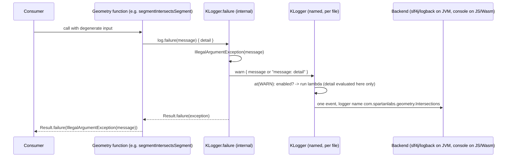

# Plan: `logging` - the failure and logging seam (unit 3 of 8)

- **Covers:**
  - [SpartanLaboratories/GeneralTools#7](https://github.com/SpartanLaboratories/GeneralTools/issues/7),
    *"Make GeneralTools Kotlin Multiplatform (Color and geometry usable from common code)"*.
  - [SpartanLaboratories/GeneralTools#8](https://github.com/SpartanLaboratories/GeneralTools/issues/8),
    *"Read-only views for Point and Square so libraries can expose geometry without copying"*,
    which the same 3.0.0 change resolves (in the `box-model` unit, not here).
- **Architecture:** [`architecture.md`](architecture.md), unit `logging` (§11.2 row 3), system **S3**
  (§6), the S6 failure sites, boundary row "Any failure site -> S3" (§7.2), adoption verdicts for the
  slf4j loggers, the failure sites and `com.spartanlabs.logging` (§8.2), break 5 (§11.3).
- **Landing order:** 3 of 8. Depends on `kmp-build` (1) and `explicit-api` (2). Unblocks `commonize` (4).
- **Branch:** `feat/issue-7-kotlin-multiplatform` (all units land on it; `master` @ `c196d1a` is merged
  into it before the first implementation commit).
- **Commit:** TBD. **PR:** TBD. This plan document is committed in the same commit as the first
  implementation stage (commit 1 below), so `git log --follow` binds the two.
- **What this plans:** the kotlin-logging 8.0.4 dependency; the internal `KLogger.failure` helper and its
  tests; the five geometry loggers moved to kotlin-logging under their 2.x names; the eleven
  `Result.failure(IllegalArgumentException)` sites routed through the helper; the deletion of
  `com.spartanlabs.logging` (break 5) as the unit's last commit.
- **Status:** planning only. **Target release:** GeneralTools `3.0.0`. Nothing is uploaded or published
  until the maintainer explicitly starts the release.

**State when this unit starts** (the seam contract of `kmp-build` and `explicit-api`):

- every existing main source file sits under `src/jvmMain/kotlin/{generaltools,geometry,logging}/` with
  explicit-API modifiers (`public`, explicit return types);
- every existing test sits under `src/jvmTest/kotlin/...`; `logback-test.xml` is in
  `src/jvmTest/resources/`;
- `commonMain` exists and holds nothing but its `api(kotlin-stdlib:2.2.0)` dependency; `commonTest`
  has `kotlin("test")`; `jvmMain` keeps `api(slf4j-api:2.0.16)` and `implementation(commons-io:2.4)`;
  `jvmTest` has logback `1.5.13`;
- `abiValidation()` is wired, `api/GeneralTools.api` equals the committed 2.2.0 baseline,
  `api/GeneralTools.klib.api` is committed as an empty file (the web compilations have no sources yet),
  `check` runs `checkKotlinAbi`, and `-PtestLevel=<level>[,<level>]` filters every target's test task;
- the README has a `## 3.0.0 migration notes` section (table: Symptom | Cause | Fix).

Line numbers below cite the baseline files (`src/main/kotlin/...` at `17d30bc`, identical to tag
`2.2.0`); after the two earlier units the same declarations sit in `src/jvmMain/kotlin/...` a few lines
lower (modifiers added). The implementer locates them by declaration.

---

## 1. Requirements

1. `commonMain` depends on `io.github.oshai:kotlin-logging:8.0.4` as `implementation` (never `api`).
   No public signature mentions kotlin-logging; no public `inline` function logs.
2. One internal helper, `KLogger.failure(message, detail)`, in
   `src/commonMain/kotlin/generaltools/Failure.kt`, builds the exception from `message` alone, logs one
   lazy WARN line on the receiver logger, attaches no throwable, and returns `Result.failure`.
3. The five geometry files that held an slf4j logger hold a kotlin-logging logger with the **same
   name**: `TwoDoubles.kt:6`, `Point.kt:9`, `Segment.kt:6`, `Vectors.kt:7`, `Intersections.kt:7`.
4. All eleven `Result.failure(IllegalArgumentException(...))` sites go through the helper. Each keeps
   its 2.x exception message byte-for-byte and passes the diagnostics of its 2.x WARN line as `detail`.
   Afterwards no `IllegalArgumentException(` construction remains outside the helper, except the
   two throwing members, `TwoDoubles.divideBy` and `Color.fromHex` (grep in section 9, level 1).
5. `TwoDoubles.divideBy` keeps its behaviour (logs ERROR, throws `IllegalArgumentException("Cannot divide
   by zero")`); only its logger moves to kotlin-logging. `Misc.kt` keeps its slf4j logger.
   `UserActions.kt` keeps slf4j.
6. `com.spartanlabs.logging` is deleted (`Logger.kt`, `MessageBuilder.kt`) in the unit's last commit.
7. The JVM API dump (`api/GeneralTools.api`) is byte-identical to the committed 2.2.0 baseline after
   commits 1 and 2; commit 3 removes exactly the `Logger`, `LoggerKt`, `MessageBuilder` and `IJColor`
   blocks (18 members) and nothing else.
8. The README gains a `## Logging` section (a Boundary-Ring note), migration rows for the startup line,
   the new WARN lines and the removed package, and loses the `com.spartanlabs.logging` module entry.

**Acceptance checks:** `./gradlew build` is green on every commit (`jvmTest`, `jsNodeTest`,
`wasmJsNodeTest`, `checkKotlinAbi`); the new tests of section 9 pass; the greps of section 9 level 1 give
the stated output; `git diff -- api/GeneralTools.api` is empty after commits 1-2 and deletion-only after
commit 3. `api/GeneralTools.klib.api` changes once, in commit 1: `Failure.kt` is the first `commonMain`
code, so the web compilations produce their first klibs and the plugin's klib dump goes from empty to
what it writes for them, expected to be its header with no declaration (the helper is `internal`).

---

## 2. Current state

**Baseline.** `master` @ `17d30bc`; `src/main` equals tag `2.2.0`; `./gradlew build` passes with 185
tests. Commits touching the geometry sources are the feature commits of issue #3 (`1ebf344`, `cacc4cd`,
`01b3c8d`); nothing in flight conflicts.

**Loggers.** Seven files hold `private val log = LoggerFactory.getLogger("com.spartanlabs....")`:
`Misc.kt:22`, `UserActions.kt:17` (both stay), and the five geometry files above.

**The twelve failure sites** (eleven `Result.failure`, one throw). In each case the 2.x log line and the
exception message differ: the log carries values, the exception a short stable text.

| # | Site (baseline lines) | 2.x WARN line (slf4j) | 2.x exception message |
|---|---|---|---|
| 1 | `Point.distanceFrom` (`Point.kt:30-35`) | `Cannot compute distance: one or both points contain NaN values` (no values) | `Point values must be numbers` |
| 2 | `Segment.asRay` (`Segment.kt:45-53`) | `Cannot build a Ray from a degenerate or non-finite Segment: {}` (`this`) | `Segment must be finite and longer than EPSILON` |
| 3 | `Point.normalized` (`Vectors.kt:74-87`) | `Cannot normalize a zero-length or non-finite vector: {}` (`this`) | `Vector must be finite and longer than EPSILON to be normalized` |
| 4 | `segmentIntersectsSegment` NaN (`Intersections.kt:61-64`) | `segmentIntersectsSegment: NaN coordinate in {} or {}` (`s1`, `s2`) | `Segments must have finite coordinates` |
| 5 | `segmentIntersectsSegment` degenerate (`:65-68`) | `segmentIntersectsSegment: degenerate segment ({} or {})` | `Segments must be longer than EPSILON` |
| 6 | `segmentIntersectsBox` bad box (`:132-135`) | `segmentIntersectsBox: {}` (the `boxProblem` text) | the `boxProblem` text itself: `Box size must be finite` or `Box size must be non-negative` |
| 7 | `segmentIntersectsBox` bad segment (`:136-141`) | `segmentIntersectsBox: degenerate or non-finite segment {}` | `Segment must be finite and longer than EPSILON` |
| 8 | `rayIntersectsBox` bad box (`:189-192`) | `rayIntersectsBox: {}` (the `boxProblem` text) | the `boxProblem` text itself |
| 9 | `rayIntersectsBox` corners (`:193-196`) | `rayIntersectsBox: non-finite box corner ({}, {})` (`box.min`, `box.max`) | `Box corners must be finite` |
| 10 | `rayIntersectsBox` ray (`:197-203`) | `rayIntersectsBox: non-finite ray {}` | `Ray must have finite coordinates` |
| 11 | `rayIntersectsBox` direction (`:204-207`) | `rayIntersectsBox: zero-direction ray {}` | `Ray direction must be longer than EPSILON` |
| - | `TwoDoubles.divideBy` (`TwoDoubles.kt:42-47`) | ERROR `Attempted to divide a {} by zero` (`this::class.simpleName`) | `Cannot divide by zero` (thrown) |

`Ray.unit()` (`Ray.kt:35-36`) has no site of its own: it maps over `normalized()`, so a failing `unit()`
produces exactly one WARN line, from site 3. `Ray.kt` is unchanged by this unit.

**No test asserts an exception message or a log line today** (`grep -rn "message" src/test` finds none
that concern these sites); byte-identity of the messages is therefore proven only by the tests this
unit adds.

**`com.spartanlabs.logging`.** `logging/Logger.kt` (`Logger`, plus a top-level `main()` giving the
facade `LoggerKt`) and `logging/MessageBuilder.kt` (`MessageBuilder`, enum `IJColor`). The compiled 2.x
classes (`javap -p` on `build/classes/kotlin/main`) expose 7 + 5 + 2 + 4 = **18** public members:
`IJColor` {`INFO`, `getEntries`, `getColorCode`, `getReset`, `plus`, `valueOf`, `values`}, `Logger`
{constructor, `getPrintToConsole`, `setPrintToConsole`, `getInfo`, `info`}, `LoggerKt` {`main()`,
`main(String[])`}, `MessageBuilder` {two constructors incl. the synthetic default-argument one,
`getColor`, `modify`}. This matches break 5 in §11.3. No file in the repository outside the package
(and outside docs and the README) refers to it.

**Verified outside-world facts** (sources: [`research/kotlin-logging-adoption.md`](research/kotlin-logging-adoption.md)
F1-F9 and §7 claims 10, 15, 16; re-read for this plan at
`https://raw.githubusercontent.com/oshai/kotlin-logging/8.0.4/src/commonMain/kotlin/io/github/oshai/kotlinlogging/KLogger.kt`
and `.../internal/MessageInvoker.kt`):

- `KLogger` (package `io.github.oshai.kotlinlogging`) declares `val name: String`,
  `fun isLoggingEnabledFor(level: Level, marker: Marker? = null): Boolean` and
  `fun at(level: Level, marker: Marker? = null, block: KLoggingEventBuilder.() -> Unit)` without bodies;
  `warn(message: () -> Any?)` and its siblings are default methods.
- `warn { }` is `at(Level.WARN, marker) { this.message = message.toStringSafe(); this.cause = throwable }`.
  The enabled-check therefore lives in `at` (the concrete logger), and the message lambda runs inside
  the `at` block, only when the logger is enabled.
- `toStringSafe()` is `try { invoke().toString() } catch (e: Exception) { ... "Log message invocation
  failed: $e" }`: a throwing lambda does not propagate (an `Error` would).
- `KLoggingEventBuilder` has a public no-argument constructor and public `message: String?`,
  `cause: Throwable?`, `payload`, `arguments`.
- On the JVM `KotlinLogging.logger(name)` is `LoggerFactory.getLogger(name)` wrapped, name verbatim; the
  slf4j-api jar is not supplied by kotlin-logging (GeneralTools' `jvmMain` `api(slf4j-api)` supplies it).
- 8.x prints `kotlin-logging: initializing... active logger factory: Slf4jLoggerFactory` once, on first
  use of `KotlinLogging`; opt-out `-Dkotlin-logging.logStartupMessage=false` or env
  `KOTLIN_LOGGING_STARTUP_MESSAGE=false`.

---

## 3. Assumptions

| # | Assumption | If false |
|---|---|---|
| L1 | `commonTest` sees `commonMain`'s `implementation` dependencies (the test compilation is associated with main). | Add `implementation("io.github.oshai:kotlin-logging:8.0.4")` to `commonTest` in commit 1 as well. |
| L2 | `KLogger` has exactly the three abstract members above, so `RecordingKLogger` compiles with them. | The compiler lists the missing members; the fake overrides them (default behaviour is irrelevant to the helper). Plan content is unaffected. |
| L3 | `FailureKt` (the facade of an internal-only file) is not written to `GeneralTools.api` (architecture §6 S3, A4). | The dump shows a `FailureKt` block after commit 1: that is a ledger error; record it as a deviation and review it - do not suppress it silently. |
| L4 | Adding kotlin-logging does not change `kotlin-js-store/yarn.lock` (the klibs carry no npm dependencies). | `./gradlew build` fails on a lock mismatch; run `./gradlew kotlinUpgradeYarnLock`, review the diff, and commit it in commit 1. |
| L5 | An slf4j-bound kotlin-logging event reaches a logback `ListAppender` attached to the named logger with `formattedMessage` equal to the logged text. | The level-3 test reads `getMessage` instead; no design change. |
| L6 | The README, as `kmp-build` left it, still has the `com.spartanlabs.logging` module bullet and (possibly rewritten) intro clause naming a logging wrapper. | The edits in commit 3 are located by content, not line; remove whichever form is present. |
| L7 | Each site's WARN line text (`<message>: <detail>`) is the intended 3.0.0 text; the helper contract fixes this form. | n/a - fixed by the architecture's call-site rule. |

---

## 4. Non-goals

- Moving any geometry file to `commonMain`, replacing `javaClass`, `String.format`, `java.lang.Math.pow`
  or `Predicate` (`commonize`, `generaltools-breaks`).
- Changing `divideBy` semantics (`Result<Unit>`, in place, WARN): `two-doubles`. This unit only changes
  which logger instance its ERROR line goes to.
- Giving `Misc.kt` a kotlin-logging logger (`generaltools-breaks`, when `evaluateList` arrives in
  common code) or touching `UserActions.kt`.
- Converting the throwing members (`divAssign`, `Color.fromHex`, `trimIfLongerThan`) to the helper.
- Any change to `Ray.kt`, `Color.kt`, `AxisAlignedBox.kt`, `Square.kt`, `CenteredBox.kt`.
- `-Dkotlin-logging.logStartupMessage` set from library code (a global side effect on a shared
  singleton); the opt-out is documented, not applied.
- Per-logger levels on JS/Wasm; a payload/event-builder logging style; MDC; markers.
- Wiring the unit's own `git` steps: the `manager` agent performs them.

---

## 5. Design

### 5.1 The helper (S3)

```kotlin
// src/commonMain/kotlin/generaltools/Failure.kt
package com.spartanlabs.generaltools

import io.github.oshai.kotlinlogging.KLogger

internal fun <T> KLogger.failure(message: String, detail: (() -> Any?)? = null): Result<T> {
    val exception = IllegalArgumentException(message)
    warn { if (detail == null) message else "$message: ${detail()}" }
    return Result.failure(exception)
}
```

- **Error handling.** The function *is* the failure path. It never throws on an expected input: the
  exception is constructed and carried, never raised. `message` may be any string. A `detail` lambda
  that throws an `Exception` is swallowed by kotlin-logging's `toStringSafe` (the log line then reads
  `Log message invocation failed: ...`) and the failure is still returned; a thrown `Error`
  (programmer/VM error, e.g. `StackOverflowError`) propagates. The `Result` is unwrapped by the
  *callers' callers* (`getOrThrow`, `fold`, `getOrElse`); the helper and its eleven call sites never
  unwrap.
- **Type.** `T` appears only in the return type and is inferred from the expected type at the call
  site (`Result<Double>`, `Result<Ray>`, `Result<Boolean>`, `Result<Double?>`, `Result<SegmentIntersection>`,
  `Result<Point>`). `Result<out T>` is covariant, so no cast or `Nothing` is needed.
- **Mutability / concurrency.** Stateless; closes over its two parameters only. Thread-safe to the
  extent the logger is (slf4j and the JS/Wasm console logger both are).
- **Laziness.** `detail` is evaluated only inside the `warn` lambda, which kotlin-logging runs only when
  WARN is enabled. `message` is never lazy (the exception needs it). The detail never reaches the
  exception.
- **No throwable on the log event** (`warn { }` with no `Throwable` overload): no stack trace is logged,
  none would point anywhere useful (it would end in the helper).
- **Visibility.** `internal`: not public API, no semver surface, not in the dump (A4/L3). No public
  signature in the library mentions `KLogger`; no public `inline` function calls it.

**KDoc contract on the helper** (Level 2, and the Boundary-Ring note for the log line):

```kotlin
/**
 * Reports an expected failure: logs one WARN line on this logger and returns the failure.
 *
 * The returned [Result] holds `IllegalArgumentException(message)` - the exception carries [message] and
 * nothing else, so the text callers see is stable. The WARN line is `message` alone when [detail] is
 * `null`, otherwise `"message: <detail>"`; it carries no throwable and therefore no stack trace.
 * [detail] is evaluated lazily, only when WARN is enabled on this logger, and never reaches the
 * exception. A [detail] that throws an `Exception` does not turn the failure into a throw.
 *
 * Boundary note: this is the library's only failure-reporting path for `Result`-returning functions.
 * Each call is one log event on the calling file's logger (`com.spartanlabs.<package>.<File>`); on the
 * JVM it reaches the consumer's slf4j backend, on JS/Wasm the console at the single global level.
 *
 * @param T the success type of the `Result` the caller returns; inferred from the call site.
 * @param message the exception message; also the head of the log line. Keep it short and stable.
 * @param detail optional diagnostics (function name and offending values) appended to the log line only.
 * @return `Result.failure(IllegalArgumentException(message))`; never a success.
 */
```

Level 1 comments (one line each, above the lines they explain): why the exception is built from
`message` alone (the text is documented API); why no `Throwable` is passed to `warn`; why `detail` is
captured as a lambda (the values' `toString` runs only when WARN is on).

### 5.2 The call-site rule, applied to the eleven sites

Every site is `return log.failure("<2.x exception message>") { "<function>: <values>" }`. The WARN line
is therefore `"<2.x exception message>: <function>: <values>"`. Sites 1-3 get a function name because
their 2.x lines carried none; sites 6 and 8, whose 2.x line carried only the problem text (which is now
`message`), get the offending box as the value. Everything else is the 2.x WARN text with the
`{}` placeholders turned into string templates.

| # | `message` (byte-identical to 2.x) | `detail` lambda body |
|---|---|---|
| 1 | `Point values must be numbers` | `"Point.distanceFrom: NaN coordinate in ($this) or ($other)"` |
| 2 | `Segment must be finite and longer than EPSILON` | `"Segment.asRay: degenerate or non-finite segment $this"` |
| 3 | `Vector must be finite and longer than EPSILON to be normalized` | `"Point.normalized: zero-length or non-finite vector ($this)"` |
| 4 | `Segments must have finite coordinates` | `"segmentIntersectsSegment: NaN coordinate in $s1 or $s2"` |
| 5 | `Segments must be longer than EPSILON` | `"segmentIntersectsSegment: degenerate segment ($s1 or $s2)"` |
| 6 | `problem` (the `boxProblem` string) | `"segmentIntersectsBox: invalid box $box"` |
| 7 | `Segment must be finite and longer than EPSILON` | `"segmentIntersectsBox: degenerate or non-finite segment $s"` |
| 8 | `problem` | `"rayIntersectsBox: invalid box $box"` |
| 9 | `Box corners must be finite` | `"rayIntersectsBox: non-finite box corner (${box.min}) and (${box.max})"` |
| 10 | `Ray must have finite coordinates` | `"rayIntersectsBox: non-finite ray $r"` |
| 11 | `Ray direction must be longer than EPSILON` | `"rayIntersectsBox: zero-direction ray $r"` |

`$this` inside a detail lambda is the enclosing `Point` / `Segment` (the lambda is a plain `() -> Any?`,
not an extension lambda). In sites 6 and 8 the `let` parameter is named `problem` (not `it`) so the
detail lambda cannot be misread as using it.

A worked example of the log line (site 4, JVM number format): `Segments must have finite coordinates:
segmentIntersectsSegment: NaN coordinate in Segment(a=NaN, 0.0, b=1.0, 0.0) or Segment(a=0.0, 1.0,
b=1.0, 1.0)`. Number text follows the platform (`1.0` prints as `1` on JS); the log line is
diagnostic, not contract.

### 5.3 Flow



### 5.4 Observability (events logged)

| Event | Level | Logger | Text |
|---|---|---|---|
| Expected failure at any of the 11 sites | WARN | the file's own logger (names below) | `<message>` or `<message>: <detail>` |
| `TwoDoubles.divideBy(0.0)` (unchanged behaviour; `two-doubles` converts it) | ERROR | `com.spartanlabs.geometry.TwoDoubles` | `Attempted to divide a <SimpleName> by zero` |
| First use of kotlin-logging in the process | stdout `println` by the library | n/a | `kotlin-logging: initializing... active logger factory: <Factory>` |

Logger names (unchanged from 2.x): `com.spartanlabs.geometry.TwoDoubles`, `...Point`, `...Segment`,
`...Vectors`, `...Intersections`. `Misc` (`com.spartanlabs.generaltools.Misc`) and `UserActions` keep
their slf4j loggers and names.

---

## 6. File-by-file changes (in commit order)

### Commit 1 - dependency, helper, helper tests

**`docs/plans/7-kotlin-multiplatform/plan-logging.md`** - this document, added.

**`build.gradle.kts`** - in the `commonMain` dependencies block that `kmp-build` created (the one with
`api("org.jetbrains.kotlin:kotlin-stdlib:2.2.0")`), add one line:

```kotlin
implementation("io.github.oshai:kotlin-logging:8.0.4")   // exact version, no range; internal use only, never api
```

with the comment that it is runtime-only on the JVM variant and that `jvmMain`'s `api(slf4j-api)` is
what supplies slf4j (kotlin-logging's jvm artifact does not). Nothing else in the build changes.

**`kotlin-js-store/yarn.lock`** - only if L4 fails; reviewed diff committed in this commit.

**`src/commonMain/kotlin/generaltools/Failure.kt`** (new) - exactly the code and KDoc of §5.1. Package
`com.spartanlabs.generaltools`. Internal declarations only.

**`src/commonTest/kotlin/com/spartanlabs/testing/component/generaltools/RecordingKLogger.kt`** (new,
test support, not a test class):

```kotlin
package com.spartanlabs.testing.component.generaltools

import io.github.oshai.kotlinlogging.KLogger
import io.github.oshai.kotlinlogging.KLoggingEventBuilder
import io.github.oshai.kotlinlogging.Level
import io.github.oshai.kotlinlogging.Marker

/** A [KLogger] that records the events it would emit. Not thread-safe; for single-threaded tests. */
internal class RecordingKLogger(
    override val name: String = "com.spartanlabs.testing.Recording",
    private val enabledLevels: Set<Level> = Level.entries.toSet(),
) : KLogger {
    data class Event(val level: Level, val marker: Marker?, val message: String?, val cause: Throwable?)

    private val recorded = mutableListOf<Event>()
    val events: List<Event> get() = recorded

    override fun isLoggingEnabledFor(level: Level, marker: Marker?): Boolean = level in enabledLevels

    // Mirrors a real backend: the enabled check precedes running the builder block, which is
    // where kotlin-logging evaluates the lazy message lambda.
    override fun at(level: Level, marker: Marker?, block: KLoggingEventBuilder.() -> Unit) {
        if (!isLoggingEnabledFor(level, marker)) return
        val builder = KLoggingEventBuilder().apply(block)
        recorded += Event(level, marker, builder.message, builder.cause)
    }
}
```

**`src/commonTest/kotlin/com/spartanlabs/testing/component/generaltools/FailureTest.kt`** (new) - see
section 9, level 2.

*Dump delta:* JVM none (`api/GeneralTools.api` unchanged; L3). Klib: `api/GeneralTools.klib.api` goes from
empty to what `./gradlew updateKotlinAbi` (its own invocation) writes for the first web klibs, expected to
be the header alone (`// Klib ABI Dump`, `// Targets: [js, wasmJs]`, the rendering settings and
`// Library unique name: <io.github.spartanlaboratories:GeneralTools>`) with no declaration. Commit that
file; a declaration line in it is an error (the helper is `internal`).

### Commit 2 - geometry loggers and the eleven sites

Each file, in `src/jvmMain/kotlin/geometry/`: replace `import org.slf4j.LoggerFactory` with
`import io.github.oshai.kotlinlogging.KotlinLogging`; replace the logger line; where sites exist add
`import com.spartanlabs.generaltools.failure`. The KDoc on the public function gets one added sentence
(Level 2): *"On failure also logs one WARN line on this file's logger (see the README's Logging
section)."* No signature, modifier or return type changes anywhere (`Result<...>` return types stay).

**`TwoDoubles.kt`** - logger and the ERROR line only:

```kotlin
/** Logger used for diagnostic output from this file's functions. */
private val log = KotlinLogging.logger("com.spartanlabs.geometry.TwoDoubles")
...
public infix fun divideBy(magnitude: Double): Unit =
    if (magnitude == 0.0) {
        log.error { "Attempted to divide a ${this::class.simpleName} by zero" }   // was log.error("... {} ...", simpleName)
        throw IllegalArgumentException("Cannot divide by zero")
    }
    else amplifyBy(1/magnitude)
```

Behaviour is unchanged: expected failure by contract, so it throws (it is a programmer-visible
`IllegalArgumentException`, not a `Result`); `divAssign` still reaches it. No `failure` import here.
`two-doubles` replaces this body.

**`Point.kt`** - logger `com.spartanlabs.geometry.Point`; site 1:

```kotlin
public infix fun distanceFrom(other: Point): Result<Double> =
    if (containsNaN || other.containsNaN)
        log.failure("Point values must be numbers") { "Point.distanceFrom: NaN coordinate in ($this) or ($other)" }
    else Result.success(sqrt((x - other.x).pow(2.0) + (y - other.y).pow(2.0)))
```

The stray `import java.lang.Math.pow` stays (`commonize` removes it). The success branch is untouched,
including its `pow(2.0)`.

**`Segment.kt`** - logger `com.spartanlabs.geometry.Segment`; site 2:

```kotlin
public fun asRay(): Result<Ray> {
    if (a.containsNaN || b.containsNaN || length < EPSILON) {
        return log.failure("Segment must be finite and longer than EPSILON") {
            "Segment.asRay: degenerate or non-finite segment $this"
        }
    }
    return Result.success(Ray(Point(a.x, a.y), delta))
}
```

**`Vectors.kt`** - logger `com.spartanlabs.geometry.Vectors`; site 3 (keep the existing explanatory
comment above `val len`, updating "Guard the same degeneracy `TwoDoubles.divideBy` guards, but return a
Result instead of throwing" only if it becomes untrue - it stays true in this unit):

```kotlin
if (containsNaN || len < EPSILON) {
    return log.failure("Vector must be finite and longer than EPSILON to be normalized") {
        "Point.normalized: zero-length or non-finite vector ($this)"
    }
}
```

**`Intersections.kt`** - logger `com.spartanlabs.geometry.Intersections`; sites 4-11:

```kotlin
// segmentIntersectsSegment
if (s1.a.containsNaN || s1.b.containsNaN || s2.a.containsNaN || s2.b.containsNaN) {
    return log.failure("Segments must have finite coordinates") {
        "segmentIntersectsSegment: NaN coordinate in $s1 or $s2"
    }
}
if (s1.length < EPSILON || s2.length < EPSILON) {
    return log.failure("Segments must be longer than EPSILON") {
        "segmentIntersectsSegment: degenerate segment ($s1 or $s2)"
    }
}

// segmentIntersectsBox
boxProblem(box)?.let { problem ->
    return log.failure(problem) { "segmentIntersectsBox: invalid box $box" }
}
if (s.a.containsNaN || s.b.containsNaN || s.length < EPSILON) {
    return log.failure("Segment must be finite and longer than EPSILON") {
        "segmentIntersectsBox: degenerate or non-finite segment $s"
    }
}

// rayIntersectsBox
boxProblem(box)?.let { problem ->
    return log.failure(problem) { "rayIntersectsBox: invalid box $box" }
}
if (!box.min.x.isFinite() || !box.min.y.isFinite() || !box.max.x.isFinite() || !box.max.y.isFinite()) {
    return log.failure("Box corners must be finite") {
        "rayIntersectsBox: non-finite box corner (${box.min}) and (${box.max})"
    }
}
if (r.origin.containsNaN || r.direction.containsNaN ||
    !r.origin.x.isFinite() || !r.origin.y.isFinite() ||
    !r.direction.x.isFinite() || !r.direction.y.isFinite()
) {
    return log.failure("Ray must have finite coordinates") { "rayIntersectsBox: non-finite ray $r" }
}
if (r.direction.length < EPSILON) {
    return log.failure("Ray direction must be longer than EPSILON") {
        "rayIntersectsBox: zero-direction ray $r"
    }
}
```

The slab arithmetic, `boxProblem`, the `minOf`/`maxOf` comments and every success path are untouched
(`commonize` and `box-model` own those). The `box.min`/`box.max` reads in the detail lambda occur only
on the failure path and only when WARN is enabled.

**New test files (jvmTest)** - see section 9, level 3:
`src/jvmTest/kotlin/com/spartanlabs/testing/integration/generaltools/LogCapture.kt`,
`.../integration/geometry/FailureSitesLoggingTest.kt`,
`.../integration/geometry/DivideByLoggingTest.kt`.

**`README.md`** - the `## Logging` section and two migration rows (section 8).

*Dump delta:* none. The only changed declarations are `private` file-level vals and bodies.

### Commit 3 - delete `com.spartanlabs.logging` (break 5)

- Delete `src/jvmMain/kotlin/logging/Logger.kt` and `src/jvmMain/kotlin/logging/MessageBuilder.kt`
  (the directory disappears). No import or reference exists anywhere in the sources or tests.
- `api/GeneralTools.api`: run `./gradlew updateKotlinAbi`; the diff removes the four blocks
  `com/spartanlabs/logging/{IJColor,Logger,LoggerKt,MessageBuilder}` (18 member lines + their four
  class headers/closers) and adds nothing. The klib dump is unaffected (the package was `jvmMain`-only
  and never common).
- `README.md`: remove the `com.spartanlabs.logging` bullet (`Logger`, `MessageBuilder`) from Modules;
  remove the clause naming a "lightweight logging wrapper" from the intro, in whatever form
  `kmp-build` left it; append the removal migration row.

*Dump delta:* deletion of exactly the 18 members of break 5; any other changed line is an error.

---

## 7. Why this shape

- **A `KLogger` extension, not a function taking the logger and not a shared logger.** The extension
  keeps each file's logger name (so consumers' `com.spartanlabs.geometry.*` backend rules still match
  and JS/Wasm get real names), mirrors the existing `Logger.time` extension idiom, and is unit-testable
  with a three-member fake in `commonTest`.
- **`detail` rather than a richer message.** The exception text is documented API and must not change;
  the 2.x WARN line carried the offending values. A lazy `detail` keeps both, and its `toString` cost is
  paid only when WARN is on.
- **No exception parameter, no payload, no throwable.** The sites all return `IllegalArgumentException`;
  the event builder's payload is invisible on JS/Wasm; a throwable adds a useless stack trace.
- **`implementation`, not `api`.** No public signature needs a `KLogger`; `api` would put kotlin-logging
  on every consumer's compile classpath and into the semver surface.
- **Deletion last.** It is the only commit that moves the dump, so the earlier commits stay
  byte-identical and a regression in them cannot hide behind the break.

---

## 8. Documentation impact

**Rings touched:** Ring 1 (Level-1 comments in `Failure.kt`), Ring 2 (KDoc on the helper and the six
public functions), Ring 3 (the Boundary-Ring note: WARN line contents, logger names, startup line,
JS/Wasm console). Ring 4: no diagram or architecture-document change; `architecture.md` already
describes S3 as built.

**KDoc.** Level 2 on the helper (text in §5.1) and one added sentence on `Point.distanceFrom`,
`Segment.asRay`, `Point.normalized`, `Ray.unit` (a pointer: "failure is reported by [Point.normalized],
which logs one WARN line"), `segmentIntersectsSegment`, `segmentIntersectsBox`, `rayIntersectsBox`.
`Logger.kt`/`MessageBuilder.kt` have no KDoc to move.

**README** (same commits as the changes; the maintainers' README-currency rule):

*Commit 2* - add, immediately above `## 3.0.0 migration notes`, a section:

> ## Logging
>
> GeneralTools logs through [kotlin-logging](https://github.com/oshai/kotlin-logging) 8.0.4. On the JVM
> it delegates to slf4j, so your existing logback / log4j configuration applies; on JS and Wasm output
> goes to the console at a single global level (INFO by default, no per-logger control - to mute
> GeneralTools there, wrap kotlin-logging's `Appender` and drop events whose `loggerName` starts with
> `com.spartanlabs`).
>
> - **Logger names** are `com.spartanlabs.<package>.<File>`, unchanged from 2.x:
>   `com.spartanlabs.geometry.TwoDoubles`, `.Point`, `.Segment`, `.Vectors`, `.Intersections`, and
>   `com.spartanlabs.generaltools.Misc` and `com.spartanlabs.generaltools.UserActions`. The JVM-only
>   helpers (`read`, `asURL`, `Logger.time`, `UserActions`) log through slf4j directly.
> - **Every expected failure logs one WARN line** on its file's logger: `Point.distanceFrom`,
>   `Segment.asRay`, `Point.normalized` (and so `Ray.unit`), `segmentIntersectsSegment`,
>   `segmentIntersectsBox`, `rayIntersectsBox`. The line is `<exception message>: <function>: <offending
>   values>`. The returned `Result` holds an `IllegalArgumentException` with the message only; no stack
>   trace is logged.
> - A loop that probes degenerate input logs one line per call. On the JVM set
>   `com.spartanlabs.geometry` to ERROR in your backend; test cheap preconditions first in hot loops.
> - kotlin-logging prints one startup line to stdout on first use. Opt out with
>   `-Dkotlin-logging.logStartupMessage=false` or the environment variable
>   `KOTLIN_LOGGING_STARTUP_MESSAGE=false`; GeneralTools does not set it for you.

Also in the "Geometry quick reference" sentence that begins "Intersection functions (all return
`Result`; ...)" append: "Each failure also logs one WARN line (see Logging)."

*Commit 2* - migration rows (Symptom | Cause | Fix):

| Symptom | Cause | Fix |
|---|---|---|
| `kotlin-logging: initializing... active logger factory: Slf4jLoggerFactory` printed once on stdout | kotlin-logging 8 prints a startup line the first time any GeneralTools code that holds a logger runs | Start the JVM with `-Dkotlin-logging.logStartupMessage=false`, or set `KOTLIN_LOGGING_STARTUP_MESSAGE=false` (JS: the same name in `process.env`). |
| New WARN lines when a geometry call returns a failed `Result`; alert or log-scrape rules written for the 2.x WARN text stop matching | Each expected failure now logs one WARN line through a shared helper: `<message>: <function>: <values>`, under the unchanged logger names. `TwoDoubles.divideBy(0.0)` still throws `IllegalArgumentException("Cannot divide by zero")` and logs at ERROR. | Match on logger name and level rather than text; silence `com.spartanlabs.geometry` in your backend if the volume is a problem. Exception messages are byte-identical to 2.x. |

(The `divideBy` sentence in the second row is true only until `two-doubles` converts `divideBy`; that
unit's commit (b) rewrites it.)

*Commit 3* - migration row:

| Symptom | Cause | Fix |
|---|---|---|
| `Unresolved reference: Logger` / `MessageBuilder` / `IJColor` from `com.spartanlabs.logging`; `NoClassDefFoundError` at runtime | The package is removed; it printed one green ANSI line and nothing else used it | Use slf4j or kotlin-logging, or `println("\u001b[92m$message\u001b[0m")` for the same output. |

---

## 9. Test plan by level

Tests live in `com.spartanlabs.testing.<level>.<package>` mirroring the production package; one test
class per file; JUnit 5 via `kotlin.test` on the JVM; no `@Tag`, no slf4j `log` fields (the
`-PtestLevel` filter selects by package).

### Level 1 - gating (local, before each commit)

No test files: level 1 is the local validation procedure. Run from the repository root:

```sh
# every commit
./gradlew compileKotlinJvm compileKotlinJs compileKotlinWasmJs
./gradlew jvmTest jsNodeTest wasmJsNodeTest -PtestLevel=component,integration
./gradlew updateKotlinAbi            # its own invocation, never together with checkKotlinAbi
git diff --stat -- api/              # commit 1: only GeneralTools.klib.api (header, no declaration); commit 2: empty; commit 3: deletions in GeneralTools.api only
./gradlew checkKotlinAbi
./gradlew build                      # the full gate: all targets, all levels, ABI check

# commit 2 (and re-run in commit 3)
grep -rnE "LoggerFactory|org\.slf4j" src/jvmMain/kotlin/geometry          # expect no output
grep -rnE "log\.(warn|error|info|debug|trace)\(\"" src/jvmMain/kotlin/geometry   # expect no output (no slf4j-style calls)
grep -rn "IllegalArgumentException(" src/commonMain src/jvmMain           # expect: Failure.kt (the helper), TwoDoubles.kt (the throw in divideBy) and Color.kt (the throw in fromHex) only
grep -rnE "Result\.failure\(" src/commonMain src/jvmMain                  # expect: Failure.kt and backticked KDoc lines only (`Result.failure(IllegalArgumentException)`)

# commit 3
grep -rn "spartanlabs.logging" src                                         # expect no output
./gradlew updateKotlinAbi && git diff --numstat -- api/GeneralTools.api    # additions 0
```

The grep for the construction uses `IllegalArgumentException(` (opening parenthesis): six KDoc lines
(`Intersections.kt:56,126,180`, `Ray.kt:31`, `Segment.kt:41`, `Vectors.kt:69`) contain the text
``Result.failure(IllegalArgumentException)`` and would match a bare `Result.failure(IllegalArgumentException`.
Several sites also split the call across two lines (`Result.failure(` newline `IllegalArgumentException(`),
which is why the guard looks for the constructor call, not the pair.

### Level 2 - isolated component behaviour (mock all external calls)

**`FailureTest`** - `src/commonTest/kotlin/com/spartanlabs/testing/component/generaltools/FailureTest.kt`,
package `com.spartanlabs.testing.component.generaltools`, source set `commonTest` (runs on `jvmTest`,
`jsNodeTest`, `wasmJsNodeTest`). Subject: `KLogger.failure`. Uses `RecordingKLogger`; the external
dependency (the logging backend) is the fake. Tests, with the behaviour each locks down:

| Backtick name | Asserts |
|---|---|
| `failure returns a failed Result holding an IllegalArgumentException with the message` | `isFailure`; `exceptionOrNull()!!::class == IllegalArgumentException::class` (the exact class, not a subclass); `message == "m"` |
| `failure logs exactly one WARN event on the receiver logger` | `events.size == 1`; `level == Level.WARN`; `marker == null` |
| `failure logs the message alone when no detail is given` | event message `== "m"` |
| `failure logs the message, a colon and a space, then the detail text` | event message `== "m: d"` |
| `failure renders a detail that returns null as the text null` | event message `== "m: null"` |
| `failure attaches no throwable to the log event` | `events.single().cause == null` |
| `failure does not evaluate detail when WARN is disabled` | logger with `enabledLevels = Level.entries.toSet() - Level.WARN`; a counter incremented by `detail` stays `0`; `events` empty; the result is still the failure with the message |
| `failure evaluates detail exactly once when WARN is enabled` | counter `== 1` |
| `failure keeps the detail out of the exception` | exception message `== "m"`; does not contain the detail text; `cause == null` on the exception |
| `a throwing detail does not turn the failure into an exception` | `detail` throws `IllegalStateException`; the call returns normally; result is the failure with message `"m"`; exactly one event (its text is deliberately not asserted - it is kotlin-logging's wording) |
| `failure infers its success type from the expected type` | `val a: Result<Int> = log.failure("x")`, `val b: Result<List<String>> = log.failure("y")` both fail with their own messages (compile-and-run check of the signature) |

### Level 3 - integration and external interfaces (JVM; real kotlin-logging, slf4j and logback)

These cross a real boundary (kotlin-logging -> slf4j -> logback) and so sit at level 3, not 2.

**`LogCapture`** (test support) -
`src/jvmTest/kotlin/com/spartanlabs/testing/integration/generaltools/LogCapture.kt`:

```kotlin
internal class LogCapture private constructor(
    private val logger: ch.qos.logback.classic.Logger,
    private val appender: ch.qos.logback.core.read.ListAppender<ch.qos.logback.classic.spi.ILoggingEvent>,
) : AutoCloseable {
    val events: List<ch.qos.logback.classic.spi.ILoggingEvent> get() = appender.list
    override fun close() { logger.detachAppender(appender); appender.stop() }
    companion object { fun attach(loggerName: String): LogCapture /* starts a ListAppender on the named logback logger */ }
}
```

`attach` casts `LoggerFactory.getLogger(name)` to the logback logger (a programmer-error `ClassCastException`
if the test classpath binds another backend - not an expected failure). Intended for `use { }`. The
`two-doubles` and later units reuse it.

**`FailureSitesLoggingTest`** -
`src/jvmTest/kotlin/com/spartanlabs/testing/integration/geometry/FailureSitesLoggingTest.kt`, package
`com.spartanlabs.testing.integration.geometry`. Each test attaches `LogCapture` to the site's logger,
makes the call, then asserts: the returned exception message is the 2.x text; `events.size == 1`;
`level == Level.WARN`; `loggerName` is the 2.x name; `formattedMessage == "<message>: <detail>"`;
`throwableProxy == null`. Boxes in these tests are `CenteredBox` values (a type this and the later
units leave in place), and expected box text is built by interpolating the same `box` object, so the
tests do not hard-code a box's `toString`.

| Backtick name | Site, inputs, expected logger |
|---|---|
| `distanceFrom with a NaN point fails and logs one WARN on the Point logger` | 1: `Point(NaN, 1.0) distanceFrom Point(2.0, 3.0)`; `...geometry.Point`; line `Point values must be numbers: Point.distanceFrom: NaN coordinate in (NaN, 1.0) or (2.0, 3.0)` |
| `asRay of a degenerate segment fails and logs one WARN on the Segment logger` | 2: `Segment(Point(1,1), Point(1,1)).asRay()`; `...geometry.Segment`; line `Segment must be finite and longer than EPSILON: Segment.asRay: degenerate or non-finite segment Segment(a=1.0, 1.0, b=1.0, 1.0)` |
| `normalized of a zero vector fails and logs one WARN on the Vectors logger` | 3: `Point(0,0).normalized()`; `...geometry.Vectors`; line `Vector must be finite and longer than EPSILON to be normalized: Point.normalized: zero-length or non-finite vector (0.0, 0.0)` |
| `unit of a zero-direction ray logs exactly one WARN, from normalized` | `Ray(Point(0,0), Point(0,0)).unit()`; one event on `...geometry.Vectors` |
| `segmentIntersectsSegment with a NaN coordinate fails and logs one WARN` | 4: `s1 = Segment(Point(NaN,0), Point(1,0))`, `s2 = Segment(Point(0,1), Point(1,1))`; `...geometry.Intersections`; the line is spelled out literally in the test: `Segments must have finite coordinates: segmentIntersectsSegment: NaN coordinate in Segment(a=NaN, 0.0, b=1.0, 0.0) or Segment(a=0.0, 1.0, b=1.0, 1.0)` |
| `segmentIntersectsSegment with a degenerate segment fails and logs one WARN` | 5: zero-length `s1`; `Segments must be longer than EPSILON: segmentIntersectsSegment: degenerate segment ($s1 or $s2)` |
| `segmentIntersectsBox with a negative-size box fails and logs one WARN` | 6: `CenteredBox(Point(0,0), Dimensions(-1.0, 1.0))`; exception message `Box size must be non-negative`; line `Box size must be non-negative: segmentIntersectsBox: invalid box $box` |
| `segmentIntersectsBox with a degenerate segment fails and logs one WARN` | 7: valid box, zero-length segment; message `Segment must be finite and longer than EPSILON`; detail `segmentIntersectsBox: degenerate or non-finite segment $s` |
| `rayIntersectsBox with a NaN-size box fails and logs one WARN` | 8: `CenteredBox(Point(0,0), Dimensions(NaN, 1.0))`; message `Box size must be finite`; detail `rayIntersectsBox: invalid box $box` |
| `rayIntersectsBox with a non-finite box corner fails and logs one WARN` | 9: `CenteredBox(Point(+Infinity, 0.0), Dimensions(1.0, 1.0))` (finite size, infinite corners); message `Box corners must be finite`; detail `rayIntersectsBox: non-finite box corner (${box.min}) and (${box.max})` |
| `rayIntersectsBox with a non-finite ray fails and logs one WARN` | 10: `Ray(Point(NaN,0), Point(1,0))`; message `Ray must have finite coordinates`; detail `rayIntersectsBox: non-finite ray $r` |
| `rayIntersectsBox with a zero-direction ray fails and logs one WARN` | 11: `Ray(Point(0,0), Point(0,0))`; message `Ray direction must be longer than EPSILON`; detail `rayIntersectsBox: zero-direction ray $r` |
| `successful geometry calls log nothing` | a valid `distanceFrom`, `normalized`, `asRay`, `segmentIntersectsSegment`, `segmentIntersectsBox`, `rayIntersectsBox` with captures on all five logger names: zero events |

**`DivideByLoggingTest`** -
`src/jvmTest/kotlin/com/spartanlabs/testing/integration/geometry/DivideByLoggingTest.kt`:

| Backtick name | Asserts |
|---|---|
| `divideBy zero still throws and logs one ERROR on the TwoDoubles logger` | `Point(1.0, 1.0).divideBy(0.0)` throws `IllegalArgumentException` with message `Cannot divide by zero`; one event, `Level.ERROR`, logger `com.spartanlabs.geometry.TwoDoubles`, text `Attempted to divide a Point by zero` |
| `divAssign by zero reaches the same ERROR line` | `p /= 0.0` throws and logs the same single event |

This class pins the interim behaviour; `two-doubles` replaces it (see section 12).

**Files stay where they are.** `FailureSitesLoggingTest`, `DivideByLoggingTest` and `LogCapture` are
already in their final `jvmTest` location (logback is JVM-only); `commonize` must not move them.

### Level 4a - deterministic

None. The helper is a logging side effect; its pure part (the `"$message: $detail"` text) is already
asserted at level 2 on all three targets, and there is no other pure function in this unit.

### Level 4b - end to end

None for this unit. There is no application flow; the consumer smoke matrix and the Maven consumer in
`release` exercise the published artifact (including that slf4j is resolvable when kotlin-logging is a
runtime dependency, A8).

### Level 4c - non-functional

None automated. The cost claims (no allocation on success paths, one small lambda per failure) follow
from the code and are not benchmarked; the lazy-evaluation guarantee is behavioural and covered by the
`does not evaluate detail when WARN is disabled` test.

### Level 5 - UAT

None for this unit. What cannot be automated and where it is checked:

- the **JS/Wasm console line** (`WARN: [com.spartanlabs.geometry.Intersections] <text>`) and the startup
  line on those targets: geometry is not common code until `commonize`, so no `js`/`wasmJs` run
  reaches a site yet. `commonize` observes it once (`./gradlew jsNodeTest -i`) - section 12;
- the **startup line and its opt-out** in a real consumer process (`-Dkotlin-logging.logStartupMessage=false`):
  confirmed once in `release`'s smoke project.

---

## 10. Risks and edge cases

- **Log text is not exception text.** WARN is `message: detail`; any consumer log scraping 2.x WARN
  text stops matching. Stated in the migration row; exception messages are byte-identical.
- **Startup line.** New stdout output for every JVM consumer, once per process; opt-out documented. It
  appears at the first load of a file facade that holds a logger (for `Segment`, `Vectors`,
  `Intersections` that is the first call of a function in the facade or of a member that touches the
  `log` field; `Point`/`TwoDoubles` loggers are touched on first failure). Not a regression in order of
  magnitude versus 2.x slf4j, which initialised at the same points but printed nothing.
- **Hot-loop floods.** Every degenerate probe is a WARN line and a captured stack trace in the
  exception (unchanged for the exception; new for the line). Documented in the README Logging section.
- **`{}` in text.** slf4j-style placeholders vanish with templates; a value whose `toString` contains
  `{}` could confuse some JVM layouts (research pitfall 8). Geometry `toString` output never contains
  braces. Not mitigated further.
- **Internal visibility across source sets.** `Failure.kt` is `commonMain`, its callers are `jvmMain`
  now and `commonMain` after `commonize`. Internal members are visible across the module's source sets,
  so no visibility change is needed when the files move.
- **First common code on JS/Wasm.** Commit 1 is the first commit with real `commonMain` code; the web
  compilations now resolve kotlin-logging's klibs (Kotlin 2.1.21, language 2.0) with KGP 2.4.21 at
  language 2.2. A resolution or klib-ABI failure appears here first (assumption A2 of the architecture,
  and L4 for `yarn.lock`).
- **`FailureKt` in the dump (L3).** If the facade does appear, the byte-identical promise fails at
  commit 1; handle as a ledger correction, not by suppression.
- **Interim state of the README.** After commit 2 the README says `divideBy(0.0)` logs ERROR; it is true
  until `two-doubles` (b). A reader of an intermediate commit sees a statement that the next unit
  rewrites; the release README does not contain it.
- **Backwards compatibility.** No public signature changes in commits 1-2; commit 3 is break 5 by
  design (clean break, no deprecation shim).
- **Cross-repo.** None: no downstream repository uses `com.spartanlabs.logging` or any logger of this
  library (architecture §3.2). Nothing is filed against them.

---

## 11. Version control

**Branch:** `feat/issue-7-kotlin-multiplatform`. The `manager` agent performs the git steps; commits
carry Conventional-Commit subjects and no attribution trailers. `master` is merged into the branch
before commit 1.

Planning documents ride with the work they plan: `architecture.md`, `impact.md` and the dated pointers
in `docs/plans/1-color-methods/plan.md` and `docs/plans/3-geometry-primitives/plan.md` land in the first
`kmp-build` commit, and each `plan-<unit>.md` lands in its unit's first commit. `plan-logging.md`
therefore rides in commit 1.

| # | Subject | Contents | Dump delta | Proving check |
|---|---|---|---|---|
| 1 | `feat(logging): add kotlin-logging and the internal failure helper` | `plan-logging.md`; `build.gradle.kts` dependency line; `Failure.kt`; `RecordingKLogger.kt`; `FailureTest.kt`; `api/GeneralTools.klib.api`; `yarn.lock` only if L4 fails | JVM none; klib: empty -> the plugin's header, no declaration (expected) | `./gradlew build` green on three targets incl. `FailureTest` on `jvmTest`, `jsNodeTest`, `wasmJsNodeTest`; `git diff -- api/GeneralTools.api` empty |
| 2 | `refactor(geometry): route expected failures through the failure helper` | five geometry files; `LogCapture`, `FailureSitesLoggingTest`, `DivideByLoggingTest`; README Logging section, quick-reference sentence, two migration rows | none | `./gradlew build` green; greps of level 1 give the stated output; `git diff -- api/` empty |
| 3 | `feat!: remove the com.spartanlabs.logging package` | delete `Logger.kt`, `MessageBuilder.kt`; `api/GeneralTools.api` updated; README module bullet, intro clause, migration row | `Logger`, `LoggerKt`, `MessageBuilder`, `IJColor` blocks removed (18 members); nothing added | `./gradlew build` green; `git diff --numstat -- api/GeneralTools.api` shows 0 additions; `grep -rn "spartanlabs.logging" src` empty |

The `!` and a `BREAKING CHANGE:` footer on commit 3 name break 5 and point at the README row. Commit 3
is its own commit so the break is reviewable against ledger row 5.

---

## 12. Interfaces with sibling units

**Provided by `logging`:**

- **To `two-doubles`:** the signature `internal fun <T> KLogger.failure(message: String, detail: (() -> Any?)? = null): Result<T>`
  in `src/commonMain/kotlin/generaltools/Failure.kt` (package `com.spartanlabs.generaltools`); call it
  as `log.failure("Cannot divide by zero") { "TwoDoubles.divideBy: ..." }` after
  `import com.spartanlabs.generaltools.failure`. `TwoDoubles.kt` already holds
  `private val log = KotlinLogging.logger("com.spartanlabs.geometry.TwoDoubles")` and uses `log.error { }`
  in `divideBy`. `two-doubles` also owns: (i) replacing `DivideByLoggingTest` (it asserts the interim
  ERROR/throw and must be rewritten to the WARN + `Result<Unit>` behaviour; reuse `LogCapture`);
  (ii) rewriting, in the README migration row about new WARN lines, the sentence that says
  `divideBy(0.0)` still throws and logs ERROR.
- **To `commonize`:** the five geometry files are free of slf4j, and their loggers are
  `KotlinLogging.logger("<same name>")` lines that must survive the `git mv` untouched. The tests added
  here (`FailureSitesLoggingTest`, `DivideByLoggingTest`, `LogCapture`, all `jvmTest`) stay in `jvmTest`.
  `FailureTest` and `RecordingKLogger` are already in `commonTest`. `commonize` should observe the
  JS/Wasm console output of a failing site once (level 5 above) and may delete nothing of mine.
  `Point.kt` still has `import java.lang.Math.pow`; `Intersections.kt` still has the
  `java.lang.Math` comments at `:150`, `:213` - both are `commonize`'s.
- **To `generaltools-breaks`:** the logger convention (`private val log =
  KotlinLogging.logger("com.spartanlabs.generaltools.Misc")` in the common `Misc.kt`, name unchanged),
  `RecordingKLogger` for any common test that needs one, and `LogCapture` for a JVM test of the `Misc`
  logger. The README `## Logging` section already names `com.spartanlabs.generaltools.Misc`, so
  `generaltools-breaks` changes nothing in it.
- **To `box-model`:** `FailureSitesLoggingTest` uses `CenteredBox` only (no `Square`/`Rectangle`
  reference); sites 6, 8 and 9 call `box.size`/`box.min`/`box.max` via `boxProblem` and the detail
  lambdas. When `boxProblem` and the corner check switch to the primitive accessors the messages
  (`Box size must be finite`, `Box size must be non-negative`, `Box corners must be finite`) and the
  detail templates in §5.2 must not change; `FailureSitesLoggingTest` is the regression guard and needs
  no edit.
- **To `release`:** (i) confirm the startup line and the `-Dkotlin-logging.logStartupMessage=false`
  opt-out in a smoke consumer; (ii) read `GeneralTools-jvm-3.0.0.module` for kotlin-logging in
  `jvmRuntimeElements-published` only and `slf4j-api` in the API variant (A8); (iii) the migration
  section already holds the three rows of §8.
- **README anchors created:** `## Logging` (above `## 3.0.0 migration notes`); three rows in the
  migration table (startup line; new WARN lines; removed `com.spartanlabs.logging`).
- **Ledger:** row 5 lands in commit 3; every other dump line is unchanged by this unit.

**Expected from earlier units:** `kmp-build` - the `commonMain` dependency block, `commonTest`
`kotlin("test")`, `jvmTest` logback and `logback-test.xml` in `src/jvmTest/resources/`, the
`-PtestLevel` filter, `abiValidation()`/`checkKotlinAbi`, the README migration section. `explicit-api` -
`public` modifiers and explicit return types on the declarations edited here.

**Not expected from later units:** nothing - this unit depends on none of them.

---

## 13. Sequencing and follow-ups

1. Merge `master` (`c196d1a`) into the branch (manager), then land commits 1, 2, 3 in order. Commit 3
   must be last in the unit and lands before `commonize` so `com.spartanlabs.logging` never enters the
   klib dump.
2. Follow-ups owned elsewhere: `two-doubles` converts `divideBy` and its ERROR log;
   `generaltools-breaks` gives common `Misc.kt` its logger; `commonize` moves the files.
3. Not planned at all: per-platform log-level configuration, structured payloads, converting
   `Color.fromHex`/`trimIfLongerThan`/`divAssign` to `Result` (a further break).

---

## 14. Known gaps

- The README as `kmp-build` leaves it was not visible; commit 3's intro and Modules edits are specified
  by content (L6).
- `KLogger`'s abstract-member list was read at 8.0.4 from the partial source and the research findings;
  the compile in commit 1 is the confirmation (L2).
- Whether `FailureKt` appears in the dump, and whether `yarn.lock` changes, are predictions until
  commit 1 builds (L3, L4).
- Expected log lines in the level-3 tests use JVM `Double.toString`; they are JVM-only by construction.
  The JS/Wasm console rendering of the same lines is unobserved until `commonize`.
- The exact count of dump lines in commit 3 is derived from `javap -p` of the 2.x classes, not from the
  dump tool (A4); the 18 public members and four classes are the expectation.
- The `detail` texts for sites 1-3, 6 and 8 add a function name or the offending box that the 2.x WARN
  lines lacked; they are new diagnostics, not 2.x text.

---

## 15. Considerations

None. No trade-off in this unit is open.
