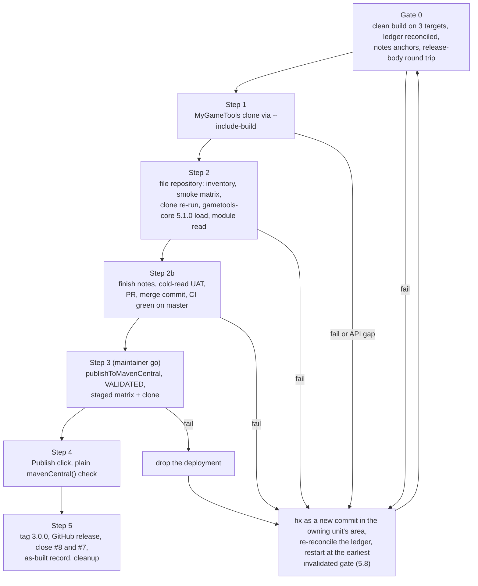
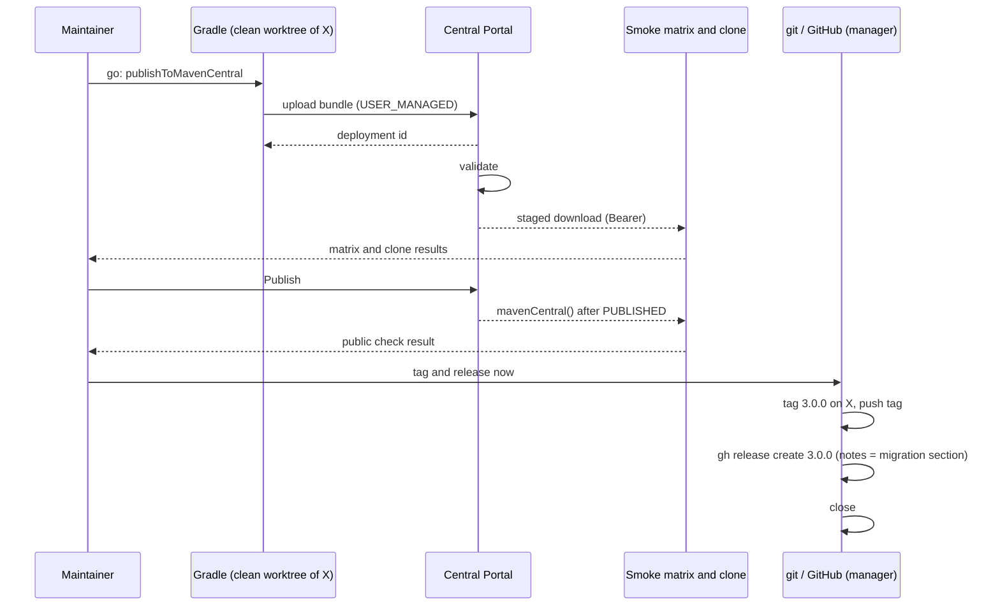

# Plan: `release` - prove, publish, tag and announce GeneralTools 3.0.0

- **Covers:**
  - [SpartanLaboratories/GeneralTools#7](https://github.com/SpartanLaboratories/GeneralTools/issues/7),
    *"Make GeneralTools Kotlin Multiplatform (Color and geometry usable from common code)"*.
  - [SpartanLaboratories/GeneralTools#8](https://github.com/SpartanLaboratories/GeneralTools/issues/8),
    *"Read-only views for Point and Square so libraries can expose geometry without copying"*,
    resolved by the same release.
- **Architecture:** [`architecture.md`](architecture.md), unit `release` (section 11.2 row 8, section
  11.4), against the break ledger in section 11.3.
- **Landing order:** unit 8 of 8, the last. It depends on units 1 to 7 (`kmp-build`, `explicit-api`,
  `logging`, `commonize`, `two-doubles`, `box-model`, `generaltools-breaks`).
- **Starts from:** branch `feat/issue-7-kotlin-multiplatform` with units 1 to 7 landed, `master`
  (`c196d1a`) merged in so `src/test/resources/keys.txt` is gone, `./gradlew build` green on `jvm`, `js`
  and `wasmJs`, the committed dumps `api/GeneralTools.api` and `api/GeneralTools.klib.api` differing from
  the 2.2.0 baseline by the ledger rows, and the README's `## 3.0.0 migration notes` table holding every
  unit's rows.
- **Branch:** `feat/issue-7-kotlin-multiplatform` (existing; this unit adds one README commit to it).
- **Commit:** TBD. **PR:** TBD. This document is committed in the same commit as the README change it
  describes (section 11).
- **What this plans:** the end-to-end release of 3.0.0 as a sequence of gated steps: ledger
  reconciliation, a throwaway MyGameTools migration, a consumer smoke matrix against a file repository,
  finishing the migration notes, the merge, a staged Central upload tested before it is released, the
  Publish click, the tag and the GitHub release. It contains no library code.
- **Status:** planning only. Nothing in this document has been run. Nothing is uploaded or published
  until the maintainer explicitly starts the release (Step 3).
- **Target:** `io.github.spartanlaboratories:GeneralTools:3.0.0` (artifacts `GeneralTools`,
  `GeneralTools-jvm`, `GeneralTools-js`, `GeneralTools-wasm-js`).

---

## 1. Requirements

Stated as plain requirements, each with its acceptance check.

1. **The dump is explained.** Every hunk of the combined JVM dump diff (committed baseline to head) maps
   to a row of the architecture's break ledger (section 11.3), and every ledger row the dump can show has
   its hunk. The klib dump holds none of `read`, `asURL`, `Logger.time`, `UserActionsKt`,
   `com.spartanlabs.logging` or anything from `org.slf4j`.
   *Check:* the reconciliation table of Gate 0 has no unmapped hunk and no row without a hunk, or each
   exception is classified (code error fixed, or ledger prediction corrected) and recorded.
2. **The API holds up under a real consumer.** MyGameTools, migrated in a throwaway clone, builds and its
   tests pass against this repository, first through `--include-build` and then through the file
   repository. Every place that needed more than the planned edits is recorded as an API gap with a
   disposition.
   *Check:* Steps 1 and 2.
3. **The published shape works for every consumer kind.** From the artifacts in a file repository, then
   again from the Central Portal's staged download, a Kotlin 2.2.0 JVM project, a Kotlin 2.1.20 JVM
   project, a Kotlin 2.4 multiplatform project (`jvm`, `js`, `wasmJs`) and a plain Maven project
   resolve and compile a one-screen use of `Color`, `Point` and `Rectangle`, and the compile-time
   guarantees the dump cannot show hold (unsealing, the opt-in gate, the arithmetic import gating).
   *Check:* the smoke matrix, Steps 2 and 3.
4. **The metadata is what the design says (A3, A8).** `GeneralTools-jvm-3.0.0.module` shows
   `kotlin-stdlib` 2.2.0, `slf4j-api` in the API variant, and `kotlin-logging` and `commons-io` in the
   runtime variant only. A Kotlin 2.2.0 and a Kotlin 2.1.20 JVM consumer compile.
5. **The notes are complete and carry the real error.** The README's `## 3.0.0 migration notes` has an
   intro naming who is affected, the clean-break statement, the published-`gametools` warning quoting the
   error text captured in Step 2, and a symptom/cause/fix row or sentence for every one of the ten breaks,
   every silent change and the cross-cutting changes (section 6.7). The GitHub release body is that
   section, verbatim.
6. **Release order protects the irreversible step.** The merge, CI on the merge commit, the upload and the
   staged checks all happen before Publish. No pre-release version exists. The tag `3.0.0` sits on a
   `master` commit whose tree equals the tree the uploaded bundle was built from.
7. **Published and checked once from the public repository.** After Publish, a Kotlin 2.2.0 JVM project
   resolves `GeneralTools:3.0.0` from plain `mavenCentral()` and passes the same checks.
8. **Issues and follow-ups.** #7 and #8 close at publication, not at the PR merge.
   - The PR refers to #7 and #8 without a closing keyword.
   - Once 3.0.0 is published and the public check passes, the `manager` closes both, each with its
     planned comment. #7's "Done when" list includes "Published to Maven Central", and #8's comment states
     its scope.
   - #11 to #18 stay open as follow-ups.
9. **Nothing outside the release leaks.** The smoke project and the clone live outside every repository
   and are deleted at the end; the clone has no remote; no downstream repository's working tree or history
   changes; no credential value appears in any file, log or document produced by this unit.
10. **README currency.** The README's "Releasing" section describes the procedure as it was actually run
    (upload, Portal Publish, staged check, tag, GitHub release, keyring-file signing properties).

---

## 2. Current state

### 2.1 The release process today

- **README, "Releasing"** (`README.md:56-69`): manual, no CI publish; names the credential properties
  `mavenCentralUsername` / `mavenCentralPassword` and `signingInMemoryKey` /
  `signingInMemoryKeyPassword`; the command is the one-shot `./gradlew publishAndReleaseToMavenCentral`;
  then "Tag the released commit `X.Y.Z` and create a matching GitHub release". `kmp-build` rewrites this
  section for the upload-then-publish flow and the keyring-file properties.
- **Build** (`build.gradle.kts:10`, `:13`, `:29-32`): vanniktech `0.36.0`; `group` at project level;
  `mavenPublishing { publishToMavenCentral(); signAllPublications(); coordinates("io.github.spartanlaboratories",
  "GeneralTools", "2.2.0") }` with the version hard-coded in `coordinates`. `kmp-build` moves the version
  onto the project and derives the coordinates from it while it is still `2.2.0` (its C5a), then bumps it
  to `3.0.0` in a `build:` commit of its own (its C5b).
- **CI** (`.github/workflows/Build.yml`): `./gradlew build` on every push; it does not publish.
- **The maintainer's machine** (`~/.gradle/gradle.properties`, property names only; values were not
  read): `mavenCentralUsername`, `mavenCentralPassword`, `signing.keyId`, `signing.password`,
  `signing.secretKeyRingFile` and `org.gradle.configuration-cache` are defined. That is the keyring-file
  signing mode the plugin documents ([`kmp-maven-central-publishing.md`](research/kmp-maven-central-publishing.md)
  F3), not the in-memory mode the current README names.
- **Published versions.** Tag `2.2.0` is an *annotated* tag (tag object `d2abd03`, message
  `GeneralTools 2.2.0`) peeling to `dcbdc9a`, the merge commit of PR #6 on `master`. GitHub releases:
  `2.2.0` (Latest, target `master`, published 2026-09-09, body opening with "Published to Maven Central as
  ..." and then grouped notes) and `1.0`. Merged PRs are merge commits (`Merge pull request #N ...`).
  Maven Central serves `GeneralTools:2.2.0`; `gametools`, `gametools-core`, `gametools-net` 5.1.0 and
  `gametools-world` 5.1.0 are also on Central, and `gametools-core` 5.1.0 requires GeneralTools `2.2.0`
  ([`downstream-under-mutable-model.md`](research/downstream-under-mutable-model.md) 3.3).
- **Downstream at survey time** (read-only): MyGameTools `master` @ `dc5214f`, clean working tree, builds
  with Kotlin 2.2.0 and pins `api("io.github.spartanlaboratories:GeneralTools:2.2.0")` in
  `build-logic/src/main/kotlin/gametools.kotlin-library.gradle.kts:18`, toolchain 23
  (`:12`). MyGameClient (local folder `GameGraphics`) @ `8b428a4`.

### 2.2 Verified outside-world facts the procedure rests on

| Fact | Source |
|---|---|
| `publishToMavenCentral` uploads one bundle as `USER_MANAGED` and does not release; `publishAndReleaseToMavenCentral` uploads as `AUTOMATIC`; the upload happens at the end of the build and logs `Uploaded bundle to Central Portal as USER_MANAGED, deployment id: <id>`; the bundle zip is kept in `build/publish/`; a build that fails after registration drops the deployment; `dropMavenCentralDeployment --deployment-id=<id>` drops one on demand | [`kmp-maven-central-publishing.md`](research/kmp-maven-central-publishing.md) F6 |
| There is no dry run of the Central upload; `prepareMavenCentralPublishing` needs `mavenCentralUsername`/`mavenCentralPassword` | same, F6, pitfall 4 |
| Portal API (re-read 2026-10-19): status `POST /api/v1/publisher/status?id=<id>` returns `deploymentState` in `PENDING`, `VALIDATING`, `VALIDATED`, `PUBLISHING`, `PUBLISHED`, `FAILED`; publish `POST /api/v1/publisher/deployment/<id>` (204); drop `DELETE` on the same path for `VALIDATED` or `FAILED`; a failed deployment should be read before it is dropped | <https://central.sonatype.org/publish/publish-portal-api/> |
| A validated bundle can be a dependency through `https://central.sonatype.com/api/v1/publisher/deployments/download/` (any validated deployment containing the file) or `.../deployment/<id>/download/` (one deployment), with a Bearer header built from the Portal user token | same page; [`kmp-maven-central-publishing.md`](research/kmp-maven-central-publishing.md) F7 |
| Central is immutable: published components are never removed or modified | <https://central.sonatype.org/publish/requirements/immutability/> |
| A Kotlin compiler reads metadata one minor ahead; web klibs carry the building compiler's ABI version, so JS/Wasm consumers need Kotlin 2.4 or newer | [`kmp-build-and-kotlin-compat.md`](research/kmp-build-and-kotlin-compat.md) F1-F5 |
| Plain Maven ignores `.module`; the root POM has only runtime-scope dependencies and the root jar has no classes, so Maven consumers need `GeneralTools-jvm` | [`kmp-maven-central-publishing.md`](research/kmp-maven-central-publishing.md) F9 |
| Composite-build substitution replaces `io.github.spartanlaboratories:GeneralTools` with the project, using the project's own variants rather than the published `.module`, so it does not prove the publication | same, F9 (claim 20) |
| kotlin-logging 8 prints `kotlin-logging: initializing... active logger factory: <name>` once on first use; opt-outs: JVM `-Dkotlin-logging.logStartupMessage=false` or env `KOTLIN_LOGGING_STARTUP_MESSAGE=false`, and the same env var in Node | [`kotlin-logging-adoption.md`](research/kotlin-logging-adoption.md), the startup-message findings |
| Published `gametools-core` 5.0.0/5.1.0 and `gametools-world` 5.1.0 reference `com/spartanlabs/geometry/Square` (first `new` at `VisibleObject.<init>(Dimensions, Point)` pc 13 in 5.1.0, reached from `Actor.<init>`; `Alive.<init>` pc 226; `TiledMap.<init>` pc 364; `ZoneGrid.<init>` pc 290). The resulting `NoClassDefFoundError` is derived from bytecode, **not executed** | [`downstream-under-mutable-model.md`](research/downstream-under-mutable-model.md) 3.3 |

---

## 3. Assumptions

Reused from the architecture (section 4):

| # | Assumption | Confirmed in | If false |
|---|---|---|---|
| A3 | A Kotlin 2.2.0 and a Kotlin 2.1.20 JVM consumer compile against `GeneralTools-jvm` built by KGP 2.4.21 at language/API 2.2 with `api(kotlin-stdlib:2.2.0)`. | Step 2 (cells A, B) | The language/API pin or the stdlib pin is wrong: the pins move in `kmp-build`'s area before anything is uploaded; Step 2 restarts. |
| A8 | `GeneralTools-jvm-3.0.0.module` shows kotlin-logging only in the runtime variant, `slf4j-api` in the API variant and `kotlin-stdlib` 2.2.0. | Step 2 (module read) | Dependency scopes in `commonMain`/`jvmMain` are corrected; Step 2 restarts. |
| A9 | vanniktech `0.37.0` signs and publishes the four KMP publications with the keyring-file properties and the configuration cache. | Step 2 (the file-repository publish signs all four) | The signing properties or the cache setting change (for example `--no-configuration-cache`); no source change. The README "Releasing" section records the working invocation. |
| A11 | The downstream line counts in architecture section 3.2 still describe the downstream heads. | Gate 0 recount, Step 1 | The migration notes quote the measured numbers instead. |
| A12 | An extension operator in `com.spartanlabs.geometry.arithmetic` takes part in resolving `a += b` only in a file that imports it; in an importing file the same statement is an ambiguity error. | `two-doubles` (non-importing file compiles beside the package); Step 2 (importing file fails) | The package would break `var` holders in files that never imported it and does not ship: the finding goes back to `two-doubles`. |

Specific to this unit:

| # | Assumption | If false |
|---|---|---|
| RA1 | The Portal download endpoint lets Gradle follow the root `.module`'s relative `available-at` redirect to `GeneralTools-jvm` (Sonatype documents the endpoint, not this case). | Use the per-deployment endpoint; failing that, the staged cell declares `GeneralTools-jvm` directly. The root redirect is then proven only by the file-repository run (same relative-URL mechanics) and by the post-Publish check; the residual is accepted and stated in the risks. |
| RA2 | A version whose deployment was dropped can be uploaded again. | The release is blocked until Sonatype confirms; nothing was published, so nothing is lost but time. |
| RA3 | Gradle 8.14.x runs KGP 2.2.0 and Gradle 8.11.x runs KGP 2.1.20 (documented ranges); Gradle 9.0.0 runs KGP 2.4.0. | The cell's wrapper moves to the nearest documented version; the cell's pass criteria do not change. |
| RA4 | `--include-build` of this KMP build into MyGameTools' Kotlin 2.2.0 build resolves the `jvm` variant for `api(...)` consumers and tolerates MyGameTools' shared plugin-classloader arrangement (`settings.gradle.kts` comments on issue #40). | Step 1 falls back to the file repository (Step 2's mechanism); API gaps then cost a re-publish to the file repository per iteration instead of an edit. |
| RA5 | `master` does not change between Gate 0 and the merge except by this PR. | The branch is brought up to date with `master`; if that changes any tracked file, Gate 0 and Step 2 re-run. |
| RA6 | The maintainer's machine has JDK 17 and JDK 23 (or lets foojay download them), can download Node and Yarn, and has the Portal user token that is `mavenCentralUsername`/`mavenCentralPassword`. | The affected cell or step is blocked, not skipped. |

---

## 4. Non-goals

- Any library, build or test code. Fixes found by the gates go to the unit that owns the code, as new
  commits on the branch.
- A CI publish workflow, a pre-release or SNAPSHOT version, a CHANGELOG file, publishing to `~/.m2`
  (`publishToMavenLocal`), automatic release (`publishAndReleaseToMavenCentral`).
- The Okio-style root-POM dependency on `-jvm` for Maven users
  ([#17](https://github.com/SpartanLaboratories/GeneralTools/issues/17) tracks it).
- Migrating MyGameTools, MyGameClient or any other downstream repository, and filing anything against
  them. The clone is a throwaway outside this repository and is never pushed.
- A committed smoke project or a Gradle TestKit compile-fail test
  ([#12](https://github.com/SpartanLaboratories/GeneralTools/issues/12) is the follow-up).
- Parameterising `EPSILON` ([#11](https://github.com/SpartanLaboratories/GeneralTools/issues/11)).
- Editing `architecture.md` or other units' plans.

---

## 5. Design: the release as gated steps

### 5.1 Conventions

- Commands are POSIX shell (Git Bash on the maintainer's Windows machine). `$GT` is this repository,
  `$SCRATCH` a new empty directory outside every repository (for example under the user temp directory)
  that is deleted as a whole in Step 5. `$GT_SHA` is the commit under test.
- **Clean trees only.** Gate 0, Step 2 and Step 3 build from a clean detached worktree
  (`git worktree add --detach "$SCRATCH/tree-<sha>" <sha>`), so untracked or ignored files cannot influence
  the artifacts.
- **Dedicated Gradle user home for consumers.** Every smoke and clone run sets
  `GRADLE_USER_HOME="$SCRATCH/gradle-home"`, so a `3.0.0` cached from the file repository cannot answer a
  later stage and the maintainer's credentials are not in scope. Builds of this repository (Gate 0 and the
  publishing steps) use the maintainer's normal home, which holds the keyring and token properties. Maven
  runs use `-Dmaven.repo.local="$SCRATCH/m2"`.
- **Secrets.** No command in this plan prints, copies into a file inside a repository, or commits a
  credential. The staged-download header is held in session environment variables only (5.5). Presence of
  the five publishing properties is checked by name only. `src/test/resources/keys.txt` is never opened; its
  absence is checked by path.
- **Scripts fail closed.** Every script uses `set -euo pipefail`, prints one `PASS`/`FAIL <cell> <check>`
  line per check, writes full logs to `$SCRATCH/results/<stage>/`, and exits non-zero on any `FAIL`. The
  exit code is the gate.
- **Who runs what.** Gate 0 and Steps 1, 2 and 2b change nothing outside the repository and `master`
  (a merge is revertible) and may be run by the implementer on the maintainer's machine. Step 3 (the upload) starts only on the maintainer's explicit go. The Publish click
  in Step 4 is the maintainer's. The `manager` agent performs every git and GitHub step (section 11).

### 5.2 Flow



### 5.3 Gate 0 - preconditions and ledger reconciliation

Runs before Step 1, from a clean worktree of the branch head.

| Check | Command or method | Pass |
|---|---|---|
| 0.1 Tree and version | `git status --porcelain` empty; `git merge-base --is-ancestor master HEAD`; `git ls-files --error-unmatch src/test/resources/keys.txt` fails; project version is `3.0.0` and `rootProject.name` is `GeneralTools` (read from `build.gradle.kts`/`settings.gradle.kts`) | all true |
| 0.2 Build | `./gradlew clean build` | exit 0 with `jvmTest`, `jsNodeTest`, `wasmJsNodeTest` and `checkKotlinAbi` all executed (confirm from the task list in the log, not only the exit code) |
| 0.3 Pointers | the dated pointer to this folder is present at the top of `docs/plans/1-color-methods/plan.md` and `docs/plans/3-geometry-primitives/plan.md` (they land in the first `kmp-build` commit, with `architecture.md` and `impact.md`) | present and committed |
| 0.4 Ledger reconciliation | below | table complete |
| 0.5 Downstream recount (A11) | read-only `grep -rn '\bSquare\b' --include=*.kt` in MyGameTools and MyGameClient; record head SHAs | numbers recorded; differences from 39 lines/14 files and 27 lines/8 files noted for the notes |
| 0.6 Notes anchors | the completeness check of section 6.7 against the current README (expected to show only the gaps this unit fills: intro, clean-break statement, `gametools` text) | gap list recorded |

**Ledger reconciliation (0.4).**

1. `BASE=$(git log --reverse --format=%H -- api/GeneralTools.api | sed -n 2p)` is the second commit to
   write the JVM dump: `kmp-build` C1b, which restated the baseline as the Kotlin plugin lists it. Confirm its
   subject is C1b's (`plan-kmp-build.md` section 11) and that `git diff "$BASE^" "$BASE" -- api/GeneralTools.api`
   removes only the `TwoDoubles` synthetic default-arguments line. The first commit, C1, is
   binary-compatibility-validator's record of the tag; a diff from it would mix the two tools' listings
   (architecture section 3.3).
2. `git diff "$BASE" HEAD -- api/GeneralTools.api` is the combined JVM diff. In it, ledger row 2 includes the
   gained line `public synthetic fun <init> (DDILkotlin/jvm/internal/DefaultConstructorMarker;)V`: 2.2.0 has
   that constructor, and the plugin lists it once `TwoDoubles` is not sealed.
   `api/GeneralTools.klib.api` has no baseline; it is checked by content.
3. Build a table `ledger row -> expected lines -> hunk lines -> status` over every row of architecture
   section 11.3 (breaks 1 to 10 and the "Additive" and "Unchanged" rows), in this order: `Square` and the
   four `com.spartanlabs.logging` classes out; `Rectangle`, `ImmutableRectangle`, the marker,
   `SupportedExtension` in; `ArithmeticKt` with twelve functions; `AxisAlignedBox` +6 and
   `$DefaultImpls` +6; `CenteredBox` +6; `CenteredBoxKt` two conversions; `MiscKt.evaluateList`
   `Function1`; `TwoDoubles` constructors, `divideBy-IoAF18A (D)Ljava/lang/Object;`, `component1`,
   `component2`, `final` `equals`/`hashCode`; `Point.unaryMinus`; and the unchanged classes (`Dimensions`,
   `Segment`, `Ray`, `Color`, `Color$Companion`, `CenteredBox$Companion`, `IntersectionsKt`,
   `VectorsKt`, `UserActionsKt`, `SegmentIntersection` and subclasses, every other `MiscKt` line) showing
   no hunk.
4. Classify each exception:
   - **Unintended dump line (code error):** fixed by a `fix:` commit in the owning unit's area, then
     `updateKotlinAbi` is run in that commit and the table is rebuilt.
   - **Ledger prediction wrong (A4), behaviour intended:** the code stays; the corrected row is recorded in
     `final-implementation.md`, and if a consumer can see the difference, a migration row is added.
   - **Ledger row with no hunk:** an error (a break missing) or a wrong prediction; same classification.
5. Klib content check: `grep -nE 'slf4j|UserActions|spartanlabs/logging|spartanlabs\.logging|\basURL\b|\bread\b' api/GeneralTools.klib.api`
   prints nothing; `Rectangle`, `ImmutableRectangle`, the marker, `SupportedExtension`, the six accessors
   and the arithmetic functions appear.
6. Bytecode spot checks on the built `GeneralTools-jvm` jar: `javap -p -cp <jar> com.spartanlabs.generaltools.MiscKt`
   lists `read`, `asURL` and `time` beside the common functions; `UserActionsKt` is present; class major
   version is 61 (`javap -v | grep 'major version'` on three classes: a geometry class, `MiscKt`, `ArithmeticKt`).

**Pass:** 0.1-0.6 satisfied and the reconciliation table has no open row. **On failure:** fix per the
classification, re-run Gate 0.

### 5.4 Step 1 - throwaway MyGameTools migration (`--include-build`)

Purpose: expose API gaps while additions are still free. Outputs: a gap list, a measured migration size
(A11), and the exact edits the notes describe.

1. **Clone, detached from its origin.**
   ```sh
   git clone --no-hardlinks /d/Documents/Programming/MyGameTools "$SCRATCH/clone/MyGameTools"
   cd "$SCRATCH/clone/MyGameTools"
   git remote remove origin          # a push is impossible from here on
   git checkout --detach dc5214f     # or the then-current master head; record the SHA
   ```
   The clone holds only committed state; the source repository is never touched.
2. **Baseline.** With GeneralTools 2.2.0 (unmodified clone), `./gradlew build` (all four modules, tests
   included) and record the passing and failing test counts per module. Pre-existing failures are noted so
   they are not charged to 3.0.0.
3. **Migrate**, applying only what the migration notes will tell a consumer:
   - `gametools.kotlin-library.gradle.kts:18`: `GeneralTools:2.2.0` -> `3.0.0`;
   - `Square` -> `Rectangle` in every file that names it (14 files at `dc5214f`), `toSquare()` ->
     `toRectangle()` where used;
   - `VisibleObject.kt:62`: `area.dimensions = value` -> `area.dimensions.setTo(value)`;
   - nothing else. The retyping of `Zone.bounds`, `Space.bounds` and `TiledMap.bounds` to
     `ImmutableRectangle` is MyGameTools' own API decision and is out of the throwaway's critical path.
4. **Build against this repository** without publishing:
   ```sh
   export GRADLE_USER_HOME="$SCRATCH/gradle-home"
   ./gradlew --include-build "$GT_WORKTREE" build
   ```
   (`$GT_WORKTREE` is the clean worktree of the branch head.) The composite substitutes
   `io.github.spartanlaboratories:GeneralTools` with the project regardless of the declared version.
5. **Measure and record:** `git diff --shortstat` (files, insertions, deletions; expected about 17 files
   and 45 lines including the dependency line, the README's two diagram lines and a changelog entry, which
   the throwaway may skip), the per-category line counts, and the per-module test results compared with
   the baseline.
6. **API-gap log.** For every place where the migration needed anything beyond item 3 - a missing
   accessor, an awkward conversion, a member that behaved differently, a compile error that is not the
   rename or the assignment - write one entry: file, line, what was needed, the workaround used, and a
   proposed additive API if one would remove it.

**Pass:** the clone's main and test source sets compile; the passing test set equals the baseline's;
the edits are the rename, the one `setTo` and the dependency line; the gap log is empty, or each entry has
a maintainer disposition. **A gap is presented to the maintainer with two options:** add the API now (a
new commit in the owning unit's area, a new ledger row, a README row, then Gate 0 and Step 1 re-run) or
record it as a follow-up for a minor release. **On failure with no gap** (a compile or test failure in
GeneralTools' own behaviour): the finding returns to the owning unit as a fix commit. If `--include-build`
itself fails (RA4), continue with the file-repository mechanism of Step 2 for the clone.

### 5.5 Step 2 - file repository, smoke matrix, binary and metadata checks

**2.1 Publish to a file repository under `build/`, without touching the build script.** An init script
outside the repository adds the repository to the publishing extension:

```kotlin
// $SCRATCH/init/smoke-repo.init.gradle.kts
allprojects {
    afterEvaluate {
        extensions.findByType<PublishingExtension>()?.repositories {
            maven { name = "smoke"; url = uri(layout.buildDirectory.dir("smoke-repo")) }
        }
    }
}
```

```sh
cd "$GT_WORKTREE"
./gradlew clean -I "$SCRATCH/init/smoke-repo.init.gradle.kts" publishAllPublicationsToSmokeRepository
```

This uses the maintainer's real home (keyring and the configuration cache setting), so it exercises A9. If
`kmp-build` has added its own file-repository task, that task is used instead and the init script is not.

**2.2 Inventory** (`inspect-repo.sh build/smoke-repo`):

| Check | Pass |
|---|---|
| Four directories under `io/github/spartanlaboratories/`: `GeneralTools`, `GeneralTools-jvm`, `GeneralTools-js`, `GeneralTools-wasm-js`, each at `3.0.0` | present, no `unspecified` in any file name |
| Each has `.pom`, `.module`, the main file (`.jar` or `.klib`), `-sources.jar`, `-javadoc.jar` | present |
| Every file has `.asc`, `.md5`, `.sha1`, `.sha256` and `.sha512`, and every `.asc` has the same four checksums: a file repository gets Gradle's full checksum set; vanniktech 0.37.0 trims it only in the Central bundle, which 3.1 lists | present |
| Root has `-kotlin-tooling-metadata.json`; the root jar contains no `.class` entries | true |
| POM packaging: `GeneralTools-js` and `GeneralTools-wasm-js` `klib`, the others `jar` | true |
| `GeneralTools-jvm` POM scopes: `kotlin-stdlib` compile, `slf4j-api` compile, `kotlin-logging-jvm` runtime, commons-io runtime | true |
| Sources jar contains only `.kt` sources of `commonMain`/`jvmMain` (no test sources, no resources, no `keys.txt`) | true |
| Signatures verify (`gpg --verify`) when the public key is in the local keyring; otherwise recorded as "verified by Central in Step 3" | true or recorded |

**2.3 Module read (A8, A3).** `GeneralTools-jvm-3.0.0.module` must show:
`jvmApiElements-published` with `kotlin-stdlib` `requires` `2.2.0` and `slf4j-api`;
`jvmRuntimeElements-published` adding `kotlin-logging-jvm` 8.0.4 and commons-io;
neither kotlin-logging nor commons-io in the API variant; `org.gradle.jvm.version` 17 on the JVM variants
and on the root redirects; `GeneralTools-js`/`-wasm-js` modules requiring the plugin-matched stdlib
(2.4.21), and `GeneralTools-js` also `kotlin-dom-api-compat` 2.4.21, which the Kotlin plugin adds to
Kotlin/JS by default (`plan-kmp-build.md` 6.1). The root `.module` lists `available-at` redirects to the
three target modules.

**2.4 Smoke matrix** (`run-matrix.sh file`, repository selected by `-PsmokeSource=file
-PsmokeRepoDir=<build/smoke-repo>`). Layout and sources are in section 6.2. Cells:

| Cell | Toolchain | Checks (all must pass) |
|---|---|---|
| A `kotlin-2.2.0-jvm` | KGP 2.2.0, Gradle 8.14.x, runs on JDK 17 | positive sources compile and `UsageScreenTest` passes; `run` prints the expected lines, the WARN line for `divideBy(0.0)` on logger `com.spartanlabs.geometry.TwoDoubles` through the cell's logback, and the kotlin-logging startup line; the same run with `JAVA_OPTS=-Dkotlin-logging.logStartupMessage=false` prints no startup line; negatives N1-N3 fail as specified |
| B `kotlin-2.1.20-jvm` | KGP 2.1.20, Gradle 8.11.x | positive compile and test; negatives N1-N3 (N1 is recorded either way: if the 2.1.20 compiler does not enforce `@SubclassOptInRequired`, the notes state the enforcement floor) |
| C `kotlin-2.4.0-kmp` | KGP 2.4.0, Gradle 9.0.0; `jvm()`, `js { nodejs() }`, `wasmJs { nodejs() }` | `compileCommonMainKotlinMetadata`; `UsageScreenTest` passes in `jvmTest`, `jsNodeTest` and `wasmJsNodeTest`; negatives N1-N3 on `compileKotlinJvm`. 2.4.0 is the claimed floor; 2.4.21 is the optional second run |
| D `maven-jvm` | Maven 3.9.x, JDK 17, dependency `GeneralTools-jvm:3.0.0` | `mvn compile`; run with the resolved runtime classpath prints the expected lines; `dependency:tree` shows `kotlin-stdlib` and `slf4j-api` compile, `kotlin-logging-jvm` runtime |
| D' `maven-root-control` | same, dependency `GeneralTools:3.0.0` | compile **fails** (no classes): documents why Maven consumers must use `-jvm` |
| E `old-binary` | compile on Kotlin 2.2.0 against `GeneralTools:2.2.0` from Central; run with the `GeneralTools-jvm:3.0.0` jar and its dependencies in place of 2.2.0 | a class implementing `AxisAlignedBox` compiled against 2.2.0 is passed to `segmentIntersectsBox`, `rayIntersectsBox` and `contains`; no `AbstractMethodError` (the six accessors are JVM default methods) |

**2.5 Re-run the clone against the file repository.** The clone keeps its Step 1 edits; an init script
adds the repository without touching its files:

```kotlin
// $SCRATCH/init/clone-use-repo.init.gradle.kts   (-Dsmoke.repo=file:///.../build/smoke-repo)
settingsEvaluated {
    dependencyResolutionManagement.repositories {
        maven {
            name = "smoke"; url = uri(System.getProperty("smoke.repo"))
            content { includeGroup("io.github.spartanlaboratories") }
        }
    }
}
```
`./gradlew -I "$SCRATCH/init/clone-use-repo.init.gradle.kts" -Dsmoke.repo=<uri> --refresh-dependencies build`
with no `--include-build`. **Pass:** the same results as Step 1. This is the run that proves the published
`.module` works for a Kotlin 2.2.0 `kotlin("jvm")` consumer on toolchain 23.

**2.6 Published `gametools` beside 3.0.0 (cell F `gametools-collision`).** A Kotlin 2.2.0 JVM project
depends on `io.github.spartanlabsgaming:gametools-core:5.1.0` (from Central) and
`io.github.spartanlaboratories:GeneralTools:3.0.0` (from the file repository).
- `dependencyInsight --dependency GeneralTools` shows 3.0.0 selected (Gradle picks the highest requested
  version), not 2.2.0.
- Its `main` first loads, then constructs, the smallest class that reaches `new Square`. The class and its
  constructor are read from the jar with `unzip -l` and `javap -p -c` (research found
  `VisibleObject.<init>(Dimensions, Point)` reached from `Actor.<init>`; `Alive.<init>` also constructs
  one). It catches `Throwable` and prints `toString()` and the first frames, for the load step and the
  construct step separately, so the notes can say *where* the error surfaces (the research left class
  linking versus construction open).
- **Pass:** the output contains `java.lang.NoClassDefFoundError: com/spartanlabs/geometry/Square`. The
  captured text, verbatim, is copied into `$SCRATCH/results/step2/gametools-error.txt` and into the notes
  (6.5). A run that succeeds contradicts the derived claim and stops the release for analysis.
- Recommended second run with `gametools-core:5.0.0` (one version string), so the notes' sentence naming
  both versions is observed rather than derived. If it is not run, the notes say 5.0.0 is derived from its
  bytecode.
- Optional third run: `GeneralTools` declared `version { strictly("2.2.0") }` beside a dependency that
  requests 3.0.0 resolves to 2.2.0. The notes recommend a pin only if this run passes.

**Pass for Step 2:** 2.1 exits 0 with all four publications signed; every inventory and module check
passes; every matrix cell passes; the clone passes; cell F reproduces the error. **On failure:** classify
as in Gate 0; any change under `src/`, `build.gradle.kts` or `settings.gradle.kts` invalidates Step 2 and
restarts it (a README-only change does not).

### 5.6 Step 2b - finish the notes, cold-read, PR, merge

1. **Finish the migration section** (section 7.1) using the numbers from Gate 0.5 and Step 1 and the
   error text from Step 2.6. Run the completeness check (6.7) and the release-body round trip (6.8).
2. **Cold-read UAT (level 5).** Start from an unmigrated MyGameTools tree and migrate it again using
   **only the README's migration section** as the instructions.
   - **Preferred:** a second throwaway clone made as in 5.4, at `"$SCRATCH/clone-coldread/MyGameTools"`.
   - **Alternative:** reset the first clone, always addressed by path:
     `git -C "$SCRATCH/clone/MyGameTools" checkout -- . && git -C "$SCRATCH/clone/MyGameTools" clean -fd`.

   **These reset commands run only inside the MyGameTools scratch clone, never in the GeneralTools
   tree.** There they would discard uncommitted work for good, including any planning document or
   `final-implementation.md` entry not yet committed.

   Every place where the section was insufficient or wrong becomes a README fix, made before the commit
   of item 3.
   **Pass:** the clone builds and passes the same tests; no step needed knowledge outside the section.
3. **Land the README.** One `docs:` commit (section 11), push, open the PR. CI green on all targets.
4. **Maintainer review gate.** The maintainer reads the PR description's evidence block (ledger table
   result, Step 1 measurement, matrix result, captured error text) and approves.
5. **Merge** with a merge commit (not squash or rebase) so the per-break commits and the ledger discipline
   survive in history, as for PRs #5 and #6. `X` is the merge commit. Record `T_branch =
   git rev-parse <branch-head>^{tree}` before the merge and assert `git rev-parse X^{tree}` equals it (RA5).
6. **Wait for CI green on `X`** (the push-triggered workflow).

**Freeze.** From the start of Step 3 until the tag exists, no commit lands on `master`. The tag goes on `X`
and the uploaded bundle is built from `X`'s tree, so a README or code change in between would break the
"tagged tree equals published tree" invariant.

**Pass:** README checks pass, cold-read pass, PR merged with `X^{tree} == T_branch`, CI green on `X`.
**On failure:** a README-only fix is a new commit and, if the PR is already merged, a new PR (Step 3 has not
started, so nothing is lost); a code fix restarts at Gate 0.

### 5.7 Step 3 - upload without releasing, then test the staged bundle

Starts on the maintainer's explicit go. Nothing is uploaded before this point.

**3.0 Pre-flight (no values printed).**
```sh
for k in mavenCentralUsername mavenCentralPassword signing.keyId signing.password signing.secretKeyRingFile; do
  grep -q "^$k=" ~/.gradle/gradle.properties && echo "present $k" || echo "MISSING $k"
done
test -f "$(grep '^signing.secretKeyRingFile=' ~/.gradle/gradle.properties | cut -d= -f2-)" && echo "keyring file present"
```
`git worktree add --detach "$SCRATCH/tree-X" X`; assert `git rev-parse HEAD^{tree}` there equals `T_branch`.

**3.1 Upload.** In the clean worktree of `X`:
```sh
./gradlew clean publishToMavenCentral 2>&1 | tee "$SCRATCH/results/step3/upload.log"
```
Never `publishAndReleaseToMavenCentral`. Record the logged `deployment id`, keep `build/publish/*.zip`
(the exact bundle) and its `sha256sum`. The build ends with "Skipping deployment validation!" for a
`USER_MANAGED` upload; validation continues in the Portal. List the bundle (`unzip -l build/publish/*.zip`):
every file has its `.asc`, `.md5` and `.sha1`, and there is no `.sha256`, no `.sha512` and no checksum of
an `.asc` (vanniktech 0.37.0's defaults for the Central bundle). A different set is recorded and read
against the Portal's validation result before Publish.

**3.2 Wait for `VALIDATED`.** Poll the Portal's Deployments page, or
`curl -s -X POST -H "Authorization: Bearer $TOKEN" "https://central.sonatype.com/api/v1/publisher/status?id=<id>"`.
- `VALIDATED`: continue.
- `FAILED`: read the per-component errors first; do not drop a `FAILED` deployment before reading it. The
  usual causes are a missing javadoc/sources jar or signature, an unverified public key, a duplicate
  publication, or a POM field. Fix at the source (Gate 0 classification), then drop and restart (5.8).

**3.3 Served bytes equal uploaded bytes.** Download each of the four main files and its `.pom` and
`.module` through the staged endpoint with `curl`; their `sha1` must equal the `sha1` of the same entries
in `build/publish/*.zip`. The staged jars are *not* compared with Step 2's: the file repository build and
the upload build are two builds and are not assumed byte-identical, which is why the matrix repeats.

**3.4 Staged matrix and clone.** Session-only environment variables (never `gradle.properties`, never a
file in a repository):
```sh
export ORG_GRADLE_PROJECT_centralManualTestingAuthHeaderName=Authorization
export ORG_GRADLE_PROJECT_centralManualTestingAuthHeaderValue="Bearer $(printf '%s:%s' "$PORTAL_USER" "$PORTAL_PASS" | base64 -w0)"
```
(`PORTAL_USER`/`PORTAL_PASS` are set by the maintainer from the existing token pair without echoing.)
`run-matrix.sh staged` points cells A to F at
`https://central.sonatype.com/api/v1/publisher/deployments/download/`, with the repository content-filtered
to `io.github.spartanlaboratories` and `mavenCentral()` listed after it for transitive dependencies. Cell D
uses a Maven `settings.xml` generated into `$SCRATCH` from the same variables (`<httpHeaders>` on the
server entry) and deleted afterwards; if Maven's header support does not take effect, D degrades to
fetching `GeneralTools-jvm-3.0.0.pom`/`.jar` with `curl` and comparing hashes with the bundle, recorded as
such. The clone re-runs with `-Dsmoke.repo=<staged URL>` and a header-credentialed repository in
`clone-use-repo.init.gradle.kts`.
- If Gradle cannot follow the root `.module`'s `available-at` through the endpoint (RA1): retry with
  `.../deployment/<id>/download/`; failing that, cell A declares `GeneralTools-jvm` directly and the gap is
  recorded.

**Pass for Step 3:** upload logged; `VALIDATED`; hash comparison equal; every cell and the clone pass with
the same outputs as Step 2. **On failure:** drop (`./gradlew dropMavenCentralDeployment
--deployment-id=<id>` or the Portal), classify, fix, and restart at the earliest invalidated gate (5.8).

**Pre-Publish checklist (all true, then the maintainer says "publish"):** Gate 0, Steps 1, 2, 2b and 3
passed with recorded outputs; `X` is on `master` with CI green; `X^{tree}` equals the uploaded tree; the
release body (`results/release-notes.md`) has been previewed; nothing has been committed to `master`
since `X`; the maintainer has read the gap log and its dispositions.

### 5.8 Failure handling by step (summary)

| Failed at | Invalidates | Restart at |
|---|---|---|
| Gate 0 (dump line, build) | nothing yet | fix, Gate 0 |
| Step 1 (gap, compile, test) | Step 1 | fix or disposition, Gate 0 if code changed, then Step 1 |
| Step 2 (any cell, inventory, module) | Step 2 | fix, Gate 0, Step 1 only if public API changed, Step 2 |
| Step 2b README-only | Step 2b | fix, Step 2b |
| Step 3 (FAILED, hash mismatch, staged cell) | the deployment | drop; fix; code: Gate 0 and Step 2, then Step 2b (new merge); README-only: Step 2b (new merge); then re-upload from the new `X` |
| Step 4 post-Publish check fails | nothing can be undone | file an issue for a `3.0.1`; still tag and release what was published, with a known-issue line in the notes |

Any change to `src/`, `build.gradle.kts` or `settings.gradle.kts` after Step 2 starts invalidates Step 2.

### 5.9 Step 4 - Publish and the public check

1. The maintainer clicks **Publish** on the deployment in the Portal (or `POST
   /api/v1/publisher/deployment/<id>` with the Bearer token; 204). This is the irreversible step.
2. Wait for `deploymentState` `PUBLISHED`; the plugin documents 10 to 30 minutes. Poll
   `https://repo1.maven.org/maven2/io/github/spartanlaboratories/GeneralTools/3.0.0/GeneralTools-3.0.0.pom`
   until it returns 200.
3. **Check once from plain `mavenCentral()`** with a fresh Gradle home: `run-matrix.sh central` runs cell A
   (Kotlin 2.2.0 JVM, the case MyGameTools is) and cell D (plain Maven on `GeneralTools-jvm`), which cover
   the two metadata paths (`.module` and POM); cells B, C and E run too and are recorded.

**Pass:** cell A and cell D green. A failure cannot be undone; it is handled as in 5.8.

### 5.10 Step 5 - tag, release, comments, record, cleanup

Sequence (the `manager` agent performs the git and GitHub parts):



1. **Tag** an *annotated* tag `3.0.0`, message `GeneralTools 3.0.0` (as `2.2.0` is), on `X`, and push it.
   Verify `git rev-parse 3.0.0^{commit}` equals `X` and `git rev-parse 3.0.0^{tree}` equals `T_branch`.
2. **GitHub release** `3.0.0` from that tag, not a pre-release, not a draft, target `master`; the body is
   `results/release-notes.md`, the README section verbatim (6.8).
3. **Close #8 and #7.** These issues close only now, after 3.0.0 is published; the PR did not close them.
   The `manager` closes each with its planned comment (section 11):
   - #8 with the scope statement;
   - #7 with the release link and the PR. Its "Done when" list includes "Published to Maven Central",
     which Step 4 has just shown.

   #11 to #18 are left open.
4. **As-built record.** Append to `docs/plans/7-kotlin-multiplatform/final-implementation.md`:
   - the PR number, `X`, the tag object, the deployment id and the dates;
   - the reconciliation table's exceptions;
   - the measured migration size;
   - the gap log with dispositions;
   - the captured error text;
   - the matrix results, including any cell that differed from expectation;
   - every deviation from this plan with its reasoning.

   This is committed through a small docs PR after the tag. The tag stays on `X`, and no published bytes
   change. The same PR carries:
   - the `Commit:`/`PR:` placeholders of the plan documents, filled in;
   - the reconciled `impact.md`, brought up to date with what was built and published (measured sizes,
     the real error text, follow-up status) when implementation ends.

   `impact.md` is not edited on the branch before the PR, so the tagged tree holds the version written
   during planning.
5. **Cleanup.** Remove `$SCRATCH` (smoke project, clone, worktrees, `gradle-home`, `m2`, results), the
   session environment variables and any generated Maven `settings.xml`. Remove the worktrees with `git
   worktree remove`. Confirm the downstream repositories' `git status` and HEAD are unchanged.

---

## 6. Outside the repository: the smoke project, the clone, and the notes checks

### 6.1 Clone

`$SCRATCH/clone/MyGameTools`, created and used as in 5.4. No remote, detached HEAD, edits only as
described. Deleted in Step 5.

### 6.2 Smoke project layout

```
$SCRATCH/
  init/        smoke-repo.init.gradle.kts, clone-use-repo.init.gradle.kts
  results/     gate0/ step1/ step2/ step3/ step4/   (logs, ledger table, gap log, error text, release-notes.md)
  smoke/
    run-matrix.sh              # <file|staged|central>; runs every cell, prints PASS/FAIL lines, exit code is the gate
    inspect-repo.sh            # section 5.5 inventory and module/POM reads
    expected-output.txt        # the lines UsageScreen prints; identical on every target
    src-shared/
      positive/
        UsageScreen.kt  UsageScreenTest.kt  Main.kt (JVM cells)
        GrantedSubclass.kt  NoOptInNeeded.kt
        ArithmeticWithoutImport.kt  ArithmeticValWithImport.kt
      negative/
        subclass-without-optin/Foo.kt      (N1)
        exhaustive-when/Exhaustive.kt      (N2)
        arithmetic-var-with-import/Arith.kt (N3)
    cell-kotlin-2.2.0-jvm/     settings.gradle.kts build.gradle.kts gradle/wrapper/gradle-wrapper.properties
    cell-kotlin-2.1.20-jvm/    (same shape)
    cell-kotlin-2.4.0-kmp/     (commonTest holds UsageScreenTest; targets jvm, js, wasmJs)
    cell-maven-jvm/            pom.xml, src/main/java/smoke/Main.java
    cell-maven-root-control/   pom.xml (depends on GeneralTools:3.0.0)
    cell-old-binary/           oldbox/ (compiled against 2.2.0), runner/
    cell-gametools-collision/  build.gradle.kts, src/main/kotlin/Collide.kt
```

Each Gradle cell copies the repository's `gradlew` and wrapper jar and sets its own
`distributionUrl` (8.14.x, 8.11.x or 9.0.0). Every cell's `settings.gradle.kts` selects the source with
`-PsmokeSource`:

```kotlin
val source = providers.gradleProperty("smokeSource").getOrElse("file")   // file | staged | central
dependencyResolutionManagement {
    repositories {
        when (source) {
            "file" -> maven {
                name = "smokeFile"; url = uri(providers.gradleProperty("smokeRepoDir").get())
                content { includeGroup("io.github.spartanlaboratories") }
            }
            "staged" -> maven {
                name = "centralStaged"
                url = uri("https://central.sonatype.com/api/v1/publisher/deployments/download/")
                credentials(HttpHeaderCredentials::class) {
                    name = providers.gradleProperty("centralManualTestingAuthHeaderName").get()
                    value = providers.gradleProperty("centralManualTestingAuthHeaderValue").get()
                }
                authentication { create<HttpHeaderAuthentication>("header") }
                content { includeGroup("io.github.spartanlaboratories") }
            }
        }
        mavenCentral()          // "central" adds nothing else; no mavenLocal() anywhere
    }
}
```

Each Gradle cell adds `../src-shared/positive` as a source directory and, when `-PsmokeNegative=<case>` is
set, `../src-shared/negative/<case>` as well. Cells A and B also have `application`, `runtimeOnly
logback-classic:1.5.13` and `kotlin("test")`; cell C has `commonTest` with `kotlin("test")`, and runs
`kotlinUpgradeYarnLock` once on first use.

### 6.3 Smoke sources (what the dump cannot show)

`UsageScreen.kt` (one screen; prints no `Double`, because `Double.toString` differs on JS):

```kotlin
package smoke

import com.spartanlabs.generaltools.Color
import com.spartanlabs.geometry.AxisAlignedBox
import com.spartanlabs.geometry.Dimensions
import com.spartanlabs.geometry.Point
import com.spartanlabs.geometry.Ray
import com.spartanlabs.geometry.Rectangle
import com.spartanlabs.geometry.rayIntersectsBox

fun usageScreen(): List<String> {
    val faded = Color.of(255, 87, 51).withAlpha(128)
    val box = Rectangle(Point(0.0, 0.0), Dimensions(4.0, 3.0))
    val p = Point(1.0, 2.0)
    val (x, y) = p                                            // componentN
    val q = -p                                                // Point.unaryMinus
    val frozen = box.toImmutable()
    val frozenAsBox: AxisAlignedBox = frozen                  // typed as the interface so == compiles
    val divided = Point(4.0, 2.0).also { it.divideBy(2.0) }   // in place
    val zero = Point(1.0, 1.0).divideBy(0.0)                  // Result<Unit>, WARN on the JVM
    val hit = rayIntersectsBox(Ray(Point(-1.0, 1.0), Point(1.0, 0.0)), box).getOrThrow()
    return listOf(
        "hex=${faded.toHex(includeAlpha = true)}",
        "roundTrip=${Color.fromHex(faded.toHex(includeAlpha = true)) == faded}",
        "constructorValidates=${runCatching { Color(300, 0, 0) }.exceptionOrNull() is IllegalArgumentException}",
        "destructure=${x == 1.0 && y == 2.0}",
        "negated=${q.x == -1.0 && q.y == -2.0}",
        "contains=${p in box}",
        "immutableEqualsRectangle=${frozenAsBox == box}",      // never equal: expected false
        "immutableContains=${p in frozen}",
        "dividedInPlace=${divided.x == 2.0 && divided.y == 1.0}",
        "zeroDivisor=${zero.exceptionOrNull() is IllegalArgumentException}",
        "rayEntry=${hit == 1.0}",
    )
}
```

The expected output is the fixed list of those eleven lines. (`Color.of(255, 87, 51).withAlpha(128).toHex(true)`
is `#80FF5733` per the README.)

Positive files and negative cases:

| File | Content | Expected |
|---|---|---|
| `NoOptInNeeded.kt` | `val p = Point(1.0, 2.0)`; `fun take(t: TwoDoubles): Double = t.first` | compiles with no opt-in |
| `GrantedSubclass.kt` | `@OptIn(ExperimentalForInheritanceGeneralToolsApi::class) class Granted : TwoDoubles()` | compiles |
| `ArithmeticWithoutImport.kt` | no arithmetic import; `fun bump() { var p = Point(); p += Point(1.0, 1.0) }` | compiles (member `plusAssign`), in the same module as the file below |
| `ArithmeticValWithImport.kt` | `import com.spartanlabs.geometry.arithmetic.*`; `val s = Point(1.0, 2.0) + Point(1.0, 1.0)`; `val t = 2.0 * Dimensions(1.0, 2.0)`; `val u = Point(1.0, 1.0) - Dimensions(1.0, 1.0)` | compiles |
| N1 `subclass-without-optin/Foo.kt` | `class Foo : TwoDoubles()` | compile fails; diagnostic names `ExperimentalForInheritanceGeneralToolsApi` |
| N2 `exhaustive-when/Exhaustive.kt` | `fun describe(t: TwoDoubles): String = when (t) { is Point -> "point"; is Dimensions -> "size" }` | compile fails; diagnostic says the `when` must be exhaustive (compiles on 2.2.0 of the library) |
| N3 `arithmetic-var-with-import/Arith.kt` | `import com.spartanlabs.geometry.arithmetic.*`; `fun f() { var p = Point(); p += Point(1.0, 1.0) }` | compile fails with an assignment-operator ambiguity, and **no error line names any other file** (so the non-importing file beside it still compiles: A12) |

Negative assertion (the helper in `run-matrix.sh`; error text is matched loosely and the observed wording is
recorded on the first run, because diagnostics differ between compiler versions):

```sh
expect_compile_failure() {  # <cell-dir> <case> <fragment> <only-file>
  local out
  if out=$(cd "$1" && ./gradlew -q compileKotlin -PsmokeNegative="$2" 2>&1); then
    echo "FAIL $1 $2: compiled"; return 1
  fi
  grep -q "$3" <<<"$out"                      || { echo "FAIL $1 $2: no '$3' in diagnostics"; return 1; }
  if grep -E '^e: ' <<<"$out" | grep -qv "$4"; then echo "FAIL $1 $2: error outside $4"; return 1; fi
  echo "PASS $1 $2"
}
```

### 6.4 The clone's measured outputs

Recorded for the notes and `final-implementation.md`: head SHA; baseline and migrated test counts per
module; files/insertions/deletions; lines per category (rename, assignment, dependency); the gap log.

### 6.5 Published-`gametools` capture

`$SCRATCH/results/step2/gametools-error.txt` holds the verbatim output of cell F for the load and
construct steps, the Gradle `dependencyInsight` line proving 3.0.0 was selected, and which of the two steps
threw.

### 6.6 What the matrix proves for each ledger proof column

| Ledger proof (architecture 11.3) | Where |
|---|---|
| Multiplatform: consumer smoke matrix; Maven on `GeneralTools-jvm` | cells A-D, D' |
| Unseal and marker: `class Foo : TwoDoubles()` fails without `@OptIn`, compiles with it; `Point(1.0, 2.0)` and a `TwoDoubles` parameter need no opt-in; exhaustive `when` stops compiling | N1, `GrantedSubclass.kt`, `NoOptInNeeded.kt`, N2 |
| Import-gated arithmetic: `var` `+=` compiles without the import, is ambiguous with it | `ArithmeticWithoutImport.kt` beside N3 |
| Additive accessors: a class compiled against 2.2.0's `AxisAlignedBox` still links | cell E |
| Operators `-p`, `val (x, y) = p`, `p in box` | `UsageScreen.kt` |
| Kotlin 2.2.0 and 2.1.20 read the metadata (A3) | cells A, B |
| Published `gametools` beside 3.0.0 | cell F |

### 6.7 Notes completeness check (Level 1, run at Gate 0.6, Step 2b and on the tagged README)

The section is extracted (6.8) and every anchor below must match at least once. A missing anchor is a
missing row or sentence, added with the table's `Symptom | Cause | Fix` columns without rewording the other
units' rows.

| Topic | Anchor (`grep -E` on the extracted section) |
|---|---|
| Who is affected; clean break, no deprecation cycle | `affected` ; `clean break` |
| Break 1: Maven needs the JVM artifact; web floor and maturity | `GeneralTools-jvm` ; `Kotlin 2\.4` ; `Wasm` |
| Break 2: exhaustive `when`; subclass opt-in | `exhaustive` ; `ExperimentalForInheritanceGeneralToolsApi` |
| Break 3: `divideBy` | `divideBy` ; `Result<Unit>` ; `last place` |
| `/=` still throws, no log | `Cannot divide by zero` |
| Break 4: `evaluateList` | `evaluateList` ; `Predicate` |
| Break 5: logging package | `com\.spartanlabs\.logging` |
| Break 6: rename, `val` references, `toString`, name collision | `Square` ; `toRectangle` ; `Val cannot be reassigned` ; `setTo` ; `java\.awt\.Rectangle` |
| Break 7: equality and hash contract; hash-key warning | `NaN` ; `-0\.0` ; `toImmutable` |
| Break 8: `Color` validation | `Color\.of` ; `IllegalArgumentException` ; `fromHex` |
| Break 9: `trimIfLongerThan` | `trimIfLongerThan` ; `IndexOutOfBoundsException` |
| Break 10: `capitalizeEveryWord` | `capitalizeEveryWord` ; `comma` |
| Logging: startup line and its opt-out; WARN; unchanged logger names | `logStartupMessage` ; `WARN` ; `logger name` |
| Published `gametools` | `NoClassDefFoundError` ; `gametools` ; `5\.1\.0` |
| Arithmetic package and its three accepted costs | `arithmetic` ; `ambigu` ; `import` |
| Additions (no action needed) | `ImmutableRectangle` ; `minX` ; `unaryMinus` ; `SupportedExtension` |
| Platform notes | `Float` ; `toString` |
| Silent changes seen in the known consumers | `==` on points with NaN ; untrusted channel values go through `Color\.of` |

### 6.8 Release-body round trip (Level 1)

```sh
awk '/^## 3\.0\.0 migration notes/{f=1;next} f&&/^## /{exit} f' README.md > "$SCRATCH/results/release-notes.md"
grep -nE '\]\((#|\.|/|[^h])' "$SCRATCH/results/release-notes.md" && echo "FAIL relative link"   # must print nothing
```
The GitHub release body is exactly this file. The section therefore contains only absolute `https://`
links and no anchors to other README sections, and uses no feature GitHub release rendering lacks. It is
re-extracted from the tagged README after the tag and compared with the body that was posted
(`gh release view 3.0.0 --json body`).

---

## 7. File-by-file changes

### 7.1 `README.md` (the only repository file this unit edits)

Section `## 3.0.0 migration notes` (the table `Symptom | Cause | Fix` already exists with every unit's
rows). This unit adds, in this order:

1. **Intro: who is affected.** Gradle consumers: coordinates unchanged, the right variant is resolved;
   Maven-only consumers: depend on `GeneralTools-jvm`; web consumers: Kotlin 2.4.0 or newer (the floor
   observed in cell C), Kotlin/Wasm is Beta, klib compatibility guarantees are not finalized; code that
   names `Square`, assigns `x.location =`/`x.dimensions =`, switches exhaustively over `TwoDoubles`,
   subclasses `TwoDoubles`, calls `evaluateList` with a `Predicate`, imports `com.spartanlabs.logging`,
   constructs `Color` from untrusted channels, or combines GeneralTools with a published `gametools`.
   Not affected: code that only uses `Color` factories and updates `Point`/`Dimensions` in place. The
   measured size for the known consumers (Step 1 and Gate 0.5), stated as a measurement with its commit,
   not a promise.
2. **Clean-break statement.** 3.0.0 makes these changes with no deprecated aliases (no
   `typealias Square`), no shims and no deprecation cycle; coordinates and package names are unchanged, so
   a build that mixes libraries compiled against 2.x with 3.x resolves to 3.0.0 and fails at run time, not
   at resolution.
3. **`gametools` warning**, with the text captured in Step 2.6 (6.5). Template, with the captured text
   inserted verbatim:
   > **Do not combine 3.0.0 with a published `gametools`.** Every published `gametools` (5.0.0 and 5.1.0,
   > including `gametools-core` and `gametools-world`) was compiled against
   > `com.spartanlabs.geometry.Square`, which 3.0.0 renamed `Rectangle`. Gradle resolves the highest
   > requested GeneralTools version, so a build that depends on one of them and on GeneralTools 3.0.0
   > resolves and compiles, then fails when the first affected class runs: `<captured text>`.
   > MyGameTools' consumers should stay on GeneralTools 2.2.0 until a MyGameTools release built on 3.0.0
   > exists.
   The sentence naming 5.0.0 is kept only if the optional 5.0.0 run was made; otherwise it says 5.0.0 is
   judged from its bytecode. A pin recommendation is included only if the optional `strictly` run passed.
4. **Cross-cutting rows or sentences** missing at Gate 0.6 (kotlin-logging startup line and the opt-outs
   `-Dkotlin-logging.logStartupMessage=false`, `KOTLIN_LOGGING_STARTUP_MESSAGE=false`; failures now log at
   WARN; logger names unchanged; web floor; `Float` precision and `toString` formatting on JS; the equality
   and `divideBy` numerical notes; the arithmetic package's three accepted costs).
5. **Completeness line.** A closing sentence that the table covers breaks 1 to 10 and the silent changes
   (verified by 6.7 before commit; the sentence itself is prose, not a checksum).

If the observed procedure differs from the "Releasing" section `kmp-build` wrote (A9 invocation, the
staged-download test, annotated tag, release notes source), the section is corrected in the same commit.
No other README section is touched by this unit.

No other file in the repository changes. In particular no source, test, build script, dump or workflow
changes; fixes found by the gates are other units' commits.

### 7.2 `docs/plans/7-kotlin-multiplatform/plan-release.md`

This document, committed with the README change.

### 7.3 `docs/plans/7-kotlin-multiplatform/final-implementation.md`

Created or appended after the tag (5.10 item 4). It is the as-built record and holds the reconciliation
exceptions, measurements and deviations.

### 7.4 Error handling, logging and API notes for this unit

No new function, type or log event is introduced. The failure design is in the scripts: fail closed,
one `PASS`/`FAIL` per check, exit code as the gate, logs kept per stage. The library's own failure paths
(`Result`, WARN-per-failure) are exercised by cell A's run (`divideBy(0.0)` returns a failure and logs one
WARN on `com.spartanlabs.geometry.TwoDoubles`). There is no public API change in this unit.

---

## 8. Documentation impact

| Ring | What moves |
|---|---|
| 1 In-editor | none |
| 2 Component / KDoc | none by this unit; a gap found by Step 1 that changes KDoc goes to the owning unit |
| 3 Boundary / protocol | README `## 3.0.0 migration notes` (intro, clean break, `gametools` warning with the real error, completeness); README "Releasing" corrected if the procedure differs; the GitHub release body (the same text); the Central Portal flow (upload, validate, staged download, Publish) is described in "Releasing" |
| 4 Architectural | `final-implementation.md` (as-built release record); the ledger corrections found by Gate 0 are recorded there, to be reconciled into the architecture |

README currency: this change alters the README's migration section and may alter "Releasing", so the same
commit updates them.

---

## 9. Test plan by level

This unit adds no library code, so no test class is added to the repository. Its checks are scripted,
live outside the repository, and are run against the real artifacts.

| Level | Checks | Where |
|---|---|---|
| 1 Gating (pre-commit) | Gate 0.1-0.6: clean tree, version, `./gradlew clean build` on three targets and `checkKotlinAbi`, ledger reconciliation table, klib content grep, bytecode spot checks, pointers present; notes anchors (6.7); release-body extraction and relative-link check (6.8) | Gate 0, Step 2b |
| 2 Component | none: no new class or function; the library's component tests belong to units 1 to 7 and are exercised by Gate 0.2 | - |
| 3 Integration / external interfaces | Central Portal: bundle accepted, validation reaches `VALIDATED` (or the `FAILED` errors are read), status API, staged download endpoint serves all four artifacts, served hashes equal uploaded hashes; the file repository's Maven layout, signatures, checksums, POM scopes and Gradle module metadata (A8) | Steps 2.1-2.3, 3.1-3.3 |
| 4a Deterministic | the dump diff against the ledger (input: two dump files and the ledger; output: an empty residual); module/POM content reads; hash equality; release-notes extraction | Gate 0.4, Step 2.3, Step 3.3, 6.8 |
| 4b End-to-end | the consumer smoke matrix (cells A-F) against the file repository, the staged bundle and, once, plain `mavenCentral()`; the compile-time guarantees N1-N3 and their positive counterparts; the Kotlin 2.4 cell running `jvmTest`, `jsNodeTest` and `wasmJsNodeTest` against the published klibs; the clone building and passing its tests against the file repository and the staged bundle; the `old-binary` linkage check; the published-`gametools` collision | Steps 2.4-2.6, 3.4, 4 |
| 4c Non-functional | JVM floor: classes at major version 61 and cell A running on JDK 17; consumers' slf4j backend receives the library's WARN lines under the unchanged logger name; the startup line appears and `-Dkotlin-logging.logStartupMessage=false` removes it; kotlin-logging absent from compile classpaths (cell D `dependency:tree`); artifact hygiene (no test resources, no `keys.txt`, no credentials in the bundle: `unzip -l` and a grep of the sources jar for the property names); signature validity; **observation, not a gate:** the clone's throughput tests (`ZoneGridQueryThroughputTest`, `ZoneIndexQueryThroughputTest`) compared before and after, as a coarse signal for the `this::class` cost (A5) | Steps 2.2, 2.4, 1, 2.5 |
| 5 UAT / exploratory | Step 1 and Step 2.5 as an assessment of product fit (does a real consumer migrate within the planned edits; is anything missing); the cold-read (2b.2): migrating the clone from the notes alone; the maintainer's read of the evidence block and the explicit go before Step 3 and before Publish | Steps 1, 2b, 3 |

**Cannot be automated or is not covered:**
- Whether the Portal accepts the four artifactIds under the existing namespace without action: only the
  Step 3 upload shows it.
- Whether Gradle follows the root `.module` redirect through the staged endpoint (RA1).
- Behaviour on a JS/Wasm runtime beyond Node, and any browser: no `browser()` target exists.
- A regression after 3.0.0 in unsealing, the opt-in gate or the arithmetic ambiguity: nothing in CI
  guards them; [#12](https://github.com/SpartanLaboratories/GeneralTools/issues/12) tracks the TestKit
  test.
- Byte equality between the file-repository build and the uploaded build is not assumed or checked.

---

## 10. Risks & edge cases

- **Irreversibility.** Publish cannot be undone, and a Central version cannot be reused. Every check that
  can fail runs before it; a post-Publish defect is a `3.0.1`.
- **Merge before upload.** `master` carries 3.0.0 source for the hours between the merge and the Publish.
  #7 and #8 stay open through that window, because the PR does not close them; they close only after
  publication, with comments that link the release. If the upload or the staged checks fail, the fix is
  another PR and merge, and the tag goes on the final `X`. The window is accepted.
- **Tree invariant.** Any commit on `master` between `X` and the tag breaks "tagged tree equals published
  tree"; the freeze (5.6) prevents it. The later `final-implementation.md` PR is after the tag.
- **Composite build proves less than it looks.** Step 1 uses the project's own variants; only the file
  repository and staged runs prove the published metadata.
- **Cached `3.0.0`.** A cached copy from an earlier stage could mask a defect; mitigated by the dedicated
  Gradle home, `--refresh-dependencies`, and no `mavenLocal()`.
- **Non-reproducible artifacts.** The two builds (file repository, upload) may differ in bytes; the matrix
  is repeated on the uploaded bytes for that reason.
- **Old compilers and the opt-in.** Kotlin 2.1.20 might not enforce `@SubclassOptInRequired`; N1 on cell B
  records it and the notes state the enforcement floor if it is above 2.1.
- **Web consumers.** Cell C tests Kotlin 2.4.0; a different floor is stated as observed. Wasm is Beta;
  partial linkage in 2.4 moves linkage problems to run time, so cell C executes the tests rather than only
  compiling.
- **Signing.** A9 is unproven for this exact combination (KGP 2.4.21, vanniktech 0.37.0, Gradle 9.0.0,
  keyring file, configuration cache). First diagnostic if signing fails: `./gradlew checkSigningConfiguration`,
  then `--no-configuration-cache` (plugin issue #1334 describes a misleading key error).
- **Credential handling.** The staged header is derived from the Portal token. It exists only in session
  environment variables and, for Maven, in a generated `settings.xml` under `$SCRATCH` that is deleted.
- **Cross-repo impact.** None is changed. MyGameTools must migrate and release in its own repository after
  3.0.0 is published (about 17 files and 45 lines plus its changelog; `Square` is in its public API, so it
  is a major for its consumers); MyGameClient follows through `gametools`. Anything tracking those
  migrations is the maintainer's to open.
- **`Rectangle` name collision** with `java.awt.Rectangle`, libGDX and SpartanGraphics' planned type is
  stated in the notes (alias one import).
- **Wasm/JS number formatting and `Float` precision** differ from the JVM; the notes say so, the smoke
  output avoids printing `Double`s.
- **Time.** Validation and post-Publish propagation take minutes to tens of minutes; the maintainer should
  expect the release to span a long session.

---

## 11. Version control

Branch: `feat/issue-7-kotlin-multiplatform` (existing). All git and GitHub steps are performed by the
`manager` agent. Commit and PR subjects follow Conventional Commits; no attribution trailers.

| # | Step | What the `manager` does |
|---|---|---|
| 1 | README commit | `docs: finish the 3.0.0 migration notes`: `README.md` plus `docs/plans/7-kotlin-multiplatform/plan-release.md` in the same commit, so `git log --follow` binds the plan to the work. Contingency commits: `fix(<area>): ...` for gate failures (in the owning unit's area, with the refreshed dump in the same commit) and `docs: correct the migration notes after the cold-read pass`. The other planning documents are already on the branch: `architecture.md`, `impact.md` and the dated pointers from the first `kmp-build` commit, each other plan from its unit's first commit |
| 2 | Push and PR | Push the branch; open the PR to `master`: `feat!: GeneralTools 3.0.0 on Kotlin Multiplatform, with immutable boxes`. Body: the break list, the evidence block (ledger result, Step 1 measurement, matrix result, captured error text, A3/A8/A9/A12 outcomes), `Refs #7, #8` with no closing keyword (no `Closes`, `Fixes` or `Resolves`, so the merge closes neither; they close at publication, row 7), and the sentence that nothing is uploaded until the maintainer starts the release |
| 3 | Merge | After CI is green and the maintainer approves: merge commit (`Merge pull request #N from SpartanLaboratories/feat/issue-7-kotlin-multiplatform`), not squash. Verify `X^{tree}` equals the branch head's tree. Watch the push CI on `X` to green |
| 4 | Freeze | No commit to `master` until the tag |
| 5 | Tag | After Publish and the public check (or the failure handling of 5.8): `git tag -a 3.0.0 -m "GeneralTools 3.0.0" X`, `git push origin 3.0.0`; verify commit and tree equal |
| 6 | GitHub release | `gh release create 3.0.0 --verify-tag --title 3.0.0 --notes-file results/release-notes.md` (not a pre-release); compare the posted body with the extraction |
| 7 | Close the issues | After 3.0.0 is published and the public check passes (Step 4), close #8 and #7 with these comments. #8: "Resolved in 3.0.0 (PR #N), now on Maven Central. Scope: boxes are covered by `ImmutableRectangle`, `Rectangle.toImmutable()` and the allocation-free `AxisAlignedBox` accessors (`minX`, `minY`, `maxX`, `maxY`, `width`, `height`). `Point` and `Dimensions` stay mutable and have no read-only view; `Segment`, `Ray` and `CenteredBox` keep their 'treat as immutable' contract. Immutable counterparts for `Point` and `Segment` are tracked in #15, and `toImmutable()` for every `AxisAlignedBox` in #13." #7: a closing comment with the release link and the PR, stating that 3.0.0 is published to Maven Central. #11 to #18 stay open |
| 8 | As-built record | A docs branch and PR `docs: record the 3.0.0 release as built` updating `final-implementation.md`, the reconciled `impact.md`, and filling `Commit:`/`PR:` in the plan headers; merged after the tag (no published bytes change) |

The tag sits on `master`'s merge commit, as `2.2.0` sits on `dcbdc9a`.

---

## 12. Interfaces with sibling units

This unit comes last and provides nothing to a later unit. What it expects, by slug:

- **`kmp-build`**
  - The project `version` is `3.0.0`, `group` is `io.github.spartanlaboratories`, `rootProject.name` is
    `GeneralTools`, and the targets keep their default names (`jvm`, `js`, `wasmJs`), so the artifacts are
    `GeneralTools`, `GeneralTools-jvm`, `GeneralTools-js` and `GeneralTools-wasm-js`.
  - `mavenPublishing {}` has `publishToMavenCentral()`, `signAllPublications()`, the coordinates derived
    from the project, and `configure(KotlinMultiplatform(javadocJar = JavadocJar.Empty(), sourcesJar =
    SourcesJar.Sources()))`. `publishAllPublicationsTo<Name>Repository` exists for any repository this
    unit adds from an init script; the build script contains no repository named `smoke` and needs none.
  - The first commits introduce `api/GeneralTools.api` as the 2.2.0 baseline and restate it as the Kotlin
    plugin lists it, then `abiValidation()`, `checkKotlinAbi` in `check`, and `api/GeneralTools.klib.api`.
  - The JVM variant declares `org.gradle.jvm.version` 17 and `jvmToolchain(17)`.
  - README: sections "Maven coordinates", "Modules", "Build & test", "Releasing" (upload-then-publish
    flow, keyring-file signing properties), "`Color` quick reference", "Geometry quick reference" and
    `## 3.0.0 migration notes` exist. This unit edits only the last (and corrects "Releasing" if the run
    shows it to be wrong).
- **`explicit-api`**: no dump change; nothing else is expected.
- **`logging`**
  - kotlin-logging 8.0.4 is an `implementation` dependency of `commonMain`; logger names are unchanged.
  - Its migration rows cover the startup line and the WARN level; Gate 0.6 checks that they exist.
- **`commonize`**: `api/GeneralTools.klib.api` exists and is free of JVM-only entries; `read`, `asURL` and
  `Logger.time` stay on `MiscKt`; README Modules marks the JVM-only items.
- **`two-doubles`**
  - The marker `ExperimentalForInheritanceGeneralToolsApi`, `SupportedExtension`, the package
    `com.spartanlabs.geometry.arithmetic` with its twelve functions and facade `ArithmeticKt`, `component1`,
    `component2`, `Point.unaryMinus`, `divideBy` returning `Result<Unit>` and logging one WARN on
    `com.spartanlabs.geometry.TwoDoubles`.
  - A non-importing test file with a `var` `+=` compiles beside the package (A12).
  - Its migration rows carry the three accepted costs of the arithmetic package.
- **`box-model`**
  - `Rectangle`, `ImmutableRectangle`, `Rectangle.toImmutable()`, `AxisAlignedBox.toRectangle()`, the six
    accessors and `operator contains`, with `CenteredBoxKt` unchanged in name.
  - Its migration rows cover the rename, the `val` references and the `toString` change.
- **`generaltools-breaks`**: `evaluateList(Iterable<T>, (T) -> Boolean)`, `trimIfLongerThan`,
  `capitalizeEveryWord`, `Color` validation, and their migration rows.
- **Contract for rows:** each unit's rows sit in the existing `Symptom | Cause | Fix` table; this unit adds
  rows only for gaps found by the anchors in 6.7 and does not reword theirs.

**What this unit sends back to earlier units:** any ledger exception (code error) as a fix commit in that
unit's area; any API gap accepted for 3.0.0 as an addition in `box-model` or `two-doubles` with a ledger
row and README row.

---

## 13. Sequencing & follow-ups

**Order:** Gate 0, Step 1, Step 2, Step 2b (README commit, PR, merge, CI), Step 3 (maintainer go), Step 4
(Publish), Step 5 (tag, release, close #8 and #7, record, cleanup). Proposed merge/publish/tag order:
**merge the PR (which closes no issue), upload from the merge commit, test the staged bundle, Publish, tag
the same commit, release, then close #8 and #7**. The tag lands on a `master` commit whose tree is the
uploaded tree, and the issues close only once the release they describe is published.

**Follow-ups (not done here):**
- [GeneralTools#11](https://github.com/SpartanLaboratories/GeneralTools/issues/11): additive overloads
  that make `EPSILON` a parameter, a minor release after 3.0.0.
- [GeneralTools#12](https://github.com/SpartanLaboratories/GeneralTools/issues/12): a Gradle TestKit
  compile-fail test (level 3) for the opt-in; it can also hold the arithmetic ambiguity. N1-N3 in 6.3 are
  the seed cases.
- **MyGameTools** (`SpartanLabsGaming`): after 3.0.0 is published, migrate and release in its own
  repository (about 17 files and 45 lines plus its changelog; a major for its consumers). **MyGameClient**
  follows through `gametools`.
- [GeneralTools#13](https://github.com/SpartanLaboratories/GeneralTools/issues/13): `toImmutable()` for
  every `AxisAlignedBox`.
- [GeneralTools#14](https://github.com/SpartanLaboratories/GeneralTools/issues/14): a `screenshotArea`
  overload taking an `AxisAlignedBox`.
- [GeneralTools#15](https://github.com/SpartanLaboratories/GeneralTools/issues/15): immutable counterparts
  for `Point` and `Segment`.
- [GeneralTools#16](https://github.com/SpartanLaboratories/GeneralTools/issues/16): a `Color` factory that
  returns a `Result`.
- [GeneralTools#17](https://github.com/SpartanLaboratories/GeneralTools/issues/17): a root artifact usable
  from plain Maven (the Okio-style root-POM dependency on `-jvm`, with no coordinate change).
- [GeneralTools#18](https://github.com/SpartanLaboratories/GeneralTools/issues/18): Node and Yarn caching
  in CI.
- Graduating the `TwoDoubles` subclassing seam to `@SupportedExtension` once a consumer builds on it,
  recorded in that release's notes.

---

## 14. Known gaps

- **Nothing here has been run.** Every command, version and expected diagnostic is derived from the
  research and documentation; the older-toolchain cells (Gradle 8.14.x for KGP 2.2.0, 8.11.x for 2.1.20)
  follow documented ranges and were not exercised.
- **The staged endpoint and `available-at`** (RA1) and which deployment states the download endpoint
  serves beyond `VALIDATED` are undocumented. Maven's `<httpHeaders>` against the endpoint is untested.
- **Re-upload after a drop** (RA2) is assumed from Sonatype's wording.
- **Where the `NoClassDefFoundError` surfaces** (class linking or first construction) is open until
  Step 2.6; the exact class and constructor used by cell F are read from the jars at that time.
- **Whether the Kotlin 2.1.20 compiler enforces `@SubclassOptInRequired`** is not established.
- **`--include-build` into MyGameTools** (RA4) is untried with KGP 2.4.21 in the included build and
  MyGameTools' shared-classloader comment (issue #40).
- **The other units' migration-row wording** is not visible to this plan; section 6.7 is the contract, and
  the real gaps appear only at Gate 0.6.
- **Downstream counts** can drift (A11); the notes quote the numbers measured at Gate 0.5 and Step 1.
- **Byte equality** of the file-repository build and the uploaded build is not established.

---

## 15. Considerations

None. The order of merge, upload and tag is proposed in section 13 and follows from the tree invariant;
the open points (an API gap found by Step 1, a post-Publish defect) are decided by the maintainer when and
if they occur, with the options stated in 5.4 and 5.8.
