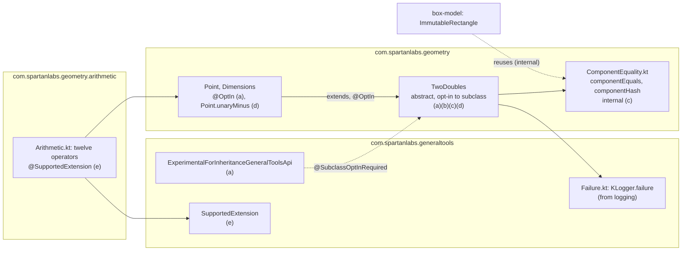
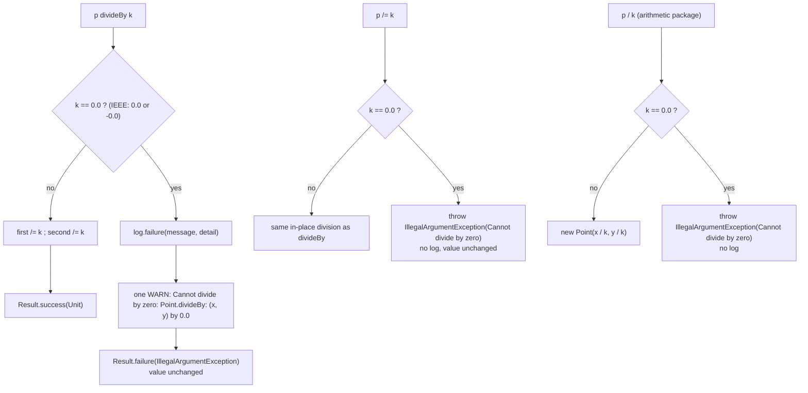
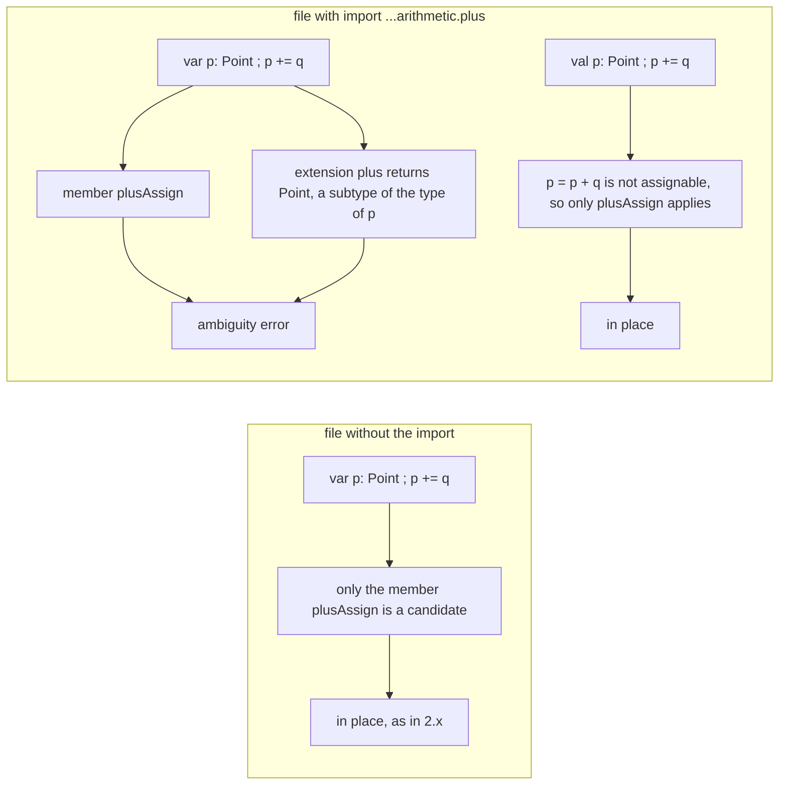

# Plan: `two-doubles` - unseal `TwoDoubles`, in-place `divideBy`, lawful equality, member operators, import-gated arithmetic

- **Covers:**
  - [SpartanLaboratories/GeneralTools#7](https://github.com/SpartanLaboratories/GeneralTools/issues/7),
    *"Make GeneralTools Kotlin Multiplatform (Color and geometry usable from common code)"* - the
    geometry value-core part of the 3.0.0 break set.
  - [SpartanLaboratories/GeneralTools#8](https://github.com/SpartanLaboratories/GeneralTools/issues/8),
    *"Read-only views for Point and Square so libraries can expose geometry without copying"*, which
    the same change resolves. This unit contributes the pieces #8 rests on that live in the value core:
    the equality helpers the immutable box reuses, and the hash-key guidance that points to
    `Rectangle.toImmutable()`.
- **Architecture:** [`architecture.md`](architecture.md), unit `two-doubles` (section 11.2 row 5, system
  S4). Landing order: **unit 5 of 8**; depends on `commonize` (4); `box-model` (6) lands after it.
- **Branch:** `feat/issue-7-kotlin-multiplatform` (shared by every unit; `master` @ `c196d1a` is merged in
  before the first implementation commit).
- **Commit:** TBD. This plan document is committed in the same commit as its first stage, commit (a)
  in section 11, so `git log --follow` binds the plan to the code.
- **PR:** TBD.
- **Scope:** this unit changes what `TwoDoubles`, `Point` and `Dimensions` are and adds two public
  annotations and one new public package. It does not touch the box model, the queries, `Color` or `Misc`.
- **Status:** planning only.
- **Target release:** `3.0.0`. Nothing is uploaded or published until the maintainer explicitly starts
  the release (unit `release`).
- **State when this unit starts:** `kmp-build`, `explicit-api`, `logging` and `commonize` have landed.
  - `TwoDoubles.kt` and `Point.kt` (holding `Point` and `Dimensions`) are in
    `src/commonMain/kotlin/geometry/`, use `this::class` with unchanged semantics and kotlin-logging, and
    carry explicit-API modifiers.
  - `src/commonMain/kotlin/generaltools/Failure.kt` holds `internal fun <T> KLogger.failure(message: String,
    detail: (() -> Any?)? = null): Result<T>`.
  - The throwing `divideBy` still logs ERROR through the kotlin-logging `log` of `TwoDoubles.kt`.
  - Their tests sit in `src/commonTest/kotlin/com/spartanlabs/testing/component/geometry/`: `PointTest`
    (the stray class's three tests folded in), `TwoDoublesTest` and `TwoDoublesHashCodeTest`, free of slf4j
    fields and `@Tag`.
  - `api/GeneralTools.api` and `api/GeneralTools.klib.api` are committed and `check` runs
    `checkKotlinAbi`.

---

## 1. Requirements

Each requirement ends with the check that proves it.

1. **`TwoDoubles` is abstract, with no abstract members, and subclassing it is Experimental.** It is
   `public abstract class TwoDoubles protected constructor(public var first: Double = 0.0, public var
   second: Double = 0.0)` with `protected constructor(doubles: TwoDoubles)`, annotated
   `@SubclassOptInRequired(ExperimentalForInheritanceGeneralToolsApi::class)`. `Point` and `Dimensions`
   carry `@OptIn(ExperimentalForInheritanceGeneralToolsApi::class)`; using them, or a `TwoDoubles`
   parameter, needs no opt-in.
   *Check:* the module compiles; `TwoDoublesSubclassTest` (an opted-in consumer-style subclass) passes on
   all three targets; the JVM/klib dump shows the constructor and marker lines of section 11 (a).
2. **The marker** `ExperimentalForInheritanceGeneralToolsApi` is `@RequiresOptIn(level = ERROR)`,
   `@Retention(BINARY)`, `@Target()`, in `com.spartanlabs.generaltools`.
   *Check:* it compiles as the argument of `@SubclassOptInRequired` and `@OptIn` (assumption A6); the
   dump shows the annotation class.
3. **`divideBy` divides in place and reports a zero divisor as a `Result`.**
   `public infix fun divideBy(magnitude: Double): Result<Unit>` divides each component directly. `0.0` and
   `-0.0` leave the value unchanged and return `Result.failure(IllegalArgumentException("Cannot divide by
   zero"))` after exactly one WARN line on the logger `com.spartanlabs.geometry.TwoDoubles`. A discarded
   result is harmless.
   *Check:* `TwoDoublesDivideByTest` (all targets) and `TwoDoublesDivisionLoggingTest` (JVM, counts the
   log lines).
4. **`/=` is unchanged for callers.** `divAssign` has a block body; a zero divisor throws
   `IllegalArgumentException("Cannot divide by zero")` without logging; otherwise it leaves exactly what
   `divideBy` leaves.
   *Check:* the existing `divAssign throws when dividing by zero` test passes untouched;
   `TwoDoublesDivAssignTest`; the JVM test that `/=` logs nothing.
5. **Equality is lawful.** `equals` and `hashCode` are `final`. Equal means the same concrete class and
   per-component IEEE equality, except that NaN equals NaN; `-0.0` hashes like `0.0` and still equals it;
   every NaN hashes alike. No pair that is equal in 2.x becomes unequal.
   *Check:* `TwoDoublesEqualityTest`, `ComponentEqualityTest`, and every case of the existing
   `TwoDoublesHashCodeTest` unchanged; the JVM allocation test confirms assumption A5.
6. **Additive member operators.** `component1()`/`component2()` on `TwoDoubles` (final) and
   `Point.unaryMinus()`. `Dimensions` has no `unaryMinus`.
   *Check:* `TwoDoublesDestructuringTest`, `PointUnaryMinusTest`.
7. **`@SupportedExtension`** exists in `com.spartanlabs.generaltools` with the shape and KDoc of
   section 6.5.
   *Check:* the dump shows the annotation class; the arithmetic functions carry it.
8. **Import-gated arithmetic.** `com.spartanlabs.geometry.arithmetic` (`Arithmetic.kt`, facade
   `ArithmeticKt`) holds the twelve operators of section 6.6. Each returns a new value and leaves its
   operands unchanged; `div` by `0.0`/`-0.0` throws `IllegalArgumentException("Cannot divide by zero")`
   without logging; `p / k` equals what `p /= k` leaves.
   *Check:* `PointArithmeticTest`, `DimensionsArithmeticTest`, `ArithmeticDivisionLoggingTest`.
9. **Gating (A12).** A file that does not import the package still resolves `+=`, `-=`, `*=` and `/=` on
   a `var` `Point`/`Dimensions` to the in-place members, and library code never imports the package.
   *Check:* `CompoundAssignmentWithoutArithmeticImportTest` compiles and passes beside the package; the
   Level-1 grep guard of section 9 is empty.
10. **Documentation moves with each change:** KDoc at Level 2 on every public declaration added or
    changed, the README quick reference and one or more migration rows in the same commit as each change.
11. **Proof of the API change.** After each commit, `api/GeneralTools.api` and `api/GeneralTools.klib.api`
    differ from the previous commit by exactly the rows listed for that commit in section 11 (architecture
    section 11.3, rows 2, 3, 7 and the three additive rows).

---

## 2. Current state

### 2.1 The code this unit changes

Citations are into the baseline (`master` @ `17d30bc`, identical to tag `2.2.0` for `src/main`). By the
time this unit starts the same declarations sit in `src/commonMain/kotlin/geometry/` with the edits of
units 1-4 applied; every edit below is written against declarations, not line numbers.

- `src/main/kotlin/geometry/TwoDoubles.kt:13` - `sealed class TwoDoubles(var first: Double = 0.0, var
  second: Double = 0.0)`. `Point` (`Point.kt:14`) and `Dimensions` (`Point.kt:40`) are its only subclasses
  in the repository; no `when` over `TwoDoubles` exists in `src/main` or `src/test`.
- `TwoDoubles.kt:15` - the copy constructor; `:17` `containsNaN`; `:19-36` `setTo`, `modBy`, `amplifyBy`
  (all final by default, as are the members below that are not overrides).
- `TwoDoubles.kt:42-47` - `divideBy` is `amplifyBy(1/magnitude)` behind `if (magnitude == 0.0)`, which logs
  `"Attempted to divide a {} by zero"` at ERROR (`this::class.simpleName`) and throws
  `IllegalArgumentException("Cannot divide by zero")`. `divAssign` (`:55`) is an expression body over it.
  Nothing in `src/main` calls `divideBy` (`grep` finds only the comment at `Vectors.kt:77`), so no
  in-repository caller unwraps its `Result` and none is broken by the change.
- `TwoDoubles.kt:61-65` - `equals` is an `override operator fun` that returns `false` for `null` or a
  different `javaClass`, then compares `first == other.first && second == other.second` (IEEE). `:72-73`
  `hashCode` is `31 * (31 * javaClass.hashCode() + first.hashCode()) + second.hashCode()`. Consequences:
  `Point(NaN, 0.0)` is not equal to itself; `Point(0.0, 0.0) == Point(-0.0, 0.0)` but the hash codes differ
  (`Double.hashCode` is bit-based on the JVM and Wasm). `equals`/`hashCode` are `override`s, so they are
  open today.
- `TwoDoubles.kt:75-77` - `toString` returns `"$first, $second"` in the platform's number format.
- `src/main/kotlin/geometry/Point.kt:30-35` - `Point.distanceFrom`, the first `Result`-returning member
  (JVM name `distanceFrom-IoAF18A`, so a `Result`-returning member is mangled; research
  `idiomatic-kotlin-api-mechanics.md` F2.1).
- `Square.kt` (renamed by `box-model`) computes `max` as `Point(location.x + dimensions.width, location.y +
  dimensions.height)`; `Point + Dimensions` in the arithmetic package is the same expression, bit for bit.
- The data classes `Segment`, `Ray`, `CenteredBox` and `Square` hold `Point`s and use `Point.equals` and
  `Point.hashCode` through their generated members, so they inherit the new equality contract with no
  edit (architecture section 8.2, `javaClass` row).

### 2.2 Bytecode and dump shape of the sealed class (read-only `javap` of the compiled 2.2.0 classes)

`TwoDoubles` is `public abstract class` in bytecode. It has two `private` constructors (`(DD)V`,
`(TwoDoubles)V`), the synthetic default-arguments form `(DDILkotlin/jvm/internal/DefaultConstructorMarker;)V`
(flags `ACC_PUBLIC, ACC_SYNTHETIC`), and two synthetic accessor forms
`(DDLkotlin/jvm/internal/DefaultConstructorMarker;)V` and
`(Lcom/spartanlabs/geometry/TwoDoubles;Lkotlin/jvm/internal/DefaultConstructorMarker;)V` that exist only so
subclasses can reach the private constructors. It has no parameterless constructor: the JVM backend adds
none to a sealed class.

The committed JVM dump is the Kotlin Gradle plugin's listing (`plan-kmp-build.md` section 6.3). It shows
only the two accessor forms. The plugin takes the synthetic default-arguments form's visibility from the
primary constructor, which is `protected` in a sealed class, and does not list a `protected` member of a
sealed class. The klib dump lists no constructor of a sealed class (architecture section 3.3).

Unsealing with `protected` constructors removes the two accessor forms and turns the real constructors
`protected`. Because the primary constructor's parameters all have defaults and the class is no longer
sealed, the JVM backend also adds a `protected` parameterless constructor `()V`: a constructor new in 3.0.0,
which Java subclasses can call as `super()`. The plugin lists all four constructors of the abstract class,
as its own test data does for `abstract class ProtectedConstructor protected constructor(val a: Int = 0)`:
the three `protected` ones and the synthetic default-arguments form, which 2.2.0 already has. This is the
commit (a) delta of section 11 and ledger row 2; the exact dump text is read from the tool, not assumed (A4).

### 2.3 Tests at the start of the unit

- `PointTest` holds `divAssign throws when dividing by zero` (`point /= 0.0` fails with
  `IllegalArgumentException`) and `equals returns false for a different type with the same values`. Both
  stay unchanged.
- `TwoDoublesHashCodeTest` holds six cases (`equal Points share a hashCode`, `equal Dimensions share a
  hashCode`, `Point and Dimensions with the same values hash differently`, `a Segment round-trips as a
  HashMap key`, `a CenteredBox round-trips as a HashMap key`, `a HashSet collapses equal CenteredBoxes`).
  All six must still pass unedited after commit (c).
- `TwoDoublesTest` KDoc says "TwoDoubles is sealed and abstract"; commit (a) corrects it.
- No test captures log output. The logback test configuration (`logback-test.xml`, moved to
  `src/jvmTest/resources/` by `kmp-build`) sets `com.spartanlabs` to TRACE and the root to INFO, so a
  `WARN` on a `com.spartanlabs.*` logger reaches any appender attached to that logger or to the root.

### 2.4 Verified outside-world facts this unit rests on

| Fact | Source |
|---|---|
| `@SubclassOptInRequired` (since Kotlin 2.1) gates subclassing of open and abstract classes only; using the type needs no opt-in; a marker with `@Target()` is only an argument of `@SubclassOptInRequired`/`@OptIn`; the annotations are absent from ABI dumps; the marker class is dumped | [`research/idiomatic-kotlin-api-mechanics.md`](research/idiomatic-kotlin-api-mechanics.md) F5.1, F5.2 |
| A data class whose supertype has `final` `componentN()` is a compile error: "If the functions of the supertype cannot be overridden due to incompatible signatures or due to their being final, an error is reported." Re-read 2026-10-19 | <https://kotlinlang.org/docs/data-classes.html> |
| `a += b` on a mutable `var` is reported as an ambiguity when `plusAssign` and `plus` both exist and `plus` returns a subtype of the type of `a`; with a `val` only `plusAssign` applies. Re-read 2026-10-19 | <https://kotlinlang.org/docs/operator-overloading.html> |
| An extension declared outside the file's package needs an import; a member wins over an extension; a star import does not reach subpackages | [`research/mutable-geometry-model.md`](research/mutable-geometry-model.md) claims 1-3 |
| A member returning `Result` is name-mangled on the JVM; top-level functions are not | `idiomatic-kotlin-api-mechanics.md` F2.1 |
| `49.0 * (1.0 / 49.0)` is `0.9999999999999999` and `49.0 / 49.0` is `1.0`; a subnormal divisor's reciprocal overflows to `Infinity` | `mutable-geometry-model.md` section 3.1 (computed) |
| kotlin-logging 8.0.4 on the JVM wraps `LoggerFactory.getLogger(name)` with the name passed verbatim, so a logback appender attached to that name sees the events | [`research/kotlin-logging-adoption.md`](research/kotlin-logging-adoption.md), recommendation on logger declaration and the `Slf4jLoggerFactory.logger(name)` claim (source-read) |
| Backtick test names with letters, digits, spaces, hyphens and apostrophes are legal on JS and Wasm; other characters (including `.`) are not | [`research/kmp-test-levels-and-names.md`](research/kmp-test-levels-and-names.md) F3 |

---

## 3. Assumptions

| # | Assumption | If false |
|---|---|---|
| A4 | The dump lines predicted in section 11 (the `TwoDoubles` constructor lines, the mangled name `divideBy-IoAF18A`, the klib text) follow the ledger in architecture section 11.3. They are derived by hand, not produced by the tool. | The actual diff is the authority: the implementer reconciles every line of `git diff -- api/` with the ledger, records any difference in `final-implementation.md`, and the planner corrects the ledger. A line outside the corrected ledger is a defect or a missing migration row. |
| A5 | `this::class` in `equals`/`hashCode` costs nothing measurable on the JVM: the `ClassReference` it allocates is removed by escape analysis. `Actor.isAtDestination` in MyGameTools compares `Point`s with `==` every frame. | Replace the class comparison and the class term of the hash with two `internal expect` functions whose JVM actuals use `javaClass` (section 6.2, "Contingency for A5"). No public signature changes. |
| A6 | `@SubclassOptInRequired(Marker::class)` on an `abstract class` in the same module forces `@OptIn` only on its subclasses (`Point`, `Dimensions`), and a `@Target()` marker is accepted by the compiler at `languageVersion` 2.2. | The marker gets a non-empty `@Target` (for example `CLASS`), or the module compiles with `-opt-in=com.spartanlabs.generaltools.ExperimentalForInheritanceGeneralToolsApi` for its own sources only; the dump shows the marker class either way. |
| A12 | An extension operator declared in `com.spartanlabs.geometry.arithmetic` takes part in resolving `a += b` only in a file that imports it. A file without the import resolves `+=` on a `var` `Point` to the member `plusAssign`. In an importing file the same statement is an ambiguity error. | The import does not confine the ambiguity, so the package would break `var` holders in files that never imported it; the arithmetic package does not ship and commit (e) is replaced by a plan revision. |
| A13 | The `logging` unit's `Failure.kt` and the file-private `log` of `TwoDoubles.kt` exist exactly as the seam describes: `internal fun <T> KLogger.failure(message: String, detail: (() -> Any?)? = null): Result<T>` in package `com.spartanlabs.generaltools`; `private val log = KotlinLogging.logger("com.spartanlabs.geometry.TwoDoubles")`. | Adjust the two imports and the `log` reference in commit (b); the behaviour specified here does not change. |
| A14 | A logback `ListAppender` attached to the logger named `com.spartanlabs.geometry.TwoDoubles` receives the event that kotlin-logging emits for that name on the JVM. | The two JVM logging tests fail at commit (b); the failure indicates that the logger-name contract of the `logging` unit is wrong and is reported to that unit. |

---

## 4. Non-goals

- Member `plus`/`minus`/`times`/`div` on `Point`/`Dimensions`; `Dimensions +/- Point`; component-wise
  products; `unaryPlus`, `inc`, `dec`, `compareTo`, `rangeTo`, `get`, `rem`; `unaryMinus` on
  `Dimensions`; arithmetic on boxes, segments or rays; arithmetic on consumers' own `TwoDoubles`
  subclasses (the package is their worked example).
- Any `ReadOnly*` type; any immutable `Point` or `Dimensions`; a factory hook or an abstract member on
  `TwoDoubles`; opening `Point` or `Dimensions`.
- A tolerance-based (`epsilon`) equality, scalar overloads, or changing which divisors count as zero (only
  `0.0` and `-0.0`; NaN and infinities divide).
- In-repository compile-fail tests for the opt-in gate, sealed-ness, the data-class restriction and the
  importing-file ambiguity. [GeneralTools#12](https://github.com/SpartanLaboratories/GeneralTools/issues/12)
  tracks a Gradle TestKit test for a minor release after 3.0.0; the `release` smoke project checks them once.
- The `Rectangle`/`ImmutableRectangle` types and their equality, `toString` and `toImmutable()` (unit
  `box-model`), `Color`, `Misc`, and the box-intersection functions.
- Publishing, tagging, or changing any downstream repository.

---

## 5. Design

### 5.1 Shape of the change



Nothing in the library imports `com.spartanlabs.geometry.arithmetic`; arrows into it come from consumers
only. `ComponentEquality.kt` is consumed by `box-model`.

### 5.2 Zero-divisor policy: three spellings, one rule, two reporting styles



`divideBy` is a named function and reports. The two operators must return their natural type (`Unit` for
`divAssign`, `Point`/`Dimensions` for `div`), so they throw, as Kotlin's own `get` throws where `getOrNull`
reports. The thrown exception is the report; logging it as well would report one fault twice.

### 5.3 Operator resolution, which is why the arithmetic is import-gated (A12)



### 5.4 Error-handling contract per signature

| Signature | Failure behaviour | Class of failure | Where unwrapped |
|---|---|---|---|
| `TwoDoubles.divideBy(Double): Result<Unit>` | zero divisor -> `Result.failure(IllegalArgumentException("Cannot divide by zero"))`, value unchanged, one WARN | expected (a caller-visible degenerate input) -> `Result` | by the caller; no in-repository caller exists |
| `TwoDoubles.divAssign(Double)` | zero divisor -> throws `IllegalArgumentException("Cannot divide by zero")`, value unchanged, no log | operator that must return `Unit`; the caller can test the divisor, so a violated precondition -> throw | the caller's `try`/`runCatching`, or avoided by testing the divisor |
| `Point.div(Double)`, `Dimensions.div(Double)` | same as `divAssign` | same | same |
| `TwoDoubles.equals`, `hashCode`, `component1`, `component2`, `toString`, `Point.unaryMinus`, `plus`, `minus`, `times` | total: NaN and infinities propagate, nothing is reported | none | n/a |
| `componentEquals`, `componentHash` | total | none | n/a |
| `TwoDoubles` constructors | total; NaN and infinities accepted (no validation, as in 2.x) | none | n/a |
| subclassing `TwoDoubles` without the opt-in | compile error | programmer error caught at compile time | the compiler |

Expected failures are `Result`; violated preconditions of an operator are exceptions, and nothing here
uses `try`/`catch`.

### 5.5 Logging events

| Event | Level | Logger | Text | Emitted by |
|---|---|---|---|---|
| `divideBy` with a zero divisor | WARN | `com.spartanlabs.geometry.TwoDoubles` (name unchanged from 2.x) | `Cannot divide by zero: <SimpleName>.divideBy: (<receiver>) by <divisor>`, for example `Cannot divide by zero: Point.divideBy: (4.0, 6.0) by 0.0` | `KLogger.failure` through `TwoDoubles.divideBy` |
| `divAssign` / arithmetic `div` with a zero divisor | none | - | the exception is the report | - |
| every other member of this unit | none | - | - | - |

2.x logged `Attempted to divide a Point by zero` at ERROR and then threw. The WARN level, the text and the
absence of a throw are all migration notes (section 8). The detail lambda is evaluated only when WARN is
enabled (helper contract). `divideBy(0.0)` builds an exception per call, with a stack trace on the JVM;
the KDoc says to test divisors that can be zero before a hot loop.

---

## 6. Design - signatures, KDoc contracts and mutability

Every declaration is `public` unless marked `internal`/`private`/`protected`, carries an explicit return
type, and (when public) a Level-2 KDoc. `TwoDoubles` is mutable (`var first`, `var second`) and
unsynchronised, exactly as in 2.x; the new operators are pure and allocate only their result.

### 6.1 `ExperimentalForInheritanceGeneralToolsApi` (commit a)

`src/commonMain/kotlin/generaltools/ExperimentalForInheritanceGeneralToolsApi.kt`

```kotlin
package com.spartanlabs.generaltools

/**
 * Opt-in marker for subclassing [com.spartanlabs.geometry.TwoDoubles], an Experimental seam.
 *
 * Subclassing `TwoDoubles` is allowed, but its shape has not yet been proven by a consumer and may change
 * in a minor release. Using `TwoDoubles`, [com.spartanlabs.geometry.Point] and
 * [com.spartanlabs.geometry.Dimensions] (as values, parameters or receivers) needs no opt-in; only a class
 * that extends `TwoDoubles` does:
 *
 *     @OptIn(ExperimentalForInheritanceGeneralToolsApi::class)
 *     class Velocity(dx: Double, dy: Double) : TwoDoubles(dx, dy)
 *
 * The marker has no targets, so it can only be passed to `@OptIn` or `@SubclassOptInRequired`; it gates
 * inheritance and nothing else. The level is ERROR: lowering a level later never breaks a consumer, raising
 * one would. Once a consumer has built against the seam it graduates to a Supported Extension
 * ([SupportedExtension]) and this marker is retired from `TwoDoubles`; the release notes of that release
 * record the promotion.
 */
@RequiresOptIn(
    level = RequiresOptIn.Level.ERROR,
    message = "Subclassing TwoDoubles is Experimental and may change in a minor release. " +
        "Opt in with @OptIn(ExperimentalForInheritanceGeneralToolsApi::class).",
)
@Retention(AnnotationRetention.BINARY)
@Target()
public annotation class ExperimentalForInheritanceGeneralToolsApi
```

No `@MustBeDocumented` (the architecture's shape omits it). Failure path: none at runtime; misuse is a
compile error.

### 6.2 `TwoDoubles` (commits a, b, c, d)

`src/commonMain/kotlin/geometry/TwoDoubles.kt`. Only the declarations below change; `containsNaN`,
`setTo`, `modBy`, `amplifyBy`, `plusAssign`, `minusAssign`, `timesAssign` and the primary-constructor
properties keep their bodies from `explicit-api`. The table after the listing says which commit adds each
element, so each commit leaves a compiling, tested tree.

```kotlin
package com.spartanlabs.geometry

import com.spartanlabs.generaltools.ExperimentalForInheritanceGeneralToolsApi
import com.spartanlabs.generaltools.failure
import io.github.oshai.kotlinlogging.KotlinLogging

/** Logger used for diagnostic output from this file's functions. */
private val log = KotlinLogging.logger("com.spartanlabs.geometry.TwoDoubles")

/**
 * Message of the [IllegalArgumentException] reported for a zero divisor by [TwoDoubles.divideBy],
 * [TwoDoubles.divAssign] and the arithmetic package's `div`. One constant keeps the three spellings equal.
 */
internal const val DIVISION_BY_ZERO_MESSAGE: String = "Cannot divide by zero"

/**
 * Base class for any type represented by a pair of Doubles, such as a 2D point or a width/height pair.
 * Provides the in-place arithmetic, equality and destructuring shared by its subclasses; [Point] and
 * [Dimensions] are the ones this library ships.
 *
 * ### Using it
 * Taking a `TwoDoubles` as a parameter, calling any member, and using [Point] or [Dimensions] need no
 * opt-in. The class is abstract, so `TwoDoubles` itself cannot be instantiated, and it has no abstract
 * members, so a subclass implements nothing.
 *
 * ### Subclassing (Experimental)
 * Subclassing is gated by [ExperimentalForInheritanceGeneralToolsApi], an ERROR-level opt-in, because the
 * seam has not yet been proven by a consumer and may change in a minor release. A subclass opts in with
 * `@OptIn(ExperimentalForInheritanceGeneralToolsApi::class)` and calls a `protected` constructor.
 * These members are final, so every subclass keeps the invariants: [first], [second], [setTo], [modBy],
 * [amplifyBy], [divideBy], the four assignment operators, [containsNaN], [component1], [component2],
 * [equals] and [hashCode]. [toString] stays open.
 * A subclass cannot be a data class: a data class's generated `componentN()` cannot override the final
 * [component1] and [component2] it inherits (the compiler reports an error). A subclass's state lives in
 * [first] and [second]; give it a plain class and, if it needs value-returning operators, extension
 * functions such as those in the `com.spartanlabs.geometry.arithmetic` package.
 *
 * ### Equality and hash keys
 * Two instances are equal when they are of the same concrete class and their components are equal, where
 * NaN equals NaN and `0.0` equals `-0.0` (so a [Point] never equals a [Dimensions] with the same values).
 * Equality and [hashCode] follow the *current* values. These types are mutable: do not change an instance
 * while it is a key in a hash-based map or an element of a hash-based set, because the collection's
 * behaviour is then undefined. Use `Rectangle.toImmutable()` where a box is the key, or a copy of the
 * point that nothing else holds.
 *
 * ### Thread safety
 * Instances are not synchronised.
 *
 * @property first the first component; `var`, written in place by every mutating member.
 * @property second the second component; `var`.
 */
@SubclassOptInRequired(ExperimentalForInheritanceGeneralToolsApi::class)
public abstract class TwoDoubles protected constructor(
    public var first: Double = 0.0,
    public var second: Double = 0.0,
) {
    /** Creates a new instance with the same values as [doubles]. */
    protected constructor(doubles: TwoDoubles) : this(doubles.first, doubles.second)

    // ...containsNaN, setTo, modBy, amplifyBy, plusAssign, minusAssign, timesAssign unchanged...

    /**
     * Divides both [first] and [second] by [magnitude], in place. Each component is divided directly
     * (`first / magnitude`), not multiplied by `1 / magnitude`, so a result can differ from 2.x by one unit
     * in the last place (`49.0` divided by `49.0` is exactly `1.0`; 2.x gave `0.9999999999999999`) and a
     * subnormal divisor no longer overflows through its reciprocal.
     *
     * A zero [magnitude] (`0.0` or `-0.0`) is an expected failure: the value is left unchanged, one WARN
     * line is logged on the `com.spartanlabs.geometry.TwoDoubles` logger, and the result is a failure
     * holding an [IllegalArgumentException] with the message "Cannot divide by zero". A NaN divisor is not
     * a failure: it yields NaN components. Use [divAssign] (`/=`) for the throwing spelling.
     *
     * A discarded result is harmless: on success the division has already happened, and on failure the
     * value is unchanged and the failure already logged. A failed call still builds an exception (with a
     * stack trace on the JVM) and logs, so test a divisor that can be zero before dividing in a hot loop.
     *
     * @param magnitude the divisor.
     * @return `Result.success(Unit)` after dividing both components, or `Result.failure` holding an
     *   [IllegalArgumentException] if [magnitude] is `0.0` or `-0.0`.
     */
    public infix fun divideBy(magnitude: Double): Result<Unit> {
        // IEEE comparison on two Doubles: -0.0 == 0.0, and NaN is not zero.
        if (magnitude == 0.0) {
            return log.failure(DIVISION_BY_ZERO_MESSAGE) {
                "${this::class.simpleName ?: "TwoDoubles"}.divideBy: ($this) by $magnitude"
            }
        }
        divideComponentsBy(magnitude)
        return Result.success(Unit)
    }

    /**
     * Divides this instance's values by [magnitude], in place, leaving exactly what [divideBy] leaves.
     * Unlike [divideBy] it throws for a zero divisor and does not log, because an operator must return
     * `Unit`; the exception is the report.
     *
     * @param magnitude the divisor.
     * @throws IllegalArgumentException with the message "Cannot divide by zero" if [magnitude] is `0.0` or
     *   `-0.0`; the value is left unchanged.
     */
    public operator fun divAssign(magnitude: Double) {
        require(magnitude != 0.0) { DIVISION_BY_ZERO_MESSAGE }
        divideComponentsBy(magnitude)
    }

    /** The one division both [divideBy] and [divAssign] use, so they cannot drift apart. */
    private fun divideComponentsBy(magnitude: Double) {
        first /= magnitude
        second /= magnitude
    }

    /**
     * The first component, so that `val (x, y) = point` destructures. Final: a subclass cannot be a data
     * class, whose generated `component1()` would have to override it.
     *
     * @return [first].
     */
    public operator fun component1(): Double = first

    /**
     * The second component, so that `val (w, h) = dimensions` destructures. Final, for the reason given
     * on [component1].
     *
     * @return [second].
     */
    public operator fun component2(): Double = second

    /**
     * Equal when [other] is the same concrete class and both components are equal: ordinary IEEE equality
     * per component, except that NaN equals NaN (so an instance with a NaN component equals itself and
     * every identical instance). `0.0` equals `-0.0`. No pair that was equal in 2.x is unequal now; only
     * NaN-versus-NaN pairs changed from unequal to equal. Final: the same-class rule and the hash fold
     * are the invariant. Consistent with [hashCode]. See the class documentation on mutable hash keys.
     *
     * @param other the value to compare with.
     * @return `true` if [other] is a `TwoDoubles` of exactly this class with equal components.
     */
    public final override fun equals(other: Any?): Boolean {
        if (this === other) return true
        // Same concrete class, not merely a TwoDoubles: a Point never equals a Dimensions.
        if (other == null || this::class != other::class) return false
        other as TwoDoubles
        return componentEquals(first, other.first) && componentEquals(second, other.second)
    }

    /**
     * Hash code consistent with [equals]: folds in the concrete class (so a [Point] and a [Dimensions]
     * holding the same values hash differently) and both components, with `-0.0` hashed as `0.0` and every
     * NaN hashed alike. Final. The value changes when the instance is mutated; see the class documentation.
     *
     * @return the hash code.
     */
    public final override fun hashCode(): Int =
        31 * (31 * this::class.hashCode() + componentHash(first)) + componentHash(second)

    /**
     * Returns "first, second". The numbers use the platform's own formatting (for example `1.0` prints as
     * `1` on JS), so do not parse the text or compare it across platforms.
     *
     * @return the text.
     */
    public override fun toString(): String = "$first, $second"
}
```

| Element | Commit |
|---|---|
| `@SubclassOptInRequired`, `abstract`, `protected` constructors, the class KDoc sections "Using it" and "Subclassing" (without the sentences about `equals`/`hashCode`, `component1`/`component2` and data classes) | (a) |
| `DIVISION_BY_ZERO_MESSAGE`, new `divideBy`/`divAssign`/`divideComponentsBy`, their KDoc | (b) |
| `componentEquals`/`componentHash`, `final override equals`/`hashCode`, the "Equality and hash keys" section, the `equals`/`hashCode` names in the final-members sentence, the `toString` KDoc | (c) |
| `component1`/`component2`, the data-class sentence | (d) |

Level-1 comments: the IEEE-zero line in `divideBy`, the same-class line in `equals`, and a one-line
comment on `hashCode` ("class term + per-component hashes; -0.0 and NaN canonicalised by componentHash").
The detail follows the `<function>: <values>` form of every other failure site (README `## Logging`), so the
WARN line reads `Cannot divide by zero: Point.divideBy: (4.0, 6.0) by 0.0`; `this::class.simpleName ?:
"TwoDoubles"` covers a consumer's anonymous subclass, whose `simpleName` is `null`.
`private fun divideComponentsBy` and `private val log` do not enter the dump; the internal const is excluded
because it is Kotlin-`internal` (if the dump unexpectedly lists a `TwoDoublesKt` line, the const is made
`private` in this file and duplicated in `Arithmetic.kt`; see section 10).

#### Contingency for A5 (not built unless the allocation test fails)

If `TwoDoublesEqualsAllocationTest` fails on the JVM, replace `this::class != other::class` and
`this::class.hashCode()` with two `internal` declarations in a new `src/commonMain/kotlin/geometry/ClassIdentity.kt`:

```kotlin
internal expect fun sameClass(a: Any, b: Any): Boolean
internal expect fun classHash(value: Any): Int
```

`src/jvmMain/kotlin/geometry/ClassIdentity.jvm.kt` actuals: `a.javaClass === b.javaClass` and
`value.javaClass.hashCode()` (hash-identical to 2.x). `src/jsMain/kotlin/geometry/ClassIdentity.js.kt` and
`src/wasmJsMain/kotlin/geometry/ClassIdentity.wasmJs.kt` actuals: `a::class == b::class` and
`value::class.hashCode()`. Both functions are internal, so no dump line changes. The allocation test then
proves the fallback.

### 6.3 `ComponentEquality.kt` (commit c)

`src/commonMain/kotlin/geometry/ComponentEquality.kt`, package `com.spartanlabs.geometry`, containing exactly
these two declarations:

```kotlin
package com.spartanlabs.geometry

/**
 * Equality of two components under the [TwoDoubles] contract: IEEE `==`, except that NaN equals NaN.
 * `0.0` and `-0.0` are equal. Pure and total. Shared with `ImmutableRectangle` so both types agree.
 */
internal fun componentEquals(a: Double, b: Double): Boolean = a == b || (a.isNaN() && b.isNaN())

/**
 * Hash of one component, consistent with [componentEquals]: `-0.0` hashes as `0.0` and every NaN hashes as
 * [Double.NaN]; any other value hashes as `value.hashCode()`. Pure and total.
 */
internal fun componentHash(value: Double): Int = when {
    value.isNaN() -> Double.NaN.hashCode()
    // IEEE comparison: true for both 0.0 and -0.0, which must hash alike because they are equal.
    value == 0.0 -> 0.0.hashCode()
    else -> value.hashCode()
}
```

### 6.4 `Point` and `Dimensions` (commits a, d)

`src/commonMain/kotlin/geometry/Point.kt`:

- (a) Both classes gain `@OptIn(ExperimentalForInheritanceGeneralToolsApi::class)` between their KDoc and the
  class keyword, with a Level-1 comment above it: `// Extending TwoDoubles is Experimental; using Point is not.`
  Their KDoc gains one sentence: "Final: equality is keyed on the concrete class, so to define another
  coordinate pair extend [TwoDoubles] (Experimental) instead of this class." Constructors, `x`, `y`,
  `width`, `height`, `distanceFrom` and the copy constructors are unchanged.
- (d) `Point` gains:

```kotlin
    /**
     * A new [Point] with both coordinates negated; this point is unchanged. `-Point(0.0, 0.0)` is
     * `Point(-0.0, -0.0)`, which equals `Point(0.0, 0.0)` under the equality contract. [Dimensions] has no
     * negation because a negative size is not a valid size.
     *
     * @return the negated point, a new instance.
     */
    public operator fun unaryMinus(): Point = Point(-x, -y)
```

Total; no failure path.

### 6.5 `SupportedExtension` (commit e)

`src/commonMain/kotlin/generaltools/SupportedExtension.kt`

```kotlin
package com.spartanlabs.generaltools

/**
 * Marks a public surface as a Supported Extension: a seam for a likely but non-core need, one a fair number of
 * consumers will want but that is not what this library is fundamentally for.
 *
 * The tier marks purpose, not a weaker promise: a Supported Extension carries the same compatibility
 * guarantee as the Stable Core, and changes only in a major release. The shipped implementations double as
 * worked examples of how to extend that seam, so they are written to be read.
 *
 * This is not an opt-in and gates nothing: it does not need `@OptIn`, produces no warning, and is not
 * checked by the compiler. It documents the tier, and consumers' IDEs show it from the compiled library.
 *
 * Surfaces that carry it: the value-returning arithmetic in `com.spartanlabs.geometry.arithmetic`, and the
 * `TwoDoubles` subclassing seam once it graduates from Experimental
 * ([ExperimentalForInheritanceGeneralToolsApi]).
 */
@MustBeDocumented
@Retention(AnnotationRetention.BINARY)
@Target(
    AnnotationTarget.CLASS,
    AnnotationTarget.FUNCTION,
    AnnotationTarget.PROPERTY,
    AnnotationTarget.TYPEALIAS,
)
public annotation class SupportedExtension
```

### 6.6 `Arithmetic.kt` (commit e)

`src/commonMain/kotlin/geometry/arithmetic/Arithmetic.kt`, package `com.spartanlabs.geometry.arithmetic`,
facade `ArithmeticKt` (no `@file:JvmName`). Imports: `com.spartanlabs.generaltools.SupportedExtension`,
`com.spartanlabs.geometry.DIVISION_BY_ZERO_MESSAGE`, `com.spartanlabs.geometry.Dimensions`,
`com.spartanlabs.geometry.Point`. Every function is `@SupportedExtension public operator fun`, non-`inline`,
immutable in its operands, allocating exactly one result, with the bodies below (`x`/`y`/`width`/`height` are
the public properties; multiplication is commutative in IEEE, so `2.0 * p` equals `p * 2.0` bit for bit):

```kotlin
public operator fun Point.plus(other: Point): Point = Point(x + other.x, y + other.y)
public operator fun Point.plus(offset: Dimensions): Point = Point(x + offset.width, y + offset.height)
public operator fun Point.minus(other: Point): Point = Point(x - other.x, y - other.y)
public operator fun Point.minus(offset: Dimensions): Point = Point(x - offset.width, y - offset.height)
public operator fun Point.times(factor: Double): Point = Point(x * factor, y * factor)
public operator fun Point.div(divisor: Double): Point {
    require(divisor != 0.0) { DIVISION_BY_ZERO_MESSAGE }   // same policy as /=: throw, no log
    return Point(x / divisor, y / divisor)                  // each component directly, as /= does
}
public operator fun Double.times(point: Point): Point = Point(this * point.x, this * point.y)

public operator fun Dimensions.plus(other: Dimensions): Dimensions =
    Dimensions(width + other.width, height + other.height)
public operator fun Dimensions.minus(other: Dimensions): Dimensions =
    Dimensions(width - other.width, height - other.height)
public operator fun Dimensions.times(factor: Double): Dimensions = Dimensions(width * factor, height * factor)
public operator fun Dimensions.div(divisor: Double): Dimensions {
    require(divisor != 0.0) { DIVISION_BY_ZERO_MESSAGE }
    return Dimensions(width / divisor, height / divisor)
}
public operator fun Double.times(dimensions: Dimensions): Dimensions =
    Dimensions(this * dimensions.width, this * dimensions.height)
```

Failure paths: `div` by `0.0`/`-0.0` throws `IllegalArgumentException("Cannot divide by zero")` (a violated
operator precondition; the operand is untouched; no log). Every other function is total. Results are not
validated: `Dimensions - Dimensions` may be negative and NaN propagates.

**File-level KDoc** (a `/** ... */` block above the `package` line) states, in this order:

1. what the package is: value-returning `plus`, `minus`, `times` and `div` for `Point` and `Dimensions`;
2. how to opt in, with the two import forms and the note that an import by name brings in every overload of
   that name:
   `import com.spartanlabs.geometry.arithmetic.*` and `import com.spartanlabs.geometry.arithmetic.plus`;
3. that `import com.spartanlabs.geometry.*` does not reach the subpackage (a star import does not reach
   subpackages) and that a file with no import resolves exactly as it did before this package existed;
4. a table of the twelve operators with their result types, `Point + Dimensions` being the corner formula
   (`Rectangle.max`) and `Point - Dimensions` its inverse;
5. the **three accepted costs** (see "Common tail" below);
6. the in-place members (`+=`, `-=`, `*=`, `/=`, `setTo`, `modBy`, `amplifyBy`, `divideBy`) as the
   allocation-free alternative;
7. that the tier is Supported Extension (same compatibility guarantee as Stable Core) and that the functions are
   the worked example for a consumer adding the same operators to its own `TwoDoubles` subclass:

```kotlin
@OptIn(ExperimentalForInheritanceGeneralToolsApi::class)
class Velocity(dx: Double, dy: Double) : TwoDoubles(dx, dy)

operator fun Velocity.plus(other: Velocity): Velocity =
    Velocity(first + other.first, second + other.second)
```

**Per-function KDoc.** Each function has a one-line summary, `@param`, `@return` ("a new instance; the
operands are unchanged") and, for `div`, `@throws IllegalArgumentException`, then the **common tail**, repeated
verbatim in all twelve:

```
 * Use the in-place members (`+=`, [TwoDoubles.modBy], [TwoDoubles.amplifyBy]) when an allocation per
 * operation is not acceptable.
 *
 * Costs of importing this operator (this package is opt in per file):
 * - in a file that imports it, `+=`, `-=`, `*=` and `/=` on a `var` [Point] or [Dimensions] holder are
 *   ambiguous and stop compiling; a `val` holder is unaffected;
 * - a wildcard import brings every operator of this package in, and an IDE may add the import when
 *   `p + q` does not resolve;
 * - a member operator added to [Point] or [Dimensions] in a later release would shadow this extension.
```

The `div` functions add: "A zero divisor (`0.0` or `-0.0`) throws, as `/=` does, and logs nothing; each
component is divided directly, so `p / k` equals what `p /= k` leaves."

**Level-1 comments:** above each `div` body, the IEEE-zero and direct-division lines shown above; above
`Double.times`, "commutative in IEEE, so equal to the Point-times-Double form".

---

## 7. File-by-file changes (in commit order)

Paths are relative to the repository root. "Test" files are specified in section 9. Every commit also runs
`./gradlew updateKotlinAbi` and commits `api/GeneralTools.api` and `api/GeneralTools.klib.api`.

### Commit (a) - unseal

| File | Change |
|---|---|
| `src/commonMain/kotlin/generaltools/ExperimentalForInheritanceGeneralToolsApi.kt` | **New**, section 6.1. |
| `src/commonMain/kotlin/geometry/TwoDoubles.kt` | `sealed` -> `abstract`; add `@SubclassOptInRequired(...)`, `protected` primary and copy constructors, the "Using it" and "Subclassing" KDoc; add the two imports it needs (`ExperimentalForInheritanceGeneralToolsApi`). No body changes. |
| `src/commonMain/kotlin/geometry/Point.kt` | `@OptIn(ExperimentalForInheritanceGeneralToolsApi::class)` on `Point` and `Dimensions`, plus the KDoc sentence (section 6.4). |
| `src/commonTest/kotlin/com/spartanlabs/testing/component/geometry/TwoDoublesTest.kt` | KDoc: "TwoDoubles is abstract, so its behavior is exercised here through its concrete subclass Point; the subclassing seam is covered by TwoDoublesSubclassTest." No test changes. |
| `src/commonTest/.../component/geometry/TwoDoublesSubclassTest.kt` | **New**, section 9. |
| `README.md` | See section 8. |
| `docs/plans/7-kotlin-multiplatform/plan-two-doubles.md` | This plan, committed here. |
| `api/GeneralTools.api`, `api/GeneralTools.klib.api` | Updated by the tool. |

Logging: none added in this commit.

### Commit (b) - `divideBy`

| File | Change |
|---|---|
| `src/commonMain/kotlin/geometry/TwoDoubles.kt` | Add `DIVISION_BY_ZERO_MESSAGE`; replace `divideBy` and `divAssign` by section 6.2's bodies and KDoc; add `private fun divideComponentsBy`. Delete the ERROR log call (the `log` field stays: `divideBy` uses it). |
| `src/commonMain/kotlin/geometry/Vectors.kt` | Comment only, inside `Point.normalized`: replace "Guard the same degeneracy TwoDoubles.divideBy guards, but return a Result instead of throwing (consistent with Point.distanceFrom)." with "Guard the same degeneracy TwoDoubles.divideBy guards (a zero divisor), reported as a Result like Point.distanceFrom." (`divideBy` itself now returns a `Result`.) Match by text, not line number. |
| `src/commonTest/.../component/geometry/TwoDoublesDivideByTest.kt` | **New.** |
| `src/commonTest/.../component/geometry/TwoDoublesDivAssignTest.kt` | **New.** |
| `src/commonTest/.../component/geometry/TwoDoublesSubclassTest.kt` | Append the `divideBy` subclass test. |
| `src/jvmTest/kotlin/com/spartanlabs/testing/integration/geometry/DivideByLoggingTest.kt` | **Deleted.** It pinned the interim throwing, ERROR-logging `divideBy`, which this commit replaces; `TwoDoublesDivisionLoggingTest` takes its place. |
| `src/jvmTest/.../integration/geometry/TwoDoublesDivisionLoggingTest.kt` | **New**, using the existing `LogCapture` (section 9). |
| `README.md`, `api/*.api` | Section 8, including the two `## Logging` edits listed there; tool-updated dumps. |

`PointTest` is **not** edited: `divAssign throws when dividing by zero` stays exactly as it is.

### Commit (c) - equality

| File | Change |
|---|---|
| `src/commonMain/kotlin/geometry/ComponentEquality.kt` | **New**, section 6.3. |
| `src/commonMain/kotlin/geometry/TwoDoubles.kt` | `equals` and `hashCode` become `public final override` over `componentEquals`/`componentHash`; KDoc for them, the "Equality and hash keys" section, the `toString` KDoc; extend the final-members sentence. |
| `src/commonTest/.../component/geometry/TwoDoublesEqualityTest.kt` | **New.** |
| `src/commonTest/kotlin/com/spartanlabs/testing/deterministic/geometry/ComponentEqualityTest.kt` | **New.** |
| `src/jvmTest/kotlin/com/spartanlabs/testing/nonfunctional/geometry/TwoDoublesEqualsAllocationTest.kt` | **New** (A5). |
| `README.md`, `api/*.api` | Section 8; tool-updated dumps. |

`TwoDoublesHashCodeTest` and `PointTest` are not edited. If the allocation test fails, the contingency of
section 6.2 is applied in this same commit.

### Commit (d) - member operators

| File | Change |
|---|---|
| `src/commonMain/kotlin/geometry/TwoDoubles.kt` | Add `component1`/`component2` with KDoc; add the data-class sentence to the class KDoc. |
| `src/commonMain/kotlin/geometry/Point.kt` | Add `Point.unaryMinus` (section 6.4). |
| `src/commonTest/.../component/geometry/TwoDoublesDestructuringTest.kt` | **New.** |
| `src/commonTest/.../component/geometry/PointUnaryMinusTest.kt` | **New.** |
| `src/commonTest/.../component/geometry/TwoDoublesSubclassTest.kt` | Append the destructuring test. |
| `README.md`, `api/*.api` | Section 8; tool-updated dumps. |

### Commit (e) - the Supported Extension

| File | Change |
|---|---|
| `src/commonMain/kotlin/generaltools/SupportedExtension.kt` | **New**, section 6.5. |
| `src/commonMain/kotlin/geometry/arithmetic/Arithmetic.kt` | **New**, section 6.6. |
| `src/commonTest/kotlin/com/spartanlabs/testing/component/geometry/arithmetic/PointArithmeticTest.kt` | **New.** |
| `src/commonTest/.../component/geometry/arithmetic/DimensionsArithmeticTest.kt` | **New.** |
| `src/commonTest/.../component/geometry/CompoundAssignmentWithoutArithmeticImportTest.kt` | **New** (A12). |
| `src/commonTest/kotlin/com/spartanlabs/testing/e2e/geometry/TwoDoublesConsumerJourneyTest.kt` | **New.** |
| `src/jvmTest/.../integration/geometry/arithmetic/ArithmeticDivisionLoggingTest.kt` | **New.** |
| `README.md`, `api/*.api` | Section 8; tool-updated dumps. |

---

## 8. Documentation impact

Rings touched:

- **Ring 1 (in-editor):** the Level-1 comments named in sections 6.2-6.6 (IEEE-zero, same-class,
  commutativity, why `div` divides directly, why the optional `<anonymous>` fallback exists, the `@OptIn`
  note on `Point`); the header comment of the A12 test (section 9) warning that the file must never import
  the package.
- **Ring 2 (component/KDoc):** Level-2 KDoc on every public declaration added or changed: the marker,
  `SupportedExtension`, `TwoDoubles` (class, `divideBy`, `divAssign`, `component1`, `component2`, `equals`,
  `hashCode`, `toString`), `Point.unaryMinus`, the `Point`/`Dimensions` class sentences, the twelve arithmetic
  functions and the `Arithmetic.kt` file comment. The architecture's section-9 obligations map to: hash-key
  warning and platform `toString` (`TwoDoubles`), final members, no data-class subclass, the opt-in;
  `divideBy` (zero, discarded result, last-ulp); `divAssign` (throws, does not log); `SupportedExtension`
  (tier, same guarantee, not an opt-in); each operator (new value, operands unchanged, `div` policy, three
  costs, in-place alternative).
- **Ring 3 (boundary):** the WARN side effect of `divideBy` (logger name, text, level) in its KDoc and in
  the README migration row; no serialisation or network effect; `toString` platform formatting.
- **Ring 4 (architecture):** no new topology. If the dump deltas (A4) differ from architecture section
  11.3, the difference is recorded in `final-implementation.md` and the planner corrects the ledger.

**README (same commit as each change).** Sections: "Modules", "Geometry quick reference",
`## 3.0.0 migration notes` (table: Symptom | Cause | Fix; rows appended, never reordered). The existing
`Square` text is left to `box-model`.

| Commit | Modules | Geometry quick reference | Migration rows |
|---|---|---|---|
| (a) | `com.spartanlabs.generaltools`: add `ExperimentalForInheritanceGeneralToolsApi` (opt-in marker for subclassing `TwoDoubles`). `TwoDoubles` line: "abstract base; subclassing is Experimental". | After the primitives list: "`TwoDoubles` is abstract. Subclassing it needs `@OptIn(ExperimentalForInheritanceGeneralToolsApi::class)` and may change in a minor release; using `Point`, `Dimensions` or a `TwoDoubles` parameter needs no opt-in." | `when (x) { is Point -> ...; is Dimensions -> ... }` over a `TwoDoubles` with no `else` reports a non-exhaustive `when` / `TwoDoubles` is no longer `sealed` / add an `else` branch. |
| (b) | - | "`divideBy(k)` divides in place and returns `Result<Unit>`; a zero divisor leaves the value unchanged and logs one WARN (logger `com.spartanlabs.geometry.TwoDoubles`). `p /= k` still throws `IllegalArgumentException("Cannot divide by zero")` and logs nothing." | Four rows: (1) a `catch (e: IllegalArgumentException)` around `divideBy` never runs and a zero divisor leaves the value unchanged / `divideBy` returns `Result<Unit>` instead of throwing / check `isFailure`/`getOrElse`, test the divisor first, or use `/=`; a statement `p divideBy k` still divides. (2) `NoSuchMethodError: TwoDoubles.divideBy(D)V` in code compiled against 2.x (Java callers see `divideBy-<hash>`) / the return type is `Result` (a Kotlin member returning `Result` is name-mangled on the JVM) / recompile Kotlin callers; Java callers use `divAssign(double)` or call through Kotlin. (3) the log line `ERROR Attempted to divide a Point by zero` is gone, a zero `divideBy` logs `WARN Cannot divide by zero: Point.divideBy: (4.0, 6.0) by 0.0`, and `/=` by zero logs nothing / the failure is a returned `Result` reported at WARN, and the exception `/=` throws is its report / adjust log filters and alerts. (4) Results of `divideBy` and `/=` can differ from 2.x in the last digit (`49.0` divided by `49.0` is exactly `1.0`) / each component is divided directly instead of multiplied by the reciprocal / compare with a tolerance. |
| (c) | - | "Equality: same concrete class, components equal per IEEE except that NaN equals NaN; `0.0` equals `-0.0` and they hash alike. `Point` and `Dimensions` are mutable: do not change one while it is a hash key; use `Rectangle.toImmutable()` to key by a box." | `Point(Double.NaN, 0.0) == Point(Double.NaN, 0.0)` is now `true` (2.x `false`), and `Point(0.0, 0.0)` / `Point(-0.0, 0.0)` now hash alike (2.x equal, different hashes) / `TwoDoubles` equality is now lawful / only NaN-versus-NaN pairs change, from unequal to equal; no pair equal in 2.x becomes unequal; code that used `p != p` to find NaN should use `containsNaN`. |
| (d) | - | "Destructuring: `val (x, y) = point`, `val (w, h) = dimensions`. Negation: `-point` (a new `Point`; `Dimensions` has none)." | Your own `operator fun Point.component1()`, `component2()` or `unaryMinus()` extension reports "extension is shadowed by a member" / `TwoDoubles` and `Point` now declare these operators / delete the extension; the member returns the same values. |
| (e) | `com.spartanlabs.generaltools`: add `SupportedExtension`. `com.spartanlabs.geometry.arithmetic`: new bullet, "`plus`/`minus`/`times`/`div` for `Point` and `Dimensions` - import to use; Supported Extension". | New subsection `### Arithmetic operators (opt-in per file)` at the end of the section: the import line (`import com.spartanlabs.geometry.arithmetic.*`, or one operator, which imports all its overloads), a code block (`val corner = location + dimensions`, `val mid = (a + b) / 2.0`, `val doubled = 2.0 * offset`), the zero-divisor rule (`div` throws like `/=`), the in-place members as the allocation-free alternative, and the three costs. | After importing the package (or `arithmetic.*`), `p += q`, `-=`, `*=` or `/=` on a `var` `Point`/`Dimensions` reports an assignment-operator ambiguity; an IDE may add the import when `p + q` does not resolve; a member `plus` added in a later release would shadow the extension / the import adds a value-returning `plus`/`minus`/`times`/`div` next to the member `plusAssign`... which makes a `var` holder ambiguous in that file, a wildcard import brings every operator in, and a later member would win over the extension / these costs apply only to files that import the package: keep the holder a `val`, write `p = p + q`, or drop the import; `import com.spartanlabs.geometry.*` does not reach the package. |

Commit (b) also brings the README's `## Logging` section (written by the `logging` unit) up to date for
`divideBy`:
- the list of functions whose failures log one WARN line gains `TwoDoubles.divideBy`;
- in the `logging` unit's migration row about new WARN lines, the sentence saying
  `TwoDoubles.divideBy(0.0)` still throws and logs at ERROR is deleted. Row (3) above replaces it.

---

## 9. Test plan by level

Conventions for every new test: Kotlin `kotlin.test`; one class per file; the class KDoc carries a
`Level N (<name>)` line; no slf4j field, no `@Tag`; backtick names use only letters, digits, spaces, hyphens
and apostrophes (no `.`, so write "zero" and "negative zero", never `0.0`/`-0.0`); the test source is
`commonTest` unless it needs logback or the JVM management beans (`jvmTest`). Zero-valued doubles are
compared through `Point` equality or `==` on primitives, not `assertEquals(0.0, x)`, because a boxed
`Double.equals` separates `0.0` from `-0.0`.
Paths use the prefix `src/commonTest/kotlin/com/spartanlabs/testing/` (abbreviated `T/`) or
`src/jvmTest/kotlin/com/spartanlabs/testing/` (abbreviated `J/`). All tests below pass at the commit that
adds them.

### Level 1 - local gating (commands, no committed tests)

Before each commit, from the repository root (Git Bash; `./gradlew` as in the README):

```sh
./gradlew compileKotlinJvm compileKotlinJs compileKotlinWasmJs          # main compiles on every target
./gradlew jvmTest jsNodeTest wasmJsNodeTest -PtestLevel=component       # fast loop; then without -PtestLevel
./gradlew updateKotlinAbi && git diff --stat -- api/ && git diff -U0 -- api/   # compare with the commit's rows in section 11
./gradlew build                                                          # includes checkKotlinAbi; the pre-commit gate
```

Guards, each of which must print nothing:

```sh
grep -rn "import com.spartanlabs.geometry.arithmetic" src/commonMain src/jvmMain       # library never imports the package
grep -rln "geometry.arithmetic" src/commonTest/kotlin/com/spartanlabs/testing/component/geometry/CompoundAssignmentWithoutArithmeticImportTest.kt   # the A12 file must not mention it
grep -rn "Result.failure(IllegalArgumentException" src/commonMain/kotlin/geometry/TwoDoubles.kt   # failures go through the helper
```

Also: `git status` shows no `src/test/resources/keys.txt` and no unrelated files.

### Level 2 - isolated component behaviour (commonTest, all three targets)

No test at this level touches a logging backend or any external system; the failure helper is exercised
through `Result` values only.

**`T/component/geometry/TwoDoublesSubclassTest.kt`** - class annotated `@OptIn(ExperimentalForInheritanceGeneralToolsApi::class)`,
with `private class Velocity(dx, dy) : TwoDoubles(dx, dy)`, `private class Heading : TwoDoubles` (copy
constructor `constructor(d: TwoDoubles) : super(d)`) and `private class Acceleration(a, b) : TwoDoubles(a, b)`.

| Commit | Test | Asserts |
|---|---|---|
| (a) | `a subclass with the opt-in inherits the in-place verbs` | `setTo`, `modBy`, `amplifyBy`, `plusAssign`, `minusAssign`, `timesAssign` change `first`/`second` as on `Point` |
| (a) | `a subclass built from the protected copy constructor copies the values` | `Heading(Velocity(1.5, 2.5))` has `first == 1.5`, `second == 2.5` |
| (a) | `a subclass inherits containsNaN` | true with a NaN component, false otherwise |
| (a) | `a subclass instance is not equal to a Point with the same values` | `Velocity(1.0, 2.0) != Point(1.0, 2.0)` and the reverse |
| (a) | `two instances of one subclass with the same values are equal and hash alike` | `==` and equal `hashCode` |
| (a) | `two different subclasses with the same values are not equal` | `Velocity(1.0, 2.0) != Acceleration(1.0, 2.0)` |
| (b) | `a subclass divideBy divides in place` | `Velocity(4.0, 6.0) divideBy 2.0` succeeds; `first == 2.0`, `second == 3.0` |
| (d) | `a subclass destructures into first and second` | `val (a, b) = Velocity(3.0, 4.0)` gives `3.0`, `4.0` |

**`T/component/geometry/TwoDoublesDivideByTest.kt`** (b):

- `divideBy divides both components in place` - `Point(4, 6) divideBy 2` -> `Point(2, 3)`.
- `divideBy reports success with Unit` - `isSuccess`, `getOrThrow() == Unit`.
- `divideBy gives exactly one for 49 divided by 49` - `Point(49, 98) divideBy 49` -> `(1.0, 2.0)`; and a runtime computation `49.0 * (1.0 / divisorVariable)` is not `1.0`, recording why the arithmetic changed.
- `divideBy does not overflow for a subnormal divisor` - `Point(MIN_VALUE, MIN_VALUE) divideBy MIN_VALUE` -> `(1.0, 1.0)`.
- `divideBy by zero fails with IllegalArgumentException and leaves the value unchanged` - `isFailure`, `assertIs<IllegalArgumentException>`, `Point(4, 6)` still equal to itself.
- `divideBy by negative zero fails with IllegalArgumentException and leaves the value unchanged` - divisor `-0.0`.
- `the failure of divideBy carries the message Cannot divide by zero` - `exceptionOrNull()?.message`.
- `divideBy by NaN succeeds and produces NaN components` - `isSuccess`, `containsNaN`.
- `divideBy by infinity succeeds and produces zero components` - `Point(1, 2) divideBy +Infinity` == `Point(0, 0)` (equality is IEEE per component at this commit, sign-insensitive).
- `a discarded divideBy result still divides in place` - the statement form `point divideBy 2.0`.
- `divideBy works on Dimensions` - `Dimensions(8, 4) divideBy 4` -> `(2, 1)`.

**`T/component/geometry/TwoDoublesDivAssignTest.kt`** (b); `PointTest`'s own divAssign tests are untouched:

- `divAssign by zero throws IllegalArgumentException with the divideBy message` - `assertFailsWith<IllegalArgumentException>`, message `Cannot divide by zero`.
- `divAssign by negative zero throws IllegalArgumentException`.
- `divAssign by zero leaves the value unchanged`.
- `divAssign divides each component directly` - `Point(49, 98) /= 49` -> `(1.0, 2.0)`.
- `divAssign leaves the same value as divideBy` - for divisors 2, 3, 49, -4, 1000: `a /= k` and `b divideBy k` give equal values (finite values only).

**`T/component/geometry/TwoDoublesEqualityTest.kt`** (c):

- `a Point with NaN equals an identical Point with NaN`; `a Point with NaN equals itself`.
- `NaN is compared per component` - `Point(NaN, 1) != Point(1, NaN)` and `Point(NaN, 1) != Point(NaN, 2)`.
- `Points with zero and negative zero are equal`; `Points with zero and negative zero have equal hash codes`.
- `Points with different NaN bit patterns are equal and hash alike` - `Double.fromBits(0x7ff8000000000001)` against `Double.NaN`.
- `a Dimensions never equals a Point with the same values` - both directions.
- `equal values of the same class hash alike over a table of cases` - `(0, -0)`, `(NaN, NaN)`, `(1.5, 1.5)`, `(+Inf, +Inf)`, `(-Inf, -Inf)`, for `Point` and `Dimensions`.
- `unequal finite values are not equal` - e.g. `(1, 2)` against `(1, 3)`, `(2, 2)`, `(2, 1)`.
- `equals is symmetric and transitive across zeros and NaN` - three instances `Point(0, NaN)`, `Point(-0, NaN)`, `Point(0, NaN)`.
- `equals is false for other types` - against a `String`, a `Double`, and `null`.
- `a Point with NaN works as a HashMap key`; `a Point with negative zero finds a map entry stored under zero`; `a HashSet collapses Points that differ only in the sign of zero`.
- `a Segment with a NaN endpoint equals an identical Segment` - shows the contract reaches the data classes with no edit to them.
- Not edited: the six `TwoDoublesHashCodeTest` cases (all must pass).

**`T/component/geometry/TwoDoublesDestructuringTest.kt`** (d): `a Point destructures into x and y`; `a Dimensions destructures into width and height`; `component1 and component2 return first and second` (both types); `destructuring works in a lambda over a list of Points` (`listOf(Point(1,2), Point(3,4)).map { (x, y) -> x + y }` is `[3.0, 7.0]`).

**`T/component/geometry/PointUnaryMinusTest.kt`** (d): `unaryMinus negates both coordinates`; `unaryMinus returns a new Point and leaves the receiver unchanged` (`assertNotSame`, receiver equal to a copy taken before); `mutating the negated Point does not change the original`; `unaryMinus of the origin equals the origin`; `unaryMinus keeps NaN and negates the other coordinate`; `negating twice gives back an equal Point`.

**`T/component/geometry/arithmetic/PointArithmeticTest.kt`** (e) - explicit `import com.spartanlabs.geometry.arithmetic.plus` (and `minus`, `times`, `div`):

- `plus adds two Points component-wise`; `plus offsets a Point by Dimensions` (equals `Point(x + width, y + height)`); `minus subtracts a Point component-wise`; `minus subtracts Dimensions from a Point`.
- `times scales both coordinates`; `Double times Point equals Point times Double` (factors 2, -3, 0, a NaN case compared through `Point` equality).
- `div divides each coordinate directly`; `div by 49 gives exactly one for 49`.
- `div equals what divAssign leaves` - `val` holder `b`, `b /= k` (the `val` holder compiles even with `div` imported: the "val holder is unaffected" claim) against `a / k`, for several divisors.
- `div by zero throws IllegalArgumentException with the divideBy message`; `div by negative zero throws IllegalArgumentException`; `a failed div leaves the operand unchanged`.
- `no operator changes its operands` - every operator, operands compared with copies taken before.
- `every operator returns a new instance` - `assertNotSame` including `p + Point()` and `p * 1.0`.
- `a result can be mutated without affecting the operands`.
- `NaN propagates through plus and times`.
- `operators compose with the usual precedence` - `a + b * 2.0 - c / 4.0`.
- The file declares no `var` holder with a compound operator (the importing-file ambiguity); every holder is a `val`.

**`T/component/geometry/arithmetic/DimensionsArithmeticTest.kt`** (e): the same set for `Dimensions` (`plus`, `minus`, `times`, `div`, `Double times Dimensions`, zero and negative zero, operands unchanged, new instances, NaN, precedence), plus `minus may produce a negative size and does not clamp` (`Dimensions(1, 1) - Dimensions(2, 3)` is `(-1, -2)`).

**`T/component/geometry/CompoundAssignmentWithoutArithmeticImportTest.kt`** (e), the A12 check. Package
`com.spartanlabs.testing.component.geometry` (not the arithmetic test package), **no import of
`com.spartanlabs.geometry.arithmetic`**, and a header comment: "This file must not import
com.spartanlabs.geometry.arithmetic. With the import, += -= *= /= on a var Point or Dimensions become
ambiguous and the file stops compiling. Its compiling at all is the check." Tests:
`compound assignments on a var Point resolve to the in-place members` and `compound assignments on a var Dimensions resolve to the in-place members`:
each takes `var p = Point(...)`, an alias `val alias = p`, applies `+=`, `-=`, `*=`, `/=` and asserts both the
values and `assertSame(alias, p)` (so the statement mutated the shared instance rather than rebinding).

**`T/component/geometry/...`** no test for `Dimensions.unaryMinus` (it does not exist; a negative size is not
valid).

### Level 3 - integration with the logging backend (jvmTest)

The WARN line is observable only through a backend, and the logger is file-private, so these tests attach a
logback `ListAppender` to the named logger (assumption A14). They run on the JVM only.

**`LogCapture`** is the `logging` unit's support class
(`J/integration/generaltools/LogCapture.kt`, package `com.spartanlabs.testing.integration.generaltools`). Tests
use `LogCapture.attach(loggerName).use { ... }` and read its `events`; this unit adds no capture class of its
own.

**`J/integration/geometry/TwoDoublesDivisionLoggingTest.kt`** (b), capturing
`com.spartanlabs.geometry.TwoDoubles`:

- `divideBy by zero logs exactly one WARN line naming the receiver class` - `Point(4.0, 6.0) divideBy 0.0`: `events.size == 1`, level `WARN`, `loggerName == "com.spartanlabs.geometry.TwoDoubles"`, `formattedMessage == "Cannot divide by zero: Point.divideBy: (4.0, 6.0) by 0.0"`.
- `divideBy by negative zero logs exactly one WARN line` - the line ends `by -0.0`.
- `divideBy on Dimensions names Dimensions in the WARN line` - `Dimensions(8.0, 4.0) divideBy 0.0` gives `"Cannot divide by zero: Dimensions.divideBy: (8.0, 4.0) by 0.0"`.
- `the WARN line of divideBy carries no throwable` - `throwableProxy == null`.
- `divideBy by a non-zero divisor logs nothing`.
- `divAssign by zero throws and logs nothing` - capture the root logger (`Logger.ROOT_LOGGER_NAME`) so any logger would be seen; assert empty.
- `divAssign by a non-zero divisor logs nothing`.

**`J/integration/geometry/arithmetic/ArithmeticDivisionLoggingTest.kt`** (e), capturing the root logger:
`Point div by zero throws and logs nothing`; `Point div by negative zero throws and logs nothing`;
`Dimensions div by zero throws and logs nothing`; `successful operators log nothing`.

The API dump check (`checkKotlinAbi`, run by `build`) is the other Level-3 gate: it is the boundary with
consumers' compiled code.

### Level 4a - deterministic input to output (commonTest)

**`T/deterministic/geometry/ComponentEqualityTest.kt`** (c), testing the two `internal` pure functions
directly: `componentEquals` over a table - `(1, 1)` true; `(0, -0)` true; `(NaN, NaN)` true; a non-canonical NaN
against `NaN` true; `(NaN, 1)` and `(1, NaN)` false; `(+Inf, +Inf)` true; `(+Inf, -Inf)` false;
`(MIN_VALUE, 0)` false. `componentHash`: `0.0` and `-0.0` equal; `Double.NaN` and a non-canonical NaN equal and
equal to `Double.NaN.hashCode()`; a finite value `v` hashes as `v.hashCode()`; `1.0` and `2.0` differ.
The arithmetic operators are also pure, but their tests construct mutable operands and live at Level 2, where the
seam places them.

### Level 4b - end-to-end (commonTest)

**`T/e2e/geometry/TwoDoublesConsumerJourneyTest.kt`** (e) - a consumer journey across this unit's surfaces,
using a private `@OptIn` subclass `Velocity` and a private extension `operator fun Velocity.plus(...)` written
in the style of the arithmetic package: `a consumer subclass gets in-place verbs, equality, hashing and destructuring from the base`;
`a consumer extension operator written like the arithmetic package works on the subclass` (including
`val (dx, dy) = a + b`); `a consumer subclass is a distinct hash key from a Point with the same values`.
The compile-level checks of the real consumer journey (opt-in gate, importing-file ambiguity) belong to the
`release` smoke project.

### Level 4c - non-functional (jvmTest)

**`J/nonfunctional/geometry/TwoDoublesEqualsAllocationTest.kt`** (c) - confirms A5. Uses
`ManagementFactory.getThreadMXBean() as com.sun.management.ThreadMXBean` and
`getThreadAllocatedBytes(Thread.currentThread().id)`. Skips (JUnit `Assumptions.assumeTrue`) when thread
allocation measurement is unsupported or the JVM runs with `-Xint`. For each of two tests - `Point equals allocates nothing once compiled`
and `Point hashCode allocates nothing once compiled` - it warms up 2,000,000 calls on distinct equal `Point`
instances, measures 5,000,000 calls, folds the results into a sink that is asserted (so the loop is not
eliminated), and asserts the bytes allocated across the measured loop are below 8 MiB (under 1.7 bytes per
call; a surviving `ClassReference` is 16 bytes per class read). It asserts no timing. A failure triggers the
contingency of section 6.2 in the same commit.

Not tested non-functionally: the cost of a failed `divideBy` (documented in the KDoc), and the cost of the
arithmetic operators (a single allocation each, by construction).

### Level 5 - UAT / exploratory

No committed tests. The maintainer's exploratory checks, performed in the `release` smoke project and
recorded in `final-implementation.md`: in an IDE, `p + q` without the import offers the import (the
accepted cost); the hover on an arithmetic function shows `@SupportedExtension` and the costs; a
subclass without `@OptIn` reports the marker message; the README quick reference reads correctly.

### What cannot be automated here

Compile-failure checks: subclassing without the opt-in, an exhaustive `when` over `TwoDoubles` without
`else`, a `data class` subclass of `TwoDoubles`, and `+=` ambiguity in an importing file. The first three
are checked once in the `release` smoke project; all four are the subject of
[GeneralTools#12](https://github.com/SpartanLaboratories/GeneralTools/issues/12). WARN-line counts are
asserted on the JVM only; on JS and Wasm the console output is not captured.

---

## 10. Risks and edge cases

- **Source and binary breaks (intended).** An exhaustive `when` over `TwoDoubles` needs `else` (source). A
  precompiled caller of `divideBy(D)V` throws `NoSuchMethodError` (binary); Java sees `divideBy-<hash>`.
  `equals`/`hashCode` become `final` (a consumer cannot have overridden them: the class was sealed). Nothing
  downstream calls `divideBy`; MyGameTools' 40 in-place mutations still compile.
- **Equality semantics.** Only NaN-versus-NaN pairs change from unequal to equal; collections now treat a
  NaN `Point` as findable and dedupe NaN points, and `0.0` / `-0.0` keys now collide as they should. Hash
  values change only for components `-0.0` and NaN variants (JVM); do not persist hash codes (the class term
  is an identity hash on the JVM, as in 2.x).
- **`this::class` cost (A5).** `Actor.isAtDestination` compares `Point`s every frame. The allocation test
  confirms or triggers the pre-designed fallback; the identity shortcut `this === other` comes first.
- **Opt-in mechanics (A6).** If the compiler rejects an empty `@Target()` or reports opt-in on `Point`
  despite `@OptIn`, apply the fallbacks listed under A6 before continuing; the dump shows the marker
  either way.
- **Ledger predictions (A4).** The `TwoDoubles` constructor lines (derived from the plugin's listing
  rules and its own test data, section 2.2) and the mangled suffix `divideBy-IoAF18A` are not read from
  a build; a one-parameter `Result`-returning member shares
  `distanceFrom`'s suffix by the mangling rule, but the tool's output decides. The internal const
  `DIVISION_BY_ZERO_MESSAGE` lives on the `TwoDoublesKt` facade; it is Kotlin-`internal`, so no dump line is
  expected, and if one appears the const is made `private` and duplicated in `Arithmetic.kt`.
- **Concurrency.** None added: `Point`/`Dimensions` stay unsynchronised; the operators are pure; the logger
  is a file-level value. Tests that attach appenders run sequentially within their class and detach in
  `close()`.
- **Performance.** `divideBy`/`/=` do two divisions instead of two multiplications. A failed `divideBy`
  allocates an exception and logs; the KDoc and the migration note say to test a divisor that can be zero
  first. Arithmetic allocates exactly one result and is non-`inline`, so its body can change without
  recompiling consumers.
- **The import-gated costs.** In an importing file, `var` compound assignments on `Point`/`Dimensions` stop
  compiling; an IDE can add the import unprompted; a later member `plus` would silently win over the
  extension. A consumer with its own `Point.plus` extension plus our import gets an ambiguity between two
  explicit imports of the same name. MyGameTools has no `var` holder that uses a compound operator.
- **Edge values.** NaN and infinite divisors divide (NaN/zero results, no failure). `Dimensions - Dimensions`
  may be negative; nothing clamps. `-Point(0, 0)` is `Point(-0, -0)`, equal to the origin. An anonymous
  `TwoDoubles` subclass has `simpleName == null`, so the WARN detail is `<anonymous>`.
- **Platforms.** `Double` formatting differs on JS (`toString`, documented); `Double.fromBits` cannot carry a
  NaN payload on JS, so the non-canonical-NaN assertions are vacuous there but still pass. The class term of
  `hashCode` uses the platform's `KClass.hashCode()`; `Point` and `Dimensions` differing in hash is the
  existing `TwoDoublesHashCodeTest` case, already green on every target after `commonize`.
- **Cross-repo.** None edited. Published `gametools` 5.x never calls `divideBy`; the unit's downstream effect
  is the exhaustive-`when` row and the shadowing row in the migration notes.

---

## 11. Version control

Branch `feat/issue-7-kotlin-multiplatform`. The `manager` agent performs every git step. Commit subjects
are Conventional Commits; there are no attribution trailers. Each commit contains its source, its tests, its
README rows and its tool-updated dump files; the build is green on `jvmTest`, `jsNodeTest`,
`wasmJsNodeTest` and `checkKotlinAbi` at every commit. Planning documents ride with the work they plan:
`architecture.md`, `impact.md` and the dated pointers on the two earlier plans land in the first `kmp-build`
commit, and this plan lands in commit (a).

| Commit | Subject | Contents | Expected dump delta (A4) | Proof |
|---|---|---|---|---|
| (a) | `feat(geometry)!: unseal TwoDoubles behind an inheritance opt-in` | Section 7 (a); this plan document. | **JVM:** `TwoDoubles` loses the two synthetic accessor forms `public synthetic fun <init> (DDLkotlin/jvm/internal/DefaultConstructorMarker;)V` and `public synthetic fun <init> (Lcom/spartanlabs/geometry/TwoDoubles;Lkotlin/jvm/internal/DefaultConstructorMarker;)V` and gains four constructor lines: `protected fun <init> ()V` (new in 3.0.0, section 2.2), `protected fun <init> (DD)V`, `protected fun <init> (Lcom/spartanlabs/geometry/TwoDoubles;)V`, and `public synthetic fun <init> (DDILkotlin/jvm/internal/DefaultConstructorMarker;)V` (present in 2.2.0's bytecode; the plugin lists it once the class is not sealed); the header stays `public abstract class`; a new line pair for `public abstract interface annotation class com/spartanlabs/generaltools/ExperimentalForInheritanceGeneralToolsApi : java/lang/annotation/Annotation`. `Point` and `Dimensions` lines unchanged. **klib:** `TwoDoubles` modality `sealed` -> `abstract`, and its two `protected` constructor entries (the primary with its default values, and the copy constructor), which the klib dump omits while the class is sealed; a new `open annotation class com.spartanlabs.generaltools/ExperimentalForInheritanceGeneralToolsApi` entry. Ledger row 2. | `git diff -U0 -- api/` lists exactly these; `./gradlew build` green; `TwoDoublesSubclassTest` passes on all targets. |
| (b) | `feat(geometry)!: divide in place and return Result<Unit> from divideBy` | Section 7 (b). | **JVM:** `-public final fun divideBy (D)V` / `+public final fun divideBy-IoAF18A (D)Ljava/lang/Object;`; `divAssign (D)V` unchanged. **klib:** the `divideBy` line gains the return type `kotlin/Result<kotlin/Unit>`; `divAssign` unchanged. Ledger row 3. | The diff has those lines only; `TwoDoublesDivideByTest`, `TwoDoublesDivAssignTest`, `TwoDoublesDivisionLoggingTest` and the untouched `divAssign throws when dividing by zero` pass. |
| (c) | `feat(geometry)!: give TwoDoubles a lawful equality and hash contract` | Section 7 (c). | **JVM:** `public fun equals (Ljava/lang/Object;)Z` -> `public final fun equals ...`; `public fun hashCode ()I` -> `public final fun hashCode ()I`; no other line (`ComponentEquality.kt` is `internal`). **klib:** `equals` and `hashCode` modality `open` -> `final`. Ledger row 7. | Two changed lines per dump; `TwoDoublesEqualityTest`, `ComponentEqualityTest`, the six unedited `TwoDoublesHashCodeTest` cases and `TwoDoublesEqualsAllocationTest` pass (A5 confirmed, or the fallback applied in this commit). |
| (d) | `feat(geometry): add component1, component2 and Point.unaryMinus` | Section 7 (d). | **JVM:** `TwoDoubles` +`public final fun component1 ()D`, +`public final fun component2 ()D`; `Point` +`public final fun unaryMinus ()Lcom/spartanlabs/geometry/Point;`. **klib:** the matching `final operator fun` entries. Ledger additive-operators row (the `TwoDoubles`/`Point` part). | Three added lines per dump; `TwoDoublesDestructuringTest`, `PointUnaryMinusTest` pass. |
| (e) | `feat(geometry): add SupportedExtension and import-gated arithmetic` | Section 7 (e). | **JVM:** new `public abstract interface annotation class com/spartanlabs/generaltools/SupportedExtension : java/lang/annotation/Annotation`; new `public final class com/spartanlabs/geometry/arithmetic/ArithmeticKt` with twelve `public static final fun` lines (`plus` x3, `minus` x3, `times` x4, `div` x2). **klib:** a `com.spartanlabs.geometry.arithmetic` package block with the same twelve functions, and the annotation class. Ledger rows "Additive: SupportedExtension" and "Additive: import-gated arithmetic". | Dump diff matches; `grep` guards of section 9 print nothing; all arithmetic tests and `CompoundAssignmentWithoutArithmeticImportTest` pass. |

The twelve functions are: `Point.plus` x2, `Point.minus` x2, `Point.times`, `Point.div`, `Double.times(Point)`,
`Dimensions.plus`, `Dimensions.minus`, `Dimensions.times`, `Dimensions.div`, `Double.times(Dimensions)`.

If an implementation commit grows a deviation from this plan, the implementer appends it with its reasoning
to `docs/plans/7-kotlin-multiplatform/final-implementation.md` in the same commit.

---

## 12. Interfaces with sibling units

**Provides**

- **To `box-model`** (`src/commonMain/kotlin/geometry/ComponentEquality.kt`, package
  `com.spartanlabs.geometry`, `internal`, same module):
  ```kotlin
  internal fun componentEquals(a: Double, b: Double): Boolean   // a == b || (a.isNaN() && b.isNaN())
  internal fun componentHash(value: Double): Int                // -0.0 hashes as 0.0, every NaN as Double.NaN
  ```
  `ImmutableRectangle`, a final class, compares with `componentEquals` on all four components and hashes
  with `componentHash` of all four. `box-model` must not duplicate either function.
- **To `box-model`, `release` and consumers:** `Point` and `Dimensions` are final, mutable, destructurable,
  and equal under the contract of section 6.2 (so `Rectangle`, `CenteredBox`, `Segment` and `Ray` inherit it
  through their generated members, and `Rectangle`'s KDoc points to `toImmutable()` as the safe hash key).
  `Point + Dimensions` in the arithmetic package is bit-identical to `Rectangle.max`'s expression. Library
  code, including `box-model`'s, never imports `com.spartanlabs.geometry.arithmetic`.
- **`SupportedExtension`** (`com.spartanlabs.generaltools`) is used by the arithmetic package now and by the
  `TwoDoubles` subclassing seam when it graduates from Experimental (a later minor), which replaces
  `ExperimentalForInheritanceGeneralToolsApi` on `TwoDoubles` and records the promotion in the release notes.
- **To `release`:** the smoke-source obligations of architecture section 11.4 for this unit - subclassing
  without `@OptIn` fails and with it compiles; `Point(1.0, 2.0)` and a `TwoDoubles` parameter need no opt-in;
  an exhaustive `when` over `TwoDoubles` without `else` stops compiling; a `data class` subclass of
  `TwoDoubles` fails; `+=` on a `var` `Point` compiles without the arithmetic import and is ambiguous with
  it. The README rows of section 8 are the unit's contribution to the notes (the Java-visible mangled name,
  the WARN level and text, the last-ulp difference, the equality change, the shadowing and ambiguity rows).

**Expects**

- **From `logging`:**
  - `Failure.kt`, as in A13;
  - the file-private `log` named `com.spartanlabs.geometry.TwoDoubles` in `TwoDoubles.kt`, with the throwing
    `divideBy` still logging ERROR on it until commit (b);
  - `LogCapture` (`J/integration/generaltools/LogCapture.kt`);
  - the interim `DivideByLoggingTest`, which commit (b) deletes;
  - the README `## Logging` section and its WARN-lines migration row, which commit (b) updates for
    `divideBy`.
- **From `commonize`:** the file locations and test packages named in the header; `this::class` equality
  with unchanged semantics; test classes already free of slf4j fields and `@Tag`.
- **From `explicit-api`:** explicit visibility and return types on the `TwoDoubles` and `Point` members.
- **From `kmp-build`:** tasks `compileKotlinJvm`, `compileKotlinJs`, `compileKotlinWasmJs`, `jvmTest`,
  `jsNodeTest`, `wasmJsNodeTest`, `updateKotlinAbi`, `checkKotlinAbi`; the `-PtestLevel` package filter
  (including the `nonfunctional` and `e2e` levels); logback on the `jvmTest` classpath with the committed
  `logback-test.xml`; the README sections named in the header.
- **From `generaltools-breaks` (independent):** no code overlap; both units append rows to the same
  README migration table, so the second to land rebases its rows after the first's without reordering.

---

## 13. Sequencing and follow-ups

- Order: (a) -> (b) -> (c) -> (d) -> (e), each independently landable. (b) needs the `Failure.kt` helper
  from `logging`; (c) is the only commit with a new cross-unit surface (`ComponentEquality.kt`); (e) must
  precede nothing in this unit and may not precede `box-model`'s use of `Point + Dimensions` expressions
  (it does not, since library code does not import it).
- `box-model` starts after (c) at the latest for `ComponentEquality.kt`; in the planned linear order it
  starts after (e).
- **Follow-ups (not part of 3.0.0):** graduate the `TwoDoubles` subclassing seam to `@SupportedExtension` when
  a consumer builds on it (a minor release, recorded in its notes); the Gradle TestKit compile-fail tests of
  GeneralTools#12 (opt-in gate, sealed-ness, data-class restriction, importing-file ambiguity); an additive
  `epsilon` equality if a consumer asks (GeneralTools#11 covers `EPSILON` overloads); scalar overloads on hot
  paths after a measurement.

---

## 14. Known gaps

- **Dump text is predicted.** The `TwoDoubles` constructor lines come from the plugin's listing rules and
  its own test data; the mangled suffix and the klib wording from the ledger and a `javap` of the 2.2.0
  classes. None is read from a 3.0.0 build (A4). The tool's output is the authority at each commit.
- **Log-line assertions are JVM-only.** On JS and Wasm only the returned `Result` is asserted; the console
  output of the failure helper is not captured in this unit.
- **Compile-time guarantees have no in-repository protection** beyond the A12 test and the positive
  subclass test: the opt-in gate, sealed-ness, the data-class restriction and the importing-file ambiguity are
  checked once in the `release` smoke project (GeneralTools#12 for later).
- **IDE behaviour is unverified:** whether and how an IDE offers the arithmetic import for an unresolved `p + q`
  is stated as an accepted cost from the language rules, not observed.
- **A5 has no performance number beyond allocation.** The test proves no allocation survives, not that the
  class comparison is as fast as `javaClass`; nothing measures time.
- **Forward reference in the hash-key text.** The KDoc and README written in commit (c) name `Rectangle.toImmutable()`, which `box-model` adds later; until then the reference is plain code text, not a KDoc link.
- **Seam assumptions about sibling units (A13) are unverified** until `logging` and `commonize` have landed.

---

## 15. Considerations

None. No trade-off in this unit is open.
